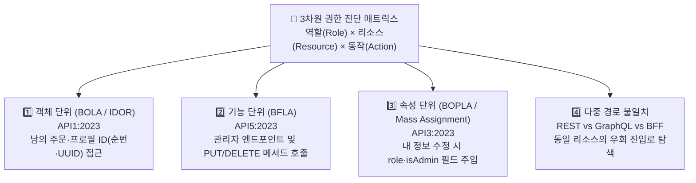
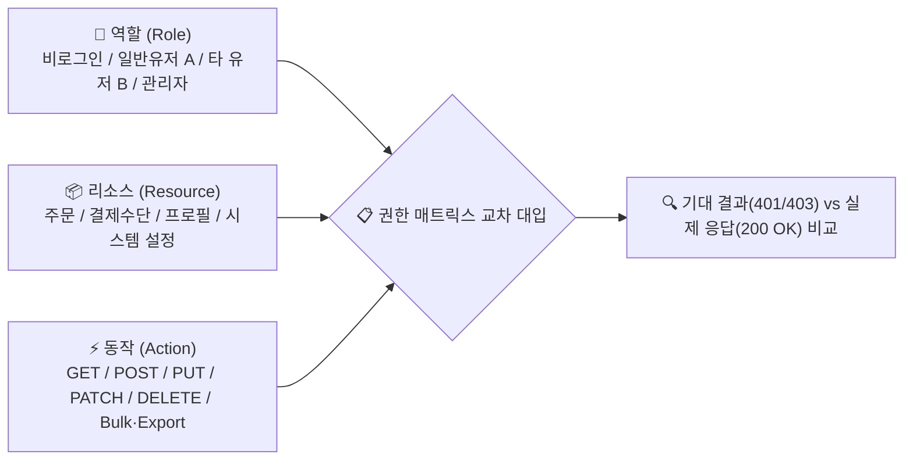

> [!summary] ⏱️ 5초 핵심 요약
> - **한 줄 비유**: 인가(Authorization) 진단은 **"일반 사원·타 부서 사원·외부 방문객(역할)이 인사팀 캐비닛과 임원실(리소스)에 가서 열람·수정·폐기 버튼(동작)을 하나씩 전부 눌러보며 잠기지 않은 서랍을 찾는 전수 조사"**입니다.
> - **핵심 원리**: 단순히 숫자 ID 하나만 바꿔보는 주먹구구식 IDOR 테스트를 넘어, **`역할(Role) × 리소스(Resource) × 동작(Action)`의 3차원 권한 매트릭스**로 펼쳐야 **객체 단위(BOLA), 기능 단위(BFLA), 속성 단위(BOPLA/Mass Assignment), 경로 간(REST vs GraphQL) 인가 누락**을 빠짐없이 찾아낼 수 있습니다.
> - **핵심 진단 포인트**: ① UUID 식별자라도 소유권 검증 유무 확인, ② 타인 데이터 부분 마스킹에 속지 말 것, ③ 조회(`GET`)가 막혀 있어도 수정/삭제(`PUT`/`DELETE`)를 따로 호출할 것, ④ 응답에만 있던 권한 필드(`role`, `isAdmin`)를 수정 요청에 끼워 넣어볼 것.

[[웹 취약점 진단 기법 입문 — XXE, SSRF부터 SQLi, XSS까지]]에서 IDOR을 "계정 2개로 번호를 바꿔보는 기초 수준"으로 다뤘다면, 이번 글은 그 뿌리를 **API 전체를 빠짐없이 훑는 3차원 권한 매트릭스(Authorization Matrix)**로 확장합니다. ID 하나만 바꿔보고 끝내면 같은 뿌리에서 파생되는 관리자 기능 직접 호출(BFLA), 응답에 숨어든 권한 필드 변조(BOPLA), REST/GraphQL 경로 간 인가 불일치를 놓치기 쉽습니다.



---

## 한눈에 보는 API 인가(Authorization) 4대 취약점 비교표

| 인가 결함 분류 | OWASP API Top 10 (2023) | 핵심 진단 질문 | 실무에서 자주 빠지는 함정 |
|---|---|---|---|
| **1. 객체 단위 권한 누락 (BOLA / IDOR)** | **API1:2023** Broken Object Level Authorization | 사용자 A의 세션으로 사용자 B의 리소스 ID(`1002` 또는 `UUID`)를 조회·수정·삭제할 수 있는가? | 식별자를 UUID로 바꿨다고 안전하다고 착각하거나, 일부 필드(`**`)가 마스킹되어 있다고 정상으로 오판함 |
| **2. 기능 단위 권한 누락 (BFLA)** | **API5:2023** Broken Function Level Authorization | 일반 유저 토큰으로 관리자 전용 URL(`/admin/...`)이나 다른 HTTP 메서드(`PUT`/`DELETE`/`export`)를 호출할 수 있는가? | `GET` 조회가 `403`으로 막혔다고 해서 같은 경로의 `PUT`/`POST`/`DELETE`도 막혔을 것이라 단정함 |
| **3. 속성 단위 권한 누락 (BOPLA / Mass Assignment)** | **API3:2023** Broken Object Property Level Authorization | 내 정보를 정상 수정(`PATCH /users/me`)할 때 응답에서 본 `role`, `isAdmin`, `balance` 필드를 끼워 넣으면 반영되는가? | 본인 소유 객체를 수정하는 요청이라 BOLA 검사는 통과하지만, 수정 허용 필드 화이트리스트(DTO)가 빠져 있음 |
| **4. 경로 간 인가 불일치 (REST vs GraphQL)** | 아키텍처 / 공통 인가 결손 | REST API(`GET /orders/1`)는 막혀 있는데, 같은 데이터를 가리키는 GraphQL 쿼리나 레거시/모바일 API 경로는 열려 있는가? | 인가 로직을 도메인/서비스 계층이 아닌 특정 라우터 미들웨어 한 곳에만 구현해 다른 진입로가 뚫림 |

---

## 1. 권한 매트릭스 설계 — `역할 × 리소스 × 동작`

**💡 한 줄 비유**: 건물 보안 점검을 할 때 1층 정문만 흔들어보는 대신, **출입자 등급별(외부인·일반직원·타팀직원·관리자)로 모든 방(리소스)의 열기·넣기·고치기·부수기(HTTP 메서드)를 체크리스트 표로 만들어 빈칸 없이 전부 채워보는 방법**입니다.



- **왜 3차원 매트릭스가 필요한가?**: 인가 결함은 **"누가(역할)" × "무엇을(리소스/객체)" × "어떻게(동작/메서드)"**라는 세 축의 조합마다 독립적으로 발생합니다. "남의 데이터를 볼 수 있는가(BOLA)"만 확인하고 "일반 유저가 관리자 기능이나 삭제 메서드를 호출할 수 있는가(BFLA)"를 빼먹으면 절반만 진단한 셈이 됩니다.
- **실전 권한 매트릭스 작성 예시**:

| 리소스 엔드포인트 | 동작 (Method) | 비로그인 | 타 유저 (B 세션 → A 객체) | 본인 (A 세션 → A 객체) | 관리자 | 진단 포인트 |
|---|---|---|---|---|---|---|
| `/api/orders/{id}` | `GET` | ❌ `401` | ❌ `403` (허용 시 **BOLA**) | ✅ `200` | ✅ `200` | 수평적 조회 권한 검증 |
| `/api/orders/{id}` | `DELETE` | ❌ `401` | ❌ `403` (허용 시 **BOLA**) | ⚠️ 정책 확인 | ✅ `200` | 조회는 막고 삭제는 열린 경우 |
| `/api/admin/users/export` | `POST` | ❌ `401` | ❌ `403` (허용 시 **BFLA**) | ❌ `403` (허용 시 **BFLA**) | ✅ `200` | 수직적 기능 권한 검증 |

- **체크 포인트**:
  - 최소 4종 역할(비로그인 / 일반 유저 A / 타 유저 B / 관리자) 준비
  - OpenAPI(Swagger) 문서나 JS 번들에서 추출한 모든 엔드포인트에 대해 `GET`/`POST`/`PUT`/`PATCH`/`DELETE`를 전수 호출하여 표 기록
- **참고**: [OWASP API Security Top 10 2023](https://api-security.owasp.org/editions/2023/en/0x11-t10/), [PortSwigger — API testing](https://portswigger.net/web-security/api-testing)

---

## 2. 객체 단위 권한 누락 심화 (BOLA / IDOR)

**💡 한 줄 비유**: 아파트 현관문 번호를 `101호` 대신 추측하기 어려운 긴 암호 이름(`f47ac10b-58cc-...` UUID)으로 바꿨다고 해서 **현관문 도어락(서버의 소유권 확인)을 아예 안 달아놓으면, 택배 송장이나 우편물에서 그 긴 이름을 본 사람은 누구나 문을 열고 들어갈 수 있습니다.**

- **함정 1 — "UUID를 썼으니 IDOR은 막았다"는 착각**:
  - 식별자를 순차 번호(`1001`, `1002`)에서 UUID/GUID로 바꾸면 공격자가 숫자를 1씩 늘려가며 대입하기는 어려워집니다. 하지만 **식별자를 추측하기 어렵다는 것(Obscurity)과 서버가 소유권을 검증한다는 것(Authorization)은 전혀 다른 문제**입니다.
  - UUID는 공개 게시글 작성자 정보, 공유 링크, 알림 이메일, 로그, `Referer` 헤더 등 다른 API 응답에서 생각보다 쉽게 노출됩니다. 서버 코드에 `WHERE order_id = ? AND user_id = ?` 같은 소유권 검증이 없다면 UUID를 쓰는 순간에도 BOLA는 그대로 성립합니다.
- **함정 2 — "부분 마스킹(`홍*동`)이 되어 있으니 안전하다"는 오판**:
  - 타 유저의 주문을 조회했을 때 이름(`홍*동`)이나 전화번호 뒷자리가 마스킹되어 내려오면 진단자가 "보안 처리가 되어 있네"라고 넘어가기 쉽습니다.
  - 그러나 마스킹은 화면 표시용 유틸리티가 돌아간 결과일 뿐 **타인의 주문 객체 자체에 대한 접근통제가 실패했다는 명백한 증거**이며, 함께 내려오는 주문 상품명·결제 금액·배송 상태·주소 일부 등 마스킹되지 않은 나머지 필드만으로도 심각한 개인정보 유출(BOLA)이 성립합니다.
- **체크 포인트**:
  - 식별자가 UUID이더라도 계정 A의 UUID를 복사해 계정 B의 세션으로 요청했을 때 차단되는지 확인
  - 응답에 마스킹된 필드가 일부 있더라도 전체 응답 구조와 노출 필드의 민감도를 끝까지 평가
- **참고**: [OWASP API Security Top 10 2023 — API1 Broken Object Level Authorization](https://api-security.owasp.org/editions/2023/en/0xa1-broken-object-level-authorization/), [PortSwigger — Insecure direct object references](https://portswigger.net/web-security/access-control/idor)

---

## 3. 기능 단위 권한 누락 (BFLA)

**💡 한 줄 비유**: 일반 직원 화면에서는 '전 사원 급여 내역 다운로드' 버튼을 안 보이게 감춰뒀지만, **서버 담당 창구에서는 요청서를 낸 사람이 인사팀장인지 확인하지 않아 일반 직원이 직접 신청서 URL(`/api/admin/payroll/export`)을 적어 내면 그대로 파일을 내주는 상황**입니다.

- **핵심 원리와 자주 뚫리는 2가지 패턴**:
  1. **관리자 UI 숨김에 의존한 백엔드 미검증**: 서버가 "이 API는 관리자 화면에서만 호출하도록 프런트엔드를 짰으니 일반 유저는 못 부를 것"이라고 가정하고 백엔드 역할(Role) 검증을 빼먹는 경우입니다. JS 번들 정찰([[웹 취약점 진단 정찰편 — 공격표면 매핑과 헤더 기반 접근통제 우회]])이나 URL 추측(`/api/users` → `/api/admin/users`)으로 찾아내 일반 유저 토큰으로 호출하면 그대로 실행됩니다.
  2. **HTTP 메서드별 미들웨어 적용 누락**: 예를 들어 `GET /api/admin/notices`에는 관리자 확인 어노테이션을 붙였는데, 나중에 추가한 `POST`나 `DELETE /api/admin/notices/{id}` 핸들러에는 어노테이션을 빠뜨리는 실수가 실무에서 매우 흔합니다. 따라서 `GET`이 `403`으로 막혔더라도 반드시 **`POST`, `PUT`, `PATCH`, `DELETE` 메서드를 각각 바꿔가며 호출**해 봐야 합니다.
- **체크 포인트**:
  - 관리자/매니저 전용 엔드포인트를 일반 유저(및 비로그인) 토큰으로 직접 호출
  - 동일 URL에 대해 HTTP 메서드를 `GET`/`POST`/`PUT`/`PATCH`/`DELETE`로 모두 변경하며 역할 검증 누락 여부 확인
- **참고**: [OWASP API Security Top 10 2023 — API5 Broken Function Level Authorization](https://api-security.owasp.org/editions/2023/en/0xa5-broken-function-level-authorization/), [OWASP Authorization Cheat Sheet](https://cheatsheetseries.owasp.org/cheatsheets/Authorization_Cheat_Sheet.html)

---

## 4. 속성 단위 권한 누락 (BOPLA / Mass Assignment)

**💡 한 줄 비유**: 동사무소에 '내 전화번호 변경 신청서(`PATCH /users/me`)'를 내면서 신청서 빈 공간에 내가 직접 **`"직급: 시장님(`"role": "ADMIN"`), 보유 포인트: 1000만 점"`이라고 한 줄 더 적어 냈더니, 직원이 적힌 내용을 가리지 않고 컴퓨터 DB에 통째로 덮어써 주는 허점**입니다.

- **핵심 원리**: 이 취약점은 남의 객체를 건드리는 BOLA와 다릅니다. **분명히 '내 소유의 프로필이나 내 데이터'를 수정하는 정당한 요청이지만, 사용자가 수정해서는 안 되는 내부 권한·상태 속성(`role`, `isAdmin`, `balance`, `planTier`, `verified`)까지 서버가 구분 없이 도메인 엔티티에 통째로 바인딩할 때** 발생합니다.

### 진단 절차와 취약한 코드 vs 안전한 코드
1. 먼저 내 정보 조회(`GET /api/users/me`) 응답 JSON을 유심히 관찰해 서버 모델이 어떤 필드 이름(`"role": "USER"`, `"is_admin": false`, `"credit": 0` 등)을 쓰는지 단서를 확보합니다.
2. 내 닉네임을 수정하는 정상 요청(`PATCH /api/users/me`)의 JSON 바디에 위에서 발견한 권한 필드를 슬쩍 추가해 전송합니다.

```http
PATCH /api/users/me HTTP/1.1
Host: api.example.com
Authorization: Bearer <일반유저_토큰>
Content-Type: application/json

{
  "nickname": "alice",
  "role": "ADMIN",
  "isAdmin": true
}
```

```java
// ❌ 취약한 코드: 요청 JSON을 DB 엔티티(User)에 직접 바인딩 (role, isAdmin까지 덮어써짐!)
@PatchMapping("/users/me")
public User updateMe(@RequestBody User inputUser, @AuthenticationPrincipal Long myId) {
    return userService.saveDirect(myId, inputUser);
}

// ✅ 안전한 코드: 수정이 허용된 필드만 담긴 전용 DTO(UpdateProfileRequest)로만 입력 수신
public record UpdateProfileRequest(String nickname, String bio) {} // role 필드 자체가 없음!
```

- **체크 포인트**:
  - 모든 `GET` 응답에 등장하는 권한·등급·잔액·승인 상태 필드명을 수집한 뒤, 대응하는 `POST`/`PUT`/`PATCH` 요청 바디에 추가 삽입해 값 반영 여부 확인
- **참고**: [OWASP API Security Top 10 2023 — API3 Broken Object Property Level Authorization](https://api-security.owasp.org/editions/2023/en/0xa3-broken-object-property-level-authorization/), [OWASP Mass Assignment Cheat Sheet](https://cheatsheetseries.owasp.org/cheatsheets/Mass_Assignment_Cheat_Sheet.html)

---

## 5. REST / GraphQL / 다중 경로 혼용 환경의 인가 불일치

**💡 한 줄 비유**: 본관 정문(REST API)에는 경비원을 세워 신분증을 꼼꼼히 확인하면서, **같은 금고실로 연결된 별관 통로(GraphQL 쿼리·모바일 BFF·구버전 API)에는 "본관에서 이미 막았겠지"라고 경비원을 안 세워둔 구조적 사각지대**입니다.

- **핵심 원리**: 하나의 서비스가 REST 엔드포인트(`GET /users/{id}/orders`)와 GraphQL 엔드포인트(`/graphql`의 `user(id: "...") { orders { ... } }`), 또는 웹용 API와 모바일 앱 전용 API를 동시에 운영하는 경우가 많습니다.
- 이때 인가 검증 로직을 도메인 Service 계층 한곳에 모으지 않고 **각 컨트롤러나 리졸버마다 따로 구현하면**, REST 쪽에서는 막혀 있는 BOLA/BFLA가 GraphQL의 하위 중첩 리졸버나 레거시 경로에서는 아무 검증 없이 뚫리는 불일치가 발생합니다.
- **체크 포인트**:
  - 동일한 비즈니스 데이터(주문, 회원 정보 등)에 도달할 수 있는 모든 진입 경로(REST v1/v2, GraphQL 쿼리·뮤테이션, 모바일/외부 연동 API)를 나열하고 동일한 권한 매트릭스를 교차 적용
- **참고**: [OWASP GraphQL Cheat Sheet](https://cheatsheetseries.owasp.org/cheatsheets/GraphQL_Cheat_Sheet.html), [OWASP Authorization Cheat Sheet](https://cheatsheetseries.owasp.org/cheatsheets/Authorization_Cheat_Sheet.html)

---

## 6. 권한 매트릭스 자동화 시 주의사항: Rate Limit과의 교차 점검

**💡 한 줄 비유**: 서랍이 잠겼는지 확인하려고 1초에 100번씩 손잡이를 당겼더니, **방범 셔터(Rate Limit)가 내려와 안 열리는 것인데 그걸 보고 "아, 서랍 자물쇠(인가 검증)가 튼튼하게 잠겨 있구나!"라고 착각하는 실수**입니다.

- 권한 매트릭스를 스크립트나 Burp Intruder로 빠르게 돌리다 보면 짧은 시간에 동일 계정/IP로 수백 건의 요청이 몰려 WAF나 API 게이트웨이의 **Rate Limit**에 걸릴 수 있습니다.
- 이때 반환되는 `429 Too Many Requests` 또는 WAF의 일괄 `403 Forbidden` 응답을 **"서버의 인가 검증이 정상적으로 거부했다"고 오판하면 실제 인가 취약점을 놓치게 됩니다.**
- **체크 포인트**:
  - 거부 응답 수신 시 상태 코드(`401`/`403` vs `429`)와 **응답 본문 메시지(권한 부족 메시지인지, 호출 횟수 초과/WAF 차단 메시지인지)**를 반드시 구분해 확인하고, 필요 시 요청 간 지연(Throttle)을 두어 정확히 검증하세요.
- 더 넓은 공격 표면은 [[웹 취약점 진단 심화 — 실무에서 보는 기법들]]을, 브라우저 설정 기반 결함은 [[웹 취약점 진단 설정편 — CORS·SOP부터 후속 공격까지]]를 이어서 참고하세요.
