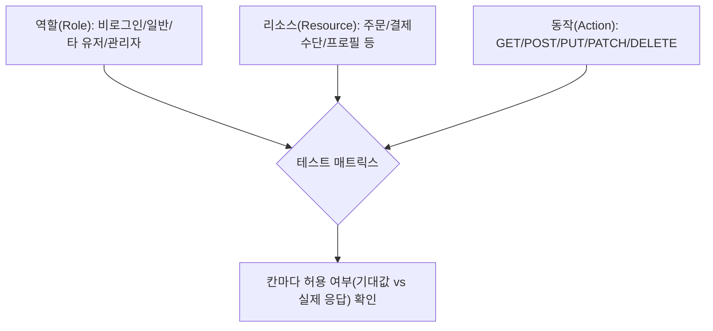

[[웹 취약점 진단 기법 입문 — XXE, SSRF부터 SQLi, XSS까지]]에서 IDOR을 "계정 2개로 번호를 바꿔보는" 수준으로 다뤘다면, 이번 글은 그 뿌리를 **API 전체를 빠짐없이 훑는 테스트 매트릭스**로 확장합니다. ID 하나 바꿔보고 끝내면 같은 뿌리의 다른 구멍들(관리자 기능 직접 호출, 응답에 숨어든 권한 필드, REST/GraphQL 경로 불일치)을 놓치기 쉽습니다. [[웹 취약점 진단 심화 — 실무에서 보는 기법들]]의 GraphQL 섹션과 겹치지 않게, 이 글은 "인가 검증이 어디서 빠지는가"에만 초점을 맞춥니다.

---

## 1. 권한 매트릭스 설계 — 역할 × 리소스 × 동작

**원리**: IDOR 테스트를 "계정 A로 받은 요청을 계정 B 세션으로 재전송"에만 그치면 놓치는 축이 있습니다. 인가 결함은 **"누가"(역할) "무엇을"(객체/리소스) "어떻게"(동작=HTTP 메서드·기능) 건드리느냐**라는 세 축의 조합마다 따로 터질 수 있어서, 한 축만 고정해서 테스트하면 다른 축의 구멍을 체계적으로 놓치게 됩니다.

OWASP API Security Top 10 2023은 이 두 축을 아예 별개 항목으로 분리해 둡니다: 객체 단위 인가 누락은 API1:2023(BOLA, Broken Object Level Authorization), 기능 단위 인가 누락은 API5:2023(BFLA, Broken Function Level Authorization)입니다. "남의 데이터를 볼 수 있는가"(BOLA)만 테스트하고 "일반 유저가 관리자 전용 기능을 호출할 수 있는가"(BFLA)를 빼먹으면, 데이터 열람 자체는 막혀 있어도 관리자 엔드포인트를 그대로 호출해 데이터를 바꾸거나 삭제하는 경로가 뚫린 채로 남습니다.

실무에서는 역할(비로그인/일반 유저/타 유저/관리자/서비스 계정) × 리소스(주문, 결제수단, 사용자 프로필, 내부 설정 등) × 동작(GET/POST/PUT/PATCH/DELETE, 그리고 벌크 처리·내보내기 같은 비-CRUD 기능)을 표로 펼쳐 놓고 칸마다 "이 조합이 허용되어야 하는가 / 실제로 허용되는가"를 채웁니다. 매트릭스가 커 보여도 핵심은 "권한이 달라지는 모든 지점에서, 모든 메서드를 다 쳐 봤는가"라는 질문 하나입니다.

- 체크 포인트: 역할(최소 비로그인/일반/타 유저/관리자 4종)마다 각 엔드포인트의 GET/POST/PUT/PATCH/DELETE를 전부 호출해 기대값과 실제 응답(상태 코드·바디)을 표로 기록. OpenAPI/Swagger 문서가 있으면 그대로 엔드포인트 목록의 뼈대로 사용
- 참고: [OWASP API Security Top 10 2023](https://api-security.owasp.org/editions/2023/en/0x11-t10/), [PortSwigger — API testing](https://portswigger.net/web-security/api-testing)

## 2. 객체 단위 권한 누락 심화 (BOLA)

**원리**: 식별자를 "예측 가능한 순번"에서 "UUID/GUID"로 바꾸면 많은 팀이 "이제 IDOR은 해결됐다"고 착각합니다. 하지만 식별자를 **추측하기 어렵다는 것**과 서버가 **소유권을 검증한다는 것**은 완전히 별개 문제입니다.

UUID는 다른 경로(응답 바디, 알림 이메일, 공유 링크, 로그 노출, 레퍼러 헤더)로 유출되는 순간 그 자체로 접근 키가 되어 버리고, 서버가 "이 UUID의 주인이 요청자인지"를 매 요청마다 확인하지 않으면 비예측성은 아무 방어도 되지 않습니다. 즉 BOLA 방어는 식별자 설계가 아니라 **조회/수정/삭제 로직 안의 소유권 체크**에 있습니다.

또 하나 놓치기 쉬운 함정이 "부분 마스킹"입니다. 타 유저의 주문을 조회했을 때 이름·이메일 같은 필드는 가려져 있지만 금액, 상태, 배송지, 주문 항목 같은 나머지 필드가 그대로 노출되면, 테스터가 "민감 정보는 가려졌으니 괜찮다"고 성급히 결론 내리고 지나가기 쉽습니다. 실제로는 그 자체로 BOLA이고, 마스킹된 필드가 일부 있다는 사실이 "권한 검증이 존재한다"는 증거가 되지 않습니다 — 오히려 필드별로 서로 다른 로직이 적용되고 있다는 신호이므로, 마스킹되지 않은 각 필드를 전부 별도로 민감도 판단해야 합니다.

- 체크 포인트:
  - UUID/GUID 식별자여도 소유자 검증 로직이 코드에 실제로 존재하는지(추측 난이도와 무관하게 확인)
  - 타 유저 리소스 조회 응답에서 일부 필드만 마스킹되고 나머지가 노출되는지
  - 식별자가 응답 바디·알림·공유 URL·Referer로 새어나가는 경로가 있는지
- 참고: [OWASP API Security Top 10 2023 — API1 Broken Object Level Authorization](https://api-security.owasp.org/editions/2023/en/0xa1-broken-object-level-authorization/), [PortSwigger — Insecure direct object references](https://portswigger.net/web-security/access-control/idor)

## 3. 기능 단위 권한 누락 (BFLA)

**원리**: 관리자 화면에서만 호출하도록 만든 엔드포인트가, 실제로는 그 화면을 거치지 않고 직접 호출해도 응답하는 경우가 흔합니다. 원인은 서버가 "이 요청이 관리자 UI에서 왔다"는 사실과 "이 호출자가 실제로 관리자 역할이다"는 사실을 혼동하기 때문입니다 — URL이 `/admin/...`으로 시작한다거나, 프런트엔드 라우팅에서만 접근을 막아 뒀다거나, 특정 내부 호스트에서만 접근 가능하다고 가정하는 것은 **클라이언트 쪽 통제**일 뿐 서버 쪽 역할 검증이 아닙니다. 일반 유저 토큰으로 그 엔드포인트를 직접 호출했을 때 서버가 역할을 다시 확인하지 않으면 그대로 뚫립니다.

같은 리소스에 대해 메서드별로 인가 체크가 다르게 구현된 경우도 자주 보입니다. 예를 들어 `GET /admin/users/{id}`는 역할 검증 미들웨어를 거치는데 `PUT /admin/users/{id}`나 `DELETE /admin/users/{id}`는 별도 핸들러로 늦게 추가되면서 같은 미들웨어를 타지 않는 식입니다. 조회(GET)는 막혀 있다는 사실이 수정·삭제(PUT/DELETE)도 막혀 있다는 보장이 전혀 되지 않으므로, 매트릭스에서 메서드 축을 생략하면 바로 이 구멍을 놓치게 됩니다.

- 체크 포인트:
  - 관리자 전용으로 보이는 엔드포인트를 일반 유저 토큰으로 직접 호출(프런트엔드 경유 없이)
  - 같은 경로·같은 리소스에 대해 GET/POST/PUT/PATCH/DELETE 전부를 각 역할로 반복 호출해 메서드별 결과 비교
  - 역할 검증이 라우터 레벨 미들웨어로 일괄 적용되는지 아니면 핸들러마다 개별 구현돼 있는지
- 참고: [OWASP API Security Top 10 2023 — API5 Broken Function Level Authorization](https://api-security.owasp.org/editions/2023/en/0xa5-broken-function-level-authorization/), [OWASP Authorization Cheat Sheet](https://cheatsheetseries.owasp.org/cheatsheets/Authorization_Cheat_Sheet.html)

## 4. 속성 단위 권한 누락 — 권한 상승으로 이어지는 필드

**원리**: Mass assignment 자체는 "클라이언트가 보낸 필드를 서버가 화이트리스트 없이 객체에 그대로 바인딩한다"는 넓은 범주의 문제이지만, 여기서 다루는 것은 그중에서도 **권한 상승으로 직결되는 특정 필드**입니다. 사용자 프로필 수정(`PATCH /users/me`) 같은, 겉보기엔 평범한 자기 자신에 대한 요청에 서버 응답 바디에서 미리 확인한 `role`, `isAdmin`, `balance`, `planTier` 같은 필드를 요청 바디에 끼워 넣었을 때, 서버가 "요청자가 자기 자신의 레코드를 수정하는 것"까지는 제대로 검증하면서도 "어떤 필드까지 수정 가능한지"는 검증하지 않으면 그대로 반영됩니다.

즉 이건 소유권 검증(BOLA)과는 다른 축의 문제입니다 — 본인 소유 리소스를 본인이 수정하는 것 자체는 정상이지만, 수정 가능한 속성의 범위를 서버가 제한하지 않은 것이 문제입니다.

이 패턴을 찾으려면 먼저 GET 응답에 어떤 필드가 내려오는지부터 확인해야 합니다. 응답에 `role`이나 `isAdmin`이 보인다면, 그 필드를 PATCH/PUT 요청 바디에 그대로 포함시켜 보내 보고 응답이나 후속 GET에서 값이 바뀌었는지 확인합니다. 바뀐다면 서버가 입력 필드를 화이트리스트 없이 그대로 객체에 바인딩하고 있다는 뜻이고, 그 필드가 권한과 관련되어 있으므로 바로 권한 상승입니다.

- 체크 포인트:
  - GET 응답에 노출되는 전체 필드 목록 확보 후 권한 관련 필드(`role`, `isAdmin`, `permissions`, `balance`, `tier` 등) 식별
  - 해당 필드를 PATCH/PUT 요청에 추가 삽입했을 때 서버가 거부하는지 그대로 반영하는지
  - 서버 측에 요청 바디 바인딩용 화이트리스트(DTO 등)가 있는지 아니면 수신 JSON을 통째로 모델에 바인딩하는지
- 참고: [OWASP API Security Top 10 2023 — API3 Broken Object Property Level Authorization](https://api-security.owasp.org/editions/2023/en/0xa3-broken-object-property-level-authorization/), [OWASP Mass Assignment Cheat Sheet](https://cheatsheetseries.owasp.org/cheatsheets/Mass_Assignment_Cheat_Sheet.html)

## 5. REST/GraphQL 혼용 환경의 인가 불일치

**원리**: 같은 리소스를 REST 엔드포인트와 GraphQL 필드로 동시에 노출하는 구조에서는, 두 경로가 서로 다른 코드베이스나 서로 다른 리졸버를 거치는 경우가 많습니다. 이때 인가 검증 로직을 한쪽에만 구현하고 다른 쪽에는 "이미 다른 경로에서 막았으니 괜찮다"고 가정한 채 넘어가는 실수가 나옵니다 — 예를 들어 REST의 `GET /users/{id}/orders`는 요청자와 `{id}`가 일치하는지 확인하는 미들웨어를 거치지만, GraphQL 스키마의 `user(id: ID!) { orders { ... } }` 필드 리졸버는 별도로 구현되면서 같은 검증을 빠뜨리는 식입니다.

이건 GraphQL 자체의 기능([[웹 취약점 진단 심화 — 실무에서 보는 기법들]]에서 다룬 introspection·배치 쿼리 문제)과는 다른 축의 문제로, **같은 데이터에 도달하는 경로가 여러 개일 때 인가 체크를 경로마다 중복 구현해야 하는데 하나를 빠뜨리는** 구조적 함정입니다.

- 체크 포인트: 같은 리소스에 접근 가능한 모든 경로(REST 엔드포인트, GraphQL 쿼리/뮤테이션, 내부 BFF 경유 등)를 먼저 나열하고, 그중 인가 검증이 약한 경로로 동일한 데이터에 도달 가능한지 비교 테스트. 공통 인가 로직이 공유 미들웨어/디렉티브로 구현돼 있는지 아니면 경로마다 각자 구현돼 있는지
- 참고: [OWASP GraphQL Cheat Sheet](https://cheatsheetseries.owasp.org/cheatsheets/GraphQL_Cheat_Sheet.html), [OWASP Authorization Cheat Sheet](https://cheatsheetseries.owasp.org/cheatsheets/Authorization_Cheat_Sheet.html)

## 6. (참고) Rate Limit과의 교차 점검

권한 매트릭스를 자동화 스크립트로 전부 돌리다 보면, 짧은 시간에 같은 계정으로 수십~수백 건의 요청이 몰려 rate limit에 걸리는 경우가 있습니다. 이때 나오는 403/429 응답을 "인가 검증이 정상 동작한다"고 잘못 해석하면 실제 인가 결함을 놓칩니다. 매트릭스 테스트 중 거부 응답을 받으면 상태 코드와 응답 바디(rate limit 메시지인지 인가 실패 메시지인지)를 반드시 구분하고, 필요하면 요청 사이에 지연을 주거나 계정을 분리해 재검증하세요.

---

## 정리

| 축 | 핵심 질문 | 관련 OWASP API Top 10 |
|---|---|---|
| 객체(BOLA) | 다른 사용자의 리소스를 식별자만 바꿔 접근 가능한가 | API1:2023 |
| 속성(필드) | 응답에만 있던 권한 필드를 요청에 끼워 넣으면 반영되는가 | API3:2023 |
| 기능(BFLA) | 관리자 전용 기능을 일반 유저 토큰으로 직접 호출 가능한가 | API5:2023 |
| 경로 불일치 | 같은 데이터에 도달하는 다른 경로(REST/GraphQL)는 인가 체크가 같은가 | - |

이 매트릭스는 한 번 짜 두면 신규 엔드포인트가 추가될 때마다 행만 늘리면 되는 재사용 가능한 체크리스트가 됩니다. 더 넓은 공격 표면은 [[웹 취약점 진단 심화 — 실무에서 보는 기법들]]을, 설정값 기반 결함은 [[웹 취약점 진단 설정편 — CORS·SOP부터 후속 공격까지]]를 참고하세요.
