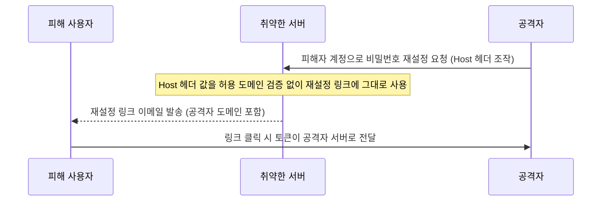

[[웹 취약점 진단 기법 입문 — XXE, SSRF부터 SQLi, XSS까지]], [[웹 취약점 진단 심화 — 실무에서 보는 기법들]], [[웹 취약점 진단 설정편 — CORS·SOP부터 후속 공격까지]]에서 다룬 항목들이 입력 처리·브라우저 보안 모델 쪽이었다면, 이번 글은 **"로그인했다/안 했다"를 가르는 인증·세션 관리 단계** 자체에 난 구멍들을 모았습니다. 계정 잠금, MFA, 비밀번호 재설정, 세션 관리는 전부 "기능이 존재하는지"가 아니라 **그 기능이 정확히 어떤 상태를 어디서 추적하고, 어느 시점에 재검증하는지**가 취약 여부를 가릅니다. 각 항목에 실제로 뚫리는 전제 조건을 명시했습니다.

---

## 1. 계정 잠금(Account Lockout) 우회

**원리**: 계정 잠금은 로그인 실패 횟수를 세어 일정 횟수를 넘기면 잠그는 방어인데, 그 카운터를 **무엇을 키로, 어디에 저장하는지**에 따라 우회 경로가 갈립니다. IP 로테이션은 카운터가 계정이 아니라 **출발지 IP당**으로만 집계될 때 통합니다 — 계정·IP를 함께 집계하면 IP를 바꿔도 계정별 제한에 걸리므로, OWASP는 IP별 집계보다 계정별 집계를 우선 권장합니다(다만 계정별 집계도 크리덴셜 스터핑에는 여전히 취약해 공격 벡터가 바뀔 뿐입니다). 사용자명 대소문자·트레일링 공백 변형은 로그인 인증 로직(DB 조회)은 대소문자를 구분하지 않거나 공백을 트림해 같은 계정으로 처리하면서, 실패 횟수 카운터의 키는 정규화 전 원본 문자열을 그대로 쓸 때만 성립합니다 — 이 불일치가 없으면 `User`, `user`, `user `는 같은 카운터를 공유해 우회가 안 됩니다. 쿠키 삭제로 리셋되는 경우는, 실패 횟수가 계정이 아니라 **교체 가능한 세션/쿠키 식별자에 키로 묶여 있을 때**만 유효합니다 — 카운터 값 자체가 클라이언트 쿠키에 실려 있든, 서버 저장소에 있지만 조회 키가 계정이 아니라 세션 ID든, 쿠키를 지워 새 세션을 받으면 둘 다 초기화됩니다. 계정 식별자를 키로 쓰는 구현이면 쿠키를 아무리 지워도 실패 횟수는 그대로 남습니다.

- 체크 포인트: 잠금 카운터가 계정/IP/세션 중 무엇을 키로 쓰는지, 사용자명 정규화 시점과 카운터 조회 시점이 같은 문자열을 쓰는지, 쿠키를 지우거나 새 세션으로 요청했을 때 실패 횟수가 리셋되는지
- 참고: [OWASP — Authentication Cheat Sheet](https://cheatsheetseries.owasp.org/cheatsheets/Authentication_Cheat_Sheet.html), [PortSwigger — Password-based login vulnerabilities](https://portswigger.net/web-security/authentication/password-based)

## 2. MFA 검증 단계 우회 — 상태 머신 결함

**원리**: 2단계 로그인은 "1단계(비밀번호) 통과 → `mfa_required` 상태 발급 → 2단계(OTP) 제출 → 성공 시 완전한 세션 발급" 순서를 가정합니다. 문제는 **1단계 응답 시점에 이미 로그인에 준하는 권한이 생기고, 보호된 엔드포인트가 2단계 완료 여부를 매 요청마다 재검증하지 않거나, 클라이언트가 보내는 값(쿠키, 응답 바디 플래그, 파라미터)을 그대로 신뢰할 때**입니다 — 이 경우 공격자는 OTP 제출을 생략하고 로그인 후 페이지의 URL을 직접 호출하거나, 응답 바디의 플래그·리다이렉트 대상을 가로채 조작해 다음 단계로 바로 진입합니다. 2단계 완료 상태가 꼭 서버 DB에 저장돼야 안전한 건 아닙니다 — 서버가 "2단계 통과" 사실을 위조 불가능하게 서명한 토큰에 담아 매 요청마다 그 서명을 검증하는 방식도 동일하게 안전합니다. 핵심은 저장 위치가 아니라 **그 상태를 서버가 매번 위조 불가능하게 재확인하는지**입니다.

- 체크 포인트: 1단계 응답만으로 보호된 엔드포인트에 접근되는지, 2단계 완료 여부가 서버가 재검증 가능한 값(서명된 토큰, 서버 저장소)인지 아니면 클라이언트가 그냥 들고 있는 값인지, 2단계 제출 요청의 사용자 식별 파라미터를 바꿔 다른 계정을 대상으로 할 수 있는지
- 참고: [PortSwigger — Multi-factor authentication](https://portswigger.net/web-security/authentication/multi-factor), [PortSwigger Lab — 2FA simple bypass](https://portswigger.net/web-security/authentication/multi-factor/lab-2fa-simple-bypass)

## 3. OTP 무차별 대입 (Rate-limit 부재)

**원리**: 6자리 숫자 OTP는 경우의 수가 100만 개뿐이라, 시도 횟수 제한이 없거나 느슨하면 유효시간 안에 공격자가 보낼 수 있는 요청 수에 비례해 성공 확률이 올라갑니다 — 유효시간이 짧아도 그 안에 충분히 많은 요청을 보낼 수 있으면 성공 확률이 의미 있게 커지고, 시도 횟수 제한이 걸려 있더라도 실패 몇 번 뒤 재로그인하면 그 제한 카운터 자체가 초기화되는 구현이면 코드가 바뀔 때마다 처음부터 다시 시도를 이어갈 수 있습니다. 반대로 시도 횟수를 짧게 제한하고 초과 시 계정을 잠그거나 코드를 즉시 무효화하며, 재로그인해도 그 제한이 유지되는 구현이면 전수 대입은 현실적인 시간 안에 성공하기 어렵습니다.

- 체크 포인트: OTP 제출 엔드포인트에 시도 횟수 제한이 있는지, 그 제한이 재로그인 후에도 유지되는지, 유효시간 동안 실제로 보낼 수 있는 요청 수 대비 성공 확률이 유의미한지
- 참고: [OWASP — Multifactor Authentication Cheat Sheet](https://cheatsheetseries.owasp.org/cheatsheets/Multifactor_Authentication_Cheat_Sheet.html), [PortSwigger Lab — 2FA bypass using a brute-force attack](https://portswigger.net/web-security/authentication/multi-factor/lab-2fa-bypass-using-a-brute-force-attack)

## 4. MFA 등록 단계의 인증 결손

**원리**: MFA를 "해제"하는 경로는 재인증을 요구하면서, 정작 **새 인증기(authenticator)나 기기를 추가 등록하는 경로**에는 같은 수준의 검증이 빠진 경우가 있습니다 — 로그인된 세션만 있으면 기존 비밀번호나 기존 2FA 요소 재확인 없이 새 TOTP 시크릿을 발급받거나 새 기기를 신뢰 목록에 추가할 수 있다면, 공격자는 세션 하이재킹이나 CSRF로 잠깐 세션에 올라탄 틈에 자신의 인증기를 등록해 둘 수 있습니다. 다만 이것만으로 **언제든 재로그인이 가능해지는 건 아니고**, 로그인에는 여전히 1차 요소(비밀번호)가 필요합니다 — 실제 영향은 공격자가 1차 요소를 이미 확보했거나(피싱 등) 이후 확보하는 경우, 미리 등록해 둔 2차 요소 덕분에 MFA가 추가 장벽으로 작동하지 못하고 그대로 로그인할 수 있게 된다는 점입니다. 즉 이 결함은 단독으로 계정을 탈취하는 게 아니라, **MFA가 막아야 할 '비밀번호만 털린' 상황에서 그 마지막 방어선을 미리 무력화해 두는** 성격의 취약점입니다. OWASP MFA 치트시트는 요소 변경(등록 포함) 전에 기존에 등록된 요소로 재인증할 것을 권고하는데, 그 재인증 단계가 빠졌을 때만 이 경로가 성립합니다.

- 체크 포인트: 새 MFA 기기/인증기 등록 요청에 현재 비밀번호나 기존 2FA 재확인을 요구하는지, 등록 성공 시 아웃오브밴드 알림(이메일 등)이 가는지, CSRF 토큰 없이도 등록 요청이 성립하는지
- 참고: [OWASP — Multifactor Authentication Cheat Sheet](https://cheatsheetseries.owasp.org/cheatsheets/Multifactor_Authentication_Cheat_Sheet.html)

## 5. 비밀번호 재설정 토큰/링크의 설계 결함

**원리**: 재설정 흐름은 세 지점에서 독립적으로 뚫립니다. 첫째, 토큰 예측 가능성 — 타임스탬프나 순차 ID처럼 **공격자가 추측 가능한 값만으로** 토큰을 만들거나 생성에 쓰인 엔트로피가 충분하지 않으면 다른 사용자 몫의 토큰을 추측할 수 있습니다(충분히 긴 CSPRNG 출력이면 막힙니다). 둘째, Host 헤더 기반 재설정 링크 오염(password reset poisoning) — 서버가 재설정 이메일 링크의 도메인을 **요청의 `Host`(또는 `X-Forwarded-Host`) 헤더 값에서 그대로 가져와 조립하고, 그 값을 허용 도메인 목록과 대조 검증하지 않을 때** 성립 가능하며, 여기에 더해 그 헤더 값이 실제로 재설정 링크 생성 로직까지 전달되고 발송된 링크를 피해자나 자동화된 클라이언트(메일 보안 스캐너 등)가 실제로 열어야 토큰이 유출됩니다 — 마지막 단계는 공격자가 통제할 수 없는 변수라 항상 성공을 보장하진 않습니다. 셋째, 재사용·만료 미검증 — 토큰을 한 번 쓴 뒤에도 서버가 폐기하지 않거나 만료 시각을 비교하지 않아 **그 토큰이 여전히 유효성 검사를 통과한다면**, 유출된 과거 토큰으로 몇 번이고 비밀번호를 재설정할 수 있습니다.

- 체크 포인트: 재설정 토큰이 CSPRNG로 생성되는지(타임스탬프·순차값만으로 추측 가능하지 않은지), 재설정 링크 도메인이 서버 고정값인지 아니면 `Host`/`X-Forwarded-Host` 헤더를 그대로 반영하는지, 토큰이 사용 즉시 폐기되는지와 만료 시각이 실제로 검증되는지
- 참고: [OWASP — Forgot Password Cheat Sheet](https://cheatsheetseries.owasp.org/cheatsheets/Forgot_Password_Cheat_Sheet.html), [PortSwigger — Password reset poisoning](https://portswigger.net/web-security/host-header/exploiting/password-reset-poisoning)

## 6. 세션 고정 (Session Fixation)

**원리**: 성립하려면 두 조건이 같이 필요합니다 — 공격자가 유효한(또는 임의로 지정 가능한) 세션 ID를 손에 쥐고 있어야 하고, 그 ID를 **피해자의 브라우저가 실제로 사용하도록 만들 수 있어야** 합니다. 서버가 URL 파라미터나 쿠키로 들어온 임의의 세션 ID를 그대로 받아들이는 "허용적(permissive)" 구현이면, 공격자는 원하는 값을 직접 지어내 그 값이 담긴 링크를 피해자에게 보내거나(공유 서브도메인 접근 권한, 네트워크 위치 선점 등을 이용해) 쿠키를 직접 심을 수 있습니다. 이 상태에서 피해자가 로그인에 성공했는데도 서버가 로그인 시점에 세션 ID를 새로 발급하지 않으면, 공격자가 심어 둔 바로 그 ID가 피해자의 인증된 세션이 되어 공격자도 같은 ID로 요청해 피해자로 로그인된 상태를 그대로 가져갑니다. 로그인 성공 시마다 서버가 새 세션 ID를 발급하고 이전 ID를 폐기하는 구현이면, 공격자가 심어 둔 ID는 로그인 순간 무효화돼 이 공격이 성립하지 않습니다.

- 체크 포인트: 서버가 클라이언트가 보낸 임의의 세션 ID를 그대로 세션으로 받아들이는지(permissive session ID), 공격자가 그 ID를 피해자 브라우저에 설정할 수 있는 실제 경로(URL 파라미터, 공유 서브도메인 쿠키 등)가 있는지, 로그인 성공 시 세션 ID가 재발급되는지(권한 상승·역할 전환 시점도 포함)
- 참고: [OWASP — Session Management Cheat Sheet](https://cheatsheetseries.owasp.org/cheatsheets/Session_Management_Cheat_Sheet.html)

## 7. 세션 무효화 결함 — 로그아웃·비밀번호 변경 후에도 살아있는 세션

**원리**: 로그아웃 버튼이 있다는 사실 자체는 안전을 보장하지 않습니다 — 핵심은 **로그아웃을 누른 바로 그 세션 토큰을, 로그아웃 처리 직후에 다시 재전송해도 여전히 통과하는지**입니다. 클라이언트 쪽에서 쿠키나 로컬 저장소의 토큰만 지우고 서버는 그 토큰을 계속 유효하게 취급한다면, 로그아웃 전에 이미 탈취돼 있던(XSS, 네트워크 스니핑, 기기 공유 등으로) 바로 그 토큰은 만료 시각까지 계속 동작합니다. 비밀번호 변경도 비슷한 구멍을 남길 수 있습니다 — 다른 기기·세션에 떠 있던 기존 세션들을 변경 시점에 전부 폐기할지는 서비스마다 다른 정책 선택이지만, **탈취된 세션을 강제로 끊을 수단 자체가 전혀 없다면** 비밀번호를 바꿔도 공격자가 들고 있던 세션은 영향을 받지 않는다는 뜻이 됩니다. 서버 측 세션 저장소가 없는 구조라도 토큰 버전(token version)이나 차단 목록(denylist)으로 특정 세션만 선별 무효화할 수 있습니다.

- 체크 포인트: 로그아웃한 바로 그 세션 토큰을 재전송했을 때 요청이 여전히 통과하는지, 비밀번호 변경 시 최소한 "모든 기기에서 로그아웃" 같은 강제 종료 수단이 제공되는지, 세션 유효성이 서버 측 조회(저장소, 토큰 버전, 차단 목록)로 결정되는지 아니면 서명 검증만으로 결정되는지
- 참고: [OWASP — Session Management Cheat Sheet](https://cheatsheetseries.owasp.org/cheatsheets/Session_Management_Cheat_Sheet.html)

## 8. JWT 세션의 구조적 revocation 결손

**원리**: 서명 위변조(`alg: none`, `kid`/`jku` 키 혼동)는 [[웹 취약점 진단 심화 — 실무에서 보는 기법들]]에서 다뤘으니 여기서는 세션 생명주기 관점만 봅니다. JWT를 세션 토큰으로 쓰면 서버가 매 요청마다 DB를 조회하지 않고 서명만 검증해도 되는 게 장점인데, 이는 "JWT를 쓰면 무조건 즉시 폐기가 안 된다"는 뜻이 아니라 **서버가 서명 검증만으로 토큰의 유효성을 판단하고, 그 외에 차단 목록·사용자별 토큰 버전·계정 상태 같은 추가 확인을 전혀 두지 않았을 때만** 생기는 문제입니다. 이 조건이 맞으면 `exp` 클레임으로 만료는 되지만, 로그아웃을 눌러도, 비밀번호를 바꿔도, 관리자가 세션 강제 종료를 눌러도 서명이 유효한 토큰은 만료 시각까지 계속 통과합니다. OWASP JWT 치트시트도 이런 순수 서명 검증 방식의 "완전한 무상태" 세션 운용을 권장하지 않고, 즉시 폐기가 필요하면 `jti` 기반 차단 목록이나 토큰 상태 목록(status list)처럼 **검증 경로에 상태를 다시 들여오는** 보완이 필요하다고 명시합니다 — 이런 보완이 전혀 없는 순수 서명 검증 구현에서만 "로그아웃해도 토큰이 산다"는 문제가 그대로 남습니다. 실무 완화책인 "액세스 토큰은 짧게, 리프레시 토큰만 서버에서 즉시 폐기"도, 이미 발급된 액세스 토큰 자체에 별도의 폐기 확인 경로가 없다면 그 토큰은 자연 만료 전까지 로그아웃과 무관하게 계속 유효하다는 한계가 똑같이 남습니다.

- 체크 포인트: 세션 유효성 판단이 서명 검증만으로 끝나는지, 아니면 차단 목록·토큰 버전 등 추가 확인이 있는지, 액세스 토큰 만료시간이 충분히 짧은지(길면 그만큼 로그아웃 후에도 유효), 비밀번호 변경·계정 정지 시 기존에 발급된 JWT들을 무력화할 방법이 실제로 있는지
- 참고: [OWASP — JSON Web Token Cheat Sheet](https://cheatsheetseries.owasp.org/cheatsheets/JSON_Web_Token_Cheat_Sheet.html), [OWASP — Session Management Cheat Sheet](https://cheatsheetseries.owasp.org/cheatsheets/Session_Management_Cheat_Sheet.html)
