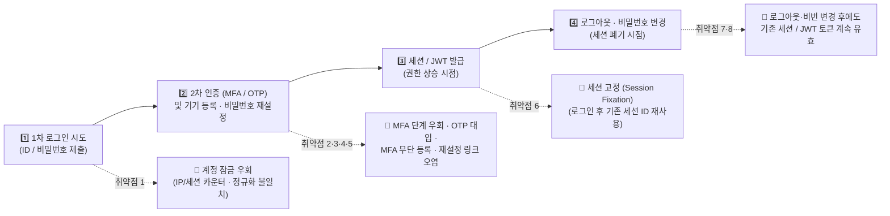
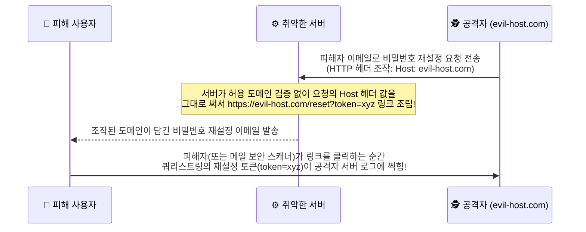

> [!summary] ⏱️ 5초 핵심 요약
> - **한 줄 비유**: 인증과 세션 관리는 **"정문에서 신분증을 검사해 임시 출입증(세션/JWT)을 발급하고, 퇴근(로그아웃)하거나 분실 신고(비밀번호 변경)가 들어오면 그 출입증을 즉시 정지시키는 출입 통제 시스템 전체"**입니다.
> - **핵심 원리**: 계정 잠금, 2단계 인증(MFA), 비밀번호 재설정, 로그아웃 기능이 화면에 존재한다고 안전한 것이 아닙니다. **"서버가 실패 횟수·인증 단계·세션 유효성을 어떤 키(Key)로 저장하고, 매 요청마다 위조 불가능하게 재검증하며, 언제 즉시 폐기하는가?"**가 취약 여부를 가릅니다.
> - **핵심 진단 포인트**: ① 잠금 카운터 키 불일치(IP/세션/대소문자), ② 1차 로그인 직후 MFA 건너뛰기, ③ OTP Rate Limit 리셋, ④ MFA 기기 추가 시 재인증 누락, ⑤ 재설정 토큰 예측·`Host` 헤더 오염, ⑥ 로그인 시 세션 ID 미재발급(세션 고정), ⑦·⑧ 로그아웃/비밀번호 변경 후 기존 세션·JWT 생존 여부를 집중 점검합니다.

[[웹 취약점 진단 기법 입문 — XXE, SSRF부터 SQLi, XSS까지]], [[웹 취약점 진단 심화 — 실무에서 보는 기법들]], [[웹 취약점 진단 설정편 — CORS·SOP부터 후속 공격까지]]에서 다룬 항목들이 입력 처리와 브라우저 보안 모델이었다면, 이번 글은 **"이 사용자가 진짜 본인이 맞고 현재 유효하게 로그인된 상태인가?"를 다루는 인증·세션 관리 생명주기 전반의 8가지 핵심 결함**을 정리합니다.

---

## 한눈에 보는 인증·세션 8대 취약점과 실제 성립 조건 요약표

| 번호 및 취약점 | 결함이 발생하는 지점 | 실제로 공격이 성립하기 위한 필수 전제조건 | 핵심 방어 원칙 |
|---|---|---|---|
| **1. 계정 잠금 우회** | 로그인 실패 횟수 카운터 집계 로직 | 카운터 키가 계정이 아닌 IP/세션이거나, 카운터 키와 DB 인증 조회 시의 문자열 정규화(대소문자·공백)가 다름 | 정규화된 **계정 식별자 기준**으로 서버 측에 실패 횟수 집계 |
| **2. MFA 단계 건너뛰기** | 1단계(비번) 통과 후 2단계(OTP) 대기 상태 | 1단계 통과만으로 최종 세션 권한이 부여되거나, 2단계 완료 여부를 클라이언트 플래그/쿠키에 의존함 | 매 요청마다 서버가 **2단계 완료 상태를 위조 불가능하게 재검증** |
| **3. OTP 무차별 대입** | 4~6자리 OTP 검증 엔드포인트 | OTP 제출 횟수 제한이 없거나, 재로그인 시 실패 카운터가 초기화되며 유효시간 내 대량 요청 가능 | 짧은 시도 횟수 제한(예: 5회) 초과 시 **OTP 즉시 폐기 및 계정 일시 잠금** |
| **4. MFA 등록 인증 결손** | 새 TOTP/인증 기기 추가 등록 API | 기존 세션만으로 현재 비밀번호나 기존 MFA 재확인 없이 새 2차 인증 수단 추가 가능 (+ 1차 비번 노출 결합 시) | MFA 등록·변경·해제 시 반드시 **기존 인증 요소로 재인증** 요구 |
| **5. 비밀번호 재설정 결함** | 재설정 토큰 생성·발송·검증 흐름 | 토큰이 예측 가능하거나, 이메일 링크 도메인에 미검증 `Host` 헤더를 쓰거나, 사용 후 토큰 미폐기 | **CSPRNG 난수 토큰** + 고정 도메인 설정 + **1회 사용 즉시 폐기 및 짧은 만료** |
| **6. 세션 고정 (Fixation)** | 로그인 성공 시점의 세션 ID 처리 | 공격자가 피해자 브라우저에 아는 세션 ID를 심을 수 있고(허용적 세션 수용 등), **로그인 시 세션 ID를 재발급하지 않음** | 로그인 성공 및 권한 수준 변경 시마다 **무조건 새 세션 ID 재발급** |
| **7. 세션 무효화 결함** | 로그아웃 및 비밀번호 변경 처리기 | 클라이언트 쿠키만 지우고 서버 측 세션 상태를 파기하지 않아 재전송 시 그대로 통과함 | 로그아웃 시 서버 세션 즉시 `invalidate()`, 비번 변경 시 전체 세션 강제 종료 |
| **8. JWT 폐기(Revocation) 결손** | 무상태(Stateless) JWT 검증 로직 | 서버가 차단 목록(Denylist)이나 토큰 버전 확인 없이 **순수하게 서명과 `exp`만 검증**함 | 짧은 Access Token 수명 + **`jti` 차단 목록 또는 사용자별 토큰 버전 검증** 결합 |

---

## 1. 계정 잠금 (Account Lockout) 우회

**💡 한 줄 비유**: 금고 비밀번호를 5번 틀리면 경보가 울리는 장치인데, **모자를 바꿔 쓰거나(IP/쿠키 변경), 이름을 `'홍길동'` 대신 `' 홍길동'`이나 `'HONG'`으로 적으면 경보기가 다른 사람인 줄 알고 횟수를 다시 1번부터 세는 허점**입니다.

- **핵심 원리와 3가지 우회 성립 조건**: 계정 잠금은 로그인 실패 횟수를 세는 카운터를 **무엇을 키(Key)로 삼아 어디에 저장하는지**에 따라 우회 경로가 결정됩니다.
  1. **출발지 IP 기준 카운터 (IP 로테이션 우회)**: 실패 횟수를 계정이 아니라 요청 IP(또는 조작 가능한 `X-Forwarded-For` 헤더) 기준으로만 집계하면, 프록시나 헤더로 IP를 바꿔가며 동일 계정에 무제한 대입이 가능합니다. (따라서 OWASP는 계정 기준 집계를 우선 권장합니다.)
  2. **사용자명 정규화 불일치 (`user` vs `User` vs `user `)**: DB에서 비밀번호를 검증할 때는 대소문자를 구분하지 않거나 앞뒤 공백을 `trim()`해서 같은 계정으로 처리하면서, 정작 **실패 카운터(Redis 등)의 키는 정규화 전 원본 문자열을 그대로 쓰는 경우**입니다. 이때 `admin`, `Admin`, `ADMIN`, `admin `은 각각 별도의 카운터로 집계되어 잠금을 우회합니다.
  3. **세션/쿠키 종속 카운터 (쿠키 삭제 리셋)**: 실패 횟수가 계정 ID가 아니라 현재 브라우저의 `JSESSIONID`나 특정 쿠키 값에 묶여 있다면, 요청 때마다 쿠키를 지워 새 세션을 발급받는 것만으로 카운터가 영원히 `1회 실패`에 머뭅니다.
- **체크 포인트**:
  - 실패 카운터가 계정/IP/세션 중 무엇을 키로 쓰는지 확인 (`X-Forwarded-For` 변조 및 쿠키 삭제 후 재시도)
  - 아이디 대소문자 변형·앞뒤 공백 추가 시 실패 횟수가 합산되는지 별도로 세어지는지 확인
- **참고**: [OWASP — Authentication Cheat Sheet](https://cheatsheetseries.owasp.org/cheatsheets/Authentication_Cheat_Sheet.html), [PortSwigger — Password-based login vulnerabilities](https://portswigger.net/web-security/authentication/password-based)

---

## 2. MFA 검증 단계 우회 — 상태 머신(State Machine) 결함

**💡 한 줄 비유**: 아파트 1층 공동현관(1단계 비밀번호)을 통과한 뒤 엘리베이터 앞 보안문(2단계 OTP)을 통과해야 집(`/my-page`)에 갈 수 있는데, **1층 문을 열자마자 이미 집 열쇠를 손에 쥐여줘서 보안문을 옆으로 돌아 계단으로 바로 올라가면 그냥 집에 들어가지는 구조**입니다.

- **핵심 원리와 성립 조건**: 정상적인 2단계 인증은 **`1단계 통과` → `임시 부분 인증 상태(mfa_pending)` → `2단계 OTP 통과` → `완전한 로그인 세션 발급`**이라는 상태 머신을 따라야 합니다. 취약점은 다음 두 경우에 성립합니다.
  1. **직접 URL 호출(강제 브라우징) 우회**: 1단계(비밀번호) 응답 시점에 이미 완전한 로그인 세션 쿠키를 발급해 버리고 프런트엔드만 `/login/mfa` 화면으로 보낸 경우입니다. 보호된 엔드포인트(`/dashboard`, `/api/me`)가 세션의 `mfa_verified == true` 여부를 매 요청마다 검사하지 않으면, 공격자는 OTP 입력 없이 바로 `/dashboard`를 호출해 진입할 수 있습니다.
  2. **클라이언트 측 상태값/파라미터 변조**: 2단계 완료 여부를 서버 세션이나 서버가 서명한 토큰이 아니라 클라이언트가 들고 있는 일반 쿠키(`mfa_passed=false`)나 응답 바디의 JSON 플래그(`{"step": "need_otp"}`), 또는 2단계 제출 시 함께 보내는 `username` 파라미터에 의존할 때 이를 가로채 조작하면 우회됩니다.
- **체크 포인트**:
  - 1단계 로그인 직후 발급된 세션으로 OTP 제출 없이 보호된 마이페이지/API를 직접 요청해 응답 확인
  - 2단계 OTP 제출 요청에서 대상 계정 식별자(`userId`, `email`)를 내 계정으로 바꿔 내 OTP로 타인 계정의 2단계를 통과할 수 있는지 확인
- **참고**: [PortSwigger — Multi-factor authentication](https://portswigger.net/web-security/authentication/multi-factor), [PortSwigger Lab — 2FA simple bypass](https://portswigger.net/web-security/authentication/multi-factor/lab-2fa-simple-bypass)

---

## 3. OTP 무차별 대입 (Rate-Limit 부재 및 카운터 리셋)

**💡 한 줄 비유**: 6자리 숫자 번호키(`000000`~`999999`, 총 100만 개)는 원래 5번 틀리면 삐삐 소리가 나며 잠겨야 하는데, **틀려도 아무 제한이 없거나 4번 틀릴 때마다 '취소' 버튼을 누르고 다시 시작하면 횟수가 초기화되어 끝까지 다 눌러볼 수 있는 허점**입니다.

- **핵심 원리와 성립 조건**: 4~6자리 숫자 OTP는 경우의 수가 적어 시도 횟수 제한(Rate Limit)이 생명입니다.
  - **단순 Rate Limit 부재**: OTP 제출 엔드포인트에 횟수 제한이 전혀 없고 유효시간 내에 충분한 요청을 빠르게 보낼 수 있다면 전수 대입이 성립합니다.
  - **재로그인을 통한 실패 카운터 초기화**: OTP를 5번 틀리면 차단하는 로직이 있더라도, **4번 틀린 뒤 다시 1단계(비밀번호 로그인)를 수행해 새 OTP를 발급받으면 실패 카운터가 0으로 초기화되는 구현**이라면 공격자는 스크립트로 `1단계 로그인 → OTP 4회 대입`을 무한 반복해 결국 뚫어낼 수 있습니다.
- **체크 포인트**:
  - OTP 검증 API에 연속 실패 제한이 있는지, 그리고 **1단계부터 다시 로그인했을 때 이전 실패 누적 횟수가 초기화되는지** 확인
- **참고**: [OWASP — Multifactor Authentication Cheat Sheet](https://cheatsheetseries.owasp.org/cheatsheets/Multifactor_Authentication_Cheat_Sheet.html), [PortSwigger Lab — 2FA bypass using a brute-force attack](https://portswigger.net/web-security/authentication/multi-factor/lab-2fa-bypass-using-a-brute-force-attack)

---

## 4. MFA 등록 단계의 재인증 결손

**💡 한 줄 비유**: 기존 금고 자물쇠를 '철거'할 때는 신분증을 꼼꼼히 확인하면서, 정작 **금고 문에 '보조 자물쇠(새 인증기/TOTP)를 하나 더 다는 작업'은 신분증 재확인 없이 그냥 해줘서, 도둑이 잠깐 들어왔을 때 자기 자물쇠를 등록해 두고 나가는 상황**입니다.

- **핵심 원리와 정확한 영향도**: MFA를 해제하거나 변경할 때는 현재 비밀번호나 기존 MFA 재인증을 요구하면서, **새 Authenticator(TOTP) 시크릿을 발급받아 추가 등록하거나 신뢰 기기를 추가하는 API**에는 재인증이 빠진 경우가 있습니다.
  - **성립 조건과 의미**: 공격자가 XSS, CSRF, 공용 PC 방치 등으로 피해자 세션에 잠깐 접근했을 때 자기 스마트폰의 OTP 앱을 피해자 계정에 몰래 추가 등록해 둘 수 있습니다. (단, 이것만으로 1차 비밀번호 없이 로그인할 수 있는 것은 아니지만, 피싱이나 유출로 1차 비밀번호가 털렸을 때 **최후의 방어선인 MFA를 완전히 무력화하는 지속성(Persistence) 백도어**가 됩니다.)
- **체크 포인트**:
  - 새 MFA 기기 등록/초기화 요청 시 **현재 비밀번호 또는 기존 2FA 코드 재입력**을 서버가 강제하는지, 등록 즉시 이메일/SMS 알림이 발송되는지 확인
- **참고**: [OWASP — Multifactor Authentication Cheat Sheet](https://cheatsheetseries.owasp.org/cheatsheets/Multifactor_Authentication_Cheat_Sheet.html)

---

## 5. 비밀번호 재설정 토큰 · 링크의 설계 결함 (Password Reset Poisoning 등)

**💡 한 줄 비유**: 아파트 관리실에 "101호 임시 열쇠를 우편으로 보내주세요"라고 신청하면서 **우편 봉투의 반송·안내 주소(`Host` 헤더)를 내 사서함 주소(`evil.com`)로 살짝 바꿔 적었더니, 101호 집주인이 메일 속 링크를 누르는 순간 임시 열쇠가 내 사서함으로 배달되는 기법**입니다.

- **비밀번호 재설정 흐름이 뚫리는 3대 지점**:
  1. **토큰 예측 가능성**: 재설정 토큰이나 인증번호를 암호학적 난수 생성기(CSPRNG) 대신 현재 시각(Timestamp), 사용자 ID, 순차 번호, 약한 해시(`md5(email)`)로 만들어 공격자가 계산해낼 수 있는 경우.
  2. **`Host` 헤더 기반 재설정 링크 오염 (Password Reset Poisoning)**: 서버가 이메일 본문에 넣을 재설정 URL(`https://<도메인>/reset?token=...`)을 만들 때 환경변수에 고정된 도메인을 쓰지 않고 **요청 패킷의 `Host` 또는 `X-Forwarded-Host` 헤더 값을 검증 없이 그대로 가져다 조립하는 경우**입니다. 피해자가 발송된 이메일 링크를 클릭하면 토큰이 고스란히 공격자 서버로 전송됩니다.
  3. **토큰 재사용 및 만료 미검증**: 한 번 비밀번호 변경에 사용된 토큰을 즉시 폐기하지 않거나, 새 토큰이 발급되었는데도 이전 토큰이 여전히 살아 있거나, 만료 시간이 지나도 검증을 통과하는 경우.
- **체크 포인트**:
  - 재설정 토큰의 충분한 엔트로피(CSPRNG) 여부, 사용 후 즉시 1회성 폐기 및 짧은 만료시간 적용 여부
  - 비밀번호 재설정 요청 시 `Host` 및 `X-Forwarded-Host` 헤더를 변조했을 때 발송되는 이메일 내 링크 도메인이 바뀌는지 확인
- **참고**: [OWASP — Forgot Password Cheat Sheet](https://cheatsheetseries.owasp.org/cheatsheets/Forgot_Password_Cheat_Sheet.html), [PortSwigger — Password reset poisoning](https://portswigger.net/web-security/host-header/exploiting/password-reset-poisoning)

---

## 6. 세션 고정 (Session Fixation)

**💡 한 줄 비유**: 사기꾼이 빈 사물함 열쇠를 미리 복사해 둔 뒤, **처음 온 손님에게 "이 사물함(`JSESSIONID=공격자지정값`) 쓰세요"라고 건네주었더니, 손님이 그 사물함에 지갑을 넣고 잠글 때(로그인 성공) 카운터에서 새 열쇠로 바꿔주지 않아 사기꾼이 복사해 둔 열쇠로 사물함을 여는 것**입니다.

- **핵심 원리와 2가지 성립 조건**: 세션 고정 공격이 성립하려면 두 가지가 동시에 맞아떨어져야 합니다.
  1. **세션 ID 주입 경로 존재**: 공격자가 알고 있는 세션 ID를 피해자의 브라우저가 사용하도록 만들 수 있어야 합니다(URL 파라미터 `;jsessionid=...` 수용, 서버가 임의의 미발급 세션 ID도 그대로 받아들이는 Permissive 설정, 또는 하위 서브도메인 XSS/HTTP 구간을 통한 Cookie Tossing 등).
  2. **로그인 시 세션 ID 미재발급**: 피해자가 그 세션 ID를 달고 로그인에 성공했을 때, **서버가 기존 세션 ID를 파기하고 새로운 세션 ID를 발급(`request.changeSessionId()`)하지 않은 채 기존 ID에 로그인 상태만 연결**하면 공격자가 쥐고 있던 ID가 즉시 로그인된 세션으로 승격됩니다.
- **체크 포인트**:
  - 로그인 요청 전 브라우저가 가진 `JSESSIONID`(또는 세션 쿠키 값)와 로그인 성공 응답의 `Set-Cookie` 값을 비교해 **로그인 전후로 세션 ID가 반드시 새로운 값으로 바뀌는지** 확인 (일반 유저 → 관리자 재인증 등 권한 상승 시점도 동일)
- **참고**: [OWASP — Session Management Cheat Sheet](https://cheatsheetseries.owasp.org/cheatsheets/Session_Management_Cheat_Sheet.html)

---

## 7. 세션 무효화 결함 — 로그아웃 · 비밀번호 변경 후에도 살아있는 세션

**💡 한 줄 비유**: 호텔에서 체크아웃(로그아웃)하면서 프런트에 카드키를 반납했더니, **프런트 직원이 "네, 손님 수첩에서만 방 번호 지우세요(브라우저 쿠키 삭제)"라고 할 뿐 방문 도어락 설정은 안 바꿔서, 복사해 둔 카드키로 체크아웃 후에도 방에 계속 들어갈 수 있는 상태**입니다.

- **핵심 원리**: 화면에서 로그아웃 버튼을 눌렀을 때 브라우저의 쿠키(`Set-Cookie: JSESSIONID=; Max-Age=0`)나 `localStorage`만 지우고, **서버 측 세션 저장소에서는 해당 세션을 파기(`session.invalidate()`)하지 않는 경우**입니다.
- **확인 방법 (가장 확실한 1초 테스트)**:
  1. 로그인된 상태에서 내 정보 조회 요청(`GET /api/me`)을 Burp Repeater로 보내 정상 응답(`200 OK`)을 확인합니다.
  2. 브라우저에서 정상적으로 **로그아웃 버튼**을 누릅니다.
  3. 방금 전 Repeater에 담아둔 **로그아웃 이전의 똑같은 요청(기존 세션 쿠키 포함)을 다시 전송(Send)**합니다. 여전히 `200 OK`와 내 정보가 나온다면 서버 측 세션 무효화가 누락된 것입니다!
  4. **비밀번호 변경 시**: 계정이 털렸을 때 사용자가 비밀번호를 변경하더라도 기존에 다른 기기(공격자)에 발급되어 있던 세션들이 그대로 유지되고 강제 로그아웃 수단도 없다면 침해 상태를 끊어낼 수 없습니다.
- **체크 포인트**: 로그아웃 직후 이전 세션 쿠키 재전송 시 즉시 `401`/`403` 차단 여부, 비밀번호 변경 시 기존 활성 세션 일괄 무효화 여부 확인.
- **참고**: [OWASP — Session Management Cheat Sheet](https://cheatsheetseries.owasp.org/cheatsheets/Session_Management_Cheat_Sheet.html)

---

## 8. JWT 세션의 구조적 폐기(Revocation) 결손

**💡 한 줄 비유**: 한 번 발급해 주면 유효기간(`exp`)이 끝날 때까지 중앙 본부에 물어보지 않고 프리패스로 통과시켜 주는 **'무상태 종이 정기권(Stateless JWT)'**만 썼더니, **직원이 퇴사(로그아웃·계정 정지)했는데도 정기권 날짜가 남았다고 건물 문이 계속 열리는 딜레마**입니다.

- **핵심 원리와 성립 조건**: JWT의 서명 위변조(`alg: none` 등)는 [[웹 취약점 진단 심화 — 실무에서 보는 기법들]]에서 다뤘고, 여기서는 **세션 생명주기 관점**을 봅니다. JWT를 쓰면서 DB/캐시 조회를 아예 안 하고 **오직 서명 유효성과 만료 시각(`exp`)만으로 통과시키는 순수 무상태(Stateless) 구현**에서는, 사용자가 로그아웃하거나 비밀번호를 바꾸더라도 이미 발급된 JWT의 만료 시각이 돌아오기 전까지는 토큰을 멈출 방법이 없습니다.
- **안전한 설계 보완책**:
  - Access Token의 유효기간을 매우 짧게 가져가고 Refresh Token은 서버 저장소에서 즉시 폐기 가능하게 관리합니다.
  - 로그아웃·비밀번호 변경·권한 회수 시 **즉시 차단이 필요한 서비스**라면, 토큰 고유 ID(`jti`)를 Redis 등의 **차단 목록(Denylist)**에 만료 시각까지만 등록해 확인하거나, 사용자 테이블의 **`token_version`(또는 비밀번호 최종 변경 시각 `iat` 비교)**을 함께 대조해 기존 토큰을 즉시 무력화해야 합니다.
- **체크 포인트**:
  - 로그아웃 또는 비밀번호 변경 직후에 기존에 발급받은 JWT Access Token 및 Refresh Token을 재전송했을 때 여전히 API 호출과 토큰 갱신이 성공하는지 확인
  - Access Token의 만료 시간(`exp - iat`)이 과도하게 길게(수 시간~수십 일) 설정되어 있지 않은지 확인
- **참고**: [OWASP — JSON Web Token Cheat Sheet](https://cheatsheetseries.owasp.org/cheatsheets/JSON_Web_Token_Cheat_Sheet.html), [OWASP — Session Management Cheat Sheet](https://cheatsheetseries.owasp.org/cheatsheets/Session_Management_Cheat_Sheet.html)
