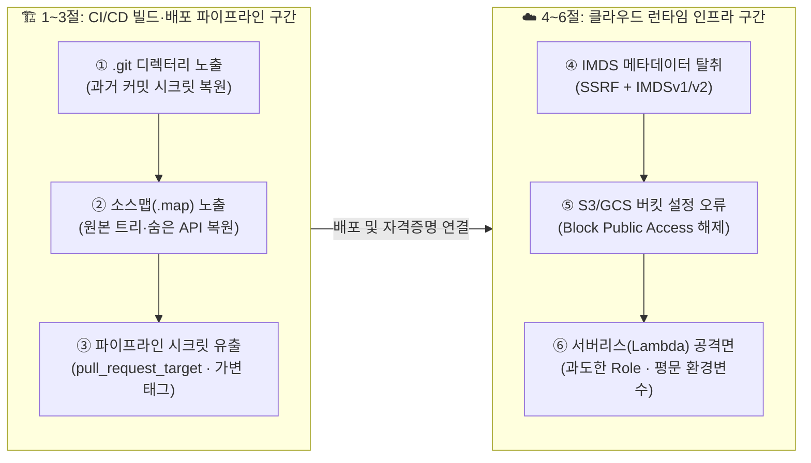
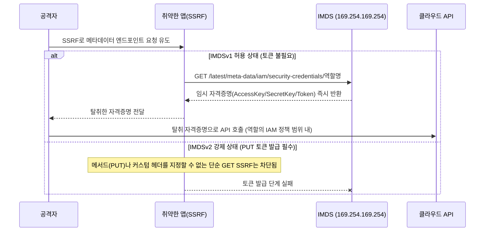

> [!summary] ⏱️ 5초 핵심 요약
> - **한 줄 비유**: 완성된 매장(웹 앱)의 현관문은 잘 잠가 두었지만, **매장 뒤편에 건물 설계도와 금고 열쇠가 적힌 공사 일지(`.git`·소스맵·CI 시크릿)를 흘려두거나, 클라우드 창고(S3·IMDS·Lambda)의 직원 전용 출입증을 아무나 꺼내 쓸 수 있게 방치한 상태**입니다.
> - **핵심 원리**: 애플리케이션 코드 자체의 취약점이 아니라, **코드를 커밋·빌드·배포하는 CI/CD 공급망 구간(1~3절)**과 **배포된 앱이 실행되는 클라우드 인프라 설정 구간(4~6절)**의 경계 실패에서 발생합니다.
> - **6대 핵심 진단 지점**: ① `/.git` 노출 및 과거 커밋 시크릿 복원, ② 프로덕션 소스맵(`.map`) 노출, ③ CI 시크릿 평문 커밋·`pull_request_target` 오용·가변 태그 액션, ④ SSRF + IMDSv1/v2 자격증명 탈취, ⑤ S3/GCS 버킷 공개 설정 오류, ⑥ 서버리스(Lambda) 과도한 실행 역할과 평문 환경변수.
> - **핵심 방어**: 빌드 아티팩트에서 `.git`·`.map` 원천 제외, GitHub Actions 최소 권한 및 커밋 SHA 고정, `IMDSv2(HttpTokens=required)` 강제, 스토리지 퍼블릭 차단(Block Public Access) 및 함수별 최소 IAM 권한 부여.

[[웹 취약점 진단 기법 입문 — XXE, SSRF부터 SQLi, XSS까지]], [[웹 취약점 진단 심화 — 실무에서 보는 기법들]], [[웹 취약점 진단 설정편 — CORS·SOP부터 후속 공격까지]]에서 다룬 항목들은 애플리케이션 코드나 브라우저 보안 모델 안에서 벌어지는 문제였다면, 이번 글은 그 **애플리케이션을 만들고 배포하는 파이프라인과 그 위에서 실제로 돌아가는 인프라** 쪽을 봅니다.

앞쪽 세 개는 소스가 커밋되고 빌드·배포되기까지의 공급망 구간(`.git` 노출, 빌드 산출물 관리, CI 시크릿), 뒤쪽 세 개는 그렇게 배포된 앱이 클라우드 위에서 도는 과정에서 생기는 설정 오류(메타데이터 자격증명, 스토리지 버킷, 서버리스)를 다룹니다. 웹 쪽 시리즈는 이번 글로 마무리하고, 다음 글부터는 모바일로 넘어갑니다.



---

## 한눈에 보는 CI/CD·클라우드 6대 설정 노출 비교

| 구간 | 진단 항목 | 실제로 위험이 성립하는 조건 | 공격자가 얻는 것 | 핵심 방어 대책 |
|---|---|---|---|---|
| **CI/CD** | **1. `.git` 디렉터리 노출** | 웹 루트에 `.git`이 포함 배포되고 웹 서버가 접근을 차단하지 않음 | 현재 소스코드 + **과거 커밋 히스토리에 남았던 삭제된 DB/API 시크릿** | 배포 아티팩트에서 `.git` 제외 + 유출 시 히스토리 정리 및 **키 즉시 회전(Rotate)** |
| **CI/CD** | **2. 빌드 아티팩트 / 소스맵** | 프로덕션 번들과 함께 `.js.map`이 접근 제어 없이 CDN/웹 루트에 업로드됨 | 번들링 전 원본 소스 구조, 주석, 비공개/디버그 API 엔드포인트 | 프로덕션 빌드 시 `.map` 외부 배포 제외 (내부 모니터링 도구에만 비공개 업로드) |
| **CI/CD** | **3. 파이프라인 시크릿 유출** | YAML 평문 키 커밋, `pull_request_target`에서 PR 코드 실행, 액션을 `@v1` 태그로 참조 | 저장소 배포 시크릿, 상위 권한 `GITHUB_TOKEN`, 빌드 파이프라인 장악 | `pull_request_target` 내 외부 코드 실행 금지 + 서드파티 액션 **전체 커밋 SHA 고정** |
| **클라우드** | **4. 클라우드 메타데이터(IMDS)** | SSRF 존재 + `IMDSv1` 허용(또는 `PUT`/헤더 통제 가능한 SSRF로 `IMDSv2` 우회) | 인스턴스에 연결된 IAM Role의 임시 자격증명 (`AccessKeyId`, `SecretAccessKey`, `Token`) | 인스턴스·계정 단위 **`IMDSv2(HttpTokens=required)` 강제** + SSRF 차단 및 Role 최소 권한 |
| **클라우드** | **5. 스토리지 버킷 설정 오류** | Block Public Access(AWS) / Public Access Prevention(GCS) 해제 + `*`/`allUsers` 허용 | 정적 자산과 함께 섞여 올라간 백업, `.env`, 로그 유출 (쓰기 허용 시 XSS/악성코드 변조) | 계정·버킷 단위 퍼블릭 액세스 차단 강제 + 정적 자산 버킷과 내부 보관 버킷 완전 분리 |
| **클라우드** | **6. 서버리스(Lambda) 공격면** | 함수에 과도한 IAM 정책 부여, 환경변수 평문 시크릿 저장, 전역 변수 상태 공유 | 함수 침해 시 타 클라우드 리소스 장악, 환경변수 시크릿 노출, 요청 간 데이터 혼선 | **함수별 전용 최소 권한 Role** + Secrets Manager 활용 + 요청 간 전역 상태 공유 금지 |

---

## 1. `.git` 디렉터리 노출

**💡 한 줄 비유**: 매장에 완성된 제품만 진열해야 하는데 **제품을 만들 때 썼던 작업 일지 공책(`.git`)까지 통째로 진열대에 올려두어, 손님이 지우개로 지웠던 옛날 금고 비밀번호(과거 커밋 기록)까지 전부 읽어보는 상황**입니다.

### 핵심 원리
배포 스크립트가 저장소를 통째로 서버에 올리면서 `.git` 폴더를 웹 루트 밖으로 옮기거나 지우지 않으면, 웹 서버가 숨김 경로를 별도로 막지 않는 한 `/.git/HEAD`, `/.git/config`, `/.git/logs/HEAD` 같은 경로가 평범한 정적 파일처럼 그대로 응답됩니다.

### 저장소 복원 원리와 히스토리 잔류 위험
- **`git-dumper` 등을 통한 복원**:
  - `.git/HEAD`와 `.git/logs/HEAD`로 현재 브랜치와 커밋 해시를 알아냅니다.
  - **디렉터리 리스팅이 켜져 있으면** `.git/objects` 전체를 순회해 저장소를 통째로 복원합니다.
  - **리스팅이 꺼져 있어도** 로그·참조(`refs`)에 남은 해시를 따라가며 가능한 범위까지 복원합니다. *(단, `git gc`로 오브젝트가 pack 파일로 압축된 뒤 리스팅까지 꺼져 있으면 로그에 남지 않은 과거 커밋까지는 복원이 보장되지 않습니다.)*
- **진짜 위험은 '과거 커밋 히스토리'**:
  - 복원이 성공하면 현재 소스코드보다 더 큰 문제는 **커밋 히스토리에만 남아 있는 시크릿**입니다.
  - 이후 커밋에서 `git rm`으로 지웠다고 생각한 DB 접속정보나 API 키가 과거 커밋 오브젝트에는 그대로 남아 있습니다. 따라서 운영 중인 코드에서 시크릿을 치웠다고 해결되지 않으며, **히스토리 자체를 재작성(rewrite)하고 유출된 자격증명을 반드시 회전(Rotate)**해야 합니다.

### 체크 포인트
- `/.git/HEAD`, `/.git/config` 요청에 대한 응답 코드와 본문이 노출되는가?
- 해당 경로에 웹 서버 디렉터리 리스팅이 열려 있는가?
- 배포 아티팩트 생성 단계(Docker 멀티스테이지 빌드, CI 패키징 등)에 `.git` 제외 규칙이 있고 웹 서버 설정에서 `/.git` 접근을 명시적으로 차단하는가?
- 참고: [git-dumper](https://github.com/arthaud/git-dumper), [OWASP Web Security Testing Guide](https://owasp.org/www-project-web-security-testing-guide/)

---

## 2. 빌드 아티팩트 / 소스맵 노출

**💡 한 줄 비유**: 암호처럼 압축해 둔 금고 설계도(번들링된 JS) 바로 옆에 **'원본 해독 사전(`app.js.map`)'을 함께 붙여 놓아서, 누구나 개발자 도구만 열면 원래 설계도와 숨겨진 관리자용 문 위치를 한눈에 볼 수 있는 상태**입니다.

### 핵심 원리
CI가 번들러(webpack, Vite 등)로 프로덕션 빌드를 만들 때 소스맵(`.map`)은 설정값 하나로 쉽게 함께 생성되고, 번들 파일 끝의 `//# sourceMappingURL=app.js.map` 주석이 그 파일의 존재 자체를 광고합니다.
- **성립 조건**: CI/배포 파이프라인이 이 `.map` 파일을 정적 자산과 똑같이 CDN·웹 루트에 올리면서 별도 접근 제어를 걸지 않을 때 문제가 됩니다.
- **공격자 관점의 활용 가치**:
  - 브라우저 DevTools만으로 번들링·난독화 이전의 **원본 소스 트리 구조, 변수명, 주석, 내부에서만 쓰려던 디버그용·관리자용 API 엔드포인트**까지 그대로 복원됩니다.
  - 소스맵 자체가 서버를 직접 뚫지는 않지만, **그걸로 드러난 내부 로직과 숨은 엔드포인트가 다음 단계 취약점(인증 누락 API, BOLA/IDOR 등)을 찾는 결정적 출발점**이 됩니다. (실제로 2026년 초 Persona는 비프로덕션 서브도메인에서 노출된 프런트엔드 소스맵에 대한 사후 분석 리포트를 공개한 바 있습니다.)

### 체크 포인트
- 배포된 JS/CSS 하단에 `//# sourceMappingURL=...` 주석이 존재하는가?
- 주석이 없더라도 번들 파일명 뒤에 `.map`을 붙여 직접 요청했을 때(`app.bundle.js.map`) 200 응답으로 JSON 소스맵이 내려오는가?
- CI 빌드/배포 단계에서 프로덕션 `devtool` 설정을 비활성화하거나, `.map` 파일을 공개 CDN에서 제외하고 내부 에러 추적 시스템(Sentry 등)에만 비공개 업로드하는가?
- 참고: [webpack — devtool 설정 가이드](https://webpack.js.org/configuration/devtool/), [Persona — Post-incident review: source map exposure](https://withpersona.com/blog/post-incident-review-source-map-exposure-non-production-subdomain)

---

## 3. 파이프라인 시크릿 유출

**💡 한 줄 비유**: 외부 방문객이 제출한 건의서(Fork PR)를 검토할 때, **검토실 금고 열쇠(`pull_request_target` 시크릿)를 방문객 손에 쥐여준 채 방문객이 적어 온 명령서(PR 코드)를 그대로 실행해 버리는 상황**입니다.

### 핵심 원리 (성격이 다른 3가지 파이프라인 결함)
1. **설정 파일 내 평문 시크릿 커밋**:
   - CI 설정 파일(GitHub Actions YAML 등)에 토큰을 평문으로 직접 커밋하면, 저장소 읽기 권한만 있어도 `git log`로 과거 커밋까지 뒤져 전부 복구할 수 있습니다.
2. **`pull_request_target`과 신뢰되지 않은 코드 실행의 결합 (Pwn Request)**:
   - `pull_request_target` 트리거는 외부 fork에서 올라온 PR이라도 **베이스 저장소의 시크릿과 상위 권한 `GITHUB_TOKEN`**으로 워크플로를 실행하도록 설계돼 있습니다.
   - 만약 이 워크플로가 **PR 헤드 커밋을 그대로 체크아웃(`ref: ${{ github.event.pull_request.head.sha }}`)해서 빌드·테스트 스텝을 실행**하면 — 즉 **"신뢰된 권한 컨텍스트"와 "신뢰 안 된 코드 실행"이 한 잡 안에서 겹치면** — PR 작성자가 임의 코드를 돌려 시크릿을 외부로 유출할 수 있습니다.
   - *(반면 일반 `pull_request` 트리거는 fork PR에 대해 시크릿과 쓰기 권한이 기본 제한되므로 안전하며, `pull_request_target`을 쓰더라도 PR 코드를 체크아웃·실행하지 않으면 안전합니다.)*
3. **서드파티 액션의 가변 태그(`@v1`) 참조**:
   - 외부 액션/플러그인을 불변 커밋 SHA가 아니라 가변 태그(`@v1`, `@main`)로 고정하면, 해당 액션 저장소가 침해되어 태그가 악성 커밋으로 옮겨지는 순간 다음 빌드부터 변조된 코드가 CI 권한 그대로 실행됩니다.

```yaml
# ❌ 취약한 GitHub Actions 설정 예시 (Pwn Request + 가변 태그)
on:
  pull_request_target:

jobs:
  build:
    runs-on: ubuntu-latest
    steps:
      - uses: actions/checkout@v4
        with:
          # 위험: 시크릿 접근이 가능한 pull_request_target에서 외부 PR의 코드를 체크아웃!
          ref: ${{ github.event.pull_request.head.sha }}
      - uses: third-party/unverified-action@v1 # 위험: 커밋 SHA가 아닌 가변 태그 사용
      - run: npm install && npm test           # PR 작성자가 조작한 package.json 스크립트 실행!
        env:
          PROD_DEPLOY_KEY: ${{ secrets.PROD_DEPLOY_KEY }}
```

### 체크 포인트
- 워크플로 YAML이나 스크립트 안에 하드코딩된 토큰·키가 있는가?
- `pull_request_target` 워크플로가 PR 헤드를 체크아웃한 뒤 그 코드를 빌드·테스트 실행 단계에서 돌리는가?
- 서드파티 액션이 가변 태그(`@v1`)가 아니라 **40자리 전체 커밋 SHA**로 고정돼 있는가?
- 참고: [OWASP Top 10 CI/CD Security Risks](https://owasp.org/www-project-top-10-ci-cd-security-risks/), [GitHub Security Lab — Preventing pwn requests](https://securitylab.github.com/research/github-actions-preventing-pwn-requests), [GitHub Docs — Security hardening for GitHub Actions](https://docs.github.com/en/actions/security-guides/security-hardening-for-github-actions)

---

## 4. 클라우드 메타데이터(IMDS)를 통한 자격증명 탈취

**💡 한 줄 비유**: 서버 방 안에만 있는 내선 전화기(`169.254.169.254`)로 안내데스크에 전화하면 **아무 확인 없이 방 주인의 마스터 출입증(`IMDSv1`)을 읽어주던 것을, 먼저 본인 확인용 일회성 암구호를 발급받아 제시해야만(`IMDSv2`) 읽어주도록 바꾼 차이**입니다.

### 핵심 원리
[[웹 취약점 진단 기법 입문 — XXE, SSRF부터 SQLi, XSS까지|SSRF]]가 이미 성립했다는 전제에서 그다음 단계로 이어지는 대표 체이닝입니다.



### IMDSv1 vs IMDSv2와 2026년 기준 진단 시 주의점
- **IMDSv1**: 토큰 없이 단순 `GET http://169.254.169.254/latest/meta-data/iam/security-credentials/<역할명>` 한 번으로 인스턴스 역할의 임시 자격증명을 그대로 돌려주므로, 응답 본문을 읽을 수 있는 가장 단순한 형태의 SSRF만으로도 탈취 체인이 완성됩니다.
- **IMDSv2**: 먼저 `PUT /latest/api/token` 요청에 TTL 헤더(`X-aws-ec2-metadata-token-ttl-seconds`)를 실어 세션 토큰을 발급받고, 이후 모든 조회에 `X-aws-ec2-metadata-token` 헤더를 실어야만 응답합니다. 따라서 **메서드(`PUT`)나 커스텀 헤더를 공격자가 통제할 수 없는 전형적인 단순 `GET` SSRF로는 토큰 발급 단계 자체가 막힙니다.** *(반대로 메서드·헤더까지 완전히 프록시하는 SSRF라면 IMDSv2도 우회될 수 있습니다.)*
- **"요즘은 IMDSv2가 기본이니 안전하다"는 착각 주의**: 2026년 현재 AWS는 계정 단위로 IMDSv2 기본값/강제 설정을 제공하고 빠른 시작 콘솔과 `imds-support=v2.0` AMI는 IMDSv2 전용으로 기본 설정되지만, **과거에 생성되었거나 계정 기본값을 바꾸지 않은 인스턴스는 여전히 `HttpTokens: optional`(IMDSv1 허용) 상태로 열려 있을 수 있습니다.** 또한 탈취에 성공해도 실제 영향은 **그 역할에 부여된 IAM 정책 범위**(및 [[클라우드 인프라 진단 — AWS IAM 권한상승 체인]]으로 이어지는 권한 상승 경로 유무)로 결정됩니다.

### 체크 포인트
- 보유한 SSRF가 단순 `GET`만 가능한지, 아니면 HTTP 메서드(`PUT`)와 커스텀 헤더까지 통제 가능한 유형인가?
- 대상 인스턴스·계정의 실제 `HttpTokens` 설정값이 `required`(IMDSv2 강제)인가, `optional`(IMDSv1 허용)인가?
- 탈취 가능한 역할의 IAM 정책 범위가 최소 권한으로 제한되어 있는가, 아니면 `iam:PassRole` 등 추가 권한 상승 경로가 있는가?
- 참고: [AWS — 새 인스턴스의 인스턴스 메타데이터 옵션 구성(IMDSv2 요구)](https://docs.aws.amazon.com/AWSEC2/latest/UserGuide/configuring-IMDS-new-instances.html), [OWASP — Server-Side Request Forgery Prevention Cheat Sheet](https://cheatsheetseries.owasp.org/cheatsheets/Server_Side_Request_Forgery_Prevention_Cheat_Sheet.html)

---

## 5. 스토리지 버킷 권한 설정 오류

**💡 한 줄 비유**: 최신 클라우드 창고(S3·GCS)는 출고 시 모든 문이 잠겨 나오지만, **"홈페이지 이미지를 편하게 보여주자"며 창고 관리자가 직접 이중 잠금장치(Block Public Access)를 풀고 활짝 열어둔 창고 안에 고객 DB 백업 파일과 `.env`까지 같이 넣어둔 상황**입니다.

### 핵심 원리
- **명시적 조작이 있어야 열리는 현대 버킷**: AWS는 신규 S3 버킷·객체를 기본적으로 퍼블릭 액세스가 차단된 상태로 생성합니다. 따라서 실제 노출은 ① 버킷 정책이나 ACL에 `Principal: "*"`처럼 공개 허용 규칙을 직접 추가하고, ② 계정·버킷 단위의 **Block Public Access** 설정을 의도적으로 끄는 명시적인 조작이 겹칠 때 성립합니다. GCS 역시 **Public Access Prevention**이 꺼진 상태에서 `allUsers` 또는 `allAuthenticatedUsers`에 권한을 부여해야 열립니다.
- **정적 호스팅 버킷에 민감 파일 혼입**: "정적 이미지·JS 호스팅용 버킷이니 통째로 공개해도 된다"는 운영 관행 때문에, **같은 버킷 안에 DB 백업 파일, 내부 설정, `.env`, 애플리케이션 로그가 섞여 올라가 함께 공개**되는 사고가 빈번합니다.
- **쓰기 권한 노출 시의 연쇄 피해**: 읽기뿐 아니라 **쓰기(`s3:PutObject`) 권한**까지 외부에 열려 있으면, 정적 JS 자산을 변조해 전 사용자 대상 **Stored XSS**나 악성 코드 배포로 즉시 이어집니다.

### 체크 포인트
- 버킷 ACL이나 버킷 정책에 공개 Principal(`"*"`, `allUsers`, `allAuthenticatedUsers`)이 설정되어 있는가?
- 계정 및 버킷 단위의 **Block Public Access(AWS)** 또는 **Public Access Prevention(GCS)**이 활성화되어 있는가?
- 정적 자산 호스팅용으로 공개된 버킷 안에 백업, `.env`, 로그 같은 내부 파일이 섞여 있지 않으며, 쓰기 권한이 완전히 차단되어 있는가?
- 참고: [AWS — Amazon S3 Block Public Access](https://docs.aws.amazon.com/AmazonS3/latest/userguide/access-control-block-public-access.html), [Google Cloud — Public access prevention](https://cloud.google.com/storage/docs/public-access-prevention)

---

## 6. 서버리스(Lambda 등) 특이 공격면

**💡 한 줄 비유**: 택배 분류 작업 하나만 하는 단기 아르바이트생(Lambda 함수)에게 **회사 전체 창고 마스터키(과도한 실행 역할)를 걸어주고, 작업대 벽면에 금고 비밀번호(평문 환경변수)를 적어 붙인 뒤, 여러 손님 물건을 한 바구니(전역 변수)에 섞어 담는 상태**입니다.

### 핵심 원리 (서버리스 3대 점검 포인트)
1. **함수별 실행 역할(Execution Role) 과다 권한**:
   - 여러 Lambda 함수에 귀찮다는 이유로 하나의 넓은 관리형 정책이나 와일드카드(`*`) 권한 역할을 공유해 붙여 두면, 특정 함수 하나가 인젝션이나 SSRF로 뚫렸을 때 애초 그 함수가 쓸 일이 없던 S3·DynamoDB·IAM 리소스까지 전부 건드릴 수 있습니다.
2. **환경변수 내 평문 시크릿 보관**:
   - 환경변수에 DB 비밀번호·API 키를 평문으로 저장하면, 콘솔·CLI(`lambda:GetFunctionConfiguration`) 조회 권한이 있는 주체나 함수 코드가 디버그/에러 로그에 `process.env`를 실수로 찍는 순간 그대로 유출됩니다.
3. **웜 컨테이너(Warm Invocation) 간 전역 상태 공유**:
   - 서버리스 실행 환경은 콜드스타트 이후 컨테이너를 재사용해 여러 요청을 처리합니다. 따라서 핸들러 함수 바깥의 **전역 변수(Global Variable)나 `/tmp` 디렉터리에 사용자별 인증 정보·세션 상태를 담아 두면**, 다음 요청을 보낸 다른 사용자에게 이전 사용자의 데이터가 섞여 노출되는 심각한 로직/동시성 결함이 발생합니다.

### 체크 포인트
- 각 Lambda 실행 역할의 IAM 정책이 **해당 함수가 실제로 호출하는 리소스와 Action으로만 최소한으로 분리**되어 있는가?
- 환경변수에 평문 시크릿을 두는 대신 AWS Secrets Manager나 Parameter Store(KMS 암호화)를 통해 런타임에 안전하게 주입받는가?
- 함수 코드 내에 요청 간 공유되는 전역 변수나 `/tmp` 파일에 사용자별 민감 상태를 저장하는 로직이 없는가?
- 참고: [OWASP Serverless Top 10](https://owasp.org/www-project-serverless-top-10/), [AWS — Security in AWS Lambda](https://docs.aws.amazon.com/lambda/latest/dg/lambda-security.html)
