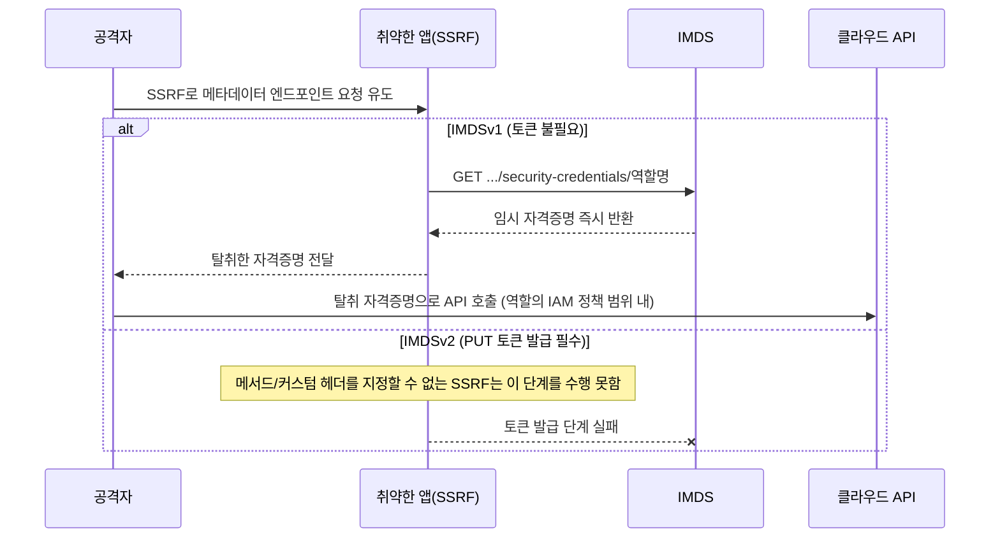

[[웹 취약점 진단 기법 입문 — XXE, SSRF부터 SQLi, XSS까지]], [[웹 취약점 진단 심화 — 실무에서 보는 기법들]], [[웹 취약점 진단 설정편 — CORS·SOP부터 후속 공격까지]]에서 다룬 항목들은 애플리케이션 코드나 브라우저 보안 모델 안에서 벌어지는 문제였다면, 이번 글은 그 **애플리케이션을 만들고 배포하는 파이프라인과 그 위에서 실제로 돌아가는 인프라** 쪽을 봅니다. 앞쪽 세 개는 소스가 커밋되고 빌드·배포되기까지의 공급망 구간(`.git` 노출, 빌드 산출물 관리, CI 시크릿), 뒤쪽 세 개는 그렇게 배포된 앱이 클라우드 위에서 도는 과정에서 생기는 설정 오류(메타데이터 자격증명, 스토리지 버킷, 서버리스)를 다룹니다. 웹 쪽 시리즈는 이번 글로 마무리하고, 다음 글부터는 모바일로 넘어갑니다.

---

## 1. `.git` 디렉터리 노출

**원리**: 배포 스크립트가 저장소를 통째로 서버에 올리면서 `.git` 폴더를 웹 루트 밖으로 옮기거나 지우지 않으면, 웹 서버가 숨김 파일을 별도로 막아 두지 않는 한 `/.git/HEAD`, `/.git/config`, `/.git/logs/HEAD` 같은 경로가 평범한 정적 파일처럼 그대로 응답됩니다. 이 상태라면 git-dumper 같은 도구가 `.git/HEAD`와 `.git/logs/HEAD`로 현재 브랜치와 커밋 해시를 알아낸 뒤, 디렉터리 리스팅이 켜져 있으면 `.git/objects` 전체를 순회해 저장소를 통째로 복원하고, 꺼져 있어도 로그·참조에 남은 해시를 따라가며 가능한 범위까지 복원합니다(단, `git gc`로 오브젝트가 pack 파일로 압축된 뒤 리스팅까지 꺼져 있으면 로그에 남지 않은 과거 커밋까지는 복원이 보장되지 않습니다). 복원이 성공하면 현재 소스코드보다 더 큰 문제는 **커밋 히스토리에만 남아 있는 값**입니다 — 이후 커밋에서 `git rm`으로 지웠다고 생각한 DB 접속정보나 API 키가 과거 커밋 오브젝트에는 그대로 남아 있고, 이는 운영 중인 코드에서 시크릿을 치웠다고 해결되지 않고 히스토리 자체를 rewrite하고 유출된 자격증명을 회전(rotate)해야만 끝납니다.

- 체크 포인트: `/.git/HEAD`, `/.git/config` 요청의 응답 코드와 본문, 해당 경로에 디렉터리 리스팅이 열려 있는지, 배포 아티팩트 생성 단계에 `.git` 제외 규칙이 있는지
- 참고: [git-dumper](https://github.com/arthaud/git-dumper), [OWASP Web Security Testing Guide](https://owasp.org/www-project-web-security-testing-guide/)

## 2. 빌드 아티팩트 / 소스맵 노출

**원리**: CI가 번들러(webpack, Vite 등)로 프로덕션 빌드를 만들 때 소스맵(`.map`)은 설정값 하나로 쉽게 같이 생성되고, 번들 파일 끝의 `//# sourceMappingURL=app.js.map` 주석이 그 파일의 존재 자체를 광고합니다. CI/배포 파이프라인이 이 `.map` 파일을 정적 자산과 똑같이 CDN·웹 루트에 올리면서 별도 접근 제어를 걸지 않을 때만 실제로 문제가 되는데, 이 경우 브라우저 devtools만으로 번들링 이전의 원본 소스 트리 구조, 변수명, 주석, 내부에서만 쓰려던 디버그용 엔드포인트까지 그대로 복원됩니다. 소스맵 자체가 서버를 뚫지는 않지만, **그걸로 드러난 내부 로직·엔드포인트가 다음 단계 취약점(인증 누락 API, IDOR 등)을 찾는 출발점**이 됩니다 — 실제로 2026년 초 Persona는 프로덕션이 아닌 서브도메인에서 노출된 프런트엔드 소스맵에 대한 사후 분석(post-incident review)을 공개로 올린 바 있습니다. CI 빌드 단계에서 `devtool`을 프로덕션용 값으로 명시하거나 아티팩트 업로드 전 `.map` 파일을 걸러내면 애초에 노출되지 않습니다.

- 체크 포인트: 배포된 JS/CSS 하단의 `sourceMappingURL` 주석 존재 여부, `.map` 파일을 직접 요청했을 때의 응답, CI 빌드/배포 단계에서 `.map` 파일을 제외하거나 비공개 스토리지로 분리 업로드하는지
- 참고: [webpack — devtool 설정 가이드](https://webpack.js.org/configuration/devtool/), [Persona — Post-incident review: source map exposure](https://withpersona.com/blog/post-incident-review-source-map-exposure-non-production-subdomain)

## 3. 파이프라인 시크릿 유출

**원리**: 성격이 다른 세 가지 결함을 묶어서 봅니다. ① CI 설정 파일(GitHub Actions YAML 등)에 토큰을 평문으로 직접 커밋하면, 그 저장소에 읽기 권한만 있어도 `git log`로 과거 커밋까지 뒤져 전부 복구할 수 있습니다. ② `pull_request_target` 트리거는 fork에서 올라온 PR이라도 베이스 저장소의 시크릿과 상위 권한 `GITHUB_TOKEN`으로 워크플로를 실행하도록 설계돼 있는데, 그 워크플로가 PR 헤드 커밋을 그대로 체크아웃해서 빌드·테스트 스텝을 실행하면 — 즉 **"신뢰된 권한 컨텍스트"와 "신뢰 안 된 코드 실행"이 한 잡 안에서 겹치면** — PR 작성자가 그 스텝 안에서 임의 코드를 돌려 시크릿을 자신이 통제하는 서버로 유출시킬 수 있습니다. 반대로 일반 `pull_request` 트리거는 fork PR에 대해 상위 시크릿 접근과 쓰기 권한이 기본적으로 제한되므로 이 문제가 없고, `pull_request_target`을 쓰더라도 PR 코드를 체크아웃하지 않거나 체크아웃한 코드를 실행 단계에 넣지 않으면 안전합니다. ③ 서드파티 액션/플러그인을 커밋 SHA가 아니라 가변 태그(`@v1`)로 고정하면, 그 액션 저장소가 침해되거나 태그가 다른 커밋으로 옮겨지는 것만으로 다음 빌드부터 변조된 코드가 CI 권한 그대로 실행되는 공급망 공격이 성립합니다.

- 체크 포인트: 워크플로 YAML 안에 하드코딩된 토큰·키가 있는지, `pull_request_target` 워크플로가 PR 헤드를 체크아웃한 뒤 그 코드를 실행 단계에서 돌리는지, 서드파티 액션이 태그가 아니라 커밋 SHA로 고정돼 있는지
- 참고: [OWASP Top 10 CI/CD Security Risks](https://owasp.org/www-project-top-10-ci-cd-security-risks/), [GitHub Security Lab — Preventing pwn requests](https://securitylab.github.com/research/github-actions-preventing-pwn-requests), [GitHub Docs — Security hardening for GitHub Actions](https://docs.github.com/en/actions/security-guides/security-hardening-for-github-actions)

## 4. 클라우드 메타데이터(IMDS)를 통한 자격증명 탈취

**원리**: [[웹 취약점 진단 기법 입문 — XXE, SSRF부터 SQLi, XSS까지|SSRF]]가 이미 성립했다는 전제에서 그다음 단계로 보는 체이닝입니다. IMDSv1은 토큰 없이 단순 `GET http://169.254.169.254/latest/meta-data/iam/security-credentials/<역할명>` 한 번으로 그 인스턴스에 붙은 역할의 임시 액세스 키·시크릿 키·세션 토큰을 그대로 돌려주므로, 응답 본문을 읽을 수 있는 가장 단순한 형태의 SSRF만으로도 자격증명 탈취 체인이 완성됩니다. IMDSv2는 먼저 `PUT /latest/api/token` 요청에 TTL 헤더를 실어 세션 토큰을 발급받고, 이후 모든 조회에 그 토큰을 `X-aws-ec2-metadata-token` 헤더로 실어야만 응답하도록 바뀌었기 때문에, 메서드(PUT)나 커스텀 헤더를 공격자가 지정할 수 없는 전형적인 SSRF(예: URL만 바꿔 넣는 이미지 미리보기 기능)로는 토큰 발급 단계 자체가 막힙니다 — 반대로 요청을 그대로 프록시하듯 메서드·헤더까지 완전히 통제 가능한 SSRF라면 IMDSv2도 여전히 우회됩니다. 2026년 현재 AWS는 계정 단위로 IMDSv2를 기본값으로 지정하고 더 나아가 강제(enforcement)할 수 있는 설정을 제공하며, 콘솔의 빠른 시작 런치 화면과 `imds-support=v2.0`으로 등록된 AMI는 이미 IMDSv2 전용으로 기본 설정되지만, 이는 **계정이 명시적으로 그렇게 설정했거나 해당 AMI·콘솔 경로로 띄운 인스턴스에 한정**되는 것이라 과거에 만들어졌거나 계정 기본값을 손대지 않은 인스턴스는 여전히 IMDSv1이 열려 있을 수 있습니다. 즉 "요즘은 IMDSv2가 기본이니 안전하다"고 단정할 수 없고, 대상 인스턴스의 실제 `HttpTokens` 설정을 확인해야 합니다. 탈취에 성공해도 실제로 할 수 있는 일은 그 역할에 부여된 IAM 정책 범위로 한정됩니다.

- 체크 포인트: 보유한 SSRF가 HTTP 메서드·커스텀 헤더까지 통제 가능한 유형인지, 대상 인스턴스·계정의 `HttpTokens` 값(`required` vs `optional`), 탈취한 역할의 IAM 정책 범위와 `iam:PassRole` 등 추가 권한 상승 경로 유무
- 참고: [AWS — 새 인스턴스의 인스턴스 메타데이터 옵션 구성(IMDSv2 요구)](https://docs.aws.amazon.com/AWSEC2/latest/UserGuide/configuring-IMDS-new-instances.html), [OWASP — Server-Side Request Forgery Prevention Cheat Sheet](https://cheatsheetseries.owasp.org/cheatsheets/Server_Side_Request_Forgery_Prevention_Cheat_Sheet.html)

## 5. 스토리지 버킷 권한 설정 오류

**원리**: AWS는 신규 S3 버킷·객체를 기본적으로 퍼블릭 액세스가 차단된 상태로 생성하므로, "버킷을 만들기만 해도 공개된다"는 건 2026년 기준 사실이 아닙니다. 실제 노출은 ① 버킷 정책이나 ACL에 `Principal: "*"`처럼 공개 허용 규칙을 직접 추가하거나, ② 계정·버킷 단위로 제공되는 네 가지 Block Public Access 설정 중 하나 이상을 의도적으로 끄는 **명시적인 조작**이 있어야 성립합니다. GCS도 마찬가지로, 버킷·조직 단위의 공개 액세스 방지(Public Access Prevention) 설정이 꺼진 상태에서 `allUsers`/`allAuthenticatedUsers` 엔터티에 권한을 부여해야 열립니다. 문제는 이게 "정적 자산 호스팅용이니 통째로 공개해도 된다"는 운영 관행에서 자주 생긴다는 점으로, 같은 버킷에 백업 파일·내부 설정·`.env`·로그가 섞여 올라가 있으면 그것들도 함께 공개됩니다. 쓰기 권한까지 열려 있으면 정적 자산을 변조해 저장형 XSS나 악성 코드 배포로 이어질 수 있습니다.

- 체크 포인트: 버킷 ACL·정책에 공개 Principal이 있는지, 계정/버킷 단위 Block Public Access(AWS)·Public Access Prevention(GCS)이 켜져 있는지, 공개된 버킷 안에 정적 자산 외의 민감 파일(백업, `.env`, 로그)이 섞여 있는지
- 참고: [AWS — Amazon S3 Block Public Access](https://docs.aws.amazon.com/AmazonS3/latest/userguide/access-control-block-public-access.html), [Google Cloud — Public access prevention](https://cloud.google.com/storage/docs/public-access-prevention)

## 6. 서버리스(Lambda 등) 특이 공격면

**원리**: 핵심만 짚으면 세 가지입니다. 함수별 실행 역할에 필요 이상으로 넓은 관리형 정책을 붙여 두면, 그 함수 하나가 다른 취약점(인젝션, SSRF 등)으로 뚫렸을 때 애초 그 함수가 쓸 일이 없던 다른 리소스까지 건드릴 수 있는데, 이는 앞서 IMDS 항목에서 본 "탈취한 자격증명의 권한 범위" 문제와 같은 뿌리입니다. 환경변수에 DB 비밀번호·API 키를 평문으로 저장하면, 콘솔·CLI 조회 권한이 있는 사람이나 함수 코드가 자기 환경변수를 실수로 로그에 찍는 순간 그대로 노출됩니다. 동시성 제한이나 콜드스타트 상황에서 요청 간에 공유되는 전역 변수(DB 커넥션·캐시 등)에 상태를 의존하는 코드는 동시 요청 사이 레이스 컨디션을 만들 수 있지만, 이는 서버리스 자체의 결함이라기보다 함수 코드 설계의 문제입니다.

- 체크 포인트: Lambda 실행 역할의 IAM 정책이 그 함수가 실제로 쓰는 리소스로 좁혀져 있는지, 환경변수에 평문 시크릿이 있는지(Secrets Manager/Parameter Store 사용 여부), 요청 간 공유되는 전역 상태에 의존하는 로직이 있는지
- 참고: [OWASP Serverless Top 10](https://owasp.org/www-project-serverless-top-10/), [AWS — Security in AWS Lambda](https://docs.aws.amazon.com/lambda/latest/dg/lambda-security.html)
