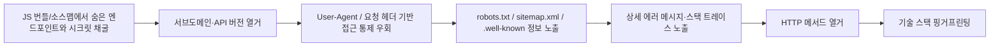

[[웹 취약점 진단 기법 입문 — XXE, SSRF부터 SQLi, XSS까지]], [[웹 취약점 진단 심화 — 실무에서 보는 기법들]], [[웹 취약점 진단 설정편 — CORS·SOP부터 후속 공격까지]]에서 다룬 항목들은 전부 "어디를 찔러야 할지 이미 아는 상태"에서 시작합니다. 이번 글은 그 앞 단계, 즉 **진단 대상의 숨은 공격 표면을 넓히는 정찰(recon) 기법**을 모았습니다. 여기서 찾은 엔드포인트·버전·설정 정보가 앞선 세 글에서 다룬 취약점들의 실제 진입점이 되는 경우가 많습니다.

---

## 1. JS 번들/소스맵에서 숨은 엔드포인트와 시크릿 채굴

**원리**: 프로덕션 빌드는 압축·난독화된 JS만 배포하는 게 정상이지만, webpack/vite 같은 빌드 도구가 만드는 `.js.map` 소스맵 파일이 같은 경로에 그대로 함께 배포되면 원본에 가까운 소스(변수명, 주석, 때로는 내부 API 호출 로직까지)를 복원할 수 있습니다 — 단, 이는 소스맵 파일 자체가 실제로 웹에서 요청 가능한 상태로 올라가 있을 때만 성립합니다. 소스맵 경로는 번들 파일 끝의 `//# sourceMappingURL=...` 주석이나 응답의 `SourceMap` HTTP 헤더로 바로 알 수 있고, 둘 다 없어도 `파일명.js.map`을 직접 요청해 보는 것만으로 종종 발견됩니다. 다만 소스맵이 존재한다고 항상 원본 코드까지 복원되는 건 아닙니다 — 매핑 정보만 담고 원본 텍스트(`sourcesContent`)는 뺀 채 빌드하는 설정도 흔해서, 이 경우엔 파일·함수 이름 정도만 복원되고 실제 코드 내용까지는 못 봅니다. 소스맵이 없어도 난독화되지 않은 번들 자체를 문자열로 뒤지는 것만으로 하드코딩된 API 키, 내부 전용 엔드포인트 URL, 디버그 플래그가 나오는 경우가 흔한데, 이건 애초에 프런트엔드 코드에 시크릿을 박아 넣은 설계 실수이지 소스맵 유무와는 별개 문제입니다. 발견한 내부 엔드포인트가 실제로 인증 없이 응답하는지, 하드코딩된 키가 아직 유효하고 어떤 권한 범위를 갖는지까지 확인해야 실제 영향도를 말할 수 있습니다.

- 체크 포인트: 브라우저 개발자 도구 Sources 탭의 `.map` 파일 유무, 번들 말미 `sourceMappingURL` 주석, 번들 텍스트에서 `api_key`, `Authorization`, `Bearer`, `internal`, `staging` 같은 문자열 검색
- 참고: [OWASP WSTG — Review Webpage Content for Information Leakage](https://owasp.org/www-project-web-security-testing-guide/latest/4-Web_Application_Security_Testing/01-Information_Gathering/05-Review_Webpage_Content_for_Information_Leakage), [sourcemapper (소스맵 복원 도구)](https://github.com/denandz/sourcemapper), [MDN — SourceMap 헤더](https://developer.mozilla.org/en-US/docs/Web/HTTP/Reference/Headers/SourceMap)

## 2. 서브도메인·API 버전 열거

**원리**: 조직 규모가 커질수록 서브도메인과 API 버전이 누적되는데, 담당자 교체나 마이그레이션 이후에도 일부는 DNS·라우팅에서 내려가지 않고 방치됩니다. staging/internal 서브도메인은 프로덕션과 달리 WAF·인증·rate limit이 느슨하거나 아예 없는 채로 운영되는 경우가 흔하고, `/api/v1`처럼 구버전으로 유지되는 엔드포인트는 `/api/v2`로 마이그레이션 이후 추가된 보안 수정(인증 로직 강화, 입력 검증 추가 등)이 하위 호환을 위해 살려둔 구버전에는 백포트되지 않는 경우가 실무에서 자주 보입니다. 다만 "옛 버전이 존재한다"는 사실만으로 취약하다고 단정할 수 없고, 실제로 v2에서 막힌 결함이 v1에서 재현되는지 두 버전의 동작을 비교해야 합니다. staging 환경이 프로덕션과 동일한 DB 접속 정보·시크릿을 재사용하면서, 그 자격증명이 실제로 프로덕션 리소스에 유의미한 권한을 갖고 네트워크상으로도 접근 가능하다면, 느슨한 staging 하나가 프로덕션 전체로 이어지는 통로가 됩니다.

- 체크 포인트: 인증서 투명성 로그(crt.sh)로 서브도메인 수집, `/v1/`·`/v2/` 등 버전 경로의 응답 차이 비교, Wayback Machine에 남은 과거 서브도메인 기록, staging/internal 환경의 자격증명이 프로덕션과 공유되는지
- 참고: [crt.sh](https://crt.sh/), [OWASP API Security Top 10 2023 — API9:2023 Improper Inventory Management](https://owasp.org/API-Security/editions/2023/en/0xa9-improper-inventory-management/)

## 3. User-Agent / 요청 헤더 기반 접근 통제 우회

**원리**: 일부 서버·WAF·애플리케이션은 `User-Agent`, `X-Forwarded-For`, `Referer`, 사내 전용 커스텀 헤더 같은 값을 보고 접근을 허용하거나 차단합니다. `User-Agent`와 `Referer`는 클라이언트가 보낸 값을 애플리케이션이 그대로 받아보는 구조라 처음부터 신원 검증 수단이 못 됩니다. `X-Forwarded-For`는 조금 더 미묘합니다 — 이 헤더는 프록시 체인의 각 홉이 자신이 받은 피어 IP를 기존 값 뒤에 덧붙여 가는 용도라, 클라이언트가 보낸 원래 값도 그 목록 맨 앞에 그대로 남아 있습니다. 애플리케이션이 자신이 신뢰하는 홉 수만큼만 **뒤에서부터** 잘라 읽으면 앞쪽에 뭘 끼워 넣어도 안전하지만, 이 파싱을 생략하고 헤더 전체나 맨 앞 값을 그대로 "클라이언트 IP"로 믿어 버리면 공격자가 `X-Forwarded-For: 127.0.0.1, <실제IP>`처럼 맨 앞에 값을 끼워 넣는 것만으로 IP 허용목록을 통과할 수 있습니다. 즉 헤더 자체가 아니라 **신뢰 가능한 홉 구분 없이 이 헤더를 파싱하는 애플리케이션 로직**이 구멍입니다. 그렇다고 이런 헤더를 조금이라도 참고하면 바로 취약하다는 뜻은 아닙니다. 실제로 뚫리려면 **그 검사가 mTLS, 서명된 내부 토큰, 실제 네트워크 분리 같은 독립적인 근거 없이 그 자체로 보안 결정을 내리는 지점이어야** 합니다 — 분석 도구가 User-Agent로 봇 트래픽 통계만 다르게 집계하는 건 취약점이 아니고, WAF가 알려진 악성 UA 패턴을 1차로 거른 뒤 별도의 인증이 뒤에 남아 있다면 그 인증 계층까지 함께 뚫리는 건 아닙니다. 다만 WAF 우회만으로도 "그 전까지 아무에게도 노출 안 됐던 내부 경로·에러 메시지·추가 공격 표면"에 닿는다는 의미가 있다면, 뒤에 다른 계층이 남아 있어도 그 우회 자체가 유의미한 발견입니다. 실제로 문제가 되는 패턴은 셋입니다. ① WAF/봇 차단 규칙이 특정 레거시 크롤러나 사내 모니터링 봇의 UA 문자열을 "이 값이면 무조건 통과"로 화이트리스트해 둔 경우 — 공격자가 그 문자열을 그대로 복사하면 그 규칙 자체는 무력화됩니다. ② 관리자/디버그 엔드포인트가 "사내망에서만 접근한다"는 가정하에 내부 전용 UA 하나만 확인하고 그걸 인증 자체의 대체물로 쓰는 경우. ③ 앞서 설명한 `X-Forwarded-For` 파싱 실수로 IP 허용목록을 우회하는 경우. 세 패턴 모두 근본 원인은 같습니다 — 신원 증명이 아니라 클라이언트가 자기 입으로 말한 값을 충분한 검증 없이 접근 통제 판단에 쓴다는 것.

- 체크 포인트: 관리자/디버그 경로가 UA나 커스텀 헤더 하나만으로 열리는지(값을 바꿔가며 재요청), 애플리케이션이 `X-Forwarded-For`의 신뢰 가능한 홉 수를 설정해 뒤에서부터 잘라 읽는지 아니면 맨 앞 값이나 헤더 전체를 그대로 신뢰하는지, WAF 차단 응답이 UA만 바꿔도 우회되는지, 그 뒤에 독립적인 인증·네트워크 분리가 실제로 남아 있는지
- 참고: [CWE-290 — Authentication Bypass by Spoofing](https://cwe.mitre.org/data/definitions/290.html), [CWE-807 — Reliance on Untrusted Inputs in a Security Decision](https://cwe.mitre.org/data/definitions/807.html), [MDN — X-Forwarded-For](https://developer.mozilla.org/en-US/docs/Web/HTTP/Reference/Headers/X-Forwarded-For)

## 4. robots.txt / sitemap.xml / .well-known 정보 노출

**원리**: robots.txt는 검색엔진 크롤러에게 "이 경로는 크롤링하지 말아 달라"고 부탁하는 명세일 뿐, 접근을 차단하거나 그 URL이 검색 결과에서 아예 빠지는 걸 보장하는 장치가 아닙니다 — 다른 페이지에 그 URL로 링크가 걸려 있으면 크롤링 없이도 주소 자체는 색인될 수 있습니다. `Disallow: /admin/`이라고 적는 순간 선의의 크롤러는 크롤링을 피해 가지만, 공격자에게는 오히려 "여기 admin 경로가 있다"는 지도를 그려주는 역설이 생깁니다. sitemap.xml도 공개 의도로 작성된 URL 목록이지만 테스트·스테이징 하위 경로가 섞여 들어가면 그대로 노출됩니다. `.well-known/` 경로는 `security.txt`, OAuth `openid-configuration`, ACME 챌린지 파일처럼 표준화된 메타데이터 교환용이라 그 자체는 노출 문제가 아니지만, 같은 정찰 단계에서 늘 함께 확인하는 게 웹 루트에 실수로 남는 `.git/`, `.env` 같은 파일입니다. `.git/HEAD`가 응답한다고 바로 전체 소스가 복원되는 건 아니고, 커밋 객체들이 실제로 하나씩 받아와지는지까지 `git-dumper` 같은 도구로 따로 확인해야 하며, `.env`는 내용이 실제로 읽혀야 시크릿 노출이 확정됩니다. 셋 다 공통적으로 **웹 서버가 해당 경로를 실제로 정적 파일로 서빙하도록 설정돼 있을 때**만 성립합니다.

- 체크 포인트: `/robots.txt`, `/sitemap.xml`, `/.well-known/security.txt`, `/.git/HEAD`, `/.env` 직접 요청, robots.txt의 Disallow 목록을 추가 탐색 후보 경로로 수집, `.git/`이 응답하면 `git-dumper` 등으로 실제 객체 추출까지 확인
- 참고: [RFC 9309 — Robots Exclusion Protocol](https://www.rfc-editor.org/rfc/rfc9309.html), [OWASP WSTG — Conduct Search Engine Discovery and Reconnaissance for Information Leakage](https://owasp.org/www-project-web-security-testing-guide/latest/4-Web_Application_Security_Testing/01-Information_Gathering/01-Conduct_Search_Engine_Discovery_Reconnaissance_for_Information_Leakage), [RFC 9116 — security.txt](https://www.rfc-editor.org/rfc/rfc9116)

## 5. 상세 에러 메시지·스택 트레이스 노출

**원리**: 개발 환경의 디버그 모드(Django `DEBUG=True`, Flask debug 모드, ASP.NET `customErrors=Off` 등)가 프로덕션에 그대로 배포되거나, 예외 처리를 못 한 경로에서 프레임워크 기본 에러 페이지가 노출되면 스택 트레이스에 내부 파일 경로, 사용 중인 프레임워크·라이브러리 버전, 때로는 SQL 쿼리 원문까지 그대로 찍힙니다. 이것만으로 바로 침해로 이어지진 않지만, 공격자는 사용 중인 프레임워크, 때로는 구체적인 버전까지 알게 되어 공개된 CVE 후보를 추릴 수 있고(스택 트레이스마다 버전까지 정확히 찍히는 건 아니라 CVE가 매칭돼도 실제 공격 전제조건은 별도로 확인해야 합니다), 내부 경로 구조를 알면 Path Traversal·LFI 공격의 타겟을 훨씬 좁혀서 시도할 수 있습니다. 평소에는 안 보이고 예상 밖의 입력(존재하지 않는 파라미터, 타입이 다른 값, 과도하게 긴 입력)을 일부러 넣어야 나오는 경우가 많아, 정찰 단계에서 "일부러 망가뜨려 보는" 시도가 필요합니다.

- 체크 포인트: 파라미터에 예상 밖 타입·값을 넣어 500 에러 유도, 404/500 응답이 프레임워크 기본 에러 페이지인지 커스텀 페이지인지, 에러 응답에 프레임워크명·버전·내부 파일 경로·SQL 조각이 포함되는지
- 참고: [OWASP WSTG — Testing for Improper Error Handling](https://owasp.org/www-project-web-security-testing-guide/latest/4-Web_Application_Security_Testing/08-Testing_for_Error_Handling/01-Testing_for_Improper_Error_Handling), [OWASP Top 10 2021 — A05 Security Misconfiguration](https://owasp.org/Top10/A05_2021-Security_Misconfiguration/)

## 6. HTTP 메서드 열거

**원리**: 웹 서버·프레임워크 대부분은 기본적으로 GET/HEAD 정도만 안전하게 지원하고, PUT·DELETE·TRACE 같은 메서드는 기본으로 열려 있기보다 WebDAV 모듈이나 특정 프레임워크 설정을 별도로 켰을 때, 혹은 레거시 구성이 방치됐을 때 남아 있는 경우가 많습니다 — "흔히 열려 있다"가 아니라 "열려 있으면 반드시 확인해야 할 목록"으로 접근해야 합니다. `OPTIONS` 요청에 대한 `Allow` 응답 헤더는 RFC 9110상 405(Method Not Allowed) 응답에는 반드시 포함되고 다른 상태코드 응답에도 포함할 수 있어, 많은 프레임워크가 정상 응답에도 `Allow`를 함께 내려주는 편이라 여전히 유용한 정찰 단서입니다. 오래된 WebDAV 설정이 남아 `PUT`이 열려 있으면 인증 없이 임의 파일을 올릴 수 있는지가 다음 확인 대상이 되는데, "메서드가 열려 있다"와 "실제로 쓰기 권한까지 있어 파일이 저장된다"는 다른 문제라 직접 시도해 확인해야 합니다. `TRACE`는 받은 요청을 그대로 되돌려 보내는 디버깅용 메서드로, Cross-Site Tracing(XST)처럼 `HttpOnly` 쿠키를 우회해 읽어내는 데 악용된 전례가 있지만, 오늘날 주요 브라우저는 `fetch`/`XMLHttpRequest`에서 `TRACE` 요청 자체를 금지하고 있어 브라우저를 경유하는 XST의 실질적 위험은 예전보다 크게 줄었습니다. 이 섹션에서 확인할 건 메서드가 "활성화돼 있다"는 사실 자체가 아니라, 그 메서드로 **인증 없이 쓰기·삭제 같은 상태 변경이 실제로 일어나는지, 또는 TRACE처럼 상태를 바꾸지 않아도 정보 노출·방어 우회로 이어지는지**입니다.

- 체크 포인트: 주요 경로에 `OPTIONS` 요청을 보내 `Allow` 헤더 확인, `PUT`/`DELETE` 요청이 인증 없이 실제로 처리되는지, `TRACE` 메서드 활성화 여부
- 참고: [OWASP WSTG — Test HTTP Methods](https://owasp.org/www-project-web-security-testing-guide/latest/4-Web_Application_Security_Testing/02-Configuration_and_Deployment_Management_Testing/06-Test_HTTP_Methods), [MDN — HTTP request methods](https://developer.mozilla.org/en-US/docs/Web/HTTP/Reference/Methods)

## 7. 기술 스택 핑거프린팅

**원리**: `Server`, `X-Powered-By` 같은 응답 헤더나 프레임워크 특유의 쿠키 이름(`JSESSIONID`, `PHPSESSID` 등), 정적 자산 경로의 버전 문자열은 서버가 어떤 소프트웨어 스택을 쓰는지 짐작하게 해주는 단서입니다 — 다만 이 값들은 설정으로 얼마든지 지우거나 위조할 수 있고, 자산 경로의 `?ver=` 같은 쿼리스트링은 프레임워크 자체 버전이 아니라 그 정적 파일 하나만의 캐시 무효화용 버전일 수도 있어 과신하면 안 됩니다. 그래도 버전이 특정되면 공격자는 "아무거나 찔러보기"가 아니라 그 버전에 공개된 CVE 목록부터 대입해 볼 수 있어 조사 범위가 좁혀집니다. 헤더에 버전이 찍혀 있다는 사실 자체는 취약점이 아니고, CVE가 매칭된다고 바로 공격이 성립하는 것도 아닙니다 — 그 CVE가 요구하는 설정·조건(특정 모듈 활성화, 특정 엔드포인트 존재 등)까지 맞아야 하고, 패치가 이미 적용돼 있으면 버전 정보가 드러나도 악용할 거리가 없습니다. 반대로 알려진 CVE가 없다고 안전한 것도 아니며, 식별된 스택은 설정 오류나 비공개 결함을 찾는 출발점으로도 쓰입니다.

- 체크 포인트: 응답 헤더의 `Server`/`X-Powered-By`와 프레임워크 특유 쿠키명, 정적 자산 경로의 버전 쿼리스트링(`?ver=`), 식별된 소프트웨어·버전을 CVE 데이터베이스와 대조
- 참고: [OWASP WSTG — Fingerprint Web Server](https://owasp.org/www-project-web-security-testing-guide/latest/4-Web_Application_Security_Testing/01-Information_Gathering/02-Fingerprint_Web_Server), [NVD (National Vulnerability Database)](https://nvd.nist.gov/)

---

## 정찰 파이프라인 한눈에 보기

---

## 정리 — 정찰이 다음 공격으로 이어지는 지점

| 기법 | 단서가 되는 기능 | 다음 단계 |
|---|---|---|
| JS 번들/소스맵 | 프런트엔드 빌드 산출물 | 내부 엔드포인트·시크릿 발견 → 직접 요청 |
| 서브도메인·API 버전 열거 | 누적된 서브도메인, 버전별 API 경로 | 최신 버전에서 패치된 결함을 구버전에 재검증 |
| 헤더 기반 접근 통제 | UA/IP/Referer로 가르는 WAF·관리자 경로 | 헤더 스푸핑으로 게이트 우회 |
| robots.txt/sitemap/.well-known | 공개 메타데이터 파일 | 숨은 경로 목록화, `.git`/`.env` 노출 확인 |
| 에러 메시지 노출 | 디버그 모드, 미처리 예외 | 버전 특정 → CVE 매칭, 내부 경로로 LFI 타겟팅 |
| HTTP 메서드 열거 | WebDAV, 디버깅용 메서드 | PUT 업로드, TRACE 악용 가능성 확인 |
| 기술 스택 핑거프린팅 | 응답 헤더, 쿠키명, 자산 버전 | 알려진 CVE 대입 |

이 글에서 찾은 엔드포인트·버전·헤더 신뢰 구조는 [[웹 취약점 진단 기법 입문 — XXE, SSRF부터 SQLi, XSS까지]]와 [[웹 취약점 진단 심화 — 실무에서 보는 기법들]]에서 다룬 기법들의 실제 타겟이 됩니다. 정찰 단계에서 넓힌 공격 표면만큼 다음 단계에서 확인할 목록도 늘어나니, 발견한 것을 전부 체크리스트로 남겨 두고 하나씩 검증하세요.
