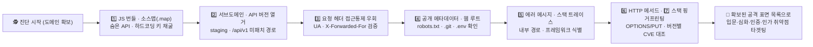
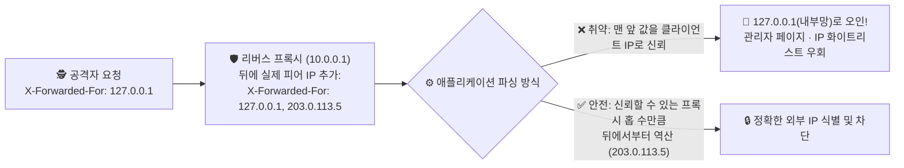

> [!summary] ⏱️ 5초 핵심 요약
> - **한 줄 비유**: 본격적인 금고 열기(취약점 익스플로잇)에 앞서, **건물 외벽을 한 바퀴 돌며 미처 안 지운 설계도(`.js.map`), 뒷문 구형 출입구(`/api/v1`, `staging`), 안내판(`robots.txt`), 그리고 "직원 복장(`User-Agent`·`X-Forwarded-For`)만 입으면 통과시켜 주는 허술한 경비원"을 찾아 지도를 그리는 단계**입니다.
> - **핵심 원리**: 정찰(Reconnaissance)은 **"어디를 찔러야 할지 모르는 상태"에서 숨은 엔드포인트·구버전 API·내부 경로·프레임워크 버전을 발굴해 실제 공격 표면을 넓히는 과정**입니다.
> - **핵심 진단 포인트**: 단서(`.map` 파일, 구버전 경로, 헤더 반사, 버전 노출)를 찾았다는 사실 자체로 끝내지 말고, **그 단서가 실제로 인증 없는 접근·유효한 시크릿·미패치 취약점으로 이어지는지 성립 조건을 끝까지 검증**해야 합니다.

[[웹 취약점 진단 기법 입문 — XXE, SSRF부터 SQLi, XSS까지]], [[웹 취약점 진단 심화 — 실무에서 보는 기법들]], [[웹 취약점 진단 설정편 — CORS·SOP부터 후속 공격까지]]에서 다룬 항목들은 모두 "어느 URL과 파라미터를 찔러야 할지 이미 아는 상태"에서 시작합니다. 이번 글은 그 가장 앞 단계, 즉 **진단 대상의 숨은 공격 표면을 넓히는 7가지 정찰(Recon) 기법**과 각 기법이 실제 취약점으로 성립하는 조건을 정리합니다.

---

## 한눈에 보는 7대 정찰 기법과 후속 공격 연결표

| 정찰 기법 | 확인 대상 (단서) | 실제로 위험해지는 성립 조건 | 연결되는 후속 공격 |
|---|---|---|---|
| **1. JS 번들 / 소스맵 분석** | `.js`, `.js.map`, `SourceMap` 헤더 | 소스맵(`sourcesContent`) 접근 가능 또는 번들 내 유효한 시크릿·내부 API 존재 | 미인증 내부 API 호출, 클라우드/외부 API 키 악용 |
| **2. 서브도메인 · 구버전 API 열거** | `crt.sh`, `staging.*`, `/api/v1/` | 구버전에 최신 보안 패치 미적용 또는 스테이징이 운영 DB/시크릿 공유 | 구버전 경유 인증/검증 우회, 스테이징 경유 운영 침투 |
| **3. 헤더 기반 접근통제 우회** | `User-Agent`, `X-Forwarded-For`, `Referer` | 독립된 인증 없이 클라이언트가 조작 가능한 헤더 값만으로 보안 결정 수행 | WAF/봇 차단 우회, 사내/관리자 전용 경로 접근 |
| **4. 메타데이터 및 설정 파일 노출** | `robots.txt`, `sitemap.xml`, `.git/`, `.env` | 웹 서버가 숨은 관리 경로를 암시하거나 `.git`/`.env`를 정적 파일로 실제 서빙 | 소스코드 전체 복원(`git-dumper`), DB·환경변수 탈취 |
| **5. 상세 에러 · 스택 트레이스** | 비정상 입력에 대한 `500` 에러 응답 | 프로덕션에 디버그 모드 방치 또는 미처리 예외로 경로·버전·쿼리 원문 노출 | 정확한 내부 절대 경로 기반 LFI/Path Traversal, CVE 매칭 |
| **6. HTTP 메서드 열거** | `OPTIONS` (`Allow` 헤더), `PUT`, `DELETE`, `TRACE` | 단순 메서드 응답을 넘어 실제로 인증 없이 파일 쓰기/삭제나 정보 노출 발생 | WebDAV `PUT` 웹쉘 업로드, 미인가 리소스 삭제 |
| **7. 기술 스택 핑거프린팅** | `Server`, `X-Powered-By`, 쿠키명, `?ver=` | 특정된 버전에 알려진 CVE가 존재하고 해당 CVE의 전제 설정 조건이 충족됨 | 기성 원데이(1-day) 익스플로잇 적용 |

---

## 1. JS 번들/소스맵에서 숨은 엔드포인트와 시크릿 채굴

**💡 한 줄 비유**: 완성된 요리(난독화된 JS)만 손님 상에 나가야 하는데, **주방장이 식재료 비율과 금고 비밀번호까지 적어둔 원본 비법 노트(`.js.map` 소스맵)를 쟁반 밑에 같이 깔아서 내보낸 상황**입니다.

- **핵심 원리**: 프로덕션 빌드는 압축·난독화된 JS만 배포하는 것이 정상이지만, Webpack/Vite 같은 빌드 도구가 생성한 **`.js.map` 소스맵 파일**이 웹 서버에 그대로 함께 배포되면 원본에 가까운 소스코드(변수명, 주석, 관리자/내부 API 호출 로직)를 복원할 수 있습니다. 소스맵 경로는 번들 파일 맨 끝의 `//# sourceMappingURL=...` 주석이나 `SourceMap` HTTP 응답 헤더로 알 수 있고, 주석이 없어도 `번들파일명.js.map`을 직접 요청해 보면 발견되곤 합니다.
- **성립 조건과 주의할 점**:
  1. **소스맵 내 원본 포함 여부**: `.js.map` 파일이 존재하더라도 빌드 설정에 따라 매핑 좌표만 담고 원본 텍스트(`sourcesContent`)는 빠져 있을 수 있습니다(이 경우 파일·함수 이름 구조만 복원됨).
  2. **번들 자체의 하드코딩 시크릿**: 소스맵이 아예 없더라도 난독화 여부와 무관하게 **프런트엔드 JS 번들 텍스트 안에 하드코딩된 API 키, 내부 전용 엔드포인트 URL(`/api/internal/...`), 권한 분기 플래그**는 문자열 검색만으로 그대로 발굴됩니다.
  3. **실제 영향도 검증**: 찾아낸 내부 엔드포인트가 **서버 측에서도 실제로 인증/인가 없이 응답하는지**, 발굴한 API 키가 **아직 살아 있고 어떤 권한 범위를 갖는지**까지 확인해야 취약점으로 확정됩니다.
- **체크 포인트**:
  - 브라우저 개발자 도구 **Sources** 탭의 `.map` 파일 자동 로드 여부 및 번들 말미 `sourceMappingURL` 주석 확인
  - 번들 텍스트 내 `api_key`, `secret`, `Authorization`, `Bearer`, `internal`, `admin`, `staging`, `/api/v` 정규식 검색
- **참고**: [OWASP WSTG — Review Webpage Content for Information Leakage](https://owasp.org/www-project-web-security-testing-guide/latest/4-Web_Application_Security_Testing/01-Information_Gathering/05-Review_Webpage_Content_for_Information_Leakage), [sourcemapper (소스맵 복원 도구)](https://github.com/denandz/sourcemapper), [MDN — SourceMap 헤더](https://developer.mozilla.org/en-US/docs/Web/HTTP/Reference/Headers/SourceMap)

---

## 2. 서브도메인 · API 버전 열거 (`Improper Inventory Management`)

**💡 한 줄 비유**: 백화점 정문(`/api/v2`, 프로덕션)은 최신 보안 검색대로 철통같이 막아놨지만, **건물 뒤편의 옛날 구관 쪽문(`/api/v1`, `staging`)은 담당자가 바뀐 뒤 잊혀진 채 옛날 열쇠 그대로 열려 있는 상태**입니다.

- **핵심 원리**: 조직 규모가 커질수록 서브도메인(`dev.`, `stg.`, `old.`, `partner.`)과 API 버전(`/v1/`, `/v2/`, `/beta/`)이 누적되는데, 마이그레이션 이후에도 DNS나 라우터에서 내려가지 않고 방치되는 경우가 많습니다.
- **성립 조건과 검증 포인트**:
  1. **구버전 API 백포트 누락**: `/api/v2/login`에는 횟수 제한이나 강화된 인가 검증이 들어갔지만, 하위 호환을 위해 살려둔 `/api/v1/login`에는 보안 패치가 적용되지 않아 같은 DB를 바라보면서 우회 통로가 되는지 두 버전의 응답을 비교합니다.
  2. **스테이징·개발 환경의 자격증명 공유**: `staging`이나 `dev` 서브도메인은 WAF나 인증이 느슨한 경우가 많습니다. 만약 이 환경이 **프로덕션과 동일한 DB 접속 정보·클라우드 시크릿·서명 키를 공유**하고 있다면 스테이징 침투가 곧바로 프로덕션 장악으로 이어집니다.
- **체크 포인트**:
  - 인증서 투명성 로그([crt.sh](https://crt.sh/))와 Wayback Machine으로 과거·비공개 서브도메인 수집
  - 확인된 모든 API 경로에서 `/v2/`를 `/v1/`, `/v0/`, `/beta/`로 바꿔 응답 차이 비교
- **참고**: [crt.sh](https://crt.sh/), [OWASP API Security Top 10 2023 — API9:2023 Improper Inventory Management](https://owasp.org/API-Security/editions/2023/en/0xa9-improper-inventory-management/)

---

## 3. `User-Agent` / 요청 헤더 기반 접근통제 우회

**💡 한 줄 비유**: 출입구에서 신분증(암호학적 인증·mTLS)을 검사하는 대신, **"방문객이 스스로 '저는 본사 임원입니다(`X-Forwarded-For: 127.0.0.1` / 사내 전용 `User-Agent`)'라고 적은 명찰만 달고 오면 그대로 문을 열어주는 경비 규칙"**입니다.

- **`X-Forwarded-For` 파싱의 함정**: 이 헤더는 프록시 체인의 각 홉이 자신이 받은 이전 피어 IP를 기존 값 **맨 뒤에 덧붙여(`append`)** 가는 구조입니다. 따라서 클라이언트가 처음부터 `X-Forwarded-For: 127.0.0.1`을 보내면 프록시를 거친 뒤 `127.0.0.1, <실제클라이언트IP>`가 됩니다. 애플리케이션이 자신이 신뢰하는 프록시 홉 수만큼 **뒤에서부터** 잘라 읽지 않고 **맨 앞 값이나 헤더 전체를 그대로 클라이언트 IP로 믿어버리면** IP 허용 목록(Whitelist)과 Rate Limit이 단번에 우회됩니다.
- **실제로 취약점이 성립하는 3가지 패턴**:
  1. **WAF/봇 화이트리스트 우회**: 검색엔진 크롤러(`Googlebot`)나 사내 모니터링 봇의 `User-Agent` 문자열을 무조건 통과시키도록 설정해 두어, 공격자가 UA만 바꾸면 WAF가 무력화되는 경우.
  2. **가짜 내부 인증 대체**: 관리자/디버그 엔드포인트가 별도 인증이나 네트워크 분리 없이 특정 커스텀 헤더나 내부 전용 `User-Agent`/`Referer` 유무만으로 접근을 허용하는 경우.
  3. **신뢰 경계 없는 IP 헤더 수용**: `X-Forwarded-For`, `X-Real-IP`, `True-Client-IP`, `X-Originating-IP` 등을 조작해 내부망 전용 기능을 외부에서 호출하는 경우.
- **체크 포인트**:
  - `403 Forbidden`이 뜨는 관리자/내부 경로에 `X-Forwarded-For: 127.0.0.1` 및 모바일/봇/내부 앱 `User-Agent`를 대입해 응답 변화 확인
  - 헤더 우회 뒤에 독립적인 진짜 인증 계층이 남아 있는지, 아니면 헤더 우회만으로 바로 기능/데이터에 닿는지 확인
- **참고**: [CWE-290 — Authentication Bypass by Spoofing](https://cwe.mitre.org/data/definitions/290.html), [CWE-807 — Reliance on Untrusted Inputs in a Security Decision](https://cwe.mitre.org/data/definitions/807.html), [MDN — X-Forwarded-For](https://developer.mozilla.org/en-US/docs/Web/HTTP/Reference/Headers/X-Forwarded-For)

---

## 4. `robots.txt` / `sitemap.xml` / `.well-known` 및 웹 루트 파일 노출

**💡 한 줄 비유**: 집 대문 앞에 **"도둑님, 안방 금고(`/admin-backup/`)와 창고 열쇠통(`/.env`)은 절대 들어가지 마세요"라고 친절하게 약도(`robots.txt`)를 그려 붙여 놓은 격**입니다.

- **`robots.txt`의 역설**: `robots.txt`는 선의의 검색엔진 크롤러에게 수집 제외를 요청하는 명세일 뿐 접근통제 장치가 아닙니다. 여기에 `Disallow: /admin_v2/`처럼 숨은 경로를 적어 두면 공격자에게는 최고의 디렉터리 지도가 됩니다.
- **`sitemap.xml`과 `.well-known/`**: `sitemap.xml`에는 미처 정리되지 않은 테스트/구버전 경로가 남아 있을 수 있고, `/.well-known/openid-configuration` 등은 OAuth/OIDC 엔드포인트 구조를 파악하는 정식 메타데이터로 활용됩니다.
- **`.git/` 및 `.env` 노출과 성립 조건**:
  - 웹 루트에 배포 실수로 `/.git/HEAD`나 `/.env`가 정적 파일로 서빙되는 경우가 있습니다.
  - 단, `/.git/HEAD` 하나가 보인다고 무조건 전체 소스코드가 털리는 것은 아니며, 실제로 커밋·블롭 객체들이 다운로드 가능한지 `git-dumper` 같은 도구로 **복원 가능 여부를 끝까지 검증**해야 합니다.
- **체크 포인트**:
  - `/robots.txt`, `/sitemap.xml`, `/.well-known/security.txt`, `/.well-known/openid-configuration`, `/.git/HEAD`, `/.env` 기본 확인
- **참고**: [RFC 9309 — Robots Exclusion Protocol](https://www.rfc-editor.org/rfc/rfc9309.html), [OWASP WSTG — Conduct Search Engine Discovery and Reconnaissance for Information Leakage](https://owasp.org/www-project-web-security-testing-guide/latest/4-Web_Application_Security_Testing/01-Information_Gathering/01-Conduct_Search_Engine_Discovery_Reconnaissance_for_Information_Leakage), [RFC 9116 — security.txt](https://www.rfc-editor.org/rfc/rfc9116)

---

## 5. 상세 에러 메시지 · 스택 트레이스 노출

**💡 한 줄 비유**: 자판기에 동전 대신 단추를 넣었더니, 자판기가 고장 나면서 **"내부 금고 위치는 `/var/www/app/config/db.yml`이고 사용 중인 잠금장치는 Spring 5.3.x 버전입니다"라고 내부 사정을 줄줄이 방송하는 상황**입니다.

- **핵심 원리**: 개발 환경의 디버그 모드(Django `DEBUG=True`, Spring 기본 Whitelabel/Stacktrace 노출, ASP.NET `customErrors=Off` 등)가 프로덕션에 그대로 남거나 예외 처리(`@ExceptionHandler`)가 누락되면, `500 Internal Server Error` 응답에 **서버 내부 디렉터리 절대 경로, 프레임워크·라이브러리 버전, DB 테이블 구조와 SQL 쿼리 조각**이 그대로 출력됩니다.
- **진단 시 활용법**: 평소 정상 요청에는 안 보이다가도, **일부러 잘못된 타입(숫자 자리에 배열 `id[]=1`, 깨진 JSON `{`, 잘못된 `Content-Type`, 존재하지 않는 경로)**을 던졌을 때 기본 에러 페이지가 튀어나오는 경우가 많습니다. 여기서 얻은 내부 경로는 Path Traversal/LFI의 정확한 타겟이 되고, 버전 정보는 CVE 탐색의 기준점이 됩니다.
- **체크 포인트**:
  - 파라미터 타입 변조·깨진 JSON·비정상 헤더 전송으로 `400`/`404`/`500` 에러 유도 및 스택 트레이스 노출 확인
- **참고**: [OWASP WSTG — Testing for Improper Error Handling](https://owasp.org/www-project-web-security-testing-guide/latest/4-Web_Application_Security_Testing/08-Testing_for_Error_Handling/01-Testing_for_Improper_Error_Handling), [OWASP Top 10 2021 — A05 Security Misconfiguration](https://owasp.org/Top10/A05_2021-Security_Misconfiguration/)

---

## 6. HTTP 메서드 열거 (`OPTIONS`, `PUT`, `DELETE`, `TRACE`)

**💡 한 줄 비유**: 손님은 원래 '열람(`GET`)'과 '신청서 제출(`POST`)'만 할 수 있어야 하는데, **창구 안내판(`OPTIONS` → `Allow`)을 보니 '물건 직접 진열(`PUT`)'과 '매장 물건 폐기(`DELETE`)' 버튼까지 열려 있는지 확인하는 과정**입니다.

- **핵심 원리와 성립 조건**:
  1. **`OPTIONS`와 `Allow` 헤더**: `OPTIONS` 요청이나 `405 Method Not Allowed` 응답의 `Allow` 헤더는 해당 경로가 어떤 HTTP 메서드를 지원하는지 알려주는 좋은 정찰 단서입니다.
  2. **`PUT` / `DELETE`의 실제 동작 검증**: 헤더에 `PUT`이나 `DELETE`가 찍혀 있다고 바로 취약점으로 보고하면 안 됩니다. 레거시 WebDAV 모듈이나 라우팅 실수로 인해 **실제로 인증/인가 없이 임의 파일 업로드(`PUT`)나 리소스 삭제(`DELETE`)가 실행되는지** 확인해야 합니다.
  3. **`TRACE` 메서드의 현대적 맥락**: 요청을 그대로 반사하는 `TRACE`는 과거 Cross-Site Tracing(XST)으로 `HttpOnly` 쿠키를 훔치는 데 쓰였으나, 현대 브라우저는 JS(`fetch`/`XHR`)에서 `TRACE` 전송을 원천 차단합니다. 다만 리버스 프록시가 요청에 내부 인증 헤더를 붙여 백엔드로 넘기는 구조에서 `TRACE`가 켜져 있으면, **프록시가 붙인 내부 전용 헤더 값이 응답에 그대로 반사되어 노출**되는 심각한 문제가 발생할 수 있습니다.
- **체크 포인트**: 주요 디렉터리 및 API 경로에 `OPTIONS`, `PUT`, `DELETE`, `TRACE` 전송 후 실제 상태 변경 또는 내부 헤더 반사 여부 확인.
- **참고**: [OWASP WSTG — Test HTTP Methods](https://owasp.org/www-project-web-security-testing-guide/latest/4-Web_Application_Security_Testing/02-Configuration_and_Deployment_Management_Testing/06-Test_HTTP_Methods), [MDN — HTTP request methods](https://developer.mozilla.org/en-US/docs/Web/HTTP/Reference/Methods)

---

## 7. 기술 스택 핑거프린팅과 CVE 매칭 주의점

**💡 한 줄 비유**: 상대방 성문 위에 걸린 깃발(`Server: nginx/1.18.0`, `JSESSIONID`)을 보고 **어떤 성벽 자재를 썼는지 파악한 뒤, 그 자재의 알려진 약점 목록(CVE)을 찾아보는 단계**입니다.

- **단서 수집**: 응답 헤더(`Server`, `X-Powered-By`, `X-AspNet-Version`), 세션 쿠키 기본 이름(`JSESSIONID`=Java, `PHPSESSID`=PHP, `ASP.NET_SessionId`=.NET, `connect.sid`=Node.js), 기본 에러 페이지 디자인, 정적 파일 쿼리스트링(`?ver=...`) 등으로 서버 스택을 추정합니다.
- **진단 시 주의할 함정**:
  - 헤더에 버전이 노출된다는 사실 자체는 직접적인 침해 취약점이 아닙니다(정보 노출/낮은 위험도).
  - 버전과 일치하는 공개 CVE를 찾았더라도, **백포트 패치(버전 숫자는 그대로인데 보안 패치만 반영된 패키지) 여부**와 **해당 CVE가 요구하는 특정 모듈·설정 조건이 실제로 켜져 있는지**를 반드시 교차 검증해야 오탐(False Positive)을 막을 수 있습니다.
- **체크 포인트**: 응답 헤더·쿠키·에러 페이지로 스택 식별 후 [NVD](https://nvd.nist.gov/) 등 CVE DB와 대조 및 실제 성립 조건 검증.
- **참고**: [OWASP WSTG — Fingerprint Web Server](https://owasp.org/www-project-web-security-testing-guide/latest/4-Web_Application_Security_Testing/01-Information_Gathering/02-Fingerprint_Web_Server), [NVD (National Vulnerability Database)](https://nvd.nist.gov/)
