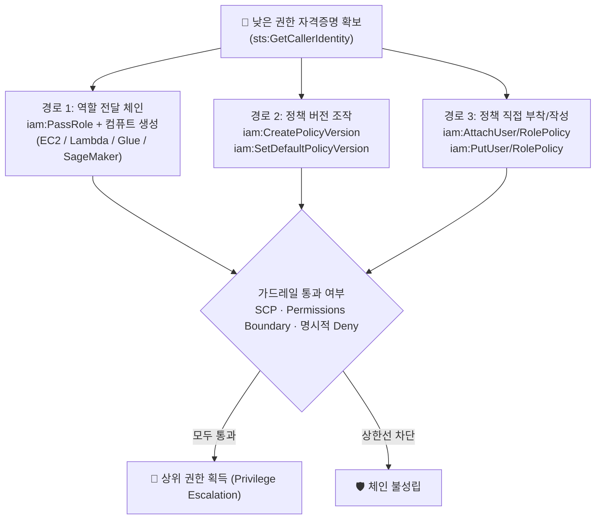
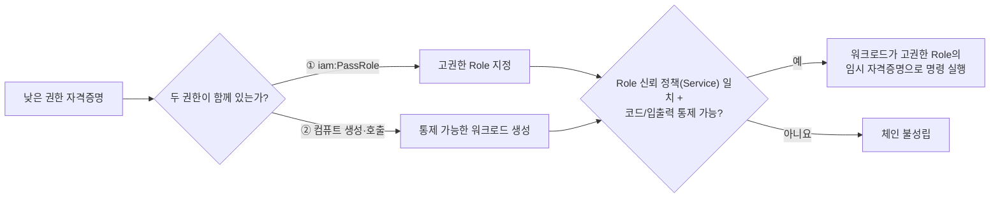

> [!summary] ⏱️ 5초 핵심 요약
> - **한 줄 비유**: 말단 직원이 마스터키를 직접 쥐진 못해도, **마스터키를 쥔 채 내 명령대로 움직이는 로봇(EC2·Lambda)을 만들거나 출입 규정 문서(Policy Version)를 고쳐 쓰면** 결국 관리자 권한을 얻게 됩니다.
> - **핵심 원리**: AWS IAM 권한 상승은 단일 권한 하나가 아니라 **`낮은 권한 주체` + `권한 전달/정책 수정 동사` + `통제 가능한 실행 환경`**이 한 줄로 연결될 때 성립합니다.
> - **3대 공격 체인**: ① `iam:PassRole` + 컴퓨트 생성(EC2/Lambda 등), ② 고객 관리형 정책 버전 조작(`CreatePolicyVersion`/`SetDefaultPolicyVersion`), ③ 정책 연결·인라인 정책 삽입(`Attach*Policy`/`Put*Policy`).
> - **핵심 방어**: `iam:PassRole`에 **대상 Role ARN 지정 + `iam:PassedToService` 조건**을 강제하고, IAM 변경 동사는 일반 개발·서비스 역할에서 완전히 분리합니다.

[[웹 취약점 진단 인프라편 — CI-CD와 클라우드 설정 노출]]이 외부에 노출된 설정과 시크릿을 **찾는 입문·정찰 단계**를 다뤘다면, 이번 글은 그렇게 확보한 낮은 권한의 AWS 자격증명에서 출발해 더 높은 역할로 이동할 수 있는지를 검증하는 **사후 익스플로잇(Post-Exploitation) 체인**을 다룹니다. 액세스 키가 유효하다는 사실만으로 권한 상승이 성립하는 것은 아니며, 정책 평가 조건과 실제 통제 가능한 리소스가 맞물릴 때만 체인이 완성됩니다.



---

## 한눈에 보는 AWS IAM 권한상승 3대 패턴

| 패턴 분류 | 핵심 IAM Action 조합 | 성립 필수 전제조건 | CloudTrail 핵심 탐지 이벤트 |
|---|---|---|---|
| **1. 역할 전달 + 워크로드 실행** | `iam:PassRole` + `ec2:RunInstances` / `lambda:CreateFunction` 등 | 대상 Role의 신뢰 정책(`Principal.Service`) 일치 + 생성된 워크로드의 코드/명령 통제 가능 | `RunInstances`, `CreateFunction` 등의 `requestParameters` 내 Role ARN |
| **2. 관리형 정책 버전 변조/롤백** | `iam:CreatePolicyVersion` 또는 `iam:SetDefaultPolicyVersion` | 대상이 **고객 관리형 정책**이고 현재 주체(또는 Assume 가능한 Role)에 연결되어 있음 | `CreatePolicyVersion` (`setAsDefault: true`), `SetDefaultPolicyVersion` |
| **3. 정책 연결 및 인라인 삽입** | `iam:AttachUserPolicy`, `iam:AttachRolePolicy`, `iam:Put*Policy` | 자기 자신 또는 자신이 맡을 수 있는(`sts:AssumeRole`) 역할/그룹이 대상 범위 안에 포함됨 | `AttachUserPolicy`, `AttachRolePolicy`, `PutUserPolicy`, `PutRolePolicy` |

---

## 1. IAM 정책·역할·신뢰 관계와 `iam:PassRole`

**💡 한 줄 비유**: **IAM 정책(Policy)**은 건물 출입 규정, **역할(Role)**은 규정이 묶인 특수 업무용 조끼, **신뢰 정책(Trust Policy)**은 대여 명부이며, **`iam:PassRole`**은 내가 못 입는 고권한 조끼를 **내가 조종하는 대리인(EC2·Lambda)에게 입혀 내보내는 권한**입니다.

### 핵심 원리
AWS의 권한 평가는 현재 주체의 자격 기반 정책(Identity-based Policy) 하나만 보지 않고 **리소스 기반 정책, 권한 경계(Permissions Boundary), 세션 정책, AWS Organizations SCP(서비스 제어 정책), 명시적 거부(`Explicit Deny`)**를 모두 교차 계산합니다. 따라서 정책 문서 한 곳에 `Allow`가 보인다고 바로 권한 상승으로 단정할 수 없습니다.

### `iam:PassRole` 체인이 성립하기 위한 4가지 필수 조건
1. **전달 권한**: 공격자가 보유한 주체에 고권한 Role ARN에 대한 `iam:PassRole`이 허용되어 있을 것
2. **서비스 신뢰**: 그 고권한 Role의 신뢰 정책(`AssumeRolePolicyDocument`)에 대상 AWS 서비스(예: `lambda.amazonaws.com`, `ec2.amazonaws.com`)가 명시되어 있을 것
3. **리소스 생성·수정 권한**: 해당 AWS 서비스의 워크로드를 생성하거나 수정할 권한이 있을 것
4. **실행 통제권**: 생성된 워크로드 안에 원하는 코드·명령을 넣거나 발급된 임시 자격증명을 밖으로 꺼내올(또는 실행 결과를 관찰할) 경로가 있을 것

*(참고: `iam:PassRole`은 **동일 AWS 계정 내부**의 서비스에 역할을 넘기는 권한입니다. 타 계정 이동은 교차 계정 신뢰 정책과 `sts:AssumeRole`로 평가하는 별개의 영역입니다.)*

### 취약한 정책 vs 안전한 방어 정책 비교
```json
// ❌ 취약한 설정: 모든 역할을 아무 서비스에나 전달 가능
{
  "Effect": "Allow",
  "Action": "iam:PassRole",
  "Resource": "*"
}

// ✅ 안전한 설정: 특정 Role만, 지정된 서비스(Lambda)에만 전달 가능하도록 제한
{
  "Effect": "Allow",
  "Action": "iam:PassRole",
  "Resource": "arn:aws:iam::123456789012:role/AppLambdaExecutionRole",
  "Condition": {
    "StringEquals": {
      "iam:PassedToService": "lambda.amazonaws.com"
    }
  }
}
```

### 체크 포인트
- 현재 주체의 `iam:PassRole` `Resource` 범위가 와일드카드(`*`)이거나 상위 권한 Role ARN을 포함하는가?
- `Condition` 블록에 `iam:PassedToService`가 지정되어 의도치 않은 컴퓨트 서비스로의 전달을 막고 있는가?
- 권한 경계(Permissions Boundary)·세션 정책·SCP·명시적 `Deny`가 최종 실행 권한을 가로막지 않는가?
- 참고: [AWS IAM — Grant a user permissions to pass a role to an AWS service](https://docs.aws.amazon.com/IAM/latest/UserGuide/id_roles_use_passrole.html), [AWS IAM — Policy evaluation logic](https://docs.aws.amazon.com/IAM/latest/UserGuide/reference_policies_evaluation-logic.html)

---

## 2. `iam:PassRole`과 컴퓨트 생성 권한의 결합

**💡 한 줄 비유**: 마스터키(`Role`)를 건네줄 권한(`PassRole`)만 있어도 손발이 없으면 소용없지만, **내 명령서(코드·스크립트)를 실행할 새 로봇(`Lambda`·`EC2`)을 조립할 권한**이 함께 있으면 마스터키의 힘을 그대로 쓸 수 있습니다.



### 핵심 원리
`iam:PassRole` 단독으로는 아무 API도 호출하지 못하지만, 진단자가 실행 내용을 통제할 수 있는 컴퓨트 서비스 생성·수정 동사와 결합되면 Role의 권한이 실행 환경 안으로 주입됩니다.

### 주요 결합 서비스별 성립 조건

| 결합 대상 서비스 | 필요한 주요 Action 조합 | 실행 통제 및 검증 포인트 |
|---|---|---|
| **AWS Lambda** | `iam:PassRole` + `lambda:CreateFunction` + `lambda:InvokeFunction` (또는 트리거 연결) | 함수 코드 안에 고권한 API 호출 로직을 넣어 직접 실행. 만약 기존 함수에 고권한 Role이 이미 붙어 있다면 `PassRole` 없이 `lambda:UpdateFunctionCode`만으로도 성립 |
| **Amazon EC2** | `iam:PassRole` + `ec2:RunInstances` | 고권한 Role이 담긴 **Instance Profile**을 지정하고, `UserData` 시작 스크립트나 SSH 키·SSM 접속 경로를 통제해 인스턴스 내부 IMDS에서 임시 자격증명 획득 |
| **AWS Glue** | `iam:PassRole` + `glue:CreateDevEndpoint` (또는 Job 생성·수정) | 개발 엔드포인트에 SSH 공개키를 등록해 접속하거나 스크립트를 실행해 연결된 Role 권한 행사 |
| **Amazon SageMaker** | `iam:PassRole` + `sagemaker:CreateNotebookInstance` + `CreatePresignedNotebookInstanceUrl` | 고권한 실행 Role로 노트북 인스턴스를 띄운 뒤 Jupyter 터미널에서 해당 Role 권한으로 AWS CLI 실행 |

### 체크 포인트
- `iam:PassRole`이 허용하는 대상 Role ARN과 컴퓨트 생성 권한의 리소스·조건 범위를 교차 비교했는가?
- 워크로드 생성 이후 **코드 삽입·호출·원격 접속·로그 열람** 중 실제로 허용되는 통제 경로가 존재하는가?
- 전달하려는 Role이 현재 주체보다 실제로 더 높은 권한을 가지고 있으며, 해당 서비스 보안 주체(`*.amazonaws.com`)를 신뢰하는가?
- 참고: [AWS IAM — PassRole 사용과 제한](https://docs.aws.amazon.com/IAM/latest/UserGuide/id_roles_use_passrole.html), [AWS Lambda — Execution role](https://docs.aws.amazon.com/lambda/latest/dg/lambda-intro-execution-role.html), [AWS SageMaker AI — API permissions reference](https://docs.aws.amazon.com/sagemaker/latest/dg/api-permissions-reference.html)

---

## 3. 관리형 정책 버전 조작 (`Policy Version`)

**💡 한 줄 비유**: 내 출입증 자체는 못 바꿔도, **출입증이 참조하는 사내 규정집의 '개정판(새 버전)'을 직접 발간해 기본 규정으로 지정**하거나, **예전에 넓게 허용됐던 구판 규정(과거 버전)을 다시 현행으로 되돌리는** 방법입니다.

### 핵심 원리
AWS **고객 관리형 정책(Customer Managed Policy)**은 문서를 수정할 때 덮어쓰지 않고 최대 5개까지 버전(`v1`~`v5`)을 관리하며, 그중 하나를 기본 버전(`IsDefaultVersion: true`)으로 지정해 적용합니다.

### 두 가지 공격 경로
1. **신규 고권한 버전 생성 (`iam:CreatePolicyVersion`)**: API 호출 시 `--set-as-default` 옵션을 주면 새 버전을 만듦과 동시에 즉시 기본 버전으로 활성화할 수 있습니다. 따라서 **`iam:SetDefaultPolicyVersion` 권한이 없어도 `iam:CreatePolicyVersion` 단독으로 권한 상승이 성립**합니다. (단, 이미 버전 5개가 꽉 차 있다면 비기본 버전을 지울 `iam:DeletePolicyVersion` 권한이 추가로 필요합니다.)
2. **과거 고권한 버전 롤백 (`iam:SetDefaultPolicyVersion`)**: 운영자가 보안을 강화하느라 `v2`에서 권한을 축소했지만, 과거에 넓은 권한(`*`)을 허용했던 `v1`을 삭제하지 않고 남겨 두었다면 `SetDefaultPolicyVersion` 하나만으로 즉시 과거 권한을 복구할 수 있습니다.

### 진단 시 확인 명령어 (Read-Only 점검)
```bash
# 1. 검토 대상 고객 관리형 정책의 전체 버전 목록 확인 (최대 5개)
aws iam list-policy-versions --policy-arn arn:aws:iam::123456789012:policy/CustomDevPolicy

# 2. 비기본 과거 버전(예: v1)에 과도한 권한이 남아 있는지 문서 내용 확인
aws iam get-policy-version \
  --policy-arn arn:aws:iam::123456789012:policy/CustomDevPolicy \
  --version-id v1

# 3. 이 정책이 현재 주체 또는 Assume 가능한 역할에 연결되어 있는지 확인
aws iam list-entities-for-policy --policy-arn arn:aws:iam::123456789012:policy/CustomDevPolicy
```

### 체크 포인트
- 대상 정책이 수정 불가능한 AWS 관리형 정책(`arn:aws:iam::aws:policy/...`)이 아니라 **고객 관리형 정책**인가?
- 해당 정책이 현재 주체(User/Role/Group) 또는 진단자가 맡을 수 있는 Role에 실제로 연결되어 있는가?
- 비기본 과거 버전(`v1` 등)에 현재보다 넓은 권한이 방치되어 있지 않은가?
- 참고: [AWS IAM — Versioning IAM policies](https://docs.aws.amazon.com/IAM/latest/UserGuide/access_policies_managed-versioning.html), [AWS IAM API — CreatePolicyVersion](https://docs.aws.amazon.com/IAM/latest/APIReference/API_CreatePolicyVersion.html)

---

## 4. 정책 연결·인라인 정책 변경 동사의 조합

**💡 한 줄 비유**: 규정집을 고치는 대신, **금고에 있는 '임원용 출입 규정 카드(`AdministratorAccess` 등)'를 내 명찰에 직접 걸거나(`Attach*Policy`)**, **내 명찰 뒷면에 '모든 출입 허용'이라고 포스트잇을 직접 적어 붙이는(`Put*Policy`)** 방식입니다.

### 핵심 원리
기존 관리형 정책을 주체에 연결하는 `iam:AttachUserPolicy`, `iam:AttachGroupPolicy`, `iam:AttachRolePolicy`와 인라인 정책을 직접 작성해 넣는 `iam:PutUserPolicy`, `iam:PutGroupPolicy`, `iam:PutRolePolicy`는 대상 주체와 허용 정책 범위가 제한되지 않으면 즉각적인 권한 상승 경로가 됩니다.

### 진단 시 자주 놓치는 함정과 확인 사항
- **"아무 Role에나 붙였다고 끝이 아니다"**: `iam:AttachRolePolicy`로 특정 Role에 관리자 정책을 붙일 수 있더라도, **현재 주체가 그 Role을 실제로 맡을 수(`sts:AssumeRole`) 있거나 그 Role로 돌아가는 컴퓨트 서비스를 통제할 수 있어야** 체인이 완성됩니다.
- **`AdministratorAccess`만 막는 블랙리스트의 한계**: SCP나 조건문으로 `AdministratorAccess` ARN만 차단하더라도, 계정 내 다른 고객 관리형 정책이나 `PowerUserAccess`, 또는 앞 절의 `PassRole + 컴퓨트 생성`을 가능하게 하는 부분 정책들을 여러 개 조합해 우회할 수 있습니다. 해법은 차단 목록이 아니라 **권한 경계(Permissions Boundary)와 최소 허용 목록**입니다.

### 체크 포인트
- `Attach*Policy` 및 `Put*Policy`의 `Resource`가 자기 자신이나 상위 Role을 포함하지 않도록 엄격히 분리되어 있는가?
- 위임된 관리자(Delegated Admin)에게 IAM 역할 생성을 허용할 때 반드시 **Permissions Boundary 부착을 강제(`iam:PermissionsBoundary` 조건)**하고 있는가?
- 정책을 부착할 수 있는 대상 Role을 현재 주체가 실제로 Assume하거나 워크로드로 실행할 수 있는가?
- 참고: [AWS IAM — Adding and removing IAM identity permissions](https://docs.aws.amazon.com/IAM/latest/UserGuide/access_policies_manage-attach-detach.html), [AWS IAM — Permissions boundaries for IAM entities](https://docs.aws.amazon.com/IAM/latest/UserGuide/access_policies_boundaries.html)

---

## 5. 체인 단위 진단 절차와 CloudTrail 탐지

**💡 한 줄 비유**: 범인은 '열쇠 전달(`PassRole`)'이라는 단독 발자국을 남기지 않습니다. **'어떤 로봇을 만들면서(`CreateFunction`/`RunInstances`) 그 안에 무슨 열쇠(Role ARN)를 넣었는지'** 작업 지시서를 봐야 잡을 수 있습니다.

### 실무 4단계 진단 워크플로
1. **시작 주체 고정**: `aws sts get-caller-identity`로 현재 IAM User 또는 Assumed Role ARN과 계정 ID를 확인합니다.
2. **유효 권한 및 상한선 매핑**: 주체에 연결된 관리형·인라인 정책, 그룹 정책, 모든 정책 버전, 그리고 상한선인 **Permissions Boundary**와 **SCP**를 함께 수집합니다.
3. **체인 연결성 검증**: 단일 위험 동사 유무가 아니라 `시작 주체 → 전달/변경할 Role·Policy → 실행 서비스 → 결과 획득 경로`가 끊기지 않고 이어지는지 교차 확인합니다. *(IAM Policy Simulator는 1차 필터링에 유용하지만 리소스 정책·SCP·런타임 네트워크 조건을 모두 대변하지 않으므로 최종 컨텍스트를 별도 점검해야 합니다.)*
4. **최소 방어 지점 도출**: 보고서에는 체인 전체 그림과 함께 **"어느 조건문 하나를 추가하면 이 사슬이 가장 안전하게 끊어지는가"**를 명시합니다.

### CloudTrail 탐지 시 핵심 주의사항
- **`PassRole`이라는 독립 이벤트는 없다**: `iam:PassRole`은 API 호출이 아니라 다른 API를 호출할 때 내부적으로 수행되는 권한 검사입니다. 따라서 CloudTrail에서 `eventName == "PassRole"`을 검색하면 아무것도 나오지 않습니다.
- **올바른 탐지 방법**: `RunInstances`, `CreateFunction`, `UpdateFunctionConfiguration`, `CreateDevEndpoint`, `CreateNotebookInstance` 이벤트의 **`requestParameters.role` 또는 `requestParameters.iamInstanceProfile`** 필드에 평소 쓰이지 않는 고권한 Role ARN이 들어갔는지 감시하고, `CreatePolicyVersion`·`SetDefaultPolicyVersion`·`Attach*Policy`·`Put*Policy` 이벤트를 실시간 경보로 묶어야 합니다.

### 체크 포인트
- 진단 보고서에 단순 권한 나열이 아니라 **시작 주체 → 대상 Role/Policy → 실행 서비스 → 영향**을 한 줄의 체인으로 입증했는가?
- CloudTrail 탐지 룰이 `PassRole` 문자열이 아닌 **컴퓨트 생성 이벤트의 Role 파라미터와 IAM 변경 이벤트**를 감시하고 있는가?
- 다음 단계로 컨테이너나 EC2 내부에서 자격증명이 어떻게 탈취되는지 보려면 [[클라우드 인프라 진단 — IMDS SSRF로 자격증명 탈취]] 및 [[클라우드 인프라 진단 — 컨테이너·Kubernetes 탈출]] 글을 이어서 참고하세요.
- 참고: [AWS IAM — PassRole actions in CloudTrail logs](https://docs.aws.amazon.com/IAM/latest/UserGuide/id_roles_use_passrole.html#id_roles_use_passrole_ct), [AWS CloudTrail — Logging IAM and AWS STS API calls](https://docs.aws.amazon.com/IAM/latest/UserGuide/cloudtrail-integration.html), [AWS IAM — Testing policies with the IAM policy simulator](https://docs.aws.amazon.com/IAM/latest/UserGuide/access_policies_testing-policies.html)
