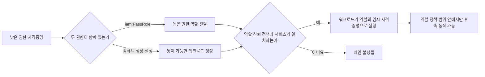

[[웹 취약점 진단 인프라편 — CI-CD와 클라우드 설정 노출]]이 외부에 드러난 설정과 시크릿을 **찾는 입문·정찰 단계**를 다뤘다면, 이번 글은 그렇게 확보한 낮은 권한의 AWS 자격증명에서 출발해 더 높은 역할로 이동할 수 있는지를 검증하는 **사후 익스플로잇 체인**에 초점을 맞춥니다. 액세스 키가 유효하다는 사실만으로 권한 상승이 성립하는 것은 아니며, IAM 변경 권한이나 역할 전달 권한과 실제로 통제할 수 있는 컴퓨트 서비스가 함께 허용될 때만 체인이 완성됩니다.

---

## 1. IAM 정책·역할·신뢰 관계와 `iam:PassRole`

쉽게 말하면, IAM 정책은 건물 안에서 "어느 문을 열고 무엇을 할 수 있는지"를 적은 출입 규정이고, 역할(Role)은 그 규정이 묶인 특정 업무용 열쇠입니다. 신뢰 관계(Trust Relationship)는 그 열쇠를 누가 빌릴 수 있는지를 정한 대여 명부이므로, 역할에 강한 권한이 붙어 있어도 현재 주체나 대상 서비스가 신뢰 명부에 없으면 그 역할을 사용할 수 없습니다.

`iam:PassRole`은 역할을 직접 착용하는 권한이라기보다 그 열쇠를 EC2나 Lambda 같은 AWS 서비스에 건네주는 권한에 가깝습니다. 열쇠를 받은 서비스가 공격자가 통제하는 코드나 인스턴스를 높은 권한으로 실행한다면, 낮은 권한 주체가 서비스라는 중간 단계를 거쳐 더 넓은 권한을 사용하게 됩니다.

**원리**: AWS의 권한 평가는 현재 주체의 자격 기반 정책만 보지 않고 리소스 정책, 권한 경계(Permissions Boundary), 세션 정책, 조직의 SCP와 명시적 거부를 함께 계산합니다. 따라서 정책 문서 한 곳에 `Allow`가 보인다는 이유만으로 체인이 성립한다고 결론 내릴 수 없고, 실제 호출 컨텍스트에서 최종 허용되는 동작과 리소스 범위를 확인해야 합니다.

`iam:PassRole` 체인은 최소한 ① 전달할 역할 ARN에 대한 `iam:PassRole`, ② 역할을 받을 서비스의 리소스 생성·수정 권한, ③ 그 역할의 신뢰 정책에 해당 서비스 보안 주체가 포함되어 있음, ④ 생성된 워크로드의 코드·명령·출력 또는 자격증명을 진단자가 통제하거나 관찰할 수 있음이라는 조건이 모두 맞을 때만 성립합니다. 또한 `PassRole`은 같은 AWS 계정 안의 서비스에 역할을 전달하는 권한이며, 교차 계정 이동은 별도의 역할 신뢰와 `sts:AssumeRole` 설계를 검토해야 하는 다른 문제입니다.

- 체크 포인트:
  - 현재 주체의 ARN과 세션 유형, `iam:PassRole`의 `Resource` 범위가 특정 역할로 제한되어 있는지
  - 역할 신뢰 정책의 서비스 보안 주체와 `iam:PassedToService` 조건이 실제 대상 서비스로 좁혀져 있는지
  - 권한 경계·세션 정책·SCP·명시적 `Deny`가 최종 권한을 제한하는지
- 참고: [AWS IAM — Grant a user permissions to pass a role to an AWS service](https://docs.aws.amazon.com/IAM/latest/UserGuide/id_roles_use_passrole.html), [AWS IAM — Policy evaluation logic](https://docs.aws.amazon.com/IAM/latest/UserGuide/reference_policies_evaluation-logic.html)

## 2. `iam:PassRole`과 컴퓨트 생성 권한의 결합

**원리**: `iam:PassRole`만으로는 API 호출 권한이나 셸이 생기지 않지만, 공격자가 설정을 통제할 수 있는 컴퓨트 서비스의 생성 동사와 결합되면 역할의 권한이 실행 환경 안으로 전달됩니다. 대표적으로 `ec2:RunInstances`, `lambda:CreateFunction`, `glue:CreateDevEndpoint`, `sagemaker:CreateNotebookInstance`가 있으며, 각 API에서 높은 권한의 실행 역할이나 인스턴스 프로파일을 지정할 수 있고 그 워크로드에 접근할 수 있을 때 권한 상승 후보가 됩니다.

EC2에서는 전달할 역할이 포함된 인스턴스 프로파일을 지정할 수 있어야 하고, 새 인스턴스의 사용자 데이터나 접속 경로까지 통제할 수 있어야 합니다. Lambda는 함수를 만드는 것에 더해 실행 코드와 호출 경로를 통제해야 하며, Glue 개발 엔드포인트와 SageMaker 노트북도 해당 기능이 계정과 리전에서 사용 가능하고 생성된 환경에 접근할 권한이 있어야 하므로, 단일 동사 이름만으로 실제 익스플로잇 가능성을 단정할 수 없습니다.



진단에서는 서비스별 생성 권한을 낱개로 나열하는 데서 멈추지 않고, 같은 역할 ARN을 전달할 수 있는지와 생성된 자원에 누가 코드를 넣고 실행 결과를 볼 수 있는지를 한 묶음으로 확인합니다. 반대로 전달 가능한 역할이 현재 주체보다 강하지 않거나 서비스가 그 역할을 신뢰하지 않거나 워크로드를 통제할 수 없다면, 위험한 이름의 권한이 있어도 이 권한 상승 체인은 완성되지 않습니다.

- 체크 포인트:
  - `iam:PassRole`의 역할 ARN과 EC2·Lambda·Glue·SageMaker 생성 권한의 리소스·조건 범위를 교차 비교
  - 생성 이후 코드 변경·호출·접속·로그 열람 중 어떤 통제 경로가 실제로 허용되는지 확인
  - 역할 신뢰 정책의 `Principal.Service`가 생성 대상 서비스와 일치하고 전달 역할이 현재 주체보다 강한지 비교
- 참고: [AWS IAM — PassRole 사용과 제한](https://docs.aws.amazon.com/IAM/latest/UserGuide/id_roles_use_passrole.html), [AWS SageMaker AI — API permissions reference](https://docs.aws.amazon.com/sagemaker/latest/dg/api-permissions-reference.html), [AWS Lambda — Execution role](https://docs.aws.amazon.com/lambda/latest/dg/lambda-intro-execution-role.html)

## 3. 관리형 정책 버전 조작

**원리**: AWS 고객 관리형 정책은 기존 문서를 제자리에서 덮어쓰는 대신 새 버전을 만들고, 그중 하나를 기본 버전으로 지정해 연결된 사용자·그룹·역할에 적용합니다. 낮은 권한 주체가 자신에게 연결된 정책에 `iam:CreatePolicyVersion`을 행사할 수 있으면 더 넓은 허용 문서를 새 버전으로 만들면서 기본값으로 지정할 수 있고, `iam:SetDefaultPolicyVersion`이 있으면 이미 존재하는 더 강한 버전을 다시 기본값으로 돌릴 수 있습니다.

두 권한이 반드시 한 쌍이어야 하는 것은 아닙니다. `CreatePolicyVersion` 호출에는 새 버전을 즉시 기본값으로 정하는 선택지가 있으므로 이것만으로 위험할 수 있고, `SetDefaultPolicyVersion`은 과거 버전 중 이미 강한 문서가 남아 있을 때 단독으로도 영향이 있습니다. 다만 대상이 AWS 관리형 정책이 아니라 수정 가능한 고객 관리형 정책이어야 하고, 그 정책이 현재 주체나 진단자가 통제하는 역할에 실제로 연결되어 있어야 하며, 권한 경계나 SCP의 상한을 넘어설 수는 없습니다.

고객 관리형 정책은 최대 다섯 개 버전만 유지할 수 있으므로 이미 한도에 도달했다면 비기본 버전을 지울 권한까지 있어야 새 버전 생성 경로가 이어집니다. 이 경우에도 과거 고권한 버전을 기본값으로 바꾸는 경로와 새 버전을 만드는 경로는 별도로 평가해야 합니다.

진단은 현재 기본 버전만 읽고 끝내지 않고 모든 버전의 생성 시각과 문서, 연결 대상을 함께 확인해야 합니다. 운영자가 권한을 줄이며 기본 버전만 교체했더라도 과거의 넓은 버전이 삭제되지 않았다면 `SetDefaultPolicyVersion`이 롤백 기능을 권한 상승 경로로 바꿀 수 있기 때문입니다.

```text
aws iam list-policy-versions --policy-arn <검토할-정책-ARN>
aws iam list-entities-for-policy --policy-arn <검토할-정책-ARN>
```

- 체크 포인트:
  - `iam:CreatePolicyVersion`, `iam:SetDefaultPolicyVersion`, 필요 시 `iam:DeletePolicyVersion`의 대상 정책 ARN 범위
  - 비기본 과거 버전에 현재보다 넓은 권한이 남아 있는지와 해당 정책이 연결된 모든 주체
  - 권한 경계와 SCP가 정책 버전을 넓혀도 최종 허용 범위를 제한하는지
- 참고: [AWS IAM — Versioning IAM policies](https://docs.aws.amazon.com/IAM/latest/UserGuide/access_policies_managed-versioning.html), [AWS IAM API — CreatePolicyVersion](https://docs.aws.amazon.com/IAM/latest/APIReference/API_CreatePolicyVersion.html)

## 4. 정책 연결·인라인 정책 변경 동사의 조합

**원리**: `iam:AttachUserPolicy`와 `iam:AttachRolePolicy`는 이미 존재하는 관리형 정책을 사용자나 역할에 연결하는 동사입니다. 현재 주체가 자기 사용자에게 강한 정책을 붙일 수 있거나, 자신이 맡을 수 있는 역할에 강한 정책을 붙일 수 있다면 정책 문서를 새로 만들지 않고도 권한이 넓어지므로, 연결 대상과 정책 ARN 양쪽의 제한을 함께 봐야 합니다.

비슷한 위험은 `iam:PutUserPolicy`, `iam:PutRolePolicy`, `iam:PutGroupPolicy`처럼 인라인 정책을 직접 쓰는 권한과, 사용자가 속한 그룹에 정책을 연결하는 `iam:AttachGroupPolicy`에서도 나타납니다. 그러나 강한 정책을 아무 역할에나 붙였다는 사실만으로 현재 주체가 그 권한을 얻는 것은 아니며, 그 역할을 실제로 맡을 수 있는 신뢰 관계와 `sts:AssumeRole`, 또는 해당 역할로 실행되는 통제 가능한 서비스가 별도로 있어야 합니다.

AWS 관리형 `AdministratorAccess` 같은 넓은 정책 이름만 차단하는 방식도 충분하지 않습니다. 공격자가 연결할 수 있는 고객 관리형 정책 가운데 와일드카드 권한이나 IAM 변경 권한이 든 정책이 있을 수 있고, 여러 개의 제한된 정책이 합쳐져 앞 절의 `PassRole + 컴퓨트 생성` 조합을 만들 수도 있기 때문입니다.

- 체크 포인트:
  - 정책 연결 동사의 대상 사용자·그룹·역할과 연결 가능한 관리형 정책 ARN이 각각 최소 범위인지
  - 인라인 정책 작성 권한과 `CreatePolicy` 권한이 우회 경로를 만들지 않는지
  - 정책을 붙인 역할을 현재 주체가 직접 Assume하거나 통제 가능한 서비스에 전달할 수 있는지
- 참고: [AWS IAM — Adding and removing IAM identity permissions](https://docs.aws.amazon.com/IAM/latest/UserGuide/access_policies_manage-attach-detach.html), [AWS IAM — Permissions boundaries for IAM entities](https://docs.aws.amazon.com/IAM/latest/UserGuide/access_policies_boundaries.html)

## 5. 체인 단위 진단과 탐지

**원리**: IAM 권한 상승은 단일 `Action`보다 여러 허용이 만나는 경로에서 발생하므로, 진단 결과도 "위험 권한 있음"이 아니라 **시작 주체 → 변경하거나 전달할 역할·정책 → 실행 서비스 → 관찰 가능한 결과**의 연결로 기록해야 합니다. 이 방식이어야 실제로 성립하지 않는 후보를 걸러내고, 한 동사만 제거해도 끊을 수 있는 최소 방어 지점을 찾을 수 있습니다.

조회 단계에서는 먼저 `aws sts get-caller-identity`로 현재 주체를 고정하고, 연결 정책·정책 버전·역할 신뢰 정책을 읽은 뒤 서비스별 생성·수정 권한과 교차합니다. IAM Policy Simulator는 후보를 좁히는 데 유용하지만 리소스 정책, SCP, 서비스별 후속 조건을 모두 대신하지는 않으므로, 승인된 테스트 계정에서 최종 컨텍스트를 별도로 검증해야 합니다.

탐지할 때 `iam:PassRole` 자체는 독립 API 호출이 아니라 권한 검사이므로 그 이름의 CloudTrail 이벤트가 남는다고 가정하면 안 됩니다. 대신 `RunInstances`, `CreateFunction`, `CreateDevEndpoint`, `CreateNotebookInstance`처럼 역할을 받은 리소스를 생성·수정한 이벤트의 요청 매개변수에서 역할 ARN을 확인하고, `CreatePolicyVersion`, `SetDefaultPolicyVersion`, `AttachUserPolicy`, `AttachRolePolicy` 같은 IAM 변경 이벤트를 평소 변경 창과 대조해야 합니다.

- 체크 포인트:
  - 후보 체인을 시작 주체·대상 역할·서비스 동사·워크로드 통제 경로까지 한 줄로 연결해 증거화
  - CloudTrail에서 컴퓨트 생성 이벤트의 전달 역할 ARN과 IAM 정책 변경 이벤트를 함께 상관 분석
  - `iam:PassRole`을 역할 ARN과 `iam:PassedToService` 조건으로 제한하고, IAM 변경 권한은 별도 관리 역할에 격리
- 참고: [AWS IAM — PassRole actions in CloudTrail logs](https://docs.aws.amazon.com/IAM/latest/UserGuide/id_roles_use_passrole.html#id_roles_use_passrole_ct), [AWS CloudTrail — Logging IAM and AWS STS API calls](https://docs.aws.amazon.com/IAM/latest/UserGuide/cloudtrail-integration.html), [AWS IAM — Testing policies with the IAM policy simulator](https://docs.aws.amazon.com/IAM/latest/UserGuide/access_policies_testing-policies.html)
