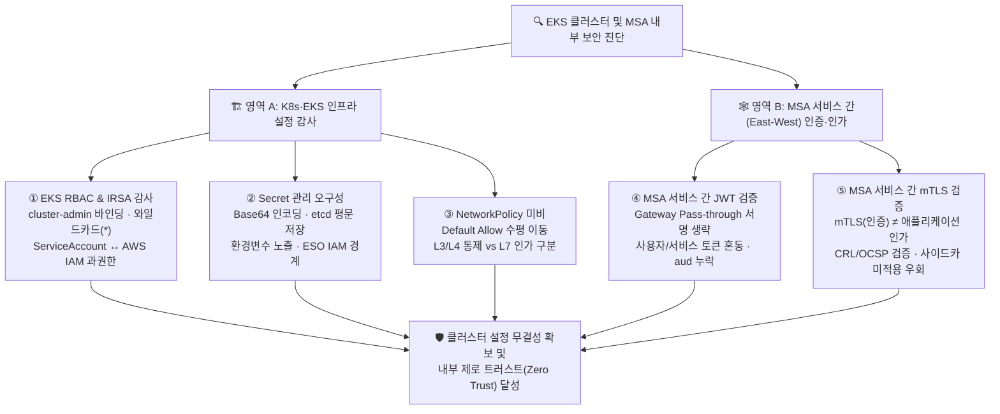
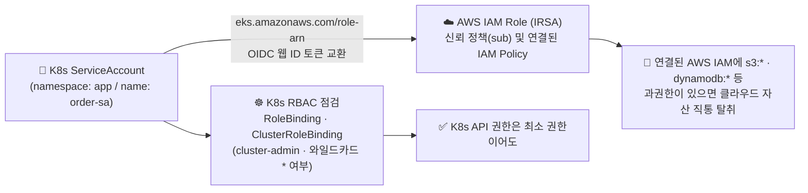
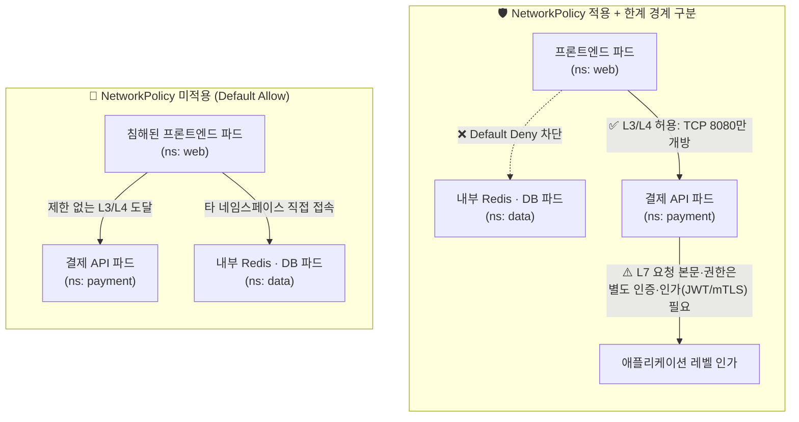
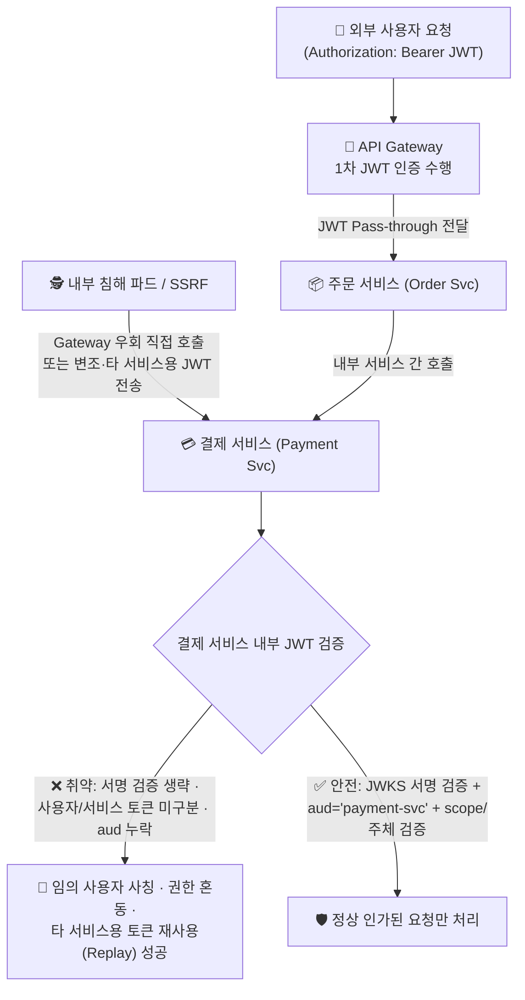
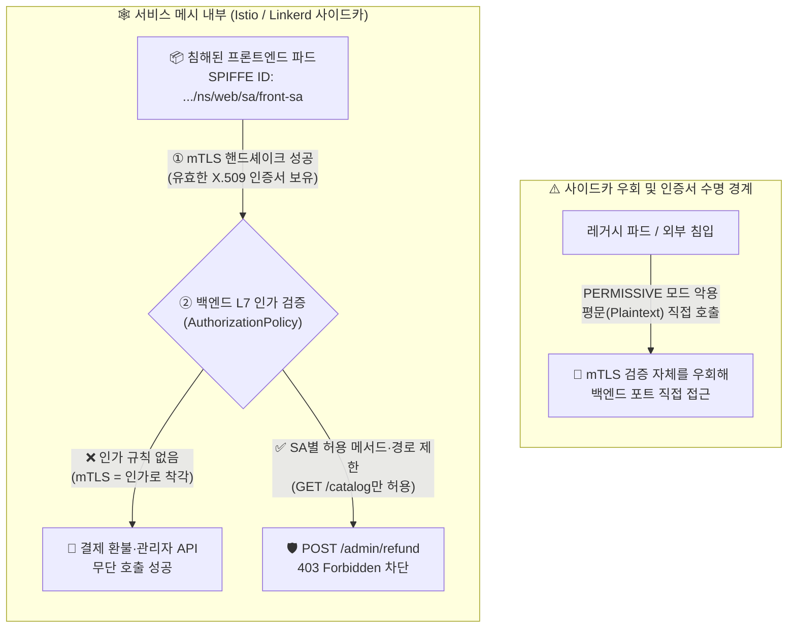

> [!summary] ⏱️ 5초 핵심 요약
> - **한 줄 비유**: 아파트 단지(클러스터)를 지어놓고 **모든 세대에 마스터키(`cluster-admin`/IRSA 과권한)**를 나눠주거나, **금고 비밀번호를 투명 포스트잇(Base64 `Secret`·환경변수)**에 붙여두고, **세대 간 내벽 출입문을 아예 달지 않은 채(`NetworkPolicy` 부재)** 정문 경비원만 믿고 내부 방문객 신분증 검사(내부 **JWT 서명·`aud` 검증** 및 **mTLS 위 애플리케이션 인가**)를 생략하는 격입니다.
> - **핵심 원리**: 클러스터 내부 보안 진단은 **① K8s RBAC 및 EKS IRSA(AWS IAM) 권한 매트릭스 감사, ② Secret 저장(`etcd` KMS)·주입(환경변수 vs 볼륨)·외부 연동 경계 점검, ③ `NetworkPolicy` 커버리지 확인(L3/L4 격리), ④ MSA 내부 동-서(East-West) 트래픽의 JWT 클레임 검증 및 mTLS(신원 인증)와 L7 인가의 분리 검증**으로 완성됩니다.
> - **핵심 방어**: **RBAC 와일드카드 제거 및 IRSA 최소 권한 분리 + `etcd` 저장 암호화와 CSI 볼륨 마운트 + 네임스페이스 기본 `Default Deny` 네트워크 정책 + 내부 마이크로서비스별 자체 JWT 검증(`aud` 포함) 및 서비스 메시 `AuthorizationPolicy`(L7 인가)**를 다계층으로 강제합니다.

[[클라우드 인프라 진단 — 컨테이너·Kubernetes 탈출]]이 이미 침해된 낮은 권한의 파드에서 출발해 호스트 노드나 클러스터 관리자 권한으로 점프하는 **사후 익스플로잇 체인의 공격 연결고리**로 위험한 RBAC 동사 조합을 다뤘다면, 이번 글은 관점을 완전히 달리합니다. 첫째, [[클라우드 인프라 진단 — IaC 보안 스캐닝(Terraform·K8s manifest)]]의 설정 진단 결을 이어받아 배포 전과 운영 중인 클러스터에서 **RBAC(EKS IRSA 포함)·Secret·NetworkPolicy 구성 자체를 체계적으로 전수 감사(Audit)하는 방법론**에 집중합니다. 둘째, 기존 인프라 진단 글들이 전혀 다루지 않았던 완전히 새로운 영역인 **MSA(마이크로서비스 아키텍처) 내부 서비스 간(East-West) 인증과 인가 — JWT 전달 검증 및 서비스 메시 mTLS 인증서·권한 검증**을 본격적으로 해부합니다.



---

## 한눈에 보는 EKS 설정 감사 및 MSA 내부 인증 5대 진단 영역

| 진단 영역 | 흔한 오구성 및 취약한 가정 | 성립 시 실제 보안 영향 | 핵심 감사 및 방어 통제 |
|---|---|---|---|
| **1. EKS RBAC · IRSA** | `cluster-admin` 남발, 규칙 내 `*` 사용, K8s RBAC만 줄이고 IRSA에 연결된 AWS IAM Role에 과권한 부여 | 클러스터 API 장악 또는 K8s RBAC가 최소 권한이어도 파드에서 AWS S3·RDS·IAM 등 클라우드 리소스 직접 탈취 | `rbac-lookup`·`kubeaudit` 매트릭스 감사, IRSA IAM Role 최소 권한 및 Trust Policy(네임스페이스·SA) 엄격 고정 |
| **2. Secret 관리** | `Secret`을 암호화로 오해(기본은 Base64 인코딩), `etcd` 암호화 미적용, 환경변수 주입, 외부 연동 Role 공유 | `etcd` 스냅샷·`describe pod`·크래시 덤프를 통한 평문 유출, 타 네임스페이스 시크릿 교차 조회 | EKS KMS Envelope Encryption 활성화, 볼륨/CSI 마운트 전환, ESO `SecretStore`를 네임스페이스별 IAM Role로 분리 |
| **3. NetworkPolicy** | 정책 미설정(`Default Allow` 방치), 또는 반대로 L3/L4 `NetworkPolicy`만으로 애플리케이션 보안이 끝났다고 오해 | 단일 파드 침해 시 클러스터 전체 내부망 스캔 및 타 네임스페이스 DB·내부 API로 수평 이동(Lateral Movement) | 네임스페이스별 `Default Deny` baseline 적용, L3/L4 포트 통제 위에 L7 인증·인가를 별도 계층으로 결합 |
| **4. MSA 인증 — JWT** | API Gateway만 믿고 내부 서비스가 JWT 서명 검증 생략, 사용자 JWT와 서비스 JWT 혼용, `aud` 클레임 미검증 | 내부망 진입 시 위조 JWT로 임의 사용자 사칭, 서비스 A용으로 발급된 토큰을 서비스 B에 재사용(Replay)해 권한 획득 | 내부 서비스마다 JWKS 기반 서명 직접 검증, 토큰 용도(`typ`/클레임) 분리, 수신 서비스 고유 `aud` 강제 검증 |
| **5. MSA 인증 — mTLS** | 서비스 메시(Istio/Linkerd) `mTLS` 적용을 곧 '애플리케이션 인가 완료'로 착각, 폐기 검증 누락, 레거시 평문 허용 | 유효한 인증서를 가진 침해된 프론트엔드 파드가 백엔드 결제 API의 관리자 엔드포인트를 합법적 mTLS 채널로 호출 | `PeerAuthentication: STRICT` 강제, mTLS(누가 보냈는가) 위에 `AuthorizationPolicy`(무엇을 할 수 있는가) 명시, OCSP/단기 인증서 적용 |

---

## 1. EKS/K8s RBAC 체계적 감사

**💡 한 줄 비유**: 사내 출입증을 감사할 때 **"건물 마스터키(`cluster-admin`)가 누구에게 풀려 있는지"**와 **"만능 프리패스 문구(`*`)가 적힌 출입증이 있는지"**를 전수 조사하고, 특히 EKS에서는 **"사내 출입증 뒤에 붙은 AWS 법인카드(IRSA IAM Role)의 결제 한도"**까지 함께 대조하는 작업입니다.



### 핵심 원리
- **`cluster-admin` 바인딩 및 와일드카드(`*`) 전수 감사**:
  - 사후 공격자 관점이 아니라 **클러스터 감사자(Auditor) 관점**에서는 개별 파드를 하나씩 뒤지는 대신, 클러스터 전체의 `ClusterRoleBinding`과 `RoleBinding`을 덤프해 `cluster-admin`이 시스템 컴포넌트(`kube-system`)가 아닌 일반 워크로드 `ServiceAccount`나 `default` 서비스 계정에 묶여 있는지 가장 먼저 찾아내야 합니다.
  - 또한 커스텀 `Role`·`ClusterRole` 정의에서 `resources: ["*"]`, `verbs: ["*"]`, `apiGroups: ["*"]` 같은 와일드카드 선언을 정적·동적으로 추출해야 합니다. 와일드카드는 현재 존재하는 리소스뿐 아니라 추후 설치될 CRD(예: External Secrets, ArgoCD, Istio 보안 정책 객체)에 대한 제어권까지 자동으로 부여하기 때문입니다.
- **권한 매트릭스(Permission Matrix) 도출**:
  - 특정 서비스 계정의 최종 유효 권한을 확인할 때는 `kubectl auth can-i --list --as=system:serviceaccount:<ns>:<sa>`를 사용하며, 클러스터 전체 주체(User·Group·ServiceAccount)와 역할의 매핑 현황을 한눈에 뽑아낼 때는 **`rbac-lookup`**, **`kubeaudit`**, **`rakkess`** 같은 감사 도구를 조합해 전체 권한 매트릭스를 생성합니다.
- **EKS 특화 사각지대 — IRSA(IAM Roles for Service Accounts) 과권한**:
  - EKS에서는 `ServiceAccount`의 어노테이션(`eks.amazonaws.com/role-arn`)과 클러스터 OIDC Provider를 통해 파드에 AWS IAM Role 자격증명을 주입합니다.
  - **핵심 감사 포인트**: 진단 현장에서 **Kubernetes RBAC 자체는 아무 권한도 없는 빈 껍데기(최소 권한)로 완벽하게 조여져 있지만, 정작 그 `ServiceAccount`에 매핑된 AWS IAM Role에 `AdministratorAccess`, `s3:*`, `secretsmanager:*` 같은 과도한 클라우드 권한이 붙어 있는 경우**가 매우 흔합니다. 이 경우 K8s API를 전혀 건드리지 않고도 파드 내부에서 곧바로 AWS 클라우드 리소스를 장악할 수 있습니다.
  - 더불어 IAM Role의 **신뢰 정책(Trust Policy)**에서 `Condition`의 `sub` 클레임이 `system:serviceaccount:<특정-네임스페이스>:<특정-SA>`로 정확히 고정되지 않고 `StringLike`와 `*`로 넓게 열려 있다면, 클러스터 내 다른 네임스페이스의 파드까지 해당 AWS Role을 가로채 사용할 수 있습니다.

### RBAC 및 EKS IRSA 매트릭스 감사 명령어 예시
```bash
# 1. cluster-admin이 바인딩된 모든 주체(ServiceAccount 등) 조회
kubectl get clusterrolebindings -o json | jq -r '
  .items[] | select(.roleRef.name=="cluster-admin") |
  {binding: .metadata.name, subjects: .subjects}'

# 2. 와일드카드(*) verbs 또는 resources를 포함한 ClusterRole 탐지
kubectl get clusterroles -o json | jq -r '
  .items[] | select(.rules[]? | (.verbs[]? == "*") or (.resources[]? == "*")) |
  .metadata.name' | sort -u

# 3. rbac-lookup / kubectl auth can-i로 특정 SA의 유효 권한 매트릭스 확인
rbac-lookup --kind serviceaccount --output wide
kubectl auth can-i --list --as=system:serviceaccount:prod:payment-sa -n prod

# 4. [EKS 특화] 클러스터 내 IRSA(AWS IAM Role)가 매핑된 모든 ServiceAccount 목록 추출
kubectl get sa -A -o json | jq -r '
  .items[] | select(.metadata.annotations["eks.amazonaws.com/role-arn"] != null) |
  "\(.metadata.namespace)/\(.metadata.name) -> \(.metadata.annotations["eks.amazonaws.com/role-arn"])"'
```

### 체크 포인트
- `ClusterRoleBinding`과 `RoleBinding`에서 `cluster-admin` 및 와일드카드(`resources: ["*"]`, `verbs: ["*"]`)가 부여된 일반 워크로드 `ServiceAccount`를 전수 식별했는가?
- `kubectl auth can-i --list`, `rbac-lookup`, `kubeaudit` 등을 활용해 네임스페이스별 서비스 계정의 실제 권한 매트릭스를 추출·검토했는가?
- **[EKS IRSA]** K8s RBAC와 별개로 각 `ServiceAccount`에 연결된 AWS IAM Role의 권한 정책(IAM Policy)과 신뢰 정책(`oidc:sub` 조건의 네임스페이스·SA 고정 여부)을 교차 감사했는가?
- 참고: [Kubernetes — RBAC Good Practices](https://kubernetes.io/docs/concepts/security/rbac-good-practices/), [AWS EKS — IAM Roles for Service Accounts (IRSA) 구성 및 보안](https://docs.aws.amazon.com/eks/latest/userguide/iam-roles-for-service-accounts.html)

---

## 2. Secret 관리 오구성

**💡 한 줄 비유**: 기밀 문서를 **누구나 읽을 수 있는 모스 부호(Base64 인코딩)로만 적어서 잠금장치 없는 캐비닛(`etcd` 평문)에 넣어두거나**, 직원 작업복 등판(**파드 환경변수**)에 큼지막하게 인쇄해 두어 건물 점검표(`describe pod`)나 사고 사진(**크래시 덤프**)에 그대로 찍혀 나가게 만드는 격입니다.

### 핵심 원리
- **Base64는 암호화가 아니라 인코딩이다**:
  - Kubernetes의 기본 `Secret` 객체는 `data` 필드에 값을 저장할 때 **기본적으로 암호화가 아니라 단순 Base64 인코딩**만 수행합니다. 물론 RBAC으로 `Secret` 리소스 접근 자체를 통제할 수는 있으므로 "전혀 보호되지 않는다"고 과장할 수는 없지만, 매니페스트 파일이나 API 응답, 저장소 블록에 접근할 수 있는 주체에게는 `base64 -d` 한 줄로 즉시 복원되는 평문과 같습니다.
- **`etcd` 저장 시 암호화(Encryption at Rest) 미적용 위험**:
  - 별도 설정이 없으면 Kubernetes 컨트롤 플레인의 상태 저장소인 `etcd`에는 `Secret` 데이터가 인코딩된 상태 그대로 디스크에 기록됩니다. 만약 `etcd` 볼륨 스냅샷이나 백업 파일이 유출되면 RBAC을 거치지 않고도 클러스터의 모든 `Secret`이 노출됩니다. 따라서 자체 구축 클러스터는 `EncryptionConfiguration`(`aescbc` 또는 KMS v2)을, AWS EKS는 **KMS 키 기반 봉투 암호화(Envelope Encryption)**를 반드시 활성화해야 합니다.
- **환경변수(`env` / `envFrom`) 주입의 유출 경로**:
  - `Secret`을 파드의 환경변수로 주입하면 애플리케이션 코드는 읽기 편하지만 여러 운영 경로로 값이 새어 나갑니다.
  - ① 매니페스트에 값을 직접 적었거나 런타임 설정을 조회할 때 `kubectl describe pod`·배포 로그에 노출될 수 있고, ② 애플리케이션 예외 발생 시 프레임워크의 **크래시 덤프(Crash Dump)·에러 리포트(Sentry 등)·디버그 페이지(`/actuator/env`, `phpinfo`)**가 프로세스 환경변수 전체(`os.environ`, `/proc/self/environ`)를 그대로 수집·전송하며, ③ 같은 컨테이너 안에서 실행되는 하위 자식 프로세스 전체에 시크릿이 상속됩니다.
  - 따라서 민감한 시크릿은 환경변수 대신 **읽기 전용 메모리 기반 볼륨(`secret` 볼륨 또는 `Secrets Store CSI Driver`)으로 파일 마운트**해 필요한 프로세스만 읽도록 제한해야 합니다.
- **외부 시크릿 관리 도구(AWS Secrets Manager / ESO) 통합 시 IAM 권한 경계**:
  - AWS Secrets Manager와 **External Secrets Operator(ESO)**를 연동할 때 흔히 범하는 실수는 **ESO 컨트롤러 파드 하나에 AWS 내 모든 시크릿(`secretsmanager:GetSecretValue` on `*`)을 읽을 수 있는 단일 IRSA 권한을 주고, 클러스터 규모의 `ClusterSecretStore`를 모든 네임스페이스에 공유**하는 것입니다. 이렇게 구성하면 개발(`dev`) 네임스페이스에서 `ExternalSecret` 리소스만 생성할 수 있는 사용자가 운영(`prod`) DB의 AWS Secret ARN을 지정해 자기 네임스페이스의 K8s `Secret`으로 끌어오는 **권한 경계 우회(Cross-Namespace Secret Theft)**가 발생합니다.

### 취약한 Secret 주입 vs 안전한 외부 시크릿 연동·볼륨 마운트 예시
```yaml
# ❌ 취약한 구성: 환경변수 주입 + 모든 네임스페이스가 공유하는 과권한 ClusterSecretStore 참조
apiVersion: v1
kind: Pod
metadata:
  name: bad-app
  namespace: dev
spec:
  containers:
    - name: app
      image: example/app:1.0
      env:
        - name: DB_PASSWORD
          valueFrom:
            secretKeyRef:
              name: prod-db-secret # 크래시 덤프·/proc/self/environ·디버그 로그로 유출 위험
              key: password
---
# ✅ 안전한 구성: 네임스페이스 전용 SecretStore(개별 IRSA 분리) + 파일 볼륨 마운트
apiVersion: external-secrets.io/v1beta1
kind: SecretStore
metadata:
  name: payment-ns-store
  namespace: payment # 네임스페이스 범위로 격리된 SecretStore
spec:
  provider:
    aws:
      service: SecretsManager
      region: ap-northeast-2
      auth:
        jwt:
          serviceAccountRef:
            name: payment-eso-sa # payment/* 경로의 AWS Secret만 읽도록 제한된 전용 IRSA
```

### 체크 포인트
- 클러스터의 `etcd` 저장 암호화(`EncryptionConfiguration` 또는 EKS KMS Envelope Encryption)가 실제로 활성화되어 있는가?
- 파드 명세에서 민감한 `Secret`이 환경변수(`env`/`envFrom`)가 아닌 **전용 볼륨 마운트(또는 Secrets Store CSI Driver)** 방식으로 전달되고 있는가?
- External Secrets Operator나 CSI Driver 사용 시, 네임스페이스별로 참조 가능한 AWS Secrets Manager 경로와 IRSA IAM Role이 엄격히 분리되어 있는가(타 네임스페이스 시크릿 ARN 조회 차단)?
- 참고: [Kubernetes — Good Practices for Kubernetes Secrets](https://kubernetes.io/docs/concepts/security/secrets-good-practices/), [Kubernetes — Encrypting Confidential Data at Rest](https://kubernetes.io/docs/tasks/administer-cluster/encrypt-data/), [AWS EKS — Using EKS Encryption Provider Support](https://docs.aws.amazon.com/eks/latest/userguide/enable-kms.html)

---

## 3. NetworkPolicy 미비로 인한 수평 이동(Lateral Movement)

**💡 한 줄 비유**: 한 건물에 입주한 수십 개 회사(네임스페이스) 사이에 **아무런 출입문도 달지 않아(`Default Allow`), 1층 카페에 들어온 외부인이 지하 금고실과 10층 임원실 문 앞까지 아무 제지 없이 걸어갈 수 있는 구조**입니다. 단, 층별 방화문(`NetworkPolicy`)을 달았다고 해서 **방문객이 들고 온 서류 내용의 위조 여부(L7 애플리케이션 인가)까지 방화문이 검사해 주는 것은 아닙니다.**



### 핵심 원리
- **Kubernetes의 기본 네트워크 모델(`Default Allow`)**:
  - Kubernetes 네트워크 설계의 기본 원칙은 **"별도의 정책이 없는 한, 클러스터 내 모든 파드는 노드에 상관없이 다른 모든 파드와 NAT 없이 직접 통신할 수 있다"**는 것입니다.
  - 따라서 `NetworkPolicy`를 정의하지 않거나, 정책 객체를 만들었더라도 클러스터 CNI 플러그인이 이를 시행하지 않으면(예: 기본 설정의 AWS VPC CNI에서 Network Policy 기능을 켜지 않았거나 Calico/Cilium이 없는 경우), 클러스터 전체가 사실상 **하나의 평평한(Flat) 내부 로컬 네트워크**처럼 동작합니다.
- **네임스페이스 침해 시 수평 이동(Lateral Movement) 구조**:
  - 네임스페이스(`Namespace`)는 리소스 이름과 RBAC 적용 범위를 나누는 **논리적 구분일 뿐 네트워크 방화벽이 아닙니다.**
  - 외부에 노출된 `dev`나 `web` 네임스페이스의 파드 하나가 웹 취약점(RCE/SSRF)으로 침해되었을 때 `NetworkPolicy`가 없으면, 공격자는 해당 파드를 거점 삼아 `payment`, `admin`, `monitoring` 네임스페이스의 내부 API, Redis 캐시, 관리 콘솔 포트를 자유롭게 스캔하고 직접 접속할 수 있습니다.
- **커버리지 감사 방법과 L3/L4 vs L7 통제 범위의 정확한 구분**:
  - 감사 시에는 `kubectl get networkpolicy -A`로 전체 네임스페이스 대비 정책 적용 비율을 확인하고, 특히 각 네임스페이스에 모든 트래픽을 일단 막는 **`Default Deny`(빈 `podSelector: {}`에 `Ingress`/`Egress` 지정)** 기준선 정책이 존재하는지 점검합니다.
  - **정확한 한계 인식 (`NetworkPolicy`만 걸면 안전한가?)**: `NetworkPolicy`는 **OSI L3/L4 계층(IP 대역, 파드/네임스페이스 라벨, 프로토콜, TCP/UDP 포트 번호)**에서만 트래픽을 허용하거나 차단합니다. 즉 "`web` 파드가 `payment` 파드의 `8080` 포트로 패킷을 보낼 수 있는가"는 통제하지만, **이미 허용된 `8080` 포트를 통해 들어오는 HTTP 요청 안의 사용자가 누구인지, 다른 고객의 주문을 취소할 권한이 있는지 같은 L7 애플리케이션 레벨 인가나 페이로드 공격은 전혀 막지 못합니다.** 따라서 `NetworkPolicy`는 내부 스캔과 비인가 경로를 줄이는 필수 방벽이지, 서비스 간 인증·인가(4·5장)의 대체재가 될 수 없습니다.

### 커버리지 감사 명령어 및 네임스페이스 Default Deny 기준선 예시
```bash
# 1. 전체 네임스페이스 목록과 NetworkPolicy가 실제로 존재하는 네임스페이스 비교 감사
kubectl get ns -o jsonpath='{range .items[*]}{.metadata.name}{"\n"}{end}'
kubectl get networkpolicy -A -o wide
```

```yaml
# 2. 네임스페이스 기본 차단(Default Deny All Ingress & Egress) 정책 예시
apiVersion: networking.k8s.io/v1
kind: NetworkPolicy
metadata:
  name: default-deny-all
  namespace: payment
spec:
  podSelector: {} # payment 네임스페이스의 모든 파드에 적용
  policyTypes:
    - Ingress
    - Egress
```

### 체크 포인트
- 클러스터의 CNI(AWS VPC CNI Network Policy 활성화, Calico, Cilium 등)가 실제로 `NetworkPolicy` 객체를 강제(Enforce)하고 있는가?
- `kubectl get networkpolicy -A` 감사 결과, 핵심 워크로드 네임스페이스에 **`Default Deny`(Ingress/Egress 기본 차단) + 필요한 파드 라벨·포트만 열어주는 화이트리스트 정책**이 빠짐없이 적용되어 있는가?
- `NetworkPolicy`가 통제하는 **L3/L4 네트워크 도달성**과 애플리케이션이 검증해야 할 **L7 인증·인가**를 혼동하지 않고 두 계층 모두 보완 통제를 갖추었는가?
- 참고: [Kubernetes — Network Policies](https://kubernetes.io/docs/concepts/services-networking/network-policies/), [AWS EKS — Amazon VPC CNI Network Policies](https://docs.aws.amazon.com/eks/latest/userguide/cni-network-policy.html)

---

## 4. MSA 서비스 간 인증 — JWT

**💡 한 줄 비유**: 공항 입국 심사대(API Gateway)를 한 번 통과했다고 해서, **공항 내부 제한구역(각 마이크로서비스)에 들어갈 때마다 여권 위조 여부(서명)나 탑승권의 목적지 게이트(`aud` 클레임), 일반 승객 표와 승무원 신분증 구분을 전혀 확인하지 않고 프리패스시키는 상황**입니다.



### 핵심 원리
- **Gateway Pass-through 구조에서 내부 서명 검증 생략의 위험성**:
  - 많은 MSA 환경에서 앞단 API Gateway가 외부 사용자의 JWT 서명을 1차 검증한 뒤, 내부 마이크로서비스로 요청을 넘길 때는 원본 JWT를 그대로 헤더에 실어 전달(Pass-through)하거나 디코딩된 페이로드(`X-User-Id` 등)만 넘깁니다. 이때 내부 백엔드 서비스 개발자가 **"어차피 앞단 게이트웨이가 검증했으니 내부에서는 `jwt.decode(token, verify=False)`로 클레임만 읽어도 안전하다"**고 가정하는 것이 치명적인 취약점이 됩니다.
  - 만약 공격자가 3장의 허술한 `NetworkPolicy`나 SSRF 취약점을 통해 클러스터 내부망에서 게이트웨이를 거치지 않고 결제·정산 서비스로 직접 HTTP 요청을 보내면, **서명이 없거나(`alg: none`) 임의의 키로 위조한 JWT(`{"sub": "admin", "role": "SUPERUSER"}`)가 아무 검증 없이 그대로 신뢰**됩니다.
- **사용자 JWT와 서비스 간(M2M) JWT 미구분으로 인한 권한 혼동**:
  - 최종 사용자의 맥락을 담은 **사용자 토큰(User Context JWT)**과 마이크로서비스 자체가 배치 작업·내부 동기화를 위해 발급받은 **서비스 계정 토큰(Client Credentials / Machine-to-Machine JWT)**을 동일한 검증 로직과 클레임 구조로 처리하면 권한 혼동(Privilege Confusion)이 발생합니다.
  - 예를 들어 내부 서비스가 사용자 ID(`sub`)만 보고 권한을 판정할 때, 일반 사용자가 자신의 프로필 이름이나 식별자를 내부 서비스 이름으로 설정하거나, 반대로 특정 사용자의 요청을 대리 처리하던 서비스가 자신의 높은 M2M 토큰 권한으로 사용자 요청을 대신 실행하는 **혼란스러운 대리인(Confused Deputy)** 문제가 생깁니다.
- **토큰 재사용(Replay / Cross-Service Relay) 방지를 위한 `aud`(Audience) 클레임 검증 누락**:
  - 서명(`iss`, JWKS)과 만료시간(`exp`)을 정상적으로 검증하더라도, **"이 토큰이 어느 서비스를 호출하기 위해 발급되었는가"를 나타내는 `aud`(Audience) 클레임을 확인하지 않으면** 서비스 간 토큰 재사용 공격이 성립합니다.
  - 공격자가 자신이 정당하게 발급받은 JWT를 '알림 서비스(Notification Svc)'에 보냈는데, 알림 서비스가 침해되어 있거나 악의적인 내부 컴포넌트라면 그 토큰을 그대로 복사해 '결제 서비스(Payment Svc)'나 '계정 관리 서비스(Account Svc)'에 제시할 수 있습니다. 결제 서비스가 `aud == "https://payment.internal"`인지 확인하지 않고 서명만 맞으면 통과시킬 경우, 알림 조회용으로 건넨 토큰이 결제 승인 요청에 그대로 재사용됩니다.

### 내부 마이크로서비스의 취약한 JWT 처리 vs 안전한 검증 예시 (Python)
```python
# ❌ 취약한 내부 서비스 구현: Gateway를 맹신해 서명 검증과 aud 검증을 모두 생략
def get_user_from_token_bad(token: str) -> dict:
    # verify_signature=False로 인해 내부망 도달 또는 SSRF 시 임의 위조 토큰 즉시 통과
    return jwt.decode(token, options={"verify_signature": False})

# ✅ 안전한 내부 서비스 구현: JWKS 서명 검증 + iss/aud/exp 강제 + 토큰 주체(typ/scope) 확인
def get_user_from_token_good(token: str, signing_key) -> dict:
    payload = jwt.decode(
        token,
        key=signing_key,
        algorithms=["RS256"], # 대칭키 혼동 방지 및 알고리즘 명시 고정
        issuer="https://auth.example.com",
        audience="payment-service", # 타 서비스용 토큰 재사용(Replay) 원천 차단
        options={"require": ["exp", "iss", "aud", "sub"]},
    )
    if payload.get("token_use") != "user_access":
        raise PermissionError("서비스(M2M) 토큰과 사용자 토큰은 혼용할 수 없습니다.")
    return payload
```

### 체크 포인트
- 내부 마이크로서비스가 앞단 API Gateway만 신뢰해 JWT 서명 검증(`verify_signature`)을 생략하거나 평문 커스텀 헤더(`X-User-Id`)를 무조건 신뢰하고 있지 않은가?
- 각 마이크로서비스가 자신에게 발급된 토큰만 수락하도록 **`aud`(Audience) 클레임과 `iss`(Issuer), 허용 알고리즘(`RS256`/`ES256`)**을 엄격히 검증하는가?
- 최종 사용자 컨텍스트 전달용 JWT( 또는 OAuth 2.0 Token Exchange `RFC 8693`의 `act` 클레임)와 서비스 간 백그라운드 호출용 M2M JWT가 명확히 분리되어 있는가?
- 참고: [RFC 7519 — JSON Web Token (JWT) `aud` Claim](https://datatracker.ietf.org/doc/html/rfc7519#section-4.1.3), [RFC 8725 — JSON Web Token Best Current Practices](https://datatracker.ietf.org/doc/html/rfc8725), [OWASP — Microservices Security Cheat Sheet](https://cheatsheetseries.owasp.org/cheatsheets/Microservices_Security_Cheat_Sheet.html)

---

## 5. MSA 서비스 간 인증 — mTLS

**💡 한 줄 비유**: 서비스 메시의 **mTLS는 택배 기사가 '진짜 우체국 소속 직원(신원 인증과 암호화)'인지만 확인해 주는 절차**입니다. 우체국 직원이 맞다고 해서 **그 직원이 회사 금고실의 현금 인출 버튼(`POST /admin/refund`)을 누를 권한(애플리케이션 인가)까지 자동으로 가지는 것은 전혀 아닙니다.**



### 핵심 원리
- **mTLS(상호 TLS)는 '신원 인증(Authentication)'이지 '권한 인가(Authorization)'가 아니다**:
  - Istio나 Linkerd 같은 서비스 메시를 도입하면 각 파드의 사이드카 프록시(Envoy 등)가 SPIFFE ID(`spiffe://cluster.local/ns/<namespace>/sa/<serviceaccount>`)가 담긴 X.509 인증서를 자동으로 발급·교환해 **mTLS**를 맺어줍니다.
  - **가장 흔하고 위험한 오해**: 운영팀이 "우리 클러스터는 서비스 메시로 전 구간 mTLS를 걸었으니 내부 서비스 간 보안이 끝났다"고 단정하는 것입니다. mTLS가 보장하는 것은 **① 전송 구간 암호화와 ② "지금 요청을 보낸 상대방 파드가 `front-sa` 서비스 계정이 맞다"는 신원 확인(Authentication)**뿐입니다.
  - 만약 그 위에서 **"그래서 `front-sa`가 `payment-sa`의 `POST /internal/v1/refund` API를 호출할 권한이 있는가?"를 따지는 L7 인가(Authorization) 정책**을 걸지 않으면, 공격자가 외부에 노출된 프론트엔드 파드 하나만 침해해도 사이드카가 자동으로 붙여주는 합법적인 mTLS 인증서를 타고 클러스터 내 모든 백엔드 마이크로서비스의 민감한 내부 API를 마음대로 호출할 수 있습니다.
- **인증서 유효기간 및 폐기(CRL·OCSP) 검증 생략**:
  - 자체 CA로 긴 유효기간(예: 1년)의 클라이언트 인증서를 발급해 쓰는 환경에서 **CRL(인증서 폐기 목록)이나 OCSP(온라인 인증서 상태 프로토콜) 확인을 생략**하면, 유출된 인증서를 폐기 등록하더라도 만료일까지 계속 내부 mTLS 인증을 통과합니다. 서비스 메시에서는 이를 보완하기 위해 인증서 수명(TTL)을 수 시간~24시간 이내로 매우 짧게 유지하고 자동 회전(Rotation)시키거나 폐기 리스트를 즉시 반영해야 합니다.
- **서비스 메시 바깥(사이드카 미적용·`PERMISSIVE` 모드)으로 우회되는 경로**:
  - 마이그레이션 편의를 위해 서비스 메시의 mTLS 모드를 **`PERMISSIVE`(mTLS와 일반 평문 HTTP 트래픽을 모두 허용)**로 방치하거나, 일부 레거시 네임스페이스·파드에 사이드카 인젝션(`istio-injection=enabled`)이 누락된 경우, 공격자는 사이드카가 없는 파드에서 평문으로 백엔드를 직접 호출해 mTLS 신원 확인 자체를 우회할 수 있습니다.
  - 또한 컨테이너에 `CAP_NET_ADMIN`/`CAP_NET_RAW` 권한이 남아 있거나 잘못된 `hostNetwork` 설정이 있으면 파드 내부의 `iptables` 리다이렉션 규칙을 조작해 사이드카 프록시를 거치지 않고 직접 외부·내부 통신을 시도할 수도 있습니다.

### Istio `STRICT` mTLS 강제 및 L7 `AuthorizationPolicy` 인가 분리 예시
```yaml
# 1. 신원 인증(Authentication) 강제: 평문(PERMISSIVE) 우회를 막기 위해 STRICT mTLS 적용
apiVersion: security.istio.io/v1
kind: PeerAuthentication
metadata:
  name: default-strict-mtls
  namespace: payment
spec:
  mtls:
    mode: STRICT
---
# 2. 애플리케이션 인가(Authorization): mTLS로 확인된 주체(principal)가 호출 가능한 메서드·경로까지 제한
apiVersion: security.istio.io/v1
kind: AuthorizationPolicy
metadata:
  name: payment-api-authz
  namespace: payment
spec:
  selector:
    matchLabels:
      app: payment-service
  action: ALLOW
  rules:
    - from:
        - source:
            # 오직 order 네임스페이스의 order-sa 서비스 계정(SPIFFE ID)에서 온 mTLS 요청만 허용
            principals: ["cluster.local/ns/order/sa/order-sa"]
      to:
        - operation:
            methods: ["POST"]
            paths: ["/api/v1/payments/charge"] # 관리자·환불(/admin/*) 경로 호출은 원천 차단
```

### 체크 포인트
- 서비스 메시의 mTLS(누가 보냈는지 확인하는 **인증**)와 서비스 간 호출 권한(무엇을 호출할 수 있는지 통제하는 **`AuthorizationPolicy` 등 L7 인가**)이 명확히 분리·적용되어 있는가?
- 네임스페이스 및 워크로드의 mTLS 모드가 `PERMISSIVE`(평문 허용)로 방치되지 않고 **`STRICT`**로 강제되어 있으며, 사이드카 미적용 레거시 파드를 통한 우회 경로가 없는가?
- 클라이언트 인증서의 유효기간(단기 TTL 자동 회전)과 **폐기 검증(CRL/OCSP)** 절차, 그리고 루트/중간 CA 개인키의 보호 상태가 적절히 관리되고 있는가?
- 참고: [Istio — Authentication Policy (PeerAuthentication & mTLS)](https://istio.io/latest/docs/concepts/security/#authentication), [Istio — Authorization Policy](https://istio.io/latest/docs/concepts/security/#authorization), [Linkerd — Automatic mTLS & Authorization Policy](https://linkerd.io/2.16/features/automatic-mtls/)
