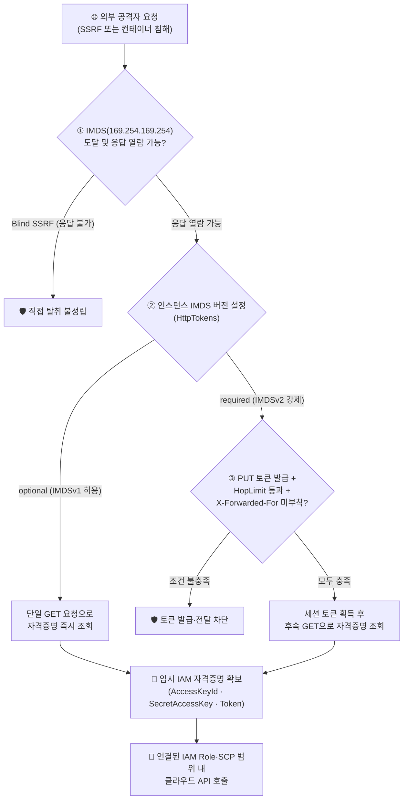
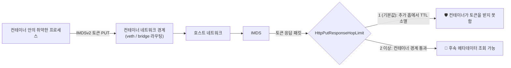
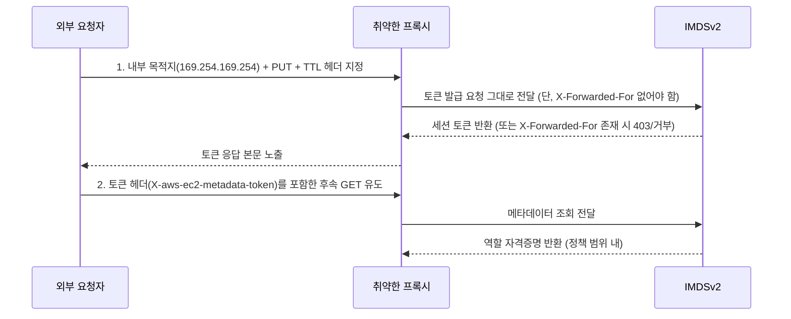

> [!summary] ⏱️ 5초 핵심 요약
> - **한 줄 비유**: 외부인은 못 들어가는 호텔 내부 전용 안내 데스크(`169.254.169.254`)에 **웹 서버라는 직원을 속여(SSRF) 대신 심부름을 보내서, 그 서버의 임시 마스터 출입증(IAM Role 자격증명)을 받아 나오는 공격**입니다.
> - **핵심 원리**: SSRF 취약점으로 링크 로컬 주소인 IMDS에 도달한 뒤, **IMDS 버전(`v1`/`v2`), 컨테이너 네트워크 홉 제한(`HttpPutResponseHopLimit`), 리버스 프록시의 메서드·헤더 전달 조건**이 모두 맞물릴 때 임시 자격증명 탈취 체인이 성립합니다.
> - **핵심 방어**: **IMDSv2 강제(`HttpTokens=required`) + 컨테이너 환경 `HopLimit=1` 유지 + 애플리케이션 목적지 허용 목록(Allowlist) 검증 + 인스턴스 프로파일 최소 권한 분리**를 중첩 적용합니다.

[[웹 취약점 진단 인프라편 — CI-CD와 클라우드 설정 노출]]이 노출된 클라우드 설정과 메타데이터 접근 가능성을 찾는 입문·정찰 단계였다면, 이번 글은 이미 확보한 낮은 권한이나 SSRF를 출발점으로 삼아 인스턴스 역할의 자격증명까지 이어지는 **사후 익스플로잇 체인**을 봅니다. [[웹 취약점 진단 기법 입문 — XXE, SSRF부터 SQLi, XSS까지]]의 SSRF 개론과도 경계를 나눠, 여기서는 SSRF 자체의 발견법보다 **클라우드 인스턴스 안의 IMDS에 도달한 다음 네트워크 홉과 요청 제약이 체인의 성립 여부를 어떻게 바꾸는지**에 초점을 맞춥니다.



---

## 한눈에 보는 IMDS SSRF 체인 4대 경계

| 경계 구간 | 체인이 성립하는 조건 | 체인이 차단되는 방어 조건 | 핵심 점검 항목 |
|---|---|---|---|
| **1. SSRF → IMDS** | `169.254.169.254` 도달 + **응답 본문(Response Body)**을 공격자가 읽을 수 있음 | Blind SSRF이거나 애플리케이션이 링크 로컬·사설 IP 대역 및 리다이렉트를 차단 | URL 파서·리다이렉트 재검증, 응답 본문 반사 여부 |
| **2. IMDSv1 vs IMDSv2** | `HttpTokens=optional`이면 단순 `GET` 1회로 탈취 가능 | `HttpTokens=required`로 `PUT` 기반 세션 토큰 없이는 `401 Unauthorized` 반환 | 인스턴스·AMI·Launch Template의 `HttpTokens` 설정 |
| **3. 컨테이너 → 호스트 IMDS** | 브리지 네트워크 컨테이너라도 `HttpPutResponseHopLimit >= 2`이면 토큰 응답 수신 | `HttpPutResponseHopLimit = 1`이면 추가 라우팅 홉에서 TTL 소멸로 토큰 수신 실패 | `HttpPutResponseHopLimit` 값, ECS Task Role 분리 여부 |
| **4. 프록시 → IMDSv2** | 프록시가 `PUT` 메서드 + 커스텀 헤더를 통과시키고 `X-Forwarded-For`를 안 붙임 | `GET`만 허용하거나 프록시가 `X-Forwarded-For` 헤더를 자동 추가(IMDSv2가 즉시 거부) | 리버스 프록시 업스트림 변수화 금지, 메서드·헤더 제한 |

---

## 1. IMDS와 SSRF — 내부 안내 데스크에 대신 심부름 보내기

**💡 한 줄 비유**: 인스턴스 메타데이터 서비스(IMDS)는 **호텔 객실 내선 전화로만 연결되는 프런트 데스크(`169.254.169.254`)**입니다. 외부인은 직접 전화를 걸 수 없지만, 객실 안에 있는 직원(웹 서버의 URL 요청 기능)을 속여 대신 내선 전화를 걸게 하면(SSRF) 객실 금고의 임시 열쇠 번호를 받아낼 수 있습니다.

### 핵심 원리
- **링크 로컬 주소와 임시 자격증명**: `169.254.169.254`(IPv6는 `fd00:ec2::254`)는 인터넷에서 직접 라우팅되지 않는 인스턴스 내부 전용 주소입니다. 하지만 서버 기능에 SSRF 취약점이 있으면 공격자가 서버를 대리인으로 삼아 IMDS를 조회할 수 있습니다.
- **IMDS 접근 성공 ≠ 무조건 관리자 장악**: IMDS가 돌려주는 자격증명(`AccessKeyId`, `SecretAccessKey`, `Token`)은 영구 키가 아니라 인스턴스에 연결된 **IAM 인스턴스 프로파일(Role)의 임시 세션**입니다. 따라서:
  1. **비가시형(Blind) SSRF 한계**: 요청이 IMDS에 닿더라도 응답 본문을 외부로 돌려주지 않는 Blind SSRF라면 자격증명 문자열을 읽을 수 없어 별도의 유출 경로가 없는 한 체인이 바로 완성되지 않습니다.
  2. **권한 범위 제한**: 응답을 읽더라도 실제 피해 범위는 그 인스턴스 역할(Role)의 IAM 정책과 조직 SCP가 허용한 범위 안에서만 성립합니다.

### IMDSv1 vs IMDSv2 요청 방식 비교
```bash
# [IMDSv1] 토큰 없이 단일 GET 요청만으로 자격증명 탈취 가능 (SSRF에 매우 취약)
curl http://169.254.169.254/latest/meta-data/iam/security-credentials/<role-name>

# [IMDSv2] 1단계: PUT 요청 + TTL 헤더로 세션 토큰 발급
TOKEN=$(curl -X PUT "http://169.254.169.254/latest/api/token" \
  -H "X-aws-ec2-metadata-token-ttl-seconds: 21600")

# [IMDSv2] 2단계: 발급받은 토큰을 헤더에 실어야만 메타데이터 조회 가능
curl -H "X-aws-ec2-metadata-token: $TOKEN" \
  http://169.254.169.254/latest/meta-data/iam/security-credentials/<role-name>
```

### 체크 포인트
- SSRF 취약점이 응답 본문을 공격자에게 반환하는가(In-band), 아니면 Blind 형태인가?
- 대상 인스턴스의 `HttpTokens` 설정이 `required`(IMDSv2 전용)로 강제되어 있는가?
- 인스턴스에 연결된 IAM Role에 실제로 어떤 정책이 붙어 있으며, 애플리케이션이 업무상 IMDS 접근을 필요로 하는가?
- 참고: [AWS — EC2 인스턴스 메타데이터 사용](https://docs.aws.amazon.com/AWSEC2/latest/UserGuide/ec2-instance-metadata.html), [OWASP — Server-Side Request Forgery Prevention Cheat Sheet](https://cheatsheetseries.owasp.org/cheatsheets/Server_Side_Request_Forgery_Prevention_Cheat_Sheet.html)

---

## 2. `HttpPutResponseHopLimit`과 컨테이너 경계

**💡 한 줄 비유**: 프런트 데스크(IMDSv2)가 내선 번호로 임시 출입증을 보낼 때 **"방문을 한 번(`HopLimit = 1`)만 통과하면 소멸하는 캡슐"**에 담아 보내면, 호스트 거실에 있는 사람은 받지만 **거실 안쪽 작은 쪽방(컨테이너 네트워크 네임스페이스)에 있는 사람은 캡슐이 문턱에서 사라져 받지 못하는 원리**입니다.



### 핵심 원리
- **IP TTL을 이용한 홉 제한**: IMDSv2의 `HttpPutResponseHopLimit`은 토큰 발급 요청(`PUT`)에 대한 **응답 IP 패킷의 TTL(Time-To-Live) 값을 몇으로 설정할지** 결정합니다.
  - **`HopLimit = 1` (EC2 기본값)**: 호스트 OS에서 직접 도는 프로세스는 홉을 넘지 않으므로 토큰을 정상 수신합니다. 반면 별도 브리지 네트워크 네임스페이스를 거치는 Docker·ECS·EKS 컨테이너는 호스트가 컨테이너로 패킷을 포워딩할 때 라우팅 홉이 1 감소하면서 패킷이 소멸해, 호스트 역할 자격증명이 컨테이너 안으로 내려오지 않는 방어 효과가 생깁니다. *(단, 컨테이너가 `hostNetwork: true`로 호스트 네트워크를 직접 공유하면 홉이 늘어나지 않아 `HopLimit = 1`이어도 도달합니다.)*
  - **`HopLimit >= 2`**: 컨테이너 워크로드의 호환성을 이유로 값을 `2` 이상으로 높이면 토큰 응답이 컨테이너 브리지 경계를 통과하므로, 컨테이너 안의 SSRF나 침해된 프로세스가 **호스트 노드의 IAM Role**을 그대로 탈취할 수 있습니다.
- **권한 분리 원칙**: 컨테이너가 사용할 클라우드 권한은 호스트 인스턴스 역할에 기대기보다 **ECS 태스크 역할(Task IAM Role)**이나 **EKS IRSA / Pod Identity**로 컨테이너마다 최소 권한을 분리하고, 호스트 IMDS 접근은 `HopLimit = 1`과 호스트 방화벽(`iptables`)으로 차단해야 합니다.

### 체크 포인트
- 인스턴스별 `HttpPutResponseHopLimit` 값과 변경 이력이 `1`로 유지되고 있는가? (`aws ec2 describe-instances --query 'Reservations[*].Instances[*].MetadataOptions'`)
- 컨테이너 안에서 호스트 IMDS 토큰 응답이 도달하는지, 혹은 `hostNetwork`가 열려 있지 않은지 확인했는가?
- 호스트 인스턴스 프로파일 역할과 컨테이너별 역할(ECS Task Role, EKS Pod Identity)이 엄격히 분리되어 있는가?
- 참고: [AWS — 인스턴스 메타데이터 옵션 구성](https://docs.aws.amazon.com/AWSEC2/latest/UserGuide/configuring-instance-metadata-options.html), [AWS — ECS 태스크 IAM 역할](https://docs.aws.amazon.com/AmazonECS/latest/developerguide/task-iam-roles.html)

---

## 3. 프록시가 메서드와 헤더를 보존할 때의 IMDSv2 체인

**💡 한 줄 비유**: IMDSv2는 "신청서(`PUT`)와 신분증 헤더를 직접 들고 와야만 출입증을 준다"고 규칙을 강화했지만, **아무 심부름이나 메서드·봉투(헤더) 그대로 다 전달해 주는 만능 심부름꾼(오구성된 리버스 프록시)**이 내부에 있으면 2단계 규칙도 그대로 뚫립니다. 단, 심부름꾼이 봉투 겉면에 **"외부인 대리 요청(`X-Forwarded-For`)" 도장을 찍는 순간 프런트 데스크가 즉시 거절**합니다.



### 핵심 원리
- **IMDSv2가 막는 것과 못 막는 것**: IMDSv2는 URL만 바꿀 수 있고 `GET`만 보내는 전형적인 단순 SSRF에는 매우 강력한 장벽입니다. 하지만 잘못 구성된 리버스 프록시나 웹훅·API 게이트웨이가 **사용자가 지정한 HTTP 메서드(`PUT`)와 커스텀 헤더를 내부 목적지로 그대로 전달**하면 IMDSv2 환경에서도 체인이 성립할 수 있습니다.
- **IMDSv2 체인이 성립하기 위한 3가지 까다로운 전제조건**:
  1. 외부 입력으로 프록시의 업스트림 목적지를 `169.254.169.254`로 지정할 수 있을 것
  2. `PUT` 메서드와 `X-aws-ec2-metadata-token-ttl-seconds` 헤더로 토큰을 발급받아 응답을 읽고, 두 번째 요청에서 `X-aws-ec2-metadata-token` 헤더를 실어 보낼 수 있을 것
  3. **`X-Forwarded-For` 헤더 미부착**: IMDSv2는 프록시 경유 공격을 막기 위해 **토큰 발급(`PUT`) 요청에 `X-Forwarded-For` 헤더가 포함되어 있으면 요청을 거부**합니다. 따라서 프록시가 이 헤더를 강제로 붙이는 구성이라면 메서드와 다른 헤더를 통제하더라도 체인이 중간에 차단됩니다.
- **안전한 진단과 다계층 방어**: 진단 시에는 실제 자격증명을 반출하는 대신 안전한 내부 테스트 엔드포인트로 프록시의 메서드·헤더·목적지 통제 범위만 확인하는 것이 바람직합니다. 방어는 `HttpTokens=required`에만 의존하지 않고, **링크 로컬·사설 IP 대역 차단(IPv4·IPv6·진법 변환 포함), 리다이렉트 후 최종 목적지 재검증, 불필요한 HTTP 메서드·헤더 제거, 프록시의 `X-Forwarded-For` 강제 설정**을 함께 적용해야 합니다.

### 체크 포인트
- 외부 사용자 입력이 리버스 프록시나 HTTP 클라이언트의 업스트림 주소를 직접 결정하는가?
- `PUT` 메서드와 임의 요청 헤더가 내부 목적지로 그대로 전달되며, `X-Forwarded-For` 헤더가 누락되어 있는가?
- HTTP 리다이렉트(`301`/`302`) 이후의 최종 목적지 IP도 링크 로컬·사설 대역 차단 목록으로 재검증하는가?
- 참고: [AWS — IMDSv2 작동 방식](https://docs.aws.amazon.com/AWSEC2/latest/UserGuide/configuring-instance-metadata-service.html), [AWS Security Blog — IMDSv2의 프록시·SSRF 방어](https://aws.amazon.com/blogs/security/defense-in-depth-open-firewalls-reverse-proxies-ssrf-vulnerabilities-ec2-instance-metadata-service/), [OWASP — SSRF 방어를 위한 네트워크 계층 통제](https://cheatsheetseries.owasp.org/cheatsheets/Server_Side_Request_Forgery_Prevention_Cheat_Sheet.html#network-layer)

---

## 4. 탈취 이후의 권한 범위와 탐지

**💡 한 줄 비유**: 호텔 직원의 임시 출입증을 손에 넣었더라도 그 출입증으로 어디까지 갈 수 있는지는 **출입증에 입력된 권한 등급(IAM Policy·SCP)**이 결정하며, **직원이 갑자기 호텔 밖(외부 IP)에서 그 출입증을 찍는 순간 경비실 경보(GuardDuty)가 울립니다.**

### 핵심 원리
- **탈취된 세션의 유효 권한**: IMDS에서 얻는 자격증명(`ASIA...`로 시작하는 STS 임시 키)은 인스턴스 프로파일 역할의 세션이므로, 후속 API 호출은 **IAM 정책 + Permissions Boundary + 조직 SCP + 대상 리소스 정책**이 모두 허용하는 범위 안에서만 성공합니다. 만약 이 역할에 S3 민감 버킷 읽기([[클라우드 인프라 진단 — S3·스토리지 오남용과 데이터 유출 체인]])나 `iam:PassRole`·정책 수정([[클라우드 인프라 진단 — AWS IAM 권한상승 체인]]) 권한이 붙어 있다면 계정 전체 침해로 이어질 수 있습니다.
- **탐지 포인트 (CloudTrail & GuardDuty)**:
  - 공격자가 탈취한 임시 자격증명을 **EC2 인스턴스 외부(공격자 PC 등)**에서 사용하면, CloudTrail 로그의 `userIdentity.arn`은 해당 인스턴스 프로파일인데 `sourceIPAddress`가 해당 EC2의 IP가 아닌 외부 IP로 기록됩니다.
  - Amazon GuardDuty는 이를 즉시 포착해 **`UnauthorizedAccess:IAMUser/InstanceCredentialExfiltration.OutsideAWS`** 또는(다른 AWS 계정에서 쓴 경우) **`InsideAWS`** 경보를 발생시킵니다.
  - 공격자가 탐지를 피하려고 SSRF나 침해된 인스턴스 내부에서 직접 호출하더라도, 평소 워크로드가 쓰지 않던 리전·서비스·열거형 API(`sts:GetCallerIdentity`, `iam:List*`, `s3:ListAllMyBuckets`)가 호출되는 이상 징후로 탐지할 수 있습니다.
- **사고 대응 (세션 즉시 무효화)**: 이미 발급된 임시 자격증명은 만료 시간까지 유효하므로, 침해 확인 시 SSRF 패치와 동시에 해당 IAM Role에 **`AWSRevokeOlderSessions` 인라인 정책**(발급 시각 기준 이전 토큰 전면 거부)을 부착해 기존 세션을 즉시 무효화해야 합니다.

### 체크 포인트
- 인스턴스 역할 정책에 스토리지 전체 접근·시크릿 조회·`iam:PassRole` 같은 고영향 권한이 과도하게 부여되어 있지 않은가?
- CloudTrail에서 인스턴스 역할 세션의 비정상 소스 IP·리전·API 호출을 감시하고, **GuardDuty 자격증명 유출 탐지**가 활성화되어 있는가?
- 침해 대응 절차에 **IMDSv2 즉시 강제(`modify-instance-metadata-options`) + 역할의 기존 임시 세션 일괄 취소(Revoke Sessions)**가 포함되어 있는가?
- 참고: [AWS — IAM 역할 임시 보안 자격증명 취소](https://docs.aws.amazon.com/IAM/latest/UserGuide/id_roles_use_revoke-sessions.html), [AWS — GuardDuty EC2 자격증명 탐지](https://docs.aws.amazon.com/guardduty/latest/ug/compromised-creds.html)
