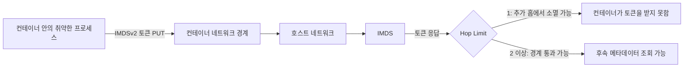
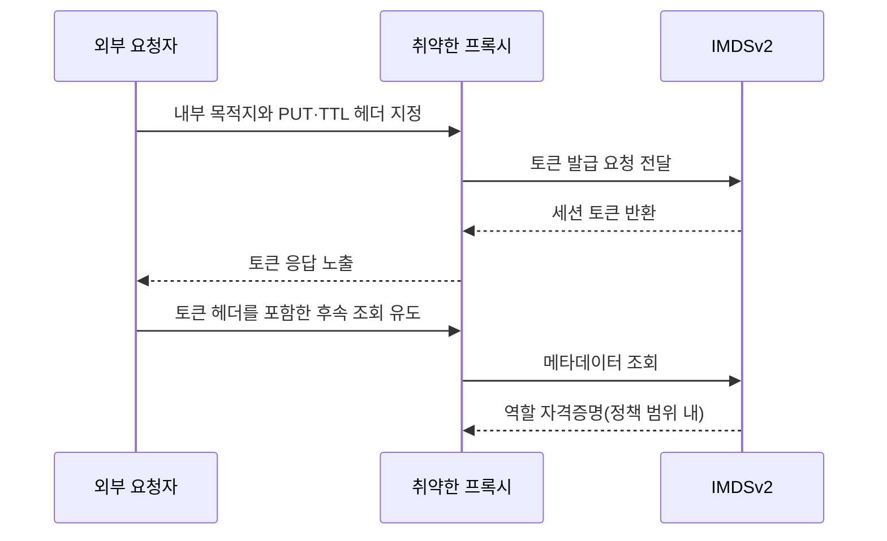

[[웹 취약점 진단 인프라편 — CI-CD와 클라우드 설정 노출]]이 노출된 클라우드 설정과 메타데이터 접근 가능성을 찾는 입문·정찰 단계였다면, 이번 글은 이미 확보한 낮은 권한이나 SSRF를 출발점으로 삼아 인스턴스 역할의 자격증명까지 이어지는 **사후 익스플로잇 체인**을 봅니다. [[웹 취약점 진단 기법 입문 — XXE, SSRF부터 SQLi, XSS까지]]의 SSRF 개론과도 경계를 나눠, 여기서는 SSRF 자체의 발견법보다 클라우드 인스턴스 안의 IMDS에 도달한 다음 네트워크 홉과 요청 제약이 체인의 성립 여부를 어떻게 바꾸는지에 초점을 맞춥니다.

---

## 1. IMDS와 SSRF — 내부 안내 데스크에 대신 심부름 보내기

쉽게 말하면, 인스턴스 메타데이터 서비스(IMDS)는 클라우드 서버 안에서만 찾아갈 수 있는 **내부 안내 데스크**와 같습니다. `169.254.169.254`는 인터넷에서 직접 방문하는 주소가 아니지만, 외부 입력을 받아 URL로 대신 요청하는 서버 기능에 SSRF가 있으면 공격자가 그 기능을 심부름꾼처럼 이용해 안내 데스크에 질문할 수 있습니다.

안내 데스크가 돌려주는 인스턴스 역할 자격증명은 영구 비밀번호가 아니라 만료되는 임시 출입증이지만, 만료 전에는 그 역할에 부여된 권한으로 클라우드 API를 호출할 수 있습니다. 따라서 IMDS 접근 성공과 관리자 권한 획득은 같은 말이 아니며, 실제 영향은 역할 정책이 허용한 범위일 때만 성립합니다.

**원리**: IMDSv1은 토큰 없는 조회를 허용하고, IMDSv2는 먼저 `PUT` 요청과 TTL 헤더로 토큰을 받은 뒤 후속 조회에 그 토큰을 요구합니다. 이 차이의 기초는 인접 글에서 이미 다뤘으므로, 진단에서는 버전 이름만 확인하고 끝내기보다 실제 인스턴스의 `HttpTokens` 값, 컨테이너 경계, 프록시가 전달하는 메서드와 헤더를 함께 봐야 합니다.

SSRF가 IMDS까지 도달해도 응답 본문을 외부로 돌려주지 않는 비가시형(blind) SSRF라면 자격증명을 바로 읽을 수 없고, 애플리케이션의 후속 동작이나 별도 유출 경로가 있어야 체인이 완성됩니다. 반대로 응답을 읽을 수 있더라도 역할에 최소 권한이 적용돼 있으면 피해 범위는 그 정책 안으로 제한됩니다.

- 체크 포인트: SSRF의 응답 본문을 읽을 수 있는지, 인스턴스의 `HttpTokens`가 `required`인지, 연결된 역할에 실제로 어떤 정책이 붙어 있는지, IMDS 접근을 애플리케이션이 업무상 필요로 하는지
- 참고: [AWS — EC2 인스턴스 메타데이터 사용](https://docs.aws.amazon.com/AWSEC2/latest/UserGuide/ec2-instance-metadata.html), [OWASP — Server-Side Request Forgery Prevention Cheat Sheet](https://cheatsheetseries.owasp.org/cheatsheets/Server_Side_Request_Forgery_Prevention_Cheat_Sheet.html)

## 2. `HttpPutResponseHopLimit`과 컨테이너 경계

**원리**: IMDSv2의 `HttpPutResponseHopLimit`은 토큰 발급 요청에 대한 응답 패킷이 몇 개의 네트워크 홉을 넘어갈 수 있는지 제한합니다. 기본값 1인 환경에서는 호스트 프로세스가 IMDS를 직접 사용할 수 있어도, 별도 네트워크 네임스페이스를 거치는 Docker·ECS 컨테이너는 추가 홉 때문에 토큰 응답을 받지 못할 수 있으며, 이때 결과적으로 호스트 역할 자격증명이 컨테이너까지 내려오지 않는 방어 효과가 생깁니다.

다만 홉 제한은 컨테이너 보안 경계를 위해 설계된 완전한 접근 제어가 아니라 IP 패킷의 전달 범위를 좁히는 설정입니다. 컨테이너 워크로드의 호환성을 이유로 값을 2 이상으로 높이면 토큰 응답이 컨테이너 네임스페이스까지 도달할 수 있고, 그 컨테이너 안의 취약한 프로세스가 호스트 인스턴스 프로파일에 접근하는 경로가 다시 열립니다. 반대로 값 1 때문에 정상 SDK가 IMDS를 쓰지 못하는 상황을 무조건 침해 징후로 해석하는 것도 잘못이며, 해당 워크로드가 인스턴스 역할을 써야 하는지부터 구분해야 합니다.

ECS에서는 컨테이너가 사용할 권한을 인스턴스 역할에 기대기보다 태스크 역할로 분리해야 합니다. 홉 제한을 높여야만 동작하는 구성이 있더라도 태스크마다 필요한 권한만 제공하면, 한 컨테이너의 취약점이 호스트 역할 전체로 번지는 범위를 줄일 수 있습니다.

- 체크 포인트: 인스턴스별 `HttpPutResponseHopLimit` 값과 변경 이력, 컨테이너에서 IMDS 토큰 응답이 도달하는지, 인스턴스 역할과 ECS 태스크 역할이 분리돼 있는지, 호환성 때문에 홉 제한을 높인 근거가 문서화돼 있는지
- 참고: [AWS — 인스턴스 메타데이터 옵션 구성](https://docs.aws.amazon.com/AWSEC2/latest/UserGuide/configuring-instance-metadata-options.html), [AWS — ECS 태스크 IAM 역할](https://docs.aws.amazon.com/AmazonECS/latest/developerguide/task-iam-roles.html)

## 3. 프록시가 메서드와 헤더를 보존할 때의 IMDSv2 체인

**원리**: IMDSv2는 URL만 바꿀 수 있고 `GET`만 보내는 전형적인 SSRF에는 강한 장벽이 되지만, 취약한 프록시나 역방향 프록시가 사용자가 지정한 HTTP 메서드와 헤더를 내부 목적지로 그대로 전달하면 조건이 달라집니다. 공격자가 토큰 발급에 필요한 `PUT`과 TTL 헤더를 전달하고, 받은 토큰을 후속 요청의 메타데이터 토큰 헤더에 다시 실을 수 있을 때만 IMDSv2 자격증명 조회 체인이 성립합니다.

nginx 같은 프록시 제품 자체가 취약한 것은 아닙니다. 사용자 입력으로 업스트림 주소를 정하게 해 두고 메서드·헤더 제한과 링크 로컬 주소 차단을 빠뜨린 구성이 문제이며, `HttpTokens=required` 하나만으로 그런 범용 내부 프록시를 안전하게 만들 수는 없습니다.

또한 IMDSv2는 토큰 발급 요청에 `X-Forwarded-For` 헤더가 있으면 토큰을 발급하지 않으므로, 프록시가 이 헤더를 강제로 붙이는 구성에서는 메서드와 다른 헤더를 통제해도 체인이 중단될 수 있습니다. 결국 우회는 `PUT`과 필수 헤더뿐 아니라 토큰 응답과 후속 조회를 왕복할 수 있고, 프록시가 이 차단 헤더를 추가하지 않을 때만 성립합니다.

진단은 실제 자격증명을 가져오는 데 목적을 두지 않고, 허가된 환경에서 프록시가 허용하는 메서드·헤더·목적지 범위를 안전한 테스트 엔드포인트로 확인하는 선에서 멈추는 편이 적절합니다. 방어는 링크 로컬·사설 주소 대역을 목적지 허용 목록 밖으로 두고, 리다이렉트 뒤의 최종 목적지도 다시 검증하며, 업무에 필요하지 않은 메서드와 요청 헤더를 제거하는 방식으로 겹쳐야 합니다.

- 체크 포인트: 외부 입력이 업스트림 주소를 결정하는지, `PUT`과 임의 헤더가 내부로 전달되는지, 리다이렉트 후 목적지를 재검증하는지, 링크 로컬 주소와 IPv4·IPv6 변형을 모두 차단하는지
- 참고: [AWS — IMDSv2 작동 방식](https://docs.aws.amazon.com/AWSEC2/latest/UserGuide/configuring-instance-metadata-service.html), [AWS Security Blog — IMDSv2의 프록시·SSRF 방어](https://aws.amazon.com/blogs/security/defense-in-depth-open-firewalls-reverse-proxies-ssrf-vulnerabilities-ec2-instance-metadata-service/), [OWASP — SSRF 방어를 위한 네트워크 계층 통제](https://cheatsheetseries.owasp.org/cheatsheets/Server_Side_Request_Forgery_Prevention_Cheat_Sheet.html#network-layer)

## 4. 탈취 이후의 권한 범위와 탐지

**원리**: IMDS에서 얻는 자격증명은 인스턴스 프로파일 역할의 임시 세션이므로, 후속 호출은 IAM 정책과 조직의 SCP, 리소스 정책이 함께 허용하는 범위에서만 성공합니다. 낮은 권한 역할이라도 민감한 스토리지 읽기, 다른 역할 전달, 비밀 조회 같은 권한이 섞여 있으면 피해가 커질 수 있지만, 자격증명을 얻었다는 사실만으로 모든 계정 리소스에 접근할 수 있는 것은 아닙니다.

탐지에서는 정상 인스턴스가 보내는 호출과 탈취 세션이 보내는 호출이 같은 역할 이름으로 보일 수 있다는 점이 어렵습니다. CloudTrail의 역할 세션, 호출 리전·소스 네트워크·사용 API가 평소 워크로드와 다른지 보고, GuardDuty의 자격증명 유출 관련 탐지와 VPC 흐름·애플리케이션 프록시 로그를 함께 맞춰 봐야 합니다. 로그만 쌓고 기준 동작을 정하지 않으면 정상 SDK 갱신과 비정상 사용을 구분하기 어렵습니다.

사후 조치는 해당 프로세스의 SSRF를 막는 것에 그치지 않고, 인스턴스 역할의 불필요한 권한을 줄이고 IMDSv2 강제와 홉 제한을 다시 검토해야 합니다. 이미 발급된 임시 자격증명은 만료 전까지 유효할 수 있으므로 역할 세션을 취소하는 대응도 별도로 고려해야 합니다.

- 체크 포인트: 역할 정책에 스토리지·시크릿·`iam:PassRole` 같은 고영향 권한이 있는지, CloudTrail에서 평소와 다른 소스·리전·API 호출이 보이는지, GuardDuty 탐지가 활성화돼 있는지, 사고 대응 절차에 역할 세션 취소와 권한 축소가 포함되는지
- 참고: [AWS — IAM 역할 임시 보안 자격증명 취소](https://docs.aws.amazon.com/IAM/latest/UserGuide/id_roles_use_revoke-sessions.html), [AWS — GuardDuty EC2 자격증명 탐지](https://docs.aws.amazon.com/guardduty/latest/ug/compromised-creds.html)

## 정리

| 경계 | 체인이 성립하는 조건 | 우선 확인할 방어 |
|---|---|---|
| SSRF → IMDS | 링크 로컬 주소에 도달하고 응답을 활용할 수 있음 | 목적지 허용 목록, 리다이렉트 재검증 |
| 컨테이너 → 호스트 IMDS | 네트워크 경계를 넘을 홉 제한과 경로가 열림 | Hop Limit, 태스크 역할 분리 |
| 프록시 → IMDSv2 | `PUT`과 필수 헤더, 후속 토큰 헤더를 모두 통제함 | 메서드·헤더 제한, `HttpTokens=required` |
| 자격증명 → 클라우드 API | 역할·SCP·리소스 정책이 해당 동작을 허용함 | 최소 권한, CloudTrail·GuardDuty 탐지 |

