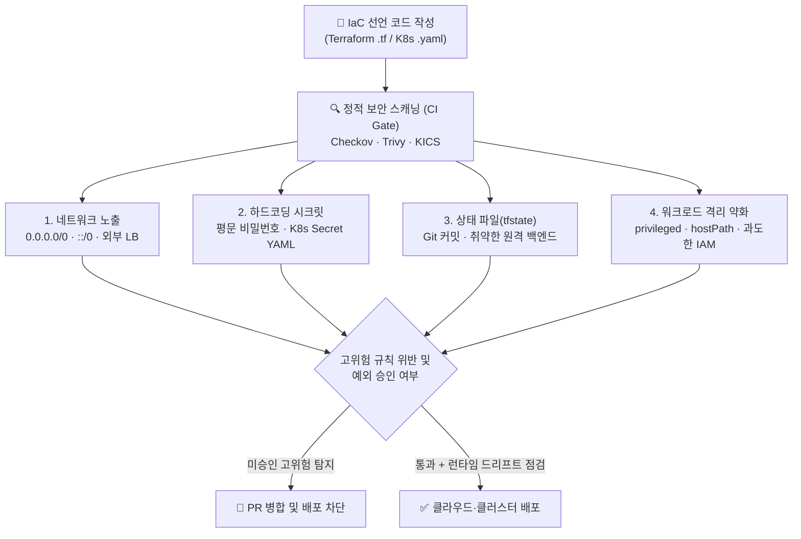
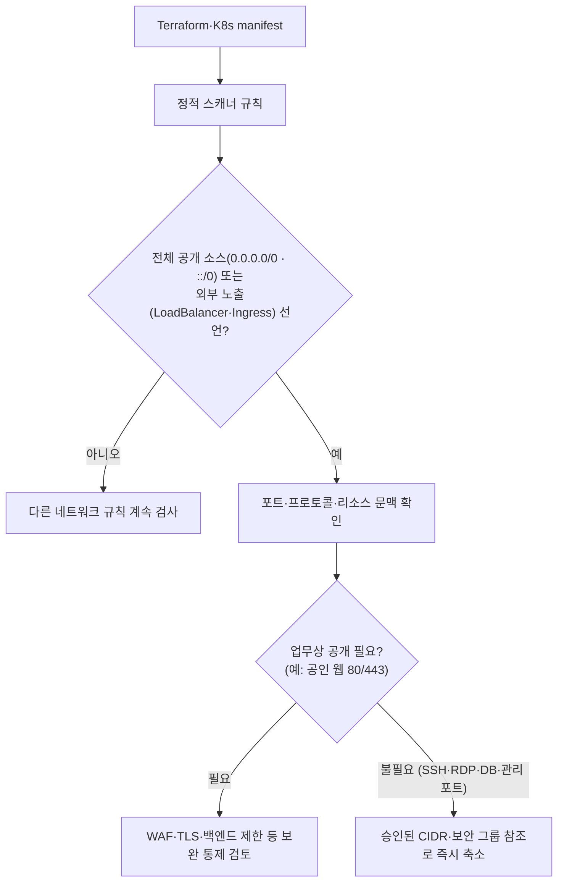
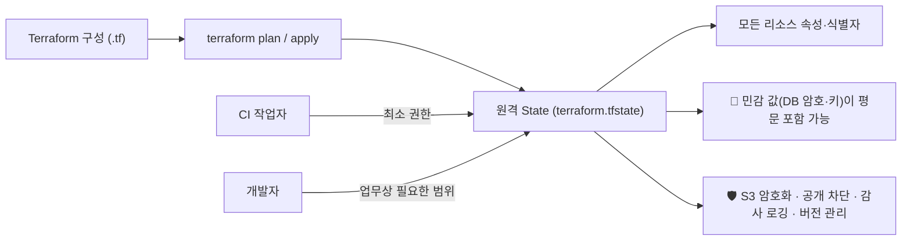

> [!summary] ⏱️ 5초 핵심 요약
> - **한 줄 비유**: 건물을 다 짓고 나서 "비상구가 없네?"라고 벽을 부수는 대신, **착공 전에 건물 설계도(`.tf`, `.yaml`)를 자동 검사기로 훑어 위험한 구조를 미리 빨간펜으로 막는 과정**입니다.
> - **핵심 원리**: Terraform HCL과 Kubernetes YAML에 선언된 **네트워크 전체 개방(`0.0.0.0/0`), 고권한 컨테이너(`privileged`), 평문 시크릿, 상태 파일(`tfstate`) 노출**을 배포 전 정적 분석(Checkov·Trivy·KICS)으로 탐지합니다.
> - **핵심 방어**: 고위험 규칙 위반 시 CI 병합(PR)을 즉시 차단하고, 원격 State 버킷 암호화·최소 권한 적용 및 예외 규칙의 만료일(`Expiration`) 관리를 강제합니다.

[[웹 취약점 진단 인프라편 — CI-CD와 클라우드 설정 노출]]이 배포된 환경에서 노출된 설정을 찾는 입문·정찰 단계였다면, 이번 글은 **이미 확보한 낮은 권한에서 시작하는 사후 익스플로잇 체인을 가능하게 만드는 조건**을 인프라 선언 코드에서 찾아 배포 전에 차단하는 **사전 진단(Shift-Left)**에 초점을 맞춥니다. 애플리케이션 코드 의존성의 알려진 취약점을 찾는 공급망 SCA 글과 달리, 여기서는 Terraform과 Kubernetes manifest에 선언된 **네트워크·권한·시크릿·상태 저장 방식의 설정 결함**만 다루며, 실행 중인 대상에서 체인을 재현하는 런타임 진단 단계와는 경계를 나눕니다.



---

## 한눈에 보는 IaC 4대 진단 영역과 한계 경계

| 진단 대상 | 정적 스캐너가 코드에서 찾는 신호 | 정적 스캔만으로 알 수 없는 별도 확인 경계 | 핵심 방어 및 통제 |
|---|---|---|---|
| **1. 네트워크 노출** | `0.0.0.0/0`, `::/0`, `type: LoadBalancer`, 외부 Ingress 선언 | 실제 라우팅 테이블, 앞단 WAF·방화벽, 포트별 업무 문맥 | 관리·DB 포트 전체 개방 즉시 차단, 보안 그룹 참조로 제한 |
| **2. 하드코딩 시크릿** | 변수 기본값·리소스 속성의 평문 키, K8s `Secret` manifest 커밋 | 예제 더미 값(오탐) 여부, 이미 Git 히스토리에 남은 과거 커밋 | 외부 Secret Manager 연동, 노출된 자격증명 즉시 폐기·회전 |
| **3. Terraform State** | `.tfstate` 파일의 Git 추적, S3 백엔드의 암호화·공개 차단 누락 | 원격 버킷의 실제 IAM 권한, CI 러너 캐시·아티팩트 보관 기간 | S3 백엔드 암호화·공개 차단·버전 관리·최소 권한 강제 |
| **4. CI 게이트·예외** | 정책 위반 리소스 및 인라인 예외(`skip`) 주석 | 운영자가 콘솔에서 직접 바꾼 **런타임 드리프트(Drift)** | 고위험 규칙 PR 차단, 예외 사유·승인자·만료일 지정 |

---

## 1. IaC와 정적 스캐닝 — 건물을 짓기 전에 설계도 검사하기

**💡 한 줄 비유**: 서버와 네트워크를 손으로 하나씩 클릭해 만드는 것이 **현장 즉흥 시공**이라면, IaC는 **표준 건물 설계도**이고 정적 스캐닝은 **착공 허가 전에 설계도에서 소방·방범 규정 위반을 잡아내는 도면 심사**입니다.

### 핵심 원리
- **선언적 코드 파싱**: Checkov, Trivy, KICS 같은 정적 스캐너는 Terraform HCL(`.tf`, `.tf.json`)과 Kubernetes YAML을 파싱해 리소스 종류와 속성을 보안 규칙에 대조합니다. 예를 들어 보안 그룹 인그레스가 `0.0.0.0/0`이고 민감한 포트를 허용하는지, 컨테이너가 `privileged: true`로 선언됐는지처럼 코드에 명시된 패턴은 클라우드에 배포하지 않고도 즉시 찾을 수 있습니다.
- **설계도 비유의 한계 (런타임과의 차이)**:
  1. **구성 드리프트(Configuration Drift)**: 배포 후 운영자가 AWS 콘솔이나 `kubectl edit`으로 설정을 직접 바꾸면 코드(설계도)와 실제 인프라 사이에 차이가 발생합니다.
  2. **동적 변수·외부 모듈 미확정**: 배포 시점에만 주입되는 변수 값이나 외부 모듈 조합이 완전히 계산되기 전에는 스캐너가 최종 구성을 100% 파악하지 못할 수 있으므로, **IaC 스캔은 런타임 진단을 대체하는 것이 아니라 상호 보완**합니다 (`terraform plan` 결과 JSON을 스캔하면 정확도를 높일 수 있습니다).
- **성패를 가르는 CI 기준**: 도구 이름보다 중요한 것은 **CI의 실패 기준(Fail Threshold)과 예외 관리**입니다. 스캔 결과를 단순 보고서로만 남기고 병합을 계속 허용하거나 모든 오탐을 전역 제외하면 사전 통제가 무력화되며, 반대로 위험도와 업무 맥락을 구분하지 않고 사소한 규칙까지 전부 차단하면 양치기 소년 현상(Alert Fatigue) 때문에 중요한 경고까지 묻히게 됩니다.

### 주요 IaC 스캐너 실행 예시
```bash
# Checkov: Terraform 디렉터리 및 Kubernetes 매니페스트 스캔
checkov -d ./terraform --framework terraform
checkov -d ./k8s --framework kubernetes

# Trivy: IaC 오구성(Misconfiguration) 스캔 및 고위험 발견 시 종료 코드 1 반환
trivy config --severity HIGH,CRITICAL --exit-code 1 ./terraform
```

### 체크 포인트
- 저장소의 `.tf`·`.tf.json`·Kubernetes YAML(Helm 렌더링 결과·Kustomize 포함)이 스캔 대상에 빠짐없이 포함되는가?
- 고위험(`HIGH`/`CRITICAL`) 규칙 위반이 PR 병합을 실제로 차단(`exit code != 0`)하는가?
- 예외 처리에 사유·소유자·만료일이 기록되어 있으며, 운영 환경 드리프트를 별도로 탐지하는가?
- 참고: [Checkov — 지원 프레임워크와 IaC 스캔](https://www.checkov.io/1.Welcome/Quick%20Start.html), [Trivy — IaC Misconfiguration Scanning](https://trivy.dev/latest/docs/scanner/misconfiguration/)

---

## 2. `0.0.0.0/0` 인그레스와 문맥 있는 판정

**💡 한 줄 비유**: 건물 정문 로비(443 웹 포트)를 모든 방문객에게 열어두는 것은 정상 영업이지만, **서버실과 금고실 문(22번 SSH, 3306·5432 DB 포트)에 '누구나 출입 가능(`0.0.0.0/0`)' 팻말을 붙이는 것**은 명백한 보안 사고입니다.



### 핵심 원리
- **문맥(Context) 기반 심각도 판정**: Terraform의 보안 그룹이나 방화벽 규칙에서 `0.0.0.0/0`(IPv4)과 `::/0`(IPv6)은 모든 주소를 소스로 허용한다는 뜻입니다. 하지만 이 문자열 하나만으로 취약점 심각도가 확정되지는 않습니다.
  - **정상적인 공개**: 대외 웹 서비스용 ALB의 `443` 포트 개방 (단, WAF·TLS 등 보완 통제 확인)
  - **즉시 차단할 위험 노출**: 관리용 포트(`22` SSH, `3389` RDP)나 데이터베이스·캐시 포트(`3306`, `5432`, `6379`, `27017` 등)의 전체 개방, 그리고 해당 리소스에 공인 IP나 인터넷 경로가 실제로 연결되는 구성
- **Kubernetes 네트워크 노출의 다계층성**: Kubernetes manifest에서는 Service의 `type: LoadBalancer`·`NodePort`나 `Ingress`가 외부 진입점을 만들 수 있지만, 실제 도달성은 클라우드 방화벽(Security Group annotation), Ingress Controller 설정, 클러스터 내 `NetworkPolicy`가 함께 결정합니다.

### 취약한 선언 vs 안전한 선언 (Terraform 예시)
```hcl
# ❌ 취약한 설정: 관리 포트(SSH 22)를 전 세계(0.0.0.0/0)에 개방
resource "aws_security_group_rule" "bad_ssh" {
  type              = "ingress"
  from_port         = 22
  to_port           = 22
  protocol          = "tcp"
  cidr_blocks       = ["0.0.0.0/0"]
  security_group_id = aws_security_group.app.id
}

# ✅ 안전한 설정: 배스천(Bastion) 보안 그룹에서의 접근만 허용 (또는 SSM Session Manager 사용으로 22번 포트 제거)
resource "aws_security_group_rule" "good_ssh" {
  type                     = "ingress"
  from_port                = 22
  to_port                  = 22
  protocol                 = "tcp"
  source_security_group_id = aws_security_group.bastion.id
  security_group_id        = aws_security_group.app.id
}
```

### 체크 포인트
- IPv4 `0.0.0.0/0`뿐만 아니라 **IPv6 `::/0`**도 동일한 기준으로 검사하고 있는가?
- 공개된 포트·프로토콜과 함께 공인 IP·`LoadBalancer`·`Ingress` 연결 여부를 교차 확인했는가?
- 관리 포트와 데이터베이스 포트가 승인된 소스 CIDR 또는 원본 보안 그룹 ID(`source_security_group_id`) 참조로 제한되는가?
- 참고: [AWS — 보안 그룹 규칙](https://docs.aws.amazon.com/vpc/latest/userguide/security-group-rules.html), [Kubernetes — Ingress](https://kubernetes.io/docs/concepts/services-networking/ingress/)

---

## 3. `.tf`·`.yaml`의 하드코딩 시크릿

**💡 한 줄 비유**: 금고 비밀번호를 **누구나 복사해 가는 건물 설계도 여백에 직접 적어두거나, 누구나 해독할 수 있는 Base64로만 바꿔 적어둔 격**입니다.

### 핵심 원리
- **코드 저장소 = 복제 경로**: 평문 비밀번호, DB 연결 문자열, API 키를 Terraform 변수 기본값(`default`), 리소스 속성, `.tfvars`, 또는 Kubernetes `Secret`의 manifest에 직접 쓰면 Git 저장소 읽기 권한이 있는 모든 사람과 CI 로그·아티팩트 경로를 통해 값이 그대로 복제됩니다.
- **Base64는 암호화가 아니다**: Kubernetes `Secret`의 `data` 필드는 암호화가 아니라 단순 **Base64 인코딩**이므로, Git에 커밋된 `Secret` YAML은 평문 노출과 다름없습니다.
- **스캐너별 시크릿 탐지 방식과 주의점**:
  - 정적 스캐너는 키 이름, 정규표현식 패턴, 문자열 엔트로피(무작위성)를 바탕으로 의심 값을 찾지만, 예제 값이 오탐으로 잡히거나 규칙적인 내부 토큰을 놓칠 수 있습니다.
  - **스캐너 옵션 차이**: Checkov는 별도 `--framework secrets`를 제공하고 KICS도 시크릿 규칙을 포함하지만, **Trivy의 `trivy config`는 기본적으로 오구성(misconfig)만 검사**하므로 평문 자격증명까지 함께 찾으려면 `trivy fs --scanners misconfig,secret`처럼 시크릿 스캐너를 명시적으로 켜야 합니다.
  - **로그 재노출 주의**: 스캐너가 찾은 실제 시크릿 원문을 CI 콘솔 로그나 PR 코멘트에 그대로 출력하면 또 다른 유출 경로가 되므로 마스킹 옵션을 확인해야 합니다.

### 안전한 주입과 유출 시 사후 조치
1. **외부 시크릿 저장소 연동**: 값을 다른 평문 파일로 옮기는 눈가림 대신, 배포·런타임 시점에 AWS Secrets Manager, Parameter Store, HashiCorp Vault, 또는 Kubernetes의 **External Secrets Operator / Secrets Store CSI Driver**로 주입합니다.
2. **즉시 폐기 및 회전(Rotation)**: 한 번이라도 Git에 커밋된 시크릿은 최신 커밋에서 파일을 지워도 **Git 히스토리, 개발자 로컬 클론, 포크, CI 캐시**에 남아 있으므로 해당 자격증명을 즉시 폐기하고 재발급해야 합니다.

### 체크 포인트
- `.tf`·`.tfvars`·`.yaml` 내 비밀번호·토큰·개인키 패턴과 Kubernetes `Secret` 매니페스트가 Git에 직접 커밋되어 있지 않은가?
- 사용하는 스캐너에서 시크릿 스캔 기능(예: Trivy의 `secret` 스캐너)이 실제로 활성화되어 있는가?
- 스캔 출력 로그가 원문 시크릿을 다시 노출하지 않으며, 발견된 자격증명의 **폐기·회전 절차**가 즉시 실행되는가?
- 참고: [Kubernetes — Secret 보안 모범 사례](https://kubernetes.io/docs/concepts/security/secrets-good-practices/), [Checkov — 시크릿 스캔](https://www.checkov.io/2.Basics/Scanning%20Credentials%20and%20Secrets.html), [Trivy — 시크릿 스캐닝](https://trivy.dev/latest/docs/scanner/secret/), [HashiCorp — Terraform에서 민감한 데이터 관리](https://developer.hashicorp.com/terraform/language/manage-sensitive-data)

---

## 4. `terraform.tfstate`는 민감한 운영 데이터다

**💡 한 줄 비유**: 설계도(`.tf`)에는 "금고를 설치한다"라고만 적혀 있어도, 시공 완료 장부인 **`terraform.tfstate`에는 실제 설치된 금고의 일련번호와 초기 마스터 비밀번호가 평문 그대로 기록**되어 있습니다.



### 핵심 원리
- **`sensitive = true`의 진짜 의미**: Terraform은 선언 코드와 실제 클라우드 리소스를 매핑하기 위해 `terraform.tfstate` 파일에 리소스 속성과 식별자를 저장합니다. 변수나 출력에 `sensitive = true`를 지정하면 **CLI 터미널 화면 출력에서만 가려질 뿐, `terraform.tfstate` 파일 내부에는 공급자(Provider)가 반환한 비밀번호나 키가 여전히 평문 JSON으로 기록**됩니다.
- **원격 백엔드(Remote Backend)와 CI 아티팩트 보안**:
  - `terraform.tfstate`와 `.tfstate.backup` 파일을 `.gitignore`에 넣어 Git 커밋을 막는 것은 기본입니다.
  - 팀이 공유하는 원격 State(예: AWS S3 버킷)에는 **저장 암호화(SSE-KMS/S3), 전송 구간 TLS 강제, S3 Block Public Access 활성화, IAM 최소 권한, 접근 감사 로그(CloudTrail/Server Access Log), 버전 관리 및 상태 잠금(Locking)**이 모두 적용되어야 합니다.
  - 백엔드 버킷이 안전하더라도 CI 파이프라인이 `terraform plan` 파일(`tfplan`)이나 작업 디렉터리의 로컬 state를 **빌드 아티팩트·캐시로 장기 보관**하면 그 경로로 민감 정보가 유출될 수 있습니다.

### 안전한 Terraform S3 백엔드 선언 예시
```hcl
terraform {
  backend "s3" {
    bucket       = "my-org-prod-tfstate-bucket"
    key          = "network/terraform.tfstate"
    region       = "ap-northeast-2"
    encrypt      = true
    kms_key_id   = "arn:aws:kms:ap-northeast-2:123456789012:key/..."
    use_lockfile = true # S3 네이티브 상태 잠금 (구버전은 dynamodb_table 사용)
  }
}
```

### 체크 포인트
- `terraform.tfstate`, `*.tfstate.*`, 그리고 민감 값이 담긴 플랜 출력 파일(`tfplan`)이 Git 저장소나 공개 CI 아티팩트에 포함되어 있지 않은가?
- 원격 백엔드 스토리지에 **암호화·공개 접근 차단(BPA)·IAM 최소 권한·감사 로그·버전 관리**가 모두 설정되어 있는가?
- 개발자와 운영자가 코드의 `sensitive = true` 표시를 state 파일 암호화로 오해하고 있지 않은가?
- 참고: [HashiCorp — Terraform state의 민감 데이터](https://developer.hashicorp.com/terraform/language/state/sensitive-data), [AWS — S3 보안 모범 사례](https://docs.aws.amazon.com/AmazonS3/latest/userguide/security-best-practices.html)

---

## 5. CI 게이트와 예외의 수명 관리

**💡 한 줄 비유**: 보안 검색대를 설치해 놓고 **경보음이 울려도 그냥 통과시키거나, 한 번 발급한 '임시 통과증(예외 처리)'을 평생 회수하지 않으면** 검색대는 장식품이 됩니다.

### 핵심 원리
- **변경분(PR) 검사와 전체(Full) 검사의 결합**: IaC 스캐너를 CI에 넣는 목적은 위험한 선언이 배포 단계로 넘어가는 조건을 통제하는 데 있습니다. PR 단계에서는 변경된 파일만 빠르게 검사하더라도, **공통 모듈(Shared Module) 수정이 이를 참조하는 여러 환경에 미치는 영향**을 놓치지 않아야 하며, 신규 규칙 반영을 위해 주기적인 전체 저장소 스캔을 함께 운영해야 합니다.
- **다중 스캐너 중복보다 단일 기준선 확립**: Checkov·Trivy·KICS는 겹치는 규칙이 많지만 규칙 ID와 파싱 범위가 조금씩 다릅니다. 세 도구를 무조건 겹쳐 돌려 중복 경고에 파묻히기보다, 팀의 저장소 형식에 맞는 **주력 스캐너 하나를 명확한 차단 게이트로 정하고**, 누락 영역이 확인될 때만 보완 도구를 추가하는 편이 훨씬 효과적입니다.
- **예외(Suppression)의 수명 주기 관리**: 인라인 주석(`#checkov:skip=...`, `#trivy:ignore:...`)이나 CI allowlist는 취약점이 사라졌다는 뜻이 아니라 **"특정 기간 동안 보완 통제하에 위험을 수용한다"는 기록**입니다. 반드시 **사유, 승인자, 보완 통제, 만료일**을 남기고 만료일이 지나면 자동으로 다시 CI가 실패하도록 구성해야 합니다.

```hcl
# ✅ 모범적인 인라인 예외 기록: 규칙 ID + 명확한 업무 사유 + 승인 티켓 및 만료일 명시
resource "aws_security_group_rule" "public_http_redirect" {
  #checkov:skip=CKV_AWS_260:ALB 80포트는 HTTPS(443) 리다이렉트 전용으로만 열림 (SEC-1042, 만료: 2026-12-31)
  type              = "ingress"
  from_port         = 80
  to_port           = 80
  protocol          = "tcp"
  cidr_blocks       = ["0.0.0.0/0"]
  security_group_id = aws_security_group.alb.id
}
```

### 체크 포인트
- 고위험 규칙 위반 시 CI 파이프라인이 실제로 실패 처리되어 병합을 막는가?
- PR 변경분 검사와 정기적인 전체 저장소·공통 모듈 검사가 함께 돌아가는가?
- 모든 인라인 skip과 allowlist 항목에 **사유·승인자·만료일**이 있으며, 스캐너 버전과 정책 번들이 정기적으로 갱신되는가?
- 배포 이후 클라우드 환경에서 발생할 수 있는 자격증명·권한 체인 진단은 [[클라우드 인프라 진단 — AWS IAM 권한상승 체인]] 및 [[클라우드 인프라 진단 — 컨테이너·Kubernetes 탈출]] 글을 이어서 참고하세요.
- 참고: [KICS — CI/CD Integrations](https://docs.kics.io/latest/integrations/), [Trivy — CI에서 종료 코드 설정](https://trivy.dev/latest/docs/configuration/others/#exit-code)
