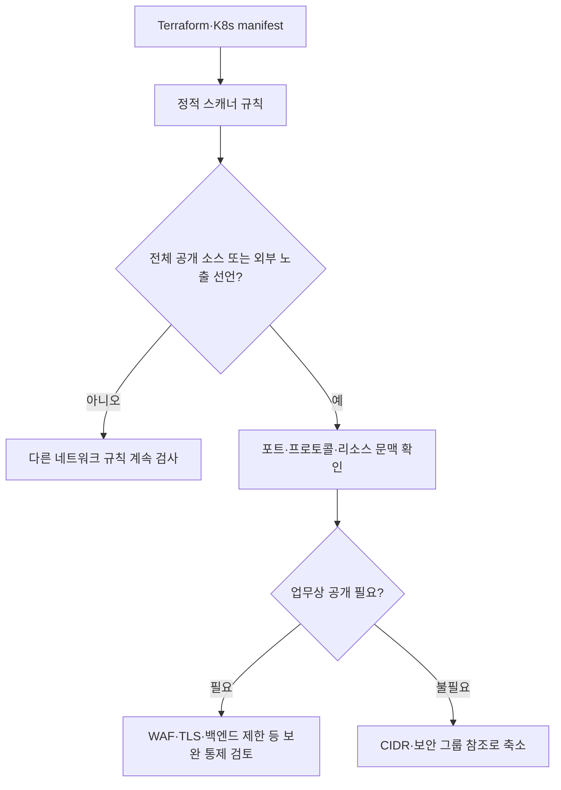
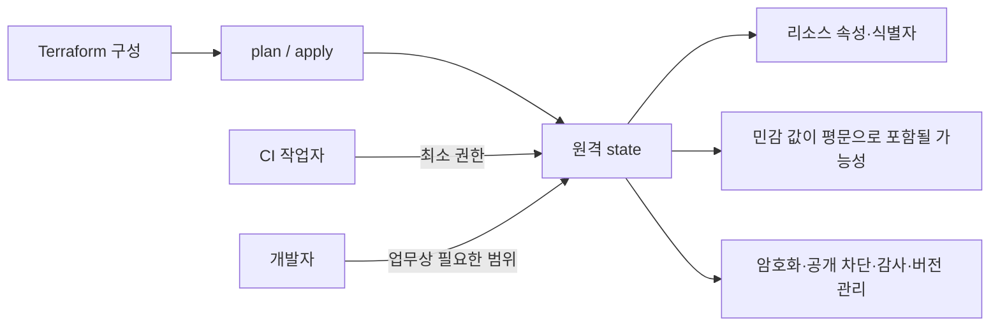

[[웹 취약점 진단 인프라편 — CI-CD와 클라우드 설정 노출]]이 배포된 환경에서 노출된 설정을 찾는 입문·정찰 단계였다면, 이번 글은 **이미 확보한 낮은 권한에서 시작하는 사후 익스플로잇 체인을 가능하게 만드는 조건**을 인프라 선언 코드에서 찾아 배포 전에 차단하는 사전 진단에 초점을 맞춥니다. 애플리케이션 코드 의존성의 알려진 취약점을 찾는 공급망 SCA 글과 달리, 여기서는 Terraform과 Kubernetes manifest에 선언된 네트워크·권한·시크릿·상태 저장 방식의 설정 결함만 다루며, 실행 중인 대상에서 체인을 재현하는 단계와는 경계를 나눕니다.

---

## 1. IaC와 정적 스캐닝 — 건물을 짓기 전에 설계도 검사하기

쉽게 말하면, IaC(Infrastructure as Code)는 서버·네트워크·권한을 사람이 콘솔에서 하나씩 클릭해 만드는 대신 **건물 설계도처럼 코드로 선언**하는 방식입니다. 건물이 완성된 뒤 현장에서 비상구가 없다는 사실을 발견하는 것보다 설계도 검토 단계에서 표시를 찾아 고치는 편이 빠르듯, 보안 그룹 전체 개방이나 privileged 파드 같은 설정도 배포 전에 코드 리뷰와 자동 검사로 막을 수 있습니다.

이 설계도 비유에는 한계도 있습니다. 실제 운영자가 콘솔에서 설정을 바꾸면 코드와 현실 사이에 드리프트가 생길 수 있고, 변수 값과 모듈 조합이 확정되기 전에는 스캐너가 최종 구성을 완전히 계산하지 못할 수 있으므로, IaC 스캔이 런타임 진단을 대체하지는 않습니다.

**원리**: Checkov, Trivy, KICS 같은 정적 스캐너는 Terraform HCL과 Kubernetes YAML을 파싱해 리소스 종류와 속성을 규칙에 대조합니다. 예를 들어 보안 그룹 인그레스가 `0.0.0.0/0`이고 민감한 포트를 허용하는지, 컨테이너가 privileged로 선언됐는지처럼 코드에 명시된 패턴은 배포 없이도 찾을 수 있습니다.

도구 이름이 다르더라도 효과를 좌우하는 것은 CI의 실패 기준과 예외 관리입니다. 결과를 보고서로만 남기고 병합을 계속 허용하거나 모든 오탐을 전역 제외하면 사전 통제가 되지 않으며, 반대로 위험도와 업무 맥락을 구분하지 않고 모든 규칙을 차단하면 반복적인 예외 승인 때문에 중요한 경고까지 묻힐 수 있습니다.

- 체크 포인트: 저장소의 `.tf`·`.tf.json`·Kubernetes YAML이 스캔 대상에 모두 포함되는지, 고위험 규칙이 병합을 실제로 차단하는지, 예외에 사유·소유자·만료일이 있는지, 운영 환경 드리프트를 별도로 탐지하는지
- 참고: [Checkov — 지원 프레임워크와 IaC 스캔](https://www.checkov.io/1.Welcome/Quick%20Start.html), [Trivy — IaC Misconfiguration Scanning](https://trivy.dev/latest/docs/scanner/misconfiguration/)

## 2. `0.0.0.0/0` 인그레스와 문맥 있는 판정

**원리**: Terraform의 보안 그룹이나 방화벽 규칙에서 `0.0.0.0/0`은 모든 IPv4 주소를 소스로 허용한다는 뜻입니다. 하지만 이 값 하나만으로 취약점의 심각도가 확정되지는 않으며, 인터넷에 공개해야 하는 443 포트인지 관리용 SSH·데이터베이스 포트인지, 리소스에 공인 경로가 실제로 연결돼 있는지까지 함께 봐야 합니다.

Kubernetes manifest에서는 Service의 `type: LoadBalancer`나 Ingress가 외부 진입점을 만들 수 있지만, 클라우드 방화벽·Ingress Controller·NetworkPolicy가 최종 도달성을 바꿉니다. 정적 스캐너는 명시적인 전체 개방을 빠르게 표시하는 데 강하지만 여러 저장소와 런타임 정책에 흩어진 최종 네트워크 경로를 모두 증명하지는 못합니다.

좋은 규칙은 `0.0.0.0/0` 문자열을 무조건 금지하는 데서 끝나지 않고, 관리 포트와 데이터 계층처럼 외부 공개가 거의 필요 없는 대상을 우선 차단합니다. IPv6의 `::/0`도 같은 의미로 검사해야 하며, 규칙을 좁힌 뒤에는 실제 배포 계획에서 다른 규칙과 합쳐 다시 열리지 않는지 확인해야 합니다.

- 체크 포인트: IPv4 `0.0.0.0/0`과 IPv6 `::/0`, 공개된 포트와 프로토콜, 공인 IP·LoadBalancer·Ingress 연결 여부, 관리 포트와 데이터베이스 포트가 승인된 소스 CIDR 또는 보안 그룹 참조로 제한되는지
- 참고: [AWS — 보안 그룹 규칙](https://docs.aws.amazon.com/vpc/latest/userguide/security-group-rules.html), [Kubernetes — Ingress](https://kubernetes.io/docs/concepts/services-networking/ingress/)

## 3. `.tf`·`.yaml`의 하드코딩 시크릿

**원리**: 평문 비밀번호나 API 키를 Terraform 변수 기본값, 리소스 속성, Kubernetes Secret의 manifest에 직접 쓰면 저장소 읽기 권한과 CI 로그·아티팩트 경로를 통해 값이 복제됩니다. Kubernetes Secret의 `data` 필드는 기본적으로 암호화가 아니라 base64 인코딩이므로, manifest에 커밋된 값을 비밀로 보호해 주지 않습니다.

정적 스캐너는 키 이름과 값의 패턴, 엔트로피를 바탕으로 의심 문자열을 찾지만 모든 시크릿을 정확히 판별할 수는 없습니다. 예제 값이 오탐으로 잡힐 수 있고 규칙적인 내부 토큰은 놓칠 수 있으므로, 탐지 결과는 실제 자격증명인지 확인하되 값을 보고서나 CI 로그에 다시 출력하지 않아야 합니다.

도구별 기본 동작도 구분해야 합니다. Checkov는 별도 secrets 프레임워크를 제공하고 KICS는 시크릿 패턴 규칙을 적용할 수 있지만, Trivy의 `config` 스캔은 기본적으로 오구성 검사이므로 평문 자격증명까지 찾으려면 파일시스템 검사에서 secret scanner를 명시적으로 함께 켜야 합니다.

해결은 값을 다른 평문 파일로 옮기는 것이 아니라 배포 시점에 전용 시크릿 저장소나 승인된 외부 Secret 연동으로 주입하는 것입니다. 이미 커밋된 값은 최신 파일에서 삭제하는 것만으로 끝나지 않고 저장소 히스토리와 포크·캐시를 고려해 자격증명을 회전해야 합니다.

- 체크 포인트: `.tf`·`.tfvars`·`.yaml`의 비밀번호·토큰·개인키 패턴, Kubernetes Secret 값이 저장소에 직접 들어 있는지, 스캔 출력이 원문 시크릿을 노출하지 않는지, 발견한 자격증명의 폐기·회전 절차가 실행되는지
- 참고: [Kubernetes — Secret 보안 모범 사례](https://kubernetes.io/docs/concepts/security/secrets-good-practices/), [Checkov — 시크릿 스캔](https://www.checkov.io/2.Basics/Scanning%20Credentials%20and%20Secrets.html), [Trivy — 시크릿 스캐닝](https://trivy.dev/latest/docs/scanner/secret/), [HashiCorp — Terraform에서 민감한 데이터 관리](https://developer.hashicorp.com/terraform/language/manage-sensitive-data)

## 4. `terraform.tfstate`는 민감한 운영 데이터다

**원리**: Terraform state는 선언 코드와 실제 리소스를 연결하기 위해 리소스 속성과 식별자를 저장합니다. 코드에서 값을 `sensitive`로 표시하면 CLI 화면의 노출은 줄어들지만 state 내부 저장 자체가 제거되는 것은 아니므로, 공급자가 반환한 비밀번호나 연결 정보가 평문 형태로 남을 수 있습니다.

`terraform.tfstate`를 Git에 커밋하지 않는 것만으로 충분하지 않습니다. 팀이 함께 쓰는 원격 state를 S3 같은 객체 스토리지에 둘 때는 저장 암호화, 전송 보호, 최소 권한, 공개 접근 차단과 감사 로그가 필요하고, 잠금이나 버전 관리도 동시 변경과 실수로 인한 손상·복구 위험을 줄이는 별도 통제입니다.

스캐닝에서는 state 파일이 저장소나 빌드 아티팩트에 포함됐는지와 원격 백엔드 구성을 함께 봐야 합니다. 백엔드가 안전해도 CI가 state를 내려받은 작업 디렉터리와 로그·캐시를 오래 보존하면 다른 유출 경로가 생기므로, 실행 환경의 수명과 아티팩트 수집 범위까지 확인해야 합니다.

- 체크 포인트: `terraform.tfstate`와 백업 파일의 Git 추적 여부, 원격 백엔드의 암호화·공개 접근 차단·IAM 최소 권한·감사 로그·버전 관리, CI 캐시와 아티팩트에 state가 포함되는지, `sensitive` 표시를 암호화로 오해하지 않는지
- 참고: [HashiCorp — Terraform state의 민감 데이터](https://developer.hashicorp.com/terraform/language/state/sensitive-data), [AWS — S3 보안 모범 사례](https://docs.aws.amazon.com/AmazonS3/latest/userguide/security-best-practices.html)

## 5. CI 게이트와 예외의 수명 관리

**원리**: IaC 스캐너를 CI에 넣는 목적은 경고 수를 늘리는 것이 아니라 위험한 선언이 배포 단계로 넘어가는 조건을 통제하는 데 있습니다. 변경된 파일만 빠르게 검사하더라도 공통 모듈 수정이 여러 환경에 미치는 영향을 놓치지 않아야 하고, 가능하면 병합 요청의 변경분 검사와 주기적인 전체 저장소 검사를 함께 둬야 합니다.

Checkov·Trivy·KICS는 겹치는 규칙이 많지만 규칙 식별자와 파싱 범위가 달라 결과가 완전히 같지는 않습니다. 세 도구를 모두 의무적으로 겹쳐 돌리는 것보다 저장소 형식과 팀 운영에 맞는 하나를 기본 게이트로 정하고, 누락되는 영역이 확인될 때만 보완 도구를 추가하는 편이 예외와 중복 경고를 관리하기 쉽습니다.

예외는 취약점이 사라졌다는 뜻이 아니라 특정 기간 동안 위험을 수용한다는 기록입니다. 인라인 skip이나 CI allowlist에는 근거, 승인자, 보완 통제, 만료일을 남기고 만료 뒤 자동으로 다시 실패하게 해야 하며, 기준선 파일이 새 결함까지 숨기지 않는지 정기적으로 줄여야 합니다.

- 체크 포인트: 고위험 결과의 CI 실패 기준, 변경분과 전체 저장소 검사 주기, 공통 모듈 변경의 영향 범위, 예외의 사유·승인자·만료일, 스캐너 버전과 정책 번들의 갱신 절차
- 참고: [KICS — CI/CD Integrations](https://docs.kics.io/latest/integrations/), [Trivy — CI에서 종료 코드 설정](https://trivy.dev/latest/docs/configuration/others/#exit-code)

## 정리

| 진단 대상 | 정적 스캐너가 찾는 신호 | 별도로 확인할 경계 |
|---|---|---|
| 네트워크 노출 | `0.0.0.0/0`, `::/0`, 외부 서비스 선언 | 실제 라우팅·방화벽·포트 문맥 |
| 하드코딩 시크릿 | 평문 값·의심 키 이름·Secret manifest | 오탐 검토, 회전, 로그 재노출 |
| Terraform state | 저장소 포함과 취약한 백엔드 설정 | 원격 저장소·CI 캐시 접근권한 |
| CI 게이트 | 정책 위반과 예외 선언 | 병합 차단 여부, 예외 만료·승인 |

