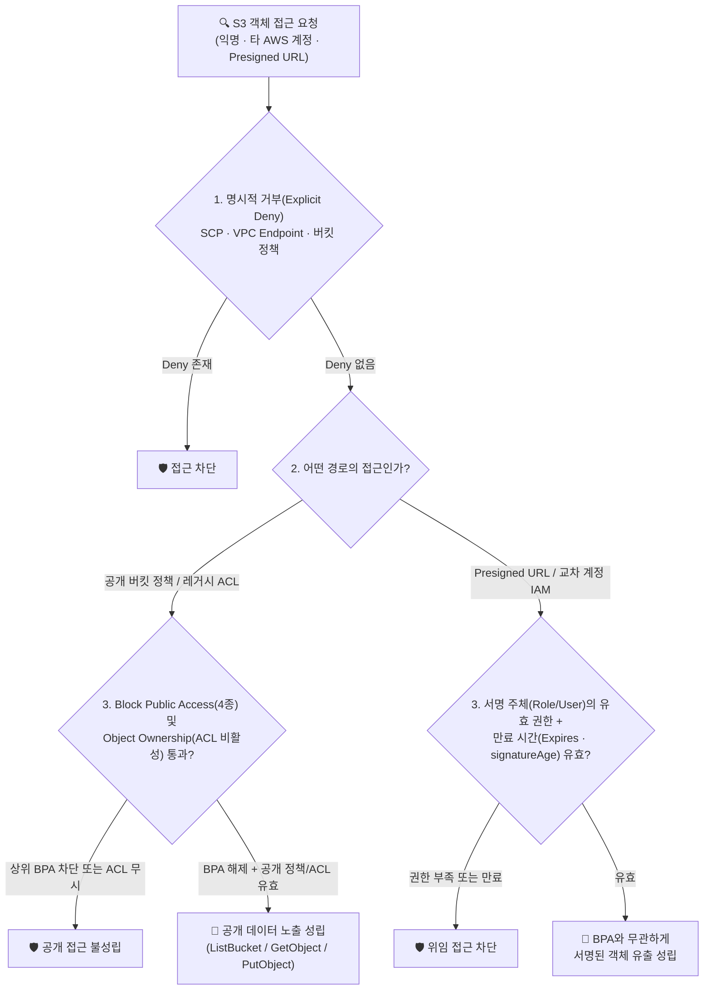
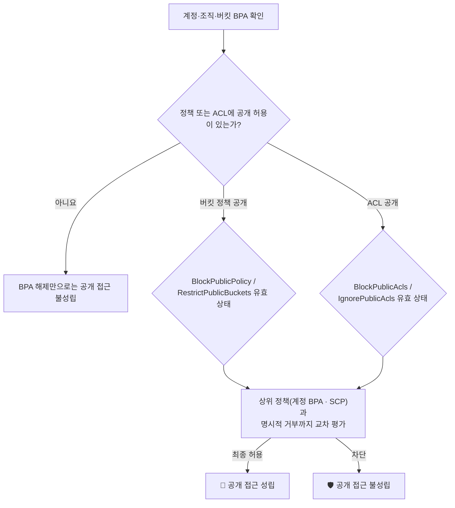

> [!summary] ⏱️ 5초 핵심 요약
> - **한 줄 비유**: 창고 바깥의 **비상 셔터(Block Public Access)**가 올라가 있고, 창고 문에 **'누구나 출입 가능' 규정(버킷 정책·레거시 ACL)**이 붙어 있거나 **유효기간이 너무 긴 시간제 출입증(Presigned URL·SAS 토큰)**이 외부로 새어 나갈 때 창고 안의 데이터가 유출됩니다.
> - **핵심 원리**: S3 데이터 노출은 단일 플래그 하나가 아니라 **`Block Public Access(계정·버킷)` + `Object Ownership(ACL 활성 여부)` + `버킷 정책/ACL/IAM 정책` + `Presigned URL 위임 범위`**가 교차 평가되어 최종 허용(`Allow`)이 나올 때 성립합니다.
> - **핵심 방어**: 계정·버킷 수준 **Block Public Access 4종 전면 활성화 + `Bucket owner enforced`로 ACL 비활성화 + Presigned URL/SAS 토큰 만료 시간 최소화 및 로그 노출 차단**을 기본 원칙으로 삼습니다.

[[웹 취약점 진단 인프라편 — CI-CD와 클라우드 설정 노출]]이 외부에서 보이는 버킷과 노출된 설정을 **찾는 입문·정찰 단계**였다면, 이번 글은 이미 식별한 스토리지의 정책·ACL·위임 URL이 어떤 조건에서 실제 데이터 접근으로 이어지는지를 분석하는 **사후 익스플로잇 단계**입니다. 공개 접근 표시 하나만 확인하는 데서 멈추지 않고, 여러 권한 계층이 만나는 지점과 링크가 유출된 뒤의 유효 범위를 구분해 데이터 유출 체인이 성립하는 경계를 봅니다.



---

## 한눈에 보는 스토리지 권한 모델 비교

| 권한/제어 계층 | 비유 및 역할 | 작동 범위와 핵심 특징 | 진단 시 가장 자주 하는 오해 |
|---|---|---|---|
| **Block Public Access (BPA)** | 창고 바깥의 **통합 안전 셔터** | 계정·버킷·액세스 포인트 수준에서 공개 ACL과 공개 버킷 정책을 덮어써서 차단 (4개 세부 설정) | "BPA를 끄면 버킷이 바로 공개된다" (❌ 기존 공개 정책/ACL이 있어야 노출됨) |
| **버킷 정책 (Bucket Policy)** | 창고 정문에 붙인 **공식 출입 규정집** | 버킷 단위의 JSON 리소스 정책. 익명(`*`), 교차 계정, VPC 조건 등을 세밀하게 제어 | "`ListBucket`이 안 되면 파일도 못 읽는다" (❌ 키 이름을 알면 `GetObject`만 열려 있어도 다운로드 가능) |
| **레거시 ACL (Access Control List)** | 옛날에 방·물건마다 달아둔 **구식 열쇠함** | 버킷·객체 단위 구형 권한. 현재는 `Bucket owner enforced`로 비활성화하는 것이 표준 | "`AuthenticatedUsers`는 우리 회사 직원만 뜻한다" (❌ **전 세계 모든 AWS 계정**을 뜻함) |
| **Presigned URL / Azure SAS** | 외부인에게 건네준 **시간제 임시 초대장(Bearer Token)** | 발급자의 권한을 빌려 특정 객체·동작을 만료 시간까지 URL 하나로 허용 | "BPA를 켜두면 Presigned URL 유출도 막힌다" (❌ 정식 서명된 요청이므로 BPA가 막지 않음) |

---

## 1. 버킷 정책·ACL·presigned URL의 역할

**💡 한 줄 비유**: **버킷 정책**은 건물 전체에 적용되는 **공식 출입 규정**, **ACL**은 옛날에 물건마다 붙여둔 **개별 열쇠함**, **Block Public Access**는 실수로 문을 열어두어도 바깥에서 한 번 더 막아주는 **외부 방화 셔터**, 그리고 **Presigned URL**은 유효기간 동안 소지자 누구나 쓸 수 있는 **시간제 무기명 초대장**입니다.

### 핵심 원리
- **다계층 교차 평가**: S3 접근 여부는 **IAM 자격 기반 정책, 버킷·액세스 포인트 정책, ACL, Block Public Access(계정·버킷), 조직 정책(SCP)과 명시적 거부(`Explicit Deny`)**를 함께 평가한 결과입니다. 따라서 "ACL이 공개다" 또는 "Block Public Access가 꺼졌다"는 단편적 관찰 하나만으로는 충분하지 않으며, 실제 객체에 대한 허용 경로가 존재하고 상위 계층에서 차단되지 않을 때만 노출이 성립합니다.
- **방화 셔터(BPA) 해제의 의미**: Block Public Access 설정을 하나 끄는 행위가 그 자체로 허용 정책을 새로 만들지는 않지만, **과거에 잘못 넣어두었던 공개 버킷 정책이나 공개 ACL을 다시 깨워 한 번의 설정 변경이 노출의 마지막 방아쇠**가 될 수 있습니다.
- **최신 기본값과 레거시 환경의 차이**: 신규 S3 버킷은 기본적으로 공개 차단(BPA 활성) 상태이며, **Object Ownership**도 `Bucket owner enforced`가 기본이라 ACL이 아예 비활성화됩니다. 반면 오래된 버킷이나 호환성 때문에 ACL을 다시 켠 환경에서는 정책과 ACL이라는 두 권한 모델이 동시에 작동하므로 현재의 유효 설정을 세트로 점검해야 합니다.

### 체크 포인트
- 계정·버킷·액세스 포인트 수준의 Block Public Access와 조직 정책(SCP) 중 가장 제한적인 값이 무엇인지 확인했는가?
- 버킷 정책의 공개 `Principal`·`Condition`, Object Ownership 모드, ACL 활성화 여부를 한 세트로 묶어 점검했는가?
- Presigned URL을 일반 익명 공개 설정과 구분하고 허용 동작·대상 객체·발급 주체·만료 시간을 별도로 기록했는가?
- 참고: [AWS S3 — Access control in Amazon S3](https://docs.aws.amazon.com/AmazonS3/latest/userguide/access-management.html), [AWS S3 — Controlling ownership of objects and disabling ACLs](https://docs.aws.amazon.com/AmazonS3/latest/userguide/about-object-ownership.html), [AWS S3 — Download and upload objects with presigned URLs](https://docs.aws.amazon.com/AmazonS3/latest/userguide/using-presigned-url.html)

---

## 2. 네 가지 Block Public Access 설정의 경계

**💡 한 줄 비유**: Block Public Access는 버튼 하나짜리 스위치가 아니라 **'새 구식 열쇠함 반입 금지(`BlockPublicAcls`)', '기존 구식 열쇠함 무시(`IgnorePublicAcls`)', '새 공개 규정 부착 금지(`BlockPublicPolicy`)', '기존 공개 규정 차단(`RestrictPublicBuckets`)'이라는 4개의 개별 잠금장치**로 이루어진 제어판입니다.



### 핵심 원리: 4가지 세부 설정의 정확한 역할

| BPA 세부 플래그 | 제어 대상 | `true`일 때의 정확한 동작 | `false`일 때 주의할 점 |
|---|---|---|---|
| **`BlockPublicAcls`** | **신규** 공개 ACL | 새로 업로드하거나 수정할 때 공개 ACL을 넣는 `PUT` 요청을 거부함 | **이미 저장되어 있던 기존 공개 ACL은 지우거나 무시하지 못함** |
| **`IgnorePublicAcls`** | **기존+신규** 공개 ACL | 버킷·객체에 저장된 모든 공개 ACL을 권한 평가 시 완전히 무시함 | 이 값이 꺼지면 과거에 남아 있던 공개 ACL이 즉시 다시 효력을 발휘함 |
| **`BlockPublicPolicy`** | **신규** 공개 버킷 정책 | 버킷 정책을 새로 저장·수정할 때 공개 허용으로 판정되면 거부함 | **이미 적용되어 있던 기존 공개 버킷 정책은 자동 삭제하지 않음** |
| **`RestrictPublicBuckets`** | **기존** 공개 버킷 정책 | 공개 정책이 있는 버킷이라도 AWS 서비스와 계정 소유자 외의 공개·교차 계정 접근을 차단함 | 이 값이 꺼지면 기존에 남아 있던 공개 버킷 정책이 실제 외부 접근을 허용함 |

- **계정 수준 vs 버킷 수준 평가**: 계정 전체(Account-level) BPA와 개별 버킷 BPA 중 **더 제한적인 쪽(`true`)이 항상 우선**합니다. 따라서 개별 버킷 화면에서 BPA가 꺼져 있어도 계정 수준 BPA가 켜져 있으면 공개되지 않으며, 반대로 계정 수준 차단이 없는 상태에서 특정 플래그를 끄면 숨어 있던 과거 정책이 활성화될 수 있습니다.

### 체크 포인트
- 네 가지 설정을 하나의 `On/Off`로 뭉뚱그리지 않고 **계정 수준과 버킷 수준 각각의 4개 불리언 값**을 모두 수집했는가?
- 과거에 공개 정책이나 공개 ACL이 이미 들어간 상태에서 차단 설정만 변경된 이력이 없는가?
- 정적 웹 호스팅 등 공개가 필요한 예외도 CloudFront OAC(Origin Access Control)를 우선 검토하고, 민감 객체와 버킷을 철저히 분리했는가?
- 참고: [AWS S3 — Blocking public access to your Amazon S3 storage](https://docs.aws.amazon.com/AmazonS3/latest/userguide/access-control-block-public-access.html), [AWS S3 — Configuring block public access settings for your S3 buckets](https://docs.aws.amazon.com/AmazonS3/latest/userguide/configuring-block-public-access-bucket.html)

---

## 3. 레거시 ACL의 `AuthenticatedUsers`와 `AllUsers`

**💡 한 줄 비유**: `AllUsers`가 **"길 지나가는 전 세계 누구나"**라면, `AuthenticatedUsers`는 **"우리 회사 사원증 소지자"가 아니라 "아마존(AWS) 무료 회원 가입만 한 전 세계 모든 사람"**입니다. 이름만 믿고 열었다가는 전 세계 공격자에게 창고를 열어주게 됩니다.

### 핵심 원리
- **`AllUsers` vs `AuthenticatedUsers`의 함정**:
  - **`AllUsers` (`http://acs.amazonaws.com/groups/global/AllUsers`)**: 서명되지 않은 익명 요청을 포함해 전 세계 누구나 접근 가능합니다.
  - **`AuthenticatedUsers` (`http://acs.amazonaws.com/groups/global/AuthenticatedUsers`)**: 이름 때문에 "우리 조직의 로그인 사용자"로 착각하기 쉬우나, 실제로는 **본인의 개인 AWS 계정으로 요청에 서명한 전 세계 모든 AWS 사용자**를 뜻합니다. 누구나 AWS 계정을 만들 수 있으므로 민감 데이터에 대해서는 사실상 전체 공개와 다름없습니다.
- **쓰기(`WRITE`) 및 ACL 권한(`READ_ACP`/`WRITE_ACP`) 위험**: 읽기(`READ`) 노출뿐 아니라 버킷 ACL에 `WRITE`를 열어두면 제3자가 임의 객체를 업로드(무결성 훼손·악성 파일 유포·스토리지 비용 폭탄)하거나 객체를 삭제할 수 있고, `WRITE_ACP`나 `FULL_CONTROL`이 열려 있으면 공격자가 ACL 자체를 다시 고쳐 모든 권한을 가져갈 수 있습니다.
- **실제 성립 전제조건**: 단, 이 경로는 **ACL이 실제 평가에 참여할 때만** 성립합니다. Object Ownership이 `Bucket owner enforced`이거나 `IgnorePublicAcls: true`가 유효하면 ACL 문서에 그룹 URI가 남아 있어도 실제로는 무시되므로, 설정 잔재와 실제 익스플로잇 가능 여부를 구분해 보고해야 합니다.

### 진단 시 확인 명령어
```bash
# 1. Object Ownership 확인 (BucketOwnerEnforced 이면 ACL은 비활성화됨)
aws s3api get-bucket-ownership-controls --bucket <검토할-버킷>

# 2. 버킷 ACL에 AllUsers 또는 AuthenticatedUsers 그룹 URI가 있는지 확인
aws s3api get-bucket-acl --bucket <검토할-버킷>
```

### 체크 포인트
- ACL의 Grantee URI에서 `AllUsers`와 `AuthenticatedUsers`를 정확히 구분하고, 부여된 권한(`READ`, `WRITE`, `READ_ACP`, `WRITE_ACP`, `FULL_CONTROL`)을 확인했는가?
- Object Ownership(`Bucket owner enforced`)과 `IgnorePublicAcls` 때문에 해당 ACL이 실제로 비활성·무시되는 상태인지 교차 검증했는가?
- 레거시 사유가 없다면 모든 버킷을 `Bucket owner enforced`로 전환해 ACL을 영구 비활성화했는가?
- 참고: [AWS S3 — Access control list overview](https://docs.aws.amazon.com/AmazonS3/latest/userguide/acl-overview.html), [AWS S3 — Configuring ACLs](https://docs.aws.amazon.com/AmazonS3/latest/userguide/managing-acls.html)

---

## 4. presigned URL과 Azure SAS 토큰의 오남용

**💡 한 줄 비유**: Presigned URL과 SAS 토큰은 **"이 링크를 가진 사람에게 내 권한으로 3번 금고 문을 열어주시오"라고 미리 도장을 찍어 준 무기명 위임장**입니다. 창고 외부 셔터(BPA)를 내려도 **정식 직원이 도장 찍어 보낸 위임장이라 통과**되며, 이 링크가 채팅방이나 로그에 새어 나가면 유효기간이 끝날 때까지 누구나 물건을 꺼내 갈 수 있습니다.

### 핵심 원리
- **위임 URL의 작동 방식과 한계**:
  - **S3 Presigned URL**: 발급자(IAM User 또는 Role)의 자격증명으로 특정 S3 동작(`GetObject`, `PutObject` 등)과 객체 키, 만료 시간을 미리 서명해 쿼리 파라미터로 담은 URL입니다. 수신자는 AWS 자격증명이 없어도 URL만으로 접근할 수 있으며, **정식 서명된 요청이므로 Block Public Access가 차단하지 않습니다.**
  - **유효 시간 결정 규칙**: AWS CLI/SDK(SigV4)로 만든 Presigned URL은 최대 **7일(604,800초)**까지 지정할 수 있지만, 만약 STS 임시 자격증명(예: EC2/Lambda Role)으로 서명했다면 **URL 만료 시간과 서명 주체의 세션 만료 시간 중 더 빠른 시점**에 만료됩니다.
- **방어 가드레일 (`s3:signatureAge` 및 네트워크 조건)**:
  - 버킷 정책이나 IAM 정책에서 `s3:signatureAge` 조건 키를 사용하면(예: 15분 초과 서명 거부) 개발자가 코드에서 실수로 7일짜리 Presigned URL을 발급하더라도 짧은 시간 뒤 무효화할 수 있습니다.
  - 내부 시스템 간 전달용이라면 `aws:SourceIp`, `aws:SourceVpc`, `aws:SourceVpce` 조건을 결합해 URL이 외부로 유출되더라도 다른 네트워크에서는 쓰지 못하게 막을 수 있습니다.
- **Azure Storage SAS(Shared Access Signature) 비교**:
  - Azure의 SAS 토큰도 대상 자원·권한(`r`, `w`, `d`, `l` 등)·시작·만료 시간을 쿼리 문자열에 담아 위임하는 동일한 구조입니다.
  - 지나치게 긴 만료 시간, 과도한 권한(`racwdl`), `sip`(허용 IP)나 `spr=https` 누락, 그리고 계정 키 기반 SAS 남발이 주요 위험 요인이며, Microsoft는 **Microsoft Entra ID 기반 사용자 위임 SAS(User Delegation SAS)**와 짧은 유효 시간, 계정 수준 SAS 만료 정책 설정을 권장합니다.

### 버킷 정책으로 Presigned URL 최대 유효 시간(15분) 강제 예시
```json
{
  "Version": "2012-10-17",
  "Statement": [
    {
      "Sid": "DenyPresignedUrlOlderThan15Minutes",
      "Effect": "Deny",
      "Principal": "*",
      "Action": "s3:*",
      "Resource": "arn:aws:s3:::my-sensitive-bucket/*",
      "Condition": {
        "NumericGreaterThan": {
          "s3:signatureAge": 900000
        },
        "StringEquals": {
          "s3:authType": "REST-QUERY-STRING"
        }
      }
    }
  ]
}
```

### 체크 포인트
- Presigned URL·SAS 토큰의 **대상 객체 범위, 허용 메서드(`GET`/`PUT`), 발급 자격증명 유형(장기 키 vs STS 임시 세션), 만료 시간**이 실제 업무 소요 시간에 맞게 최소화되어 있는가?
- `s3:signatureAge` 및 네트워크 조건, 또는 Azure SAS의 `sip`·HTTPS 전용·사용자 위임 SAS가 적용되어 있는가?
- 프론트엔드 URL 파라미터, 웹 서버 액세스 로그, 에러 트래커, 고객 지원 티켓 등에 위임 URL 원문이 그대로 기록·노출되지 않으며, 유출 시 **서명 자격증명 취소(Revoke)/회전** 절차가 준비되어 있는가?
- 참고: [AWS S3 — Download and upload objects with presigned URLs](https://docs.aws.amazon.com/AmazonS3/latest/userguide/using-presigned-url.html), [AWS Prescriptive Guidance — Establishing guardrails and monitoring for presigned URLs](https://docs.aws.amazon.com/prescriptive-guidance/latest/presigned-url-best-practices/introduction.html), [Microsoft Learn — Grant limited access to Azure Storage resources using SAS](https://learn.microsoft.com/en-us/azure/storage/common/storage-sas-overview)

---

## 5. 데이터 유출 체인의 검증과 탐지

**💡 한 줄 비유**: 금고 방에 들어갈 수 있다고 해서 금고 문이 열린 것은 아니고, 반대로 **방 안의 물건 목록표(`ListBucket`)는 가려져 있어도 물건 번호를 미리 알고 손만 뻗으면 꺼내지는(`GetObject`) 경우**가 있습니다. 그리고 진단자는 금고가 열리는지 증명하려고 **실제 고객 현금을 자루에 담아 밖으로 들고 나와서는 안 됩니다.**

### 핵심 원리
- **`s3:ListBucket`과 `s3:GetObject`의 분리 평가**:
  - `s3:ListBucket`(버킷 ARN 대상)은 버킷 안의 파일 목록을 조회하는 권한이고, `s3:GetObject`(`버킷ARN/*` 대상)는 실제 파일 내용을 내려받는 권한입니다.
  - 목록 조회(`ListBucket`)가 `AccessDenied`로 막혀 있어도, 웹 페이지 소스나 모바일 앱 정적 분석에서 파일 경로(Key 패턴)가 노출되어 있고 `GetObject`가 열려 있으면 데이터 유출 체인이 그대로 성립합니다.
- **안전한 진단 윤리와 검증 방법**: 승인된 진단에서는 정책·설정 조회로 먼저 후보를 좁히고, 접근 검증이 필요할 때는 **시스템 소유자가 준비한 무해한 더미(Canary) 객체나 메타데이터(`head-object`)**로만 최소 확인합니다. 운영 고객 데이터를 대량으로 내려받아 로컬 PC에 저장하는 행위는 그 자체로 2차 유출 사고를 만들 수 있으므로 절대 피해야 합니다.
- **탐지 및 가시성 확보**:
  - 일반 CloudTrail 관리 이벤트(Management Events)에는 버킷 생성·정책 변경만 남고 **개별 파일 다운로드(`GetObject`)나 업로드(`PutObject`)는 기록되지 않습니다.**
  - 따라서 중요 버킷에는 반드시 **CloudTrail S3 데이터 이벤트(Data Events)** 또는 **S3 서버 액세스 로깅(Server Access Logging)**을 켜야 누가 언제 어떤 객체나 Presigned URL을 호출했는지 추적할 수 있으며, **Amazon Macie**를 병행하면 버킷 내 민감 정보(PII·자격증명) 분포와 공개 노출 상태를 자동으로 식별할 수 있습니다.

### 진단 시 설정 확인 명령어 (Read-Only 점검)
```bash
# 1. 계정 및 버킷의 Block Public Access 4가지 설정 확인
aws s3control get-public-access-block --account-id 123456789012
aws s3api get-public-access-block --bucket <검토할-버킷>

# 2. AWS가 판정한 버킷 정책의 공개 상태(IsPublic) 및 정책 원문 확인
aws s3api get-bucket-policy-status --bucket <검토할-버킷>
aws s3api get-bucket-policy --bucket <검토할-버킷>
```

### 체크 포인트
- `ListBucket`과 객체별 `GetObject`·`PutObject` 허용 여부를 분리해 평가하고, 실제 검증은 승인된 카나리 객체로만 제한했는가?
- 공개 접근(BPA)을 차단한 뒤에도 **Presigned URL, 교차 계정 역할(`sts:AssumeRole`), VPC 엔드포인트 정책, S3 액세스 포인트** 같은 우회 경로가 남아 있지 않은가?
- 중요 버킷에 **CloudTrail 데이터 이벤트 또는 S3 서버 액세스 로그**가 활성화되어 비정상 대량 다운로드와 외부 IP 접근을 탐지할 수 있는가?
- 참고: [AWS S3 — Logging with CloudTrail](https://docs.aws.amazon.com/AmazonS3/latest/userguide/cloudtrail-logging-s3-info.html), [AWS S3 — Logging requests with server access logging](https://docs.aws.amazon.com/AmazonS3/latest/userguide/ServerLogs.html), [Amazon Macie — Discovering sensitive data](https://docs.aws.amazon.com/macie/latest/user/discovery-jobs.html)
