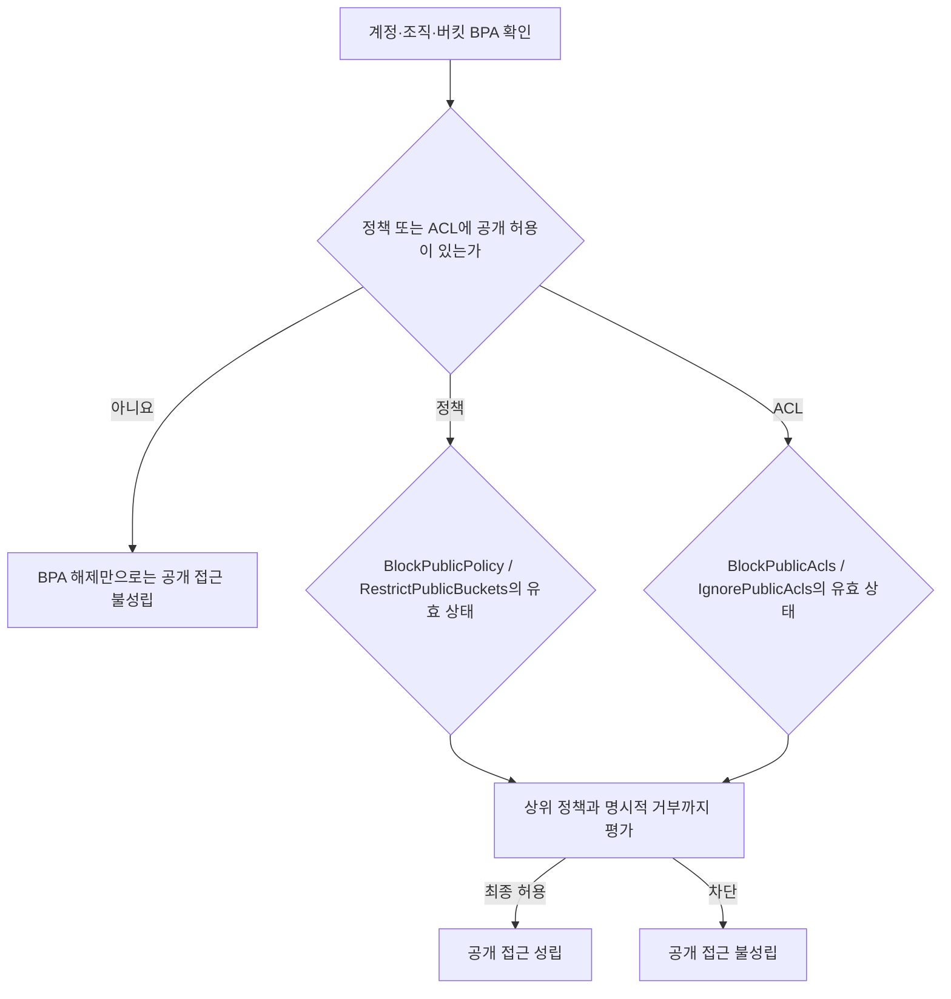

[[웹 취약점 진단 인프라편 — CI-CD와 클라우드 설정 노출]]이 외부에서 보이는 버킷과 노출된 설정을 **찾는 입문·정찰 단계**였다면, 이번 글은 이미 식별한 스토리지의 정책·ACL·위임 URL이 어떤 조건에서 실제 데이터 접근으로 이어지는지를 분석하는 **사후 익스플로잇 단계**입니다. 공개 접근 표시 하나만 확인하는 데서 멈추지 않고, 여러 권한 계층이 만나는 지점과 링크가 유출된 뒤의 유효 범위를 구분해 데이터 유출 체인이 성립하는 경계를 봅니다.

---

## 1. 버킷 정책·ACL·presigned URL의 역할

쉽게 말하면, 버킷 정책은 건물 전체에 적용되는 출입 규정이고 ACL은 방이나 물건마다 붙어 있던 오래된 개별 열쇠함에 가깝습니다. presigned URL은 특정 물건에 정해진 동작을 허용하는 시간제 초대장인데, 한 번 쓰면 사라지는 일회용 표가 아니라 유효 시간 동안 URL을 가진 사람이 반복해서 사용할 수 있는 전달식 표(bearer token)라는 점이 중요합니다.

Block Public Access는 출입 규정이나 열쇠함이 실수로 "모두 허용"을 가리키더라도 공개 접근을 막는 건물 바깥의 안전 셔터와 비슷합니다. 셔터 설정을 하나 끄는 행위가 그 자체로 허용 정책을 만들지는 않지만, 이미 남아 있던 공개 정책이나 ACL을 다시 효력 있게 만들어 한 번의 설정 변경이 노출의 마지막 조건이 될 수 있습니다.

**원리**: S3 접근 여부는 IAM 자격 기반 정책, 버킷·액세스 포인트 정책, ACL, Block Public Access, 조직 정책과 명시적 거부를 함께 평가한 결과입니다. 따라서 "ACL이 공개다" 또는 "Block Public Access가 꺼졌다"는 관찰 하나만으로는 충분하지 않고, 실제 객체에 대한 허용 경로가 존재하며 상위 계층에서 차단되지 않을 때만 익명 또는 광범위한 접근이 성립합니다.

신규 S3 버킷은 기본적으로 공개되지 않고, Object Ownership의 `Bucket owner enforced`가 기본이면 ACL도 비활성화됩니다. 반면 오래된 버킷이나 호환성 때문에 ACL을 다시 활성화한 환경에서는 정책과 ACL이라는 두 권한 모델이 동시에 남을 수 있으므로, 진단 시 버킷 생성 시점이나 화면 표시가 아니라 현재의 유효 설정을 확인해야 합니다.

- 체크 포인트:
  - 계정·버킷·액세스 포인트 수준의 Block Public Access와 조직 정책 중 가장 제한적인 값
  - 버킷 정책의 공개 Principal·조건, Object Ownership 모드, ACL 활성화 여부를 한 세트로 확인
  - presigned URL을 일반 공개 설정과 구분하고 허용 동작·객체·발급 주체·유효 시간을 별도로 기록
- 참고: [AWS S3 — Access control in Amazon S3](https://docs.aws.amazon.com/AmazonS3/latest/userguide/access-management.html), [AWS S3 — Controlling ownership of objects and disabling ACLs](https://docs.aws.amazon.com/AmazonS3/latest/userguide/about-object-ownership.html), [AWS S3 — Download and upload objects with presigned URLs](https://docs.aws.amazon.com/AmazonS3/latest/userguide/using-presigned-url.html)

## 2. 네 가지 Block Public Access 설정의 경계

**원리**: S3 Block Public Access는 하나의 스위치처럼 보이지만 실제로는 `BlockPublicAcls`, `IgnorePublicAcls`, `BlockPublicPolicy`, `RestrictPublicBuckets` 네 설정으로 나뉩니다. 앞의 두 개는 각각 새 공개 ACL의 설정을 거부하고 기존 공개 ACL을 평가에서 무시하며, 뒤의 두 개는 각각 새 공개 정책의 설정을 거부하고 공개로 판정된 정책을 가진 버킷의 접근을 제한합니다.

`BlockPublicAcls`는 이미 저장된 ACL을 지우거나 무시하지 않고 새 공개 ACL의 추가를 막는 설정이므로, 기존 ACL까지 차단하려면 `IgnorePublicAcls`의 유효 여부도 봐야 합니다. 마찬가지로 `BlockPublicPolicy`는 새 공개 정책을 저장하지 못하게 하지만 기존 정책을 자동 삭제하지 않으며, `RestrictPublicBuckets`는 공개 정책이 있는 버킷에서 허용되는 접근 범위를 제한하므로 네 값은 서로 대체 관계가 아닙니다.

계정과 버킷에 서로 다른 값이 있으면 S3는 가장 제한적인 조합을 적용하고, 조직 수준 정책이 추가 상한을 둘 수도 있습니다. 따라서 버킷 화면에서 일부 값을 껐더라도 계정·조직 수준 차단 때문에 공개되지 않을 수 있고, 반대로 상위 차단이 없는 상태에서 기존 공개 정책이나 ACL과 맞물리면 특정 플래그 해제가 실제 노출을 활성화할 수 있습니다.



- 체크 포인트:
  - 네 설정을 하나의 `On/Off` 값으로 축약하지 않고 계정·버킷별 값을 각각 수집
  - 공개 정책·ACL이 과거에 이미 존재하는 상태에서 차단 설정만 변경된 이력 확인
  - 정적 웹 호스팅 등 공개가 필요한 예외도 민감 객체와 버킷을 분리하고 읽기 범위만 허용했는지 확인
- 참고: [AWS S3 — Blocking public access to your Amazon S3 storage](https://docs.aws.amazon.com/AmazonS3/latest/userguide/access-control-block-public-access.html), [AWS S3 — Configuring block public access settings for your S3 buckets](https://docs.aws.amazon.com/AmazonS3/latest/userguide/configuring-block-public-access-bucket.html)

## 3. 레거시 ACL의 `AuthenticatedUsers`와 `AllUsers`

**원리**: S3의 `AllUsers` 그룹은 서명되지 않은 익명 요청까지 포함해 전 세계 누구나를 뜻하고, `AuthenticatedUsers` 그룹은 이름과 달리 해당 조직이나 계정의 로그인 사용자만을 뜻하지 않습니다. 후자는 요청이 AWS 자격증명으로 서명되어야 하지만 **전 세계의 모든 AWS 계정**을 포함하므로, 공개 계정 생성이 가능한 현실에서는 민감 데이터에 대해 사실상 공개에 가까운 범위입니다.

두 그룹을 혼동하면 `AuthenticatedUsers`를 "우리 회사에서 인증된 사용자"로 오해해 읽기나 쓰기 권한을 부여하는 사고가 생깁니다. 특히 버킷 ACL의 `WRITE`를 넓게 주면 기존 객체를 곧바로 덮어쓴다는 뜻과 완전히 같지는 않더라도 제3자가 비용이 청구되는 객체를 업로드할 수 있으므로, 읽기 유출과 별개의 무결성·비용 위험까지 검토해야 합니다.

이 경로는 ACL이 실제 평가에 참여할 때만 성립합니다. Object Ownership이 `Bucket owner enforced`이면 ACL이 비활성화되고, `IgnorePublicAcls`가 유효하면 저장된 공개 ACL은 무시되므로, ACL 문서에 그룹 URI가 남아 있다는 사실과 현재 접근 가능성은 구분해 기록해야 합니다.

```text
aws s3api get-bucket-ownership-controls --bucket <검토할-버킷>
aws s3api get-bucket-acl --bucket <검토할-버킷>
```

- 체크 포인트:
  - ACL의 그룹 URI에서 `AllUsers`와 `AuthenticatedUsers`를 구분하고 부여된 `READ`, `WRITE`, `READ_ACP`, `WRITE_ACP`, `FULL_CONTROL` 확인
  - Object Ownership과 `IgnorePublicAcls` 때문에 ACL이 비활성·무시되는 상태인지 확인
  - ACL을 유지해야 하는 레거시 사유가 없다면 정책 중심 권한 모델과 `Bucket owner enforced`로 전환 가능한지 검토
- 참고: [AWS S3 — Access control list overview](https://docs.aws.amazon.com/AmazonS3/latest/userguide/acl-overview.html), [AWS S3 — Configuring ACLs](https://docs.aws.amazon.com/AmazonS3/latest/userguide/managing-acls.html)

## 4. presigned URL과 Azure SAS 토큰의 오남용

**원리**: S3 presigned URL은 발급자의 자격증명으로 특정 S3 동작을 미리 서명해 둔 URL이므로, 수신자는 별도의 AWS 자격증명 없이도 그 URL이 허용한 객체와 동작에 접근할 수 있습니다. 권한은 발급 주체가 원래 가진 범위를 넘지 않고 임시 자격증명으로 서명했다면 그 자격증명이 먼저 만료될 때 URL도 끝나지만, URL 자체가 로그·채팅·브라우저 기록 등에 유출되면 만료 전까지 소지자를 구별하기 어렵습니다.

AWS CLI나 SDK로 만든 S3 presigned URL은 조건에 따라 최대 7일까지 지정할 수 있으므로, 업무에 필요한 시간보다 긴 만료값은 유출 뒤의 악용 가능 시간을 그대로 늘립니다. 버킷 또는 IAM 정책에서 `s3:signatureAge`로 허용할 서명 나이를 더 짧게 제한하고 `aws:SourceIp`, `aws:SourceVpc`, `aws:SourceVpce` 같은 네트워크 조건을 적용할 수 있지만, 실제 사용자의 네트워크가 고정되어 있지 않다면 정상 요청까지 막을 수 있어 배포 환경에 맞춘 검증이 필요합니다.

Azure Storage의 SAS도 자원·권한·시작·만료 시간을 쿼리 문자열에 담아 위임한다는 점에서 같은 부류입니다. 지나치게 긴 만료 시간, 필요 이상으로 넓은 읽기·쓰기·삭제 권한, `sip` IP 제한이나 HTTPS 전용 조건의 부재가 함께 있으면 토큰 유출의 영향이 커지며, Microsoft는 가능한 경우 사용자 위임 SAS와 짧은 유효 기간, 계정 수준 만료 정책, 서비스 SAS의 저장 액세스 정책을 권장합니다.

presigned URL이나 SAS의 존재는 버킷·컨테이너 전체가 익명 공개됐다는 의미와는 별개입니다. 진단 결과에는 "공개 버킷"으로 뭉뚱그리지 말고, URL이 허용한 자원과 메서드, 남은 유효 시간, 네트워크 제약, 조기 취소 가능성 및 발급 자격증명의 회전 영향을 구분해 적어야 합니다.

- 체크 포인트:
  - URL·SAS의 대상 자원, 허용 동작, 발급 자격증명 유형, 만료와 실제 업무 소요 시간 비교
  - `s3:signatureAge`와 네트워크 경로 조건, Azure SAS의 `sip`·HTTPS·계정 만료 정책 적용 여부
  - 애플리케이션 로그·분석 도구·지원 티켓·채팅 등 URL 전체가 저장되는 경로와 유출 시 폐기 절차
- 참고: [AWS S3 — Download and upload objects with presigned URLs](https://docs.aws.amazon.com/AmazonS3/latest/userguide/using-presigned-url.html), [AWS Prescriptive Guidance — Establishing guardrails and monitoring for presigned URLs](https://docs.aws.amazon.com/prescriptive-guidance/latest/presigned-url-best-practices/introduction.html), [Microsoft Learn — Grant limited access to Azure Storage resources using SAS](https://learn.microsoft.com/en-us/azure/storage/common/storage-sas-overview)

## 5. 데이터 유출 체인의 검증과 탐지

**원리**: 실제 유출 가능성은 **접근 경로 → 열람 가능한 객체 범위 → 민감도 → 흔적과 회수 수단**을 연결해야 판단할 수 있습니다. 버킷 목록이 보이지 않아도 알려진 객체 키에 대한 읽기가 허용될 수 있고, 반대로 목록 권한만 열려 있어도 객체 읽기는 거부될 수 있으므로 `ListBucket`과 `GetObject`를 같은 권한으로 간주하면 안 됩니다.

승인된 진단에서는 설정 조회 결과로 먼저 후보를 좁히고, 실제 데이터 대신 소유자가 준비한 무해한 카나리 객체로 최소 범위의 접근을 확인하는 편이 안전합니다. 운영 객체를 대량 내려받아 "영향을 증명"하는 행위는 데이터 유출 자체를 재현할 수 있으므로 필요하지 않으며, 접근 가능한 키 패턴과 정책 평가 증거만으로 충분한 경우가 많습니다.

```text
aws s3api get-public-access-block --bucket <검토할-버킷>
aws s3api get-bucket-policy-status --bucket <검토할-버킷>
aws s3api get-bucket-policy --bucket <검토할-버킷>
```

탐지는 S3 서버 액세스 로깅이나 CloudTrail 데이터 이벤트를 목적에 맞게 활성화하고, 예상하지 않은 계정·네트워크·대량 객체 읽기를 모니터링하는 데서 시작합니다. Amazon Macie는 S3의 민감 데이터와 보안 상태를 식별하는 데 도움을 주지만 모든 권한 경로의 실시간 차단을 대신하지는 않으므로, Block Public Access·최소 권한·짧은 위임 토큰과 함께 사용해야 합니다.

- 체크 포인트:
  - `ListBucket`과 객체별 `GetObject` 허용을 분리해 평가하고, 검증은 승인된 카나리 객체로 제한
  - 공개 접근을 차단한 뒤에도 presigned URL·교차 계정 정책·액세스 포인트 같은 별도 경로가 남는지 재확인
  - CloudTrail 데이터 이벤트·S3 액세스 로그·Macie 결과의 보존과 경보가 사고 조사 요구사항을 충족하는지
- 참고: [AWS S3 — Logging with CloudTrail](https://docs.aws.amazon.com/AmazonS3/latest/userguide/cloudtrail-logging-s3-info.html), [AWS S3 — Logging requests with server access logging](https://docs.aws.amazon.com/AmazonS3/latest/userguide/ServerLogs.html), [Amazon Macie — Discovering sensitive data](https://docs.aws.amazon.com/macie/latest/user/discovery-jobs.html)
