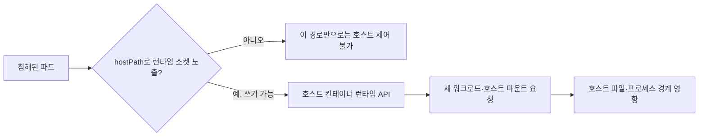
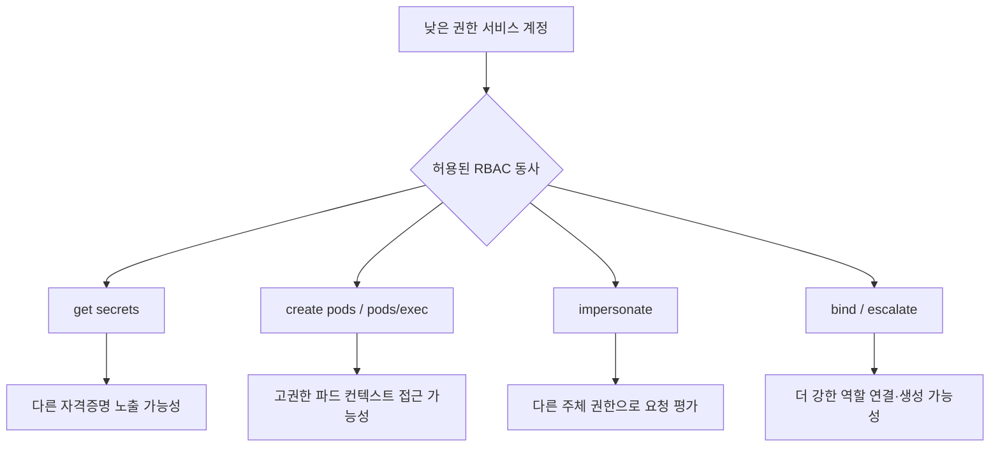

[[웹 취약점 진단 인프라편 — CI-CD와 클라우드 설정 노출]]이 외부에 드러난 설정과 시크릿을 찾는 입문·정찰 단계였다면, 이번 글은 이미 확보한 낮은 권한의 컨테이너나 파드를 출발점으로 호스트와 클러스터 쪽으로 이동 가능한지를 확인하는 **사후 익스플로잇 체인**을 다룹니다. [[클라우드 인프라 진단 — IMDS SSRF로 자격증명 탈취]]가 클라우드 메타데이터에서 역할 자격증명을 얻는 경로라면, 이 글은 컨테이너·파드 격리 경계를 넘어 호스트 제어권이나 Kubernetes 권한으로 확장되는 별개의 단계를 봅니다.

---

## 1. 컨테이너 격리와 RBAC — 가벽과 출입 카드 표

쉽게 말하면, 컨테이너는 한 건물 안을 여러 방처럼 나누는 **가벽**에 가깝습니다. 네임스페이스는 각 방에서 보이는 프로세스·네트워크·마운트를 나누고, cgroup은 방마다 쓸 수 있는 CPU와 메모리 양을 제한하지만, 모든 방은 결국 같은 호스트 커널이라는 건물 골조를 공유합니다. 가상머신처럼 서로 다른 커널을 가진 완전히 별도의 건물과는 경계의 성격이 다릅니다.

Kubernetes의 RBAC은 직원 출입 카드마다 어느 문을 열고 어떤 행동을 할 수 있는지 적어 둔 표와 같습니다. 파드 안의 서비스 계정 토큰이 카드라면 Role·ClusterRole은 허용 목록이고, RoleBinding·ClusterRoleBinding은 그 목록을 특정 카드에 연결하는 절차입니다.

**원리**: 컨테이너 탈출은 컨테이너 안에서 코드가 실행됐다는 사실만으로 자동 성립하지 않습니다. 호스트 자원을 직접 노출하는 마운트, 과도한 Linux capability, 호스트 네임스페이스 공유, 커널 취약점 또는 클러스터 API의 과도한 권한처럼 격리를 약화시키는 조건이 추가로 있어야 합니다.

RBAC도 이름이 `viewer`이거나 네임스페이스 범위라는 이유만으로 안전하다고 볼 수 없습니다. 실제 위험은 허용된 리소스와 동사의 조합에서 결정되며, 새 파드를 만들 수 있는 권한처럼 겉보기에는 운영 기능인 동작도 고권한 서비스 계정·노드·호스트 자원과 결합될 때 경계 이동 수단이 됩니다.

- 체크 포인트: 파드 보안 설정과 서비스 계정 토큰 자동 마운트 여부, 실제 RBAC의 리소스·동사 조합, 호스트 커널을 공유한다는 전제에서 추가로 열린 마운트·capability·네임스페이스가 있는지
- 참고: [Kubernetes — 컨테이너 런타임](https://kubernetes.io/docs/setup/production-environment/container-runtimes/), [Kubernetes — RBAC 권한 부여](https://kubernetes.io/docs/reference/access-authn-authz/rbac/)

## 2. `docker.sock`과 `hostPath` — 호스트 제어면을 파드에 넣는 경우

**원리**: `/var/run/docker.sock`은 단순한 로그 파일이 아니라 Docker 데몬에 명령을 내리는 제어 채널입니다. 이 소켓을 `hostPath`로 컨테이너에 마운트하면 컨테이너 안의 프로세스가 호스트 데몬에 새 컨테이너 생성과 마운트를 요청할 수 있으므로, 소켓 접근 권한이 있는 사용자에게 사실상 호스트 제어권을 넘기는 경로가 됩니다.

모든 Kubernetes 노드가 Docker 소켓을 쓰는 것은 아니며 containerd 같은 런타임에서는 경로와 인터페이스가 다릅니다. 그러나 핵심 경계는 동일합니다. 호스트의 런타임 소켓이나 루트 파일시스템처럼 강한 제어면을 `hostPath`로 노출했을 때만 해당 체인이 성립하고, 단순한 읽기 전용 애플리케이션 데이터 마운트와 같은 위험도로 취급할 수는 없습니다.

진단에서는 소켓으로 실제 호스트 명령을 실행하기보다 배포 선언과 노드의 마운트 목록을 확인하고, `hostPath`의 경로·읽기 전용 여부·사용 주체를 대조하는 것으로 충분합니다. 운영 에이전트가 반드시 호스트 경로를 써야 한다면 전용 노드와 전용 서비스 계정, 읽기 전용 마운트, Admission 정책을 함께 적용해야 위험 범위를 설명할 수 있습니다.

- 체크 포인트: 모든 `hostPath` 경로와 `readOnly` 값, Docker·containerd·CRI 소켓 노출 여부, 해당 파드를 만들거나 수정할 수 있는 주체, Pod Security Admission이나 별도 정책 엔진에서 호스트 경로를 제한하는지
- 참고: [Kubernetes — Volumes: hostPath](https://kubernetes.io/docs/concepts/storage/volumes/#hostpath), [Kubernetes — Pod Security Standards](https://kubernetes.io/docs/concepts/security/pod-security-standards/)

## 3. `privileged`, `hostPID`, `hostNetwork`가 허무는 격리

**원리**: `privileged: true`는 컨테이너에 광범위한 장치와 커널 기능 접근을 허용해 일반 컨테이너보다 호스트에 훨씬 가까운 권한을 부여합니다. `hostPID: true`는 호스트 프로세스 공간을, `hostNetwork: true`는 호스트 네트워크 공간을 공유하므로 각각 프로세스 정보와 로컬 네트워크 서비스라는 별도 경계를 약화시킵니다.

이 세 설정은 위험의 크기와 결과가 같지 않습니다. `hostNetwork`만 켰다고 곧바로 호스트 파일을 수정할 수 있는 것은 아니고, `hostPID`도 추가 capability나 쓰기 가능한 호스트 경로 없이 모든 프로세스를 제어하게 만드는 것은 아닙니다. 다만 여러 설정이 결합되거나 `CAP_SYS_ADMIN`, 쓰기 가능한 `hostPath`가 더해지면 서로의 한계를 보완하면서 호스트 탈출에 가까운 조건이 만들어집니다.

Kubernetes의 Restricted Pod Security Standard는 이런 호스트 네임스페이스와 privileged 컨테이너를 금지하고 capability를 좁히는 기준을 제공합니다. 예외가 필요한 시스템 파드는 일반 애플리케이션과 같은 네임스페이스 정책에 섞기보다 예외 범위와 운영 주체를 분리해야 합니다.

- 체크 포인트: `privileged`, `hostPID`, `hostIPC`, `hostNetwork`, `allowPrivilegeEscalation` 값과 추가 capability, 해당 예외가 꼭 필요한 워크로드인지, Restricted 정책 위반이 배포 전에 차단되는지
- 참고: [Kubernetes — Linux 커널 보안 제약](https://kubernetes.io/docs/concepts/security/linux-kernel-security-constraints/), [Kubernetes — Pod Security Standards](https://kubernetes.io/docs/concepts/security/pod-security-standards/)

## 4. 위험한 RBAC 동사 조합

**원리**: `get secrets`는 저장된 자격증명을 읽는 직접 경로이고, `create pods`는 더 높은 권한의 서비스 계정이나 민감한 볼륨을 사용하는 파드를 만들 수 있을 때 간접 권한 상승이 됩니다. `pods/exec` 생성 권한은 이미 실행 중인 파드 안에서 명령을 수행하는 통로가 되지만, 어느 파드에 접근 가능한지와 그 파드의 서비스 계정·마운트 권한이 낮다면 영향도 그 범위로 제한됩니다.

`impersonate`는 다른 사용자·그룹·서비스 계정으로 API 요청을 평가하게 할 수 있고, `bind`는 자신이 원래 갖지 않은 권한이 포함된 Role이나 ClusterRole을 주체에 연결할 수 있으며, `escalate`는 보유 권한을 넘어서는 역할을 생성·수정하는 제한을 우회하도록 허용합니다. 따라서 개별 동사의 이름보다 **어떤 대상에 대해 어떤 동사들이 이어지는가**를 그래프로 봐야 하며, 와일드카드 리소스나 동사는 새 API가 추가될 때 권한 범위가 조용히 넓어질 수 있습니다.

검증은 `kubectl auth can-i --list --as=system:serviceaccount:<namespace>:<name>`처럼 허가된 조회 명령으로 유효 권한을 확인하고, RoleBinding과 ClusterRoleBinding을 따라가며 실제 연결 대상을 검토하는 수준에서 진행할 수 있습니다. 운영 클러스터에서 고권한 파드를 새로 만들거나 비밀을 읽어 증명하는 방식은 진단 범위를 넘어설 수 있습니다.

- 체크 포인트: 서비스 계정별 `get/list/watch secrets`, `create pods`, `create pods/exec`, `impersonate`, `bind`, `escalate` 권한, 와일드카드 리소스·동사, 고권한 ClusterRole이 네임스페이스 주체에 연결됐는지
- 참고: [Kubernetes — RBAC 권한 상승 방지와 `bind`·`escalate`](https://kubernetes.io/docs/reference/access-authn-authz/rbac/#restrictions-on-role-creation-or-update), [Kubernetes — RBAC 모범 사례](https://kubernetes.io/docs/concepts/security/rbac-good-practices/)

## 5. kubelet 10250 포트와 익명 인증

**원리**: kubelet HTTPS API는 일반적으로 10250 포트에서 노드의 파드·컨테이너 작업을 제공합니다. 익명 인증이 켜져 있으면 클라이언트 인증서나 토큰이 없는 요청도 `system:anonymous` 사용자와 `system:unauthenticated` 그룹으로 받아들여지지만, 이것만으로 민감한 동작이 모두 허용되는 것은 아니며 뒤의 인가 모드와 정책이 해당 요청을 허용할 때만 노출이 성립합니다.

따라서 포트가 열려 있다는 사실, 익명 인증이 켜져 있다는 사실, 익명 사용자에게 실제 API 동작이 허용된다는 사실을 분리해 확인해야 합니다. `AlwaysAllow` 인가나 과도한 Webhook 인가 정책까지 겹치면 파드 정보·로그·실행 기능이 노출될 수 있고, 노드 포트가 인터넷이나 일반 워크로드 네트워크에서 직접 도달 가능하면 영향 범위가 넓어집니다.

방어는 kubelet의 익명 인증을 끄고 Webhook 인증·인가를 사용하며, 네트워크 계층에서도 제어 플레인과 필요한 운영 주체만 10250에 접근하도록 제한하는 것입니다. 관리형 Kubernetes에서는 플래그를 직접 바꿀 수 없을 수 있으므로 공급자 기본값과 노드 구성 템플릿을 함께 확인해야 합니다.

- 체크 포인트: kubelet `anonymous-auth` 값, authorization mode가 `Webhook`인지, 10250 포트의 도달 가능 네트워크, 익명 사용자·미인증 그룹에 연결된 RBAC 권한, 관리형 서비스의 노드 기본 설정
- 참고: [Kubernetes — Kubelet 인증과 인가](https://kubernetes.io/docs/reference/access-authn-authz/kubelet-authn-authz/), [Kubernetes — 포트와 프로토콜](https://kubernetes.io/docs/reference/networking/ports-and-protocols/)

## 정리

| 경계 | 위험을 만드는 추가 조건 | 우선 통제 |
|---|---|---|
| 컨테이너 → 호스트 런타임 | 쓰기 가능한 런타임 소켓 `hostPath` | 소켓 미마운트, Admission 제한 |
| 파드 → 호스트 네임스페이스 | privileged·host namespace·capability 결합 | Restricted 정책, 예외 분리 |
| 서비스 계정 → 클러스터 권한 | 고영향 RBAC 동사와 민감한 대상의 조합 | 최소 권한, 바인딩 정기 검토 |
| 네트워크 → kubelet | 10250 도달성과 익명 인증·인가 허용이 겹침 | 익명 인증 해제, Webhook, 방화벽 |

