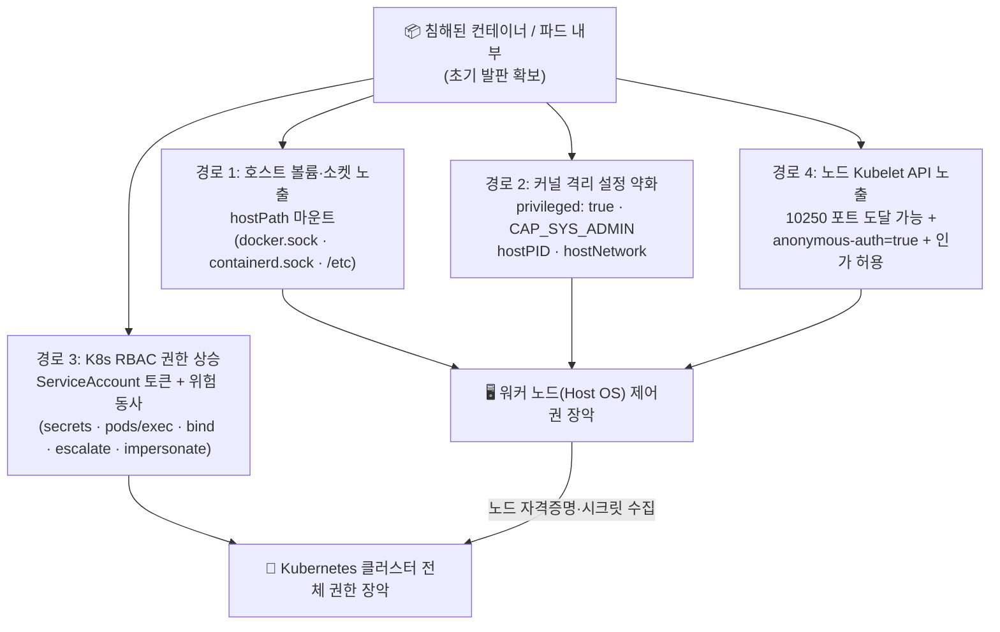
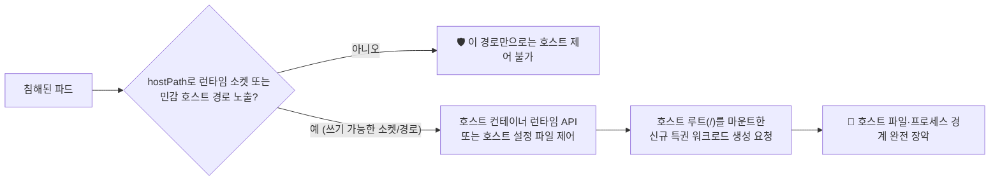
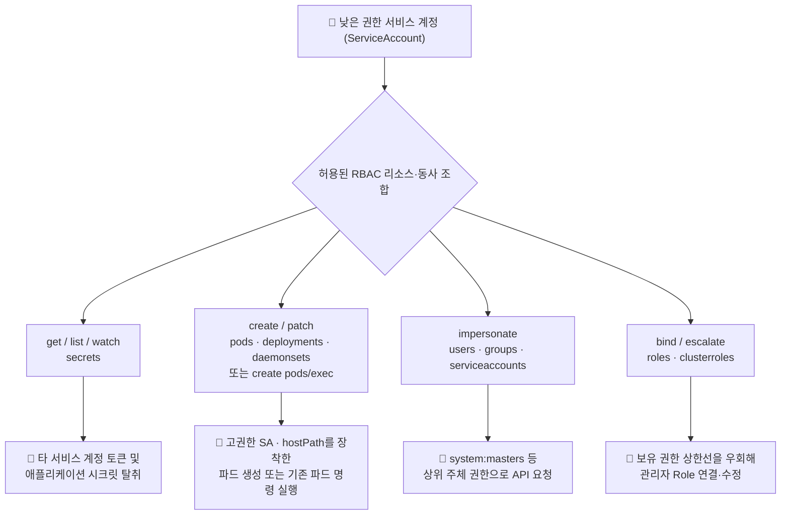

> [!summary] ⏱️ 5초 핵심 요약
> - **한 줄 비유**: 컨테이너는 같은 건물(호스트 커널) 안을 얇은 **석고보드 가벽**으로 나눈 방입니다. 방 안에 **건물 중앙 제어실 직통 스위치(`docker.sock`/`hostPath`)**를 넣어두거나, **가벽을 아예 뜯어내거나(`privileged`/`hostPID`)**, **마스터 출입증 발급기(`RBAC` 과권한)**를 방치하면 방 안의 침입자가 건물 전체를 장악합니다.
> - **핵심 원리**: 컨테이너·파드 침해가 호스트 노드나 클러스터 전체 장악으로 번지려면 **① 호스트 볼륨·런타임 소켓 노출, ② 커널 격리 해제(`privileged`·호스트 네임스페이스·Capability), ③ 위험한 RBAC 동사 조합, ④ Kubelet API(10250) 인증 누락** 중 하나 이상의 연결 고리가 필요합니다.
> - **핵심 방어**: **Pod Security Standards(`Restricted`) 강제 + 런타임 소켓 마운트 금지 + 서비스 계정 토큰 자동 마운트 해제 및 RBAC 최소 권한 + Kubelet 익명 인증 비활성화(`--anonymous-auth=false`)**를 적용합니다.

[[웹 취약점 진단 인프라편 — CI-CD와 클라우드 설정 노출]]이 외부에 드러난 설정과 시크릿을 찾는 입문·정찰 단계였다면, 이번 글은 이미 확보한 낮은 권한의 컨테이너나 파드를 출발점으로 호스트와 클러스터 쪽으로 이동 가능한지를 확인하는 **사후 익스플로잇 체인**을 다룹니다. [[클라우드 인프라 진단 — IMDS SSRF로 자격증명 탈취]]가 클라우드 메타데이터에서 역할 자격증명을 얻는 경로라면, 이 글은 **컨테이너·파드 격리 경계를 넘어 호스트 제어권이나 Kubernetes 클러스터 권한으로 확장되는 별개의 단계**를 봅니다.



---

## 한눈에 보는 컨테이너·K8s 4대 탈출 및 확장 경로

| 경계 구간 | 위험을 만드는 핵심 조건 | 성립 시 실제 영향 | 최우선 방어 통제 |
|---|---|---|---|
| **1. 컨테이너 → 호스트 런타임** | `hostPath`로 쓰기 가능한 런타임 소켓(`docker.sock`, `containerd.sock`)이나 호스트 `/`, `/etc` 마운트 | 호스트 데몬에 새 특권 컨테이너 생성을 명령해 호스트 루트 권한 즉시 획득 | 런타임 소켓 마운트 전면 금지, CI 빌드는 Kaniko/BuildKit rootless 사용 |
| **2. 파드 → 호스트 커널/네임스페이스** | `privileged: true`, `hostPID: true`, `hostNetwork: true`, `CAP_SYS_ADMIN` 등의 결합 | 호스트 디스크 장치 직접 마운트, 호스트 프로세스·네트워크 공간 침투 | Pod Security Admission `Restricted` 프로필 강제, 예외 워크로드 전용 노드 분리 |
| **3. 서비스 계정 → 클러스터 API** | 파드에 마운트된 SA 토큰에 `get secrets`, `create pods`, `pods/exec`, `bind`, `escalate`, `impersonate` 허용 | 타 파드 시크릿 탈취, 고권한 파드 생성·명령 실행으로 클러스터 관리자 승격 | `automountServiceAccountToken: false` 기본화, RBAC 와일드카드(`*`) 제거 |
| **4. 네트워크 → Kubelet (10250)** | 10250 포트 네트워크 도달 + `--anonymous-auth=true` + `AlwaysAllow` 등 느슨한 인가 | 인증 없이 노드 내 모든 파드 목록 조회 및 컨테이너 원격 명령 실행(`/run`) | `--anonymous-auth=false`, `--authorization-mode=Webhook`, 노드 방화벽 통제 |

---

## 1. 컨테이너 격리와 RBAC — 가벽과 출입 카드 표

**💡 한 줄 비유**: 가상머신(VM)이 아예 **별도의 기초 공사를 한 독립 건물**이라면, 컨테이너는 **하나의 건물 골조(호스트 Linux 커널) 안에 얇은 석고보드 가벽(Namespace·cgroup)을 세워 나눈 방**입니다. 그리고 Kubernetes **RBAC**은 각 방에 놓인 **사원증(ServiceAccount 토큰)으로 건물 내 어느 시설을 조작할 수 있는지 적어둔 출입 권한표**입니다.

### 핵심 원리
- **커널 공유와 격리의 본질**:
  - **Namespace**는 각 방에서 보이는 프로세스(`PID`), 네트워크(`NET`), 파일시스템 마운트(`MNT`) 시야를 가리고, **cgroup**은 방마다 쓸 수 있는 CPU·메모리 양을 제한하며, **Seccomp·AppArmor·Capabilities**는 컨테이너가 호스트 커널에 요청할 수 있는 시스템 콜과 특권을 제한합니다.
  - 따라서 컨테이너 안에서 코드가 실행됐다고 자동으로 호스트가 뚫리는 것은 아니지만, **가벽에 구멍을 뚫어주는 설정(위험한 마운트·특권 플래그)이나 커널 취약점**이 결합되면 곧바로 호스트 OS 경계가 무너집니다.
- **RBAC(역할 기반 접근 제어)의 구조**:
  - 파드 내부(`/var/run/secrets/kubernetes.io/serviceaccount/token`)에 마운트된 **ServiceAccount 토큰**이 신분증이라면, **`Role`·`ClusterRole`**은 허용할 대상(Resource)과 행동(Verb) 목록이고, **`RoleBinding`·`ClusterRoleBinding`**은 그 권한 목록을 특정 신분증에 연결하는 고리입니다.
  - 역할 이름이 `developer`나 `viewer`처럼 온건해 보이거나 특정 네임스페이스 범위(`Role`)로만 묶여 있어도, 허용된 **리소스와 동사(Verb)의 조합**에 따라 클러스터 전체나 노드 권한으로 점프하는 사다리가 될 수 있습니다.

### 체크 포인트
- 파드 보안 컨텍스트(`securityContext`) 설정과 서비스 계정 토큰 자동 마운트(`automountServiceAccountToken`) 여부를 확인했는가?
- 역할 이름만 보지 않고 실제 RBAC 규칙의 **리소스(`resources`)·하위 리소스(`pods/exec` 등)·동사(`verbs`) 조합**을 교차 분석했는가?
- 호스트 커널을 공유한다는 전제 위에서 추가로 열린 마운트·Capability·호스트 네임스페이스가 있는지 점검했는가?
- 참고: [Kubernetes — 컨테이너 런타임](https://kubernetes.io/docs/setup/production-environment/container-runtimes/), [Kubernetes — RBAC 권한 부여](https://kubernetes.io/docs/reference/access-authn-authz/rbac/)

---

## 2. `docker.sock`과 `hostPath` — 호스트 제어면을 파드에 넣는 경우

**💡 한 줄 비유**: 세입자가 쓰는 작은 방(`Pod`) 벽면에 **건물 전체의 벽을 새로 짓고 허물 수 있는 '중앙 마스터 콘솔 직통 단자(`docker.sock` / `containerd.sock`)'를 꽂아둔 격**입니다.



### 핵심 원리
- **런타임 소켓 = 호스트 `root` 권한**: `/var/run/docker.sock`, `/run/containerd/containerd.sock`, `/var/run/crio/crio.sock` 같은 유닉스 도메인 소켓은 단순 파일이 아니라 **호스트의 컨테이너 데몬에 직접 명령을 내리는 API 채널**입니다. 이 소켓을 `hostPath`로 파드에 마운트하면, 파드 안의 공격자가 호스트 데몬에 **"호스트의 루트 파일시스템(`/`)을 마운트한 새 특권 컨테이너를 띄워달라"**고 요청해 즉시 호스트 전체를 장악할 수 있습니다.
- **기타 위험한 `hostPath` 마운트**: 소켓이 아니더라도 호스트의 `/`, `/etc`, `/var/log`(심볼릭 링크 악용 가능), `/root`, `/var/lib/kubelet` 등을 쓰기 가능(`readOnly` 미설정) 상태로 마운트하면 `/etc/crontab`, `/etc/shadow`, SSH 키, 또는 파드 인증서·토큰을 변조·탈취할 수 있습니다.
- **안전한 진단 방법**: 실무 진단에서는 소켓을 이용해 실제로 호스트에 새 컨테이너를 띄우거나 파일을 덮어쓰지 않고, **파드 명세(`kubectl get pods -o yaml`)와 컨테이너 내부 `mount` 목록에서 `hostPath` 경로·`readOnly` 여부·소켓 접근 권한을 확인하는 것만으로 체인 성립을 충분히 입증**할 수 있습니다.

### 체크 포인트
- 클러스터 내 모든 워크로드의 `hostPath` 경로와 `readOnly: true` 설정 여부, 특히 Docker·containerd·CRI 소켓 노출 여부를 전수 확인했는가?
- `hostPath`를 사용하는 파드를 생성·수정할 수 있는 RBAC 주체가 누구인지 파악했는가?
- Pod Security Admission(PSA)이나 Kyverno·OPA Gatekeeper 같은 정책 엔진에서 임의의 `hostPath` 볼륨 마운트를 배포 전에 차단하고 있는가?
- 참고: [Kubernetes — Volumes: hostPath](https://kubernetes.io/docs/concepts/storage/volumes/#hostpath), [Kubernetes — Pod Security Standards](https://kubernetes.io/docs/concepts/security/pod-security-standards/)

---

## 3. `privileged`, `hostPID`, `hostNetwork`가 허무는 격리

**💡 한 줄 비유**: `privileged: true`는 **방 안의 가벽을 전부 철거해 호스트 거실과 합치는 것**이고, `hostPID`는 **거실의 모든 사람 움직임(프로세스)을 들여다보는 유리창**, `hostNetwork`는 **거실 내부 전용 전화망을 방 안에서 그대로 같이 쓰는 설정**입니다.

### 핵심 원리: 각 설정이 허무는 격리 경계 비교

| 설정 항목 | 무너지는 격리 경계 | 단독 활성화 시 위험과 결합 시 파급력 |
|---|---|---|
| **`privileged: true`** | Linux Capabilities 전체 + 디바이스(`/dev/*`) 접근 제어 + AppArmor/Seccomp 무력화 | **단독으로도 호스트 탈출에 매우 가까움.** 컨테이너 안에서 호스트 디스크 장치(`/dev/sda1`, `/dev/nvme0n1p1` 등)를 직접 `mount`하거나 `cgroup` `release_agent`·커널 모듈 로드를 통해 호스트 명령 실행 가능 |
| **`hostPID: true`** | 프로세스 ID(PID) 네임스페이스 | 컨테이너에서 호스트의 모든 프로세스 목록과 환경변수(`/proc/<pid>/environ`)를 볼 수 있음. 여기에 `CAP_SYS_PTRACE`나 루트 권한이 결합되면 호스트 프로세스로 코드 인젝션·탈출 가능 |
| **`hostNetwork: true`** | 네트워크 스택·인터페이스·로컬호스트(`127.0.0.1`) | 호스트의 루프백(`127.0.0.1`)에서만 듣는 내부 서비스나 Kubelet 포트, 클라우드 IMDS(`HopLimit=1` 우회)에 직접 접근하고 네트워크 트래픽 스니핑 가능 |
| **`hostIPC: true`** | 프로세스 간 통신(IPC) 공유 메모리 | 호스트나 `hostIPC`를 공유하는 다른 파드의 공유 메모리 세그먼트에 접근 가능 |
| **`CAP_SYS_ADMIN` 등** | 개별 커널 특권(Capability) | `privileged`가 아니더라도 `CAP_SYS_ADMIN`(마운트 등), `CAP_SYS_PTRACE`, `CAP_SYS_MODULE`, `CAP_DAC_READ_SEARCH` 등이 열리면 호스트 경계 돌파 가능 |

- **Pod Security Standards (PSS) 적용**: Kubernetes의 **Restricted** 프로필은 위와 같은 호스트 네임스페이스 공유와 `privileged` 컨테이너를 전면 금지하고, 모든 Capability를 제거(`drop: ["ALL"]`)하며 `allowPrivilegeEscalation: false`를 요구합니다. CNI나 모니터링 데몬셋처럼 예외가 꼭 필요한 시스템 파드는 일반 애플리케이션 네임스페이스와 섞지 말고 전용 네임스페이스와 최소 운영 주체로 격리해야 합니다.

### 안전한 파드 `securityContext` 선언 예시 (Restricted 기준)
```yaml
securityContext:
  runAsNonRoot: true
  seccompProfile:
    type: RuntimeDefault
containers:
  - name: app
    image: example/app:1.0
    securityContext:
      allowPrivilegeEscalation: false
      privileged: false
      readOnlyRootFilesystem: true
      capabilities:
        drop:
          - ALL
```

### 체크 포인트
- `privileged`, `hostPID`, `hostIPC`, `hostNetwork`, `allowPrivilegeEscalation` 값과 추가된 `capabilities.add` 목록을 함께 점검했는가?
- 해당 예외 설정이 업무상 꼭 필요한 시스템 데몬인지, 일반 웹·애플리케이션 파드에 습관적으로 붙어 있는지 구분했는가?
- 네임스페이스에 Pod Security Admission(`enforce: restricted` 또는 `baseline`)이 적용되어 위반 파드가 배포 전에 차단되는가?
- 참고: [Kubernetes — Linux 커널 보안 제약](https://kubernetes.io/docs/concepts/security/linux-kernel-security-constraints/), [Kubernetes — Pod Security Standards](https://kubernetes.io/docs/concepts/security/pod-security-standards/)

---

## 4. 위험한 RBAC 동사 조합

**💡 한 줄 비유**: AWS IAM에 `iam:PassRole`과 정책 부착 체인이 있다면, Kubernetes RBAC에는 **'금고 열람(`get secrets`)', '마스터키를 쥔 새 로봇 조립(`create pods`)', '남의 방에 원격 접속(`pods/exec`)', '다른 사람 신분증 위조(`impersonate`)', '내 사원증에 관리자 권한 스티커 직접 부착(`bind`/`escalate`)'**이라는 5대 권한 상승 사다리가 있습니다.



### 핵심 원리: 5대 고위험 RBAC 패턴
1. **`secrets`에 대한 `get` / `list` / `watch`**: 네임스페이스나 클러스터 내 저장된 다른 고권한 자격증명과 시크릿을 직접 읽습니다. *(주의: `list`나 `watch` 권한만 있어도 응답 본문에 전체 Secret의 `data` 값이 모두 포함되어 반환되므로 `get`과 동일하게 평문 전체가 유출됩니다.)*
2. **워크로드 생성(`create/patch pods`, `deployments`, `daemonsets`) 및 `create pods/exec`**:
   - 파드나 컨트롤러를 생성·수정할 수 있으면 **같은 네임스페이스에 있는 더 높은 권한의 `serviceAccountName`을 지정(K8s판 `PassRole`)**하거나 `hostPath`/`privileged`를 붙인 파드를 띄워 권한을 상승시킬 수 있습니다.
   - `pods/exec`에 대한 `create` 권한이 있으면 이미 돌아가고 있는 다른 고권한 파드 안에 들어가 명령을 실행할 수 있습니다.
3. **`impersonate` (`users`, `groups`, `serviceaccounts`)**: API 요청 시 `Impersonate-User` 또는 `Impersonate-Group: system:masters` 헤더를 붙여 다른 관리자 주체로 둔갑해 명령을 실행합니다.
4. **`bind`와 `escalate` (`roles`, `clusterroles`)**: 원래 Kubernetes는 "자신이 현재 가진 권한보다 더 큰 권한을 가진 Role을 생성·수정하거나 바인딩하지 못하도록" 기본 차단합니다. 하지만 **`escalate`** 동사가 있으면 자신이 갖지 않은 권한이 담긴 Role을 만들거나 수정할 수 있고, **`bind`** 동사가 있으면 이미 존재하는 고권한 Role(예: `cluster-admin`)을 자기 자신에게 바인딩할 수 있습니다.
5. **와일드카드(`*`)의 위험**: 리소스나 동사에 `*`를 주면 위에 열거한 모든 위험 동사와 향후 추가될 CRD·API까지 자동으로 전부 허용됩니다.

### 진단 시 유효 권한 조회 명령어 (Read-Only 점검)
```bash
# 특정 파드의 서비스 계정이 실제로 할 수 있는 모든 RBAC 권한 목록 확인
kubectl auth can-i --list --as=system:serviceaccount:<namespace>:<sa-name>
```

### 체크 포인트
- 서비스 계정별로 `get/list/watch secrets`, `create/patch pods`(및 워크로드 컨트롤러), `create pods/exec`, `impersonate`, `bind`, `escalate` 권한이 열려 있지 않은가?
- 클러스터 API를 호출할 필요가 없는 일반 파드에 `automountServiceAccountToken: false`가 적용되어 있는가?
- 와일드카드(`*`) 리소스·동사 사용을 금지하고, 고권한 `ClusterRole`이 불필요한 네임스페이스 주체에 `RoleBinding`/`ClusterRoleBinding`으로 연결되어 있지 않은가?
- 참고: [Kubernetes — RBAC 권한 상승 방지와 `bind`·`escalate`](https://kubernetes.io/docs/reference/access-authn-authz/rbac/#restrictions-on-role-creation-or-update), [Kubernetes — RBAC 모범 사례](https://kubernetes.io/docs/concepts/security/rbac-good-practices/)

---

## 5. kubelet 10250 포트와 익명 인증

**💡 한 줄 비유**: 클러스터 정문(API Server)에는 삼엄한 경비원을 세워두었지만, **각 건물 관리소(워커 노드의 Kubelet 10250 포트) 뒷문이 열려 있고 신분증 없는 방문객(`system:anonymous`)의 명령까지 그대로 처리해 주는(`AlwaysAllow`) 상태**입니다.

### 핵심 원리
- **Kubelet API(10250)의 역할**: 각 워커 노드에서 도는 Kubelet은 일반적으로 HTTPS `10250` 포트(읽기 전용 비인증 포트가 켜진 구형 설정은 `10255`)에서 해당 노드의 파드 목록 조회, 로그 열람, 컨테이너 내부 명령 실행(`/run`, `/exec`) API를 제공합니다.
- **노출 체인이 성립하는 3단 조건**: 단순히 10250 포트가 열려 있다는 사실만으로 취약점이 되지는 않으며, 아래 세 조건이 겹칠 때 API Server의 통제를 우회한 노드 장악이 성립합니다.
  1. **네트워크 도달성**: 침해된 파드나 내부 네트워크(심지어 공인 IP)에서 워커 노드의 `10250` 포트로 접근 가능할 것
  2. **익명 인증 허용 (`--anonymous-auth=true`)**: 클라이언트 인증서나 베어러 토큰 없이 보낸 요청을 거부(`401 Unauthorized`)하지 않고 `system:anonymous` 사용자(`system:unauthenticated` 그룹)로 받아들일 것
  3. **느슨한 인가 (`--authorization-mode=AlwaysAllow` 또는 잘못된 RBAC 바인딩)**: 인가 모드가 `Webhook`(API Server에 권한 위임 질의)이 아니라 `AlwaysAllow`로 설정되어 있거나, 누군가 실수로 `system:anonymous` / `system:unauthenticated`에 넓게 RBAC 권한을 바인딩해 두었을 것 (`403 Forbidden` 대신 `200 OK` 반환)

### Kubelet 설정 및 응답 상태 판별 기준

| `curl -k https://<node-ip>:10250/pods` 응답 | 의미 및 보안 상태 |
|---|---|
| **`401 Unauthorized`** | ✅ **안전**: `--anonymous-auth=false`가 적용되어 익명 요청을 입구에서 즉시 차단함 |
| **`403 Forbidden`** | ⚠️ **절반의 방어**: 익명 인증(`anonymous-auth=true`)은 열려 있으나, `Webhook` 인가가 해당 경로의 익명 접근을 거부함 (단, 다른 엔드포인트나 잘못된 RBAC 바인딩이 없는지 추가 확인 필요) |
| **`200 OK` (파드 JSON 반환)** | 🚨 **치명적 취약**: 익명 인증과 인가가 모두 뚫려 있어 인증 없이 노드 내 파드 정보 조회 및 `/run` 명령 실행 위험이 존재함 |

### 체크 포인트
- 모든 노드의 Kubelet 설정(`--anonymous-auth=false`, `--authorization-mode=Webhook`, 읽기 전용 포트 `--read-only-port=0`)이 안전하게 구성되어 있는가?
- 워커 노드의 `10250` 포트가 컨트롤 플레인과 승인된 운영 주체 외의 일반 파드·외부 네트워크에서 도달하지 못하도록 방화벽/보안 그룹/NetworkPolicy로 제한되어 있는가?
- 클러스터 RBAC에 `system:anonymous` 또는 `system:unauthenticated`를 대상으로 한 잘못된 RoleBinding/ClusterRoleBinding이 없는가?
- 참고: [Kubernetes — Kubelet 인증과 인가](https://kubernetes.io/docs/reference/access-authn-authz/kubelet-authn-authz/), [Kubernetes — 포트와 프로토콜](https://kubernetes.io/docs/reference/networking/ports-and-protocols/)
